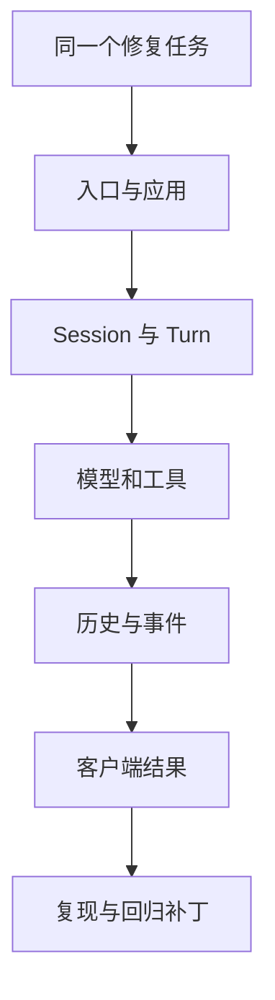

## 本章的问题

一个会调用模型的循环，还不足以成为产品。终端、脚本与编辑器客户端怎样共用状态？取消后什么时候可以接纳下一条？热更新以后谁还在使用旧工具？本课用一个能运行的 host，逐章回答这些问题。

host 不重做另一套庞大的 Pi。它把模型执行放在可替换端口后面，重点实现宿主的状态、持久事实、资源和对外协议；其中 Prompt Registry、MCP generation 与 SDK accumulator 直接装载固定上游模块。最后一章会实际启动 MCP 和长工具进程，取消 A，再让队列里的 B 完成文件修复。

默认模型回复是确定性的，临时文件、日志、测试和进程则真实运行。这样可以反复验证生命周期，而不把模型偶然成功当成工程保证。

## 沿固定源码逐段拆解

@source scope

### 先用公开范围约束架构解释

docs/architecture 的边界列出公开 CLI、运行时和发行设施，没有把完整 Desktop、私有后端和云执行器纳入这份源码。发现一个内部命名，不能直接画出公开项目并未实现的服务调用。

@source cli

### 发行范围、包范围与文件清单不是同一层

extraction.json 的 packageRoots 用于界定包；public-source.json 记录发布文件；package exports 决定导入入口。它们能证明哪些代码属于公开分发，不能证明某台机器安装包与构建产物逐字一致。

本课从 Git 对象读取固定提交，不受独立贡献 checkout 的未提交修改影响。源码升级应作为新的研究操作，不能在构建时悄悄拉最新 main。

### 先把术语变成可查的问题

| 概念 | 要找的 owner | 验证动作 |
| --- | --- | --- |
| Session | 持久会话和工作区 | 重开日志，继续同一身份 |
| Turn | 一次工作的接纳与收尾 | 并发输入、取消后下一条 |
| snapshot | 同次读取使用的材料视图 | 捕获后更新原材料 |
| lease | 仍在使用资源的一份责任 | 更新时旧资源存活，结束后释放 |
| drain | 已入队交付的完成 | 人为延迟首个 writer |
| committed facts | 已经提交的存储事实 | 重启后恢复与去重 |

这张表是整门课的导航。每个词都要在代码、反例和实验中落地。

## 机制总览



## 接入贯穿项目

@implementation 00-method

### 逐步跟踪本章实现

先按固定 commit 读取公开文件，再沿 package roots、发布清单和 exports 确定可研究范围。实验中的 scope 核对回答“当前解读对应哪些公开代码”，不把私有 Desktop 或云端实现补进架构图。后续 importSource 也始终从同一组 Git 对象装载。

host 的基础不是 UI，而是物理工作区与追加日志。workspacePath 拒绝包含越界物理目标的路径；Journal 把事件写入磁盘、fsync 并记录哈希链接，读取时区分末尾截断与完整坏行。Session、事件流和队列分别在这条基础上定义自己的事实格式。

模型通过显式端口输入回复，课程实验不读取私人 CLI 配置，也不访问付费服务。固定回复只决定下一步意图，实际权限判断、文件写入、进程生命周期和日志重开仍由 host 执行。因而每章可以指出失败发生在哪个 owner，而不是只看到一段模型文本。

## 运行本章实验

```bash
node --disable-warning=ExperimentalWarning labs/chapters/00-method.mjs
```

@experiment 00-method

## 逐项解释实验结果

实验核对版本与发布范围，然后检查工作区路径不能向外逃逸。Journal 的实现会在后面支撑 Session、事件和队列，不是一份只供展示的辅助代码。

每章独立实验会建立并清理临时目录。任何缺失的源文件、断言失败或未注册实验都会使课程构建失败。

## 继续动手与验收

画出一次用户请求的 Session id、Turn id 和 tool call id。写出它们分别在哪个阶段生成、由谁保存，指出哪一种 id 可以跨请求复用。

::: interview 源码固定提交能够证明产品端到端可用吗？
固定提交证明阅读坐标和受控执行来源，不证明私有组件或完整产品端到端可用。课程以原始模块、原创 host 和明确外部端口分别建立证据；确定性模型使生命周期反例可以重复。
:::

::: interview 为什么要让模型回复确定，而其他边真实运行？
它能把模型选择的不确定性移出生命周期实验。文件、进程、协议和日志仍真实执行，因此错误可以稳定复现；这与真实 Provider 端到端验收是两份证据。
:::

::: interview 学习源码和贡献源码为什么分目录？
课程需要稳定的研究坐标，贡献需要跟进主线与尝试补丁。分开以后，课程从固定 Git 对象读取，贡献改动不会悄悄改变原结论。
:::
