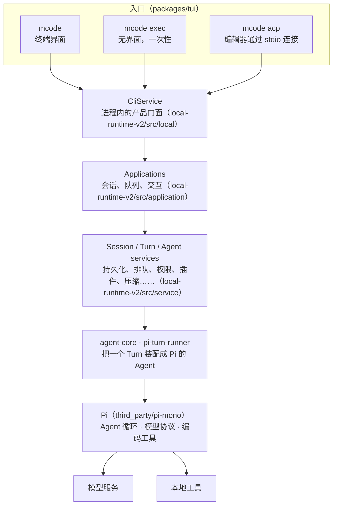

如果你学完了 Learn Pi Agent，你已经知道一个 coding agent 的骨架：循环、工具、上下文、会话、压缩。MiniMax Code 的骨架**就是 Pi**——它把 Pi 的源码整个放在 `third_party/pi-mono/` 里，Agent 循环直接用 Pi 的 `Agent` 类。

那剩下的代码在做什么？下面这个实验统计了固定提交里每一层的代码量：

@lab node labs/chapters/00-method.mjs

不含测试，七十多万行 TypeScript。Pi 的 Agent 循环包只有八千多行，**占全部代码的百分之一**。Pi 的其余部分（模型协议 `ai`、编码工具 `coding-agent`、终端组件 `tui`）加起来占百分之十六；另外八成多，是 MiniMax 自己写的。

这些代码回答的都是“产品”问题，而不是“Agent”问题：

- 同一个会话，终端界面、`mcode exec` 脚本、编辑器（通过 ACP 协议）都要能用，状态放在哪？
- 用户在 Agent 干活时又发了一条消息，是插话、排队还是拒绝？排队的消息重启之后还在吗？
- 用户按了取消，正在跑的命令、写了一半的历史、还没送达的事件，按什么顺序收尾，下一条才能开始？
- 插件更新了，正在运行的任务还在用旧版本的工具，什么时候才能把旧连接关掉？
- 模型服务偶尔返回一个没有 `stop_reason` 的流，算正常结束还是失败，要不要重试？

Pi 刻意不回答这些问题：它是一个内核，把这些决定留给宿主。**这门课读的，就是 MiniMax 作为宿主的那九十九。**


@figure assets/course/ch00-ninety-nine.png 内核很小，产品是外面一圈圈加上去的

## 分层：从三个入口到一个内核

MiniMax 在 `docs/architecture.md` 里用一行话画出了整个架构：

@mm docs/architecture.md#L1-L10 hl=3

翻译成图：



和 Pi 自己的分层对比一下就能看出重心：Pi 是“`Agent` 循环 → `AgentSession`（会话、压缩、扩展）→ 三种运行模式”，宿主层很薄；MiniMax 在循环和入口之间塞进了三层——门面、应用、服务——这三层占了将近一半的代码。

### 三个入口在哪里分开

`mcode` 的命令行定义在 `packages/tui/src/cli/program.ts`。`exec` 和 `acp` 两个子命令是这样注册的：

@mm packages/tui/src/cli/program.ts#L104-L138 hl=104,110,125-128

三条路在这里各自交给一个“runner”：交互模式调用 `options.launchTui`，`exec` 调用 `options.runExec`，`acp` 调用 `runAcp`。这些 runner 是从外面注入的（`options`），`program.ts` 自己只负责解析参数、把它们整理成请求对象——这让命令行的解析可以单独测试，也让三个入口共用一套参数约定（比如 `--lane`、系统提示的覆盖选项）。

### 汇合点：CliService

三个 runner 最后都通过同一个门面访问运行时：`packages/local-runtime-v2/src/local/cli-service.ts` 里的 `CliService`。它有五十多个方法，覆盖会话、消息、分叉、回退、用量、队列、目标、工作区……其中最核心的几个动词是：

@mm packages/local-runtime-v2/src/local/cli-service.ts#L282-L329

`sendMessage`（发一条消息并拿到事件流）、`resumeSession`（接上一个会话的事件流）、`abortSession`（取消）、`steerSession`（插话）、`enqueueMessage`（排队）、`requestCompaction`（手动压缩）。门面本身几乎不做事，每个方法都转交给某个 Application；它的价值在于**给三个入口一份完全相同的能力清单**。终端界面能做的，编辑器通过 ACP 也能做，脚本通过 `exec` 也能做。第 1 章会沿着这里往下读。

把这几个动词和 Pi 对照：Pi 的 `Agent` 有 `prompt`、`steer`、`followUp`、`abort`，都是**进程内、内存里**的操作，进程退出就没了。MiniMax 的同名操作背后都有持久化：排队的消息写进数据库，会话事件可以从任意位置 `resume`，取消要协调正在运行的进程和还没送达的事件。这正是第 2、9、10 章的主题。

## 内核的接缝：MiniMax 怎样使用 Pi 的 Agent

一路往下，到 `packages/agent-core/src/pi-turn-runner/`，才真正碰到 Pi。每个 Turn 开始时，MiniMax 用这一个函数创建 Pi 的 `Agent`：

@mm packages/agent-core/src/pi-turn-runner/agent.ts#L35-L56 hl=36-43,44-45

前几行是 Learn Pi Agent 里熟悉的东西：系统提示、模型、思考级别、工具、初始消息，原样交给 Pi。第 44 行的 `convertToLlm` 是 Pi 留给宿主的一个接缝：每次请求模型之前，把 Agent 内部的消息列表转换成发给模型的格式。MiniMax 在这里插入了自己的 `projectAgentMessagesForModel`——比如删掉找不到对应工具调用的“孤儿”工具结果（主流模型接口都要求每个工具结果对应前面的某个工具调用，否则拒绝整个请求），并把删了几条记进日志；这个投影只作用于发出去的那份副本，Agent 内部的消息原样保留。

这就是 MiniMax 使用 Pi 的基本方式：**不改 Pi 的循环，通过 Pi 暴露的选项和回调把产品逻辑接进去**。Learn Pi Agent 第 3 章读过的 `prepareNextTurn`、`finishTurn`、插话队列，在 MiniMax 里都有对应的使用者，第 2 章会一一找出来。

## 不改循环，但会改内核

“不改 Pi”只说对了一半。体检实验的后半段统计了 `third_party/pi-mono/MINIMAX_CHANGES.md`——MiniMax 给内置的 Pi 打的本地补丁台账，四十多条，每条都写明了原因、改了哪个包、怎么验证、要不要回馈上游。挑一条看：

@mm third_party/pi-mono/MINIMAX_CHANGES.md#L34-L40

模型有时会把一个 18 位的身份证号写成不带引号的 JSON 数字，而这个参数的 schema 类型是字符串。`JSON.parse` 会把超过 `Number.MAX_SAFE_INTEGER` 的整数四舍五入成最近的浮点数，于是工具收到的是另一串数字，错误的号码还被存进了会话历史。补丁用 Node 21 起提供的 reviver 源文本访问，把不安全的整数保留成原始字符串。

这类问题有一个共同点：**只有在大量真实用户、多家模型服务、各种操作系统上跑起来之后才会出现**。台账里的补丁大致分成几类：

| 类别 | 例子（台账里的标题） | 说明 |
| --- | --- | --- |
| 模型协议的完整性 | 没有 `stop_reason` 的 Anthropic 流按截断处理；保留拒答的详细原因 | 第三方兼容接口的行为和官方不完全一致 |
| 各家服务的兼容 | 为 Mistral、DashScope、Kimi 等保留 system 角色；OpenAI 兼容的压缩请求不发空工具列表 | 一个产品要接很多家模型 |
| 给宿主开的接缝 | 让宿主注入 `fetch`（代理、观测）；工具 Hook 可以终止整个 Agent；暴露已接纳的工具执行边界 | 宿主需要的控制点，内核原本没有 |
| 工具的边界 | `read` 的截断上限可配置（给 PTC 用）；Bash 执行事实与有界输出；编辑后 diff 的大小上限 | 产品功能对工具提出了新要求 |
| 平台 | Windows PowerShell 受限语言模式、`taskkill` 的解析 | 用户的机器千差万别 |

这张表也是一份很好的面试素材：被问到“把一个开源 Agent 内核做成产品要处理哪些问题”，这里每一行都是真实答案。对想做贡献的读者，它还有另一层意思：大多数补丁写着 “Upstream PR: not opened”，不少自认“可以回馈上游”——第 11 章会从这里出发，讨论一条扎实的贡献路线。

::: note 两个 Pi 版本
MiniMax 内置的是 pi-mono **v0.79.1**（体检实验打印了导入基线），Learn Pi Agent 读的是 **v1.5.0**。本课讲 MiniMax 实际调用的 Pi 代码时，摘录的都是 `third_party/pi-mono/` 里的版本；需要和 Learn Pi Agent 衔接时才引用 v1.5.0。
:::

## 这份源码的边界

MiniMax Code 是一个官方开源仓库（MIT），但开源的是终端 CLI、无界面模式、ACP 和它们的运行时，不是 MiniMax 的全部产品。架构文档开头已经写明：应用层不实例化 Desktop 服务、HTTP 入口和云端交接服务。`release/extraction.json` 列出了属于这次发布的包，`release/public-source.json` 列出了每一个公开的文件，`pnpm check:source` 会检查二者一致。

所以读源码时遇到一个指向私有服务的名字（比如 `@mavis/*` 包名、`DesktopService`），不要据此推断它背后的实现。这门课的所有结论都来自这个公开仓库里能读到、能运行的代码。

## 这门课怎样读、怎样验证

**固定版本。** 所有摘录来自提交 `6e062ae`（0.7.2）。构建时从 Git 对象读取，不受你本地修改的影响——这很重要，因为你可能会在另一个目录（`../minimax-code-contrib`）里尝试修改和贡献。

**运行真实的上游代码。** MiniMax 有不少模块是纯函数或者只依赖相对路径的纯模块。`lab/source.mjs` 的 `importSource()` 会从固定提交里读出完整的模块文件，用 Node 去掉类型后直接执行。比如第 10 章，SDK 的 `ItemAccumulator` 就是这样跑起来的：实验里看到的行为是 MiniMax 自己的代码给出的，不是课程的模仿。

**每章一条调用链。** 和 Learn Claude Code 一样，每章挑一个具体问题，从入口一路追到它被解决的地方，先画图，再一站一站读。

## 贯穿全课的项目：host

Learn Pi Agent 从零写了 mox（一个 Agent），Learn Claude Code 写了 coda（一个更像 Claude Code 的 Agent）。这门课写的 **host**（`host/src/`）不是又一个 Agent 循环，而是**一个产品宿主**：它把模型和工具的执行当成一个可替换的内核，自己负责会话、Turn、事件、队列、取消、插件更新和对外协议——正好是 MiniMax 在 Pi 外面加的那一圈。

| 章 | host 模块 | 对应 MiniMax |
| --- | --- | --- |
| 1 | `adapters.mjs`、`sessions.mjs`、`cli.mjs` | 三个入口、`CliService`、Session 应用 |
| 2 | `turns.mjs`、`events.mjs` | `pi-turn-runner`：一个 Turn 的装配与终态 |
| 3 | `models.mjs` | `model-system`、LLM 重试与超时 |
| 4 | `tools.mjs` | `agent-core/src/tools`、`newRuntimeTool` |
| 5 | `context.mjs` | 提示块、prompt-config、Turn 开始时的快照 |
| 6 | `history.mjs` | 历史投影、checkpoint 压缩 |
| 7 | `permissions.mjs` | 权限检查、沙箱策略 |
| 8 | `plugins.mjs`、`skills.mjs` | 插件系统、Skill、MCP 的代际切换 |
| 9 | `queue.mjs`、`fork.mjs` | 持久队列、插话、取消、分叉 |
| 10 | `sdk.mjs`、`events.mjs` | `code-sdk`、exec 事件流、ACP |
| 11 | `contribution.mjs` | 从复现到 Issue 的贡献流程 |
| 12 | `app.mjs` | 把以上装成一个应用，跑一次完整的“取消—更新—排队修复” |

产品宿主和 Agent 最大的不同，是**状态要活过进程**。所以 host 先有两块地基，后面每一章都站在它们上面。

第一块是 `runtime/journal.mjs` 的 `Journal`：一个只追加的日志文件，每条记录带序号、上一条的哈希和自己的哈希，写完立刻 `fsync`。会话、事件、队列都存在这样的日志里：

@code runtime/journal.mjs#Journal

两个细节值得注意。追加之前先 `scan()`：如果最后一行没有换行（上次写到一半进程就崩了），把这半行截掉再写——**只修复末尾的半条**；如果中间某一行的哈希对不上，直接报错，绝不悄悄跳过。前者是正常的崩溃窗口，后者说明文件被改坏了，继续用只会让错误扩散。

第二块是 `runtime/files.mjs` 的 `workspacePath`：任何工具要访问的路径都先经过它，拒绝 `..` 越界，也拒绝通过符号链接跳出工作区。

@code runtime/files.mjs#workspacePath

每章的实验都能单独运行，不需要 API Key，不读你的个人配置：

```bash
npm ci
npm run setup:source     # 准备固定版本的 MiniMax Code 源码（../minimax-code-source）
npm run lesson -- 0      # 运行本章的实验
npm run build && npm run serve
```

## 你来改

::: predict 内核的比例
把体检实验里的“Pi 的 Agent 循环包”换成整个 `third_party/pi-mono`（循环、模型协议、编码工具、终端组件），比例大概是多少？再想一想：MiniMax 用到了 Pi 的终端组件 `tui` 吗？
???
整个 pi-mono 大约占百分之十六（实验表格里那一行）。MiniMax 的发布范围（`release/extraction.json` 的 `packageRoots`）包含 `third_party/pi-mono/packages/tui`，终端界面确实建在 Pi 的终端组件上；但 MiniMax 自己的 `packages/tui` 有十多万行，是在它上面搭的完整产品界面。
:::

::: predict 截断的半行
往一个 `Journal` 文件末尾手工追加半行 JSON（没有换行），然后调用一次 `append`。文件最后会是什么样？如果把半行插在文件中间呢？
???
末尾的半行：`append` 先 `scan`，发现最后一段没有换行，把文件截回到最后一个完整的换行处，再写入新记录——半行消失，新记录正常追加，序号连续。中间插入：`scan` 逐行校验序号和哈希链，中间那行解析失败或哈希对不上，抛出 `journal integrity failure`，拒绝继续写。可以自己写几行代码试一试。
:::

## 面试题

::: interview 把一个开源 Agent 内核做成产品，需要在外面加哪些东西？
从 MiniMax Code 看至少有：多入口共享的应用层（终端、脚本、编辑器协议共用一套会话能力）；状态的持久化（会话、事件、排队的消息要活过进程重启）；Turn 的生命周期管理（接纳、插话、排队、取消后的有序收尾）；模型系统（多家服务的命名、凭证、重试、超时、用量）；权限与沙箱；插件/Skill/MCP 的加载和热更新；对外协议（SDK、ACP）。另外还要给内核打补丁：协议完整性、各家服务的兼容、给宿主开的控制点、平台差异。Agent 循环本身在代码量里只占很小一部分。
:::

::: interview MiniMax Code 是怎样使用 Pi 的？为什么不直接改 Pi 的循环？
它把 pi-mono 的源码放在 `third_party/` 里，每个 Turn 用 `newAgent` 创建 Pi 的 `Agent`，通过 Pi 暴露的选项和回调（初始状态、`convertToLlm`、Hook、插话队列等）接入产品逻辑。不直接改循环，是为了保持内核可以升级、可以回馈上游；确实需要内核配合时，以“小而通用的接缝”形式打补丁，并在 `MINIMAX_CHANGES.md` 里记录原因、影响范围、验证方式和是否可以回馈上游。
:::

::: interview 一个只追加的日志文件，崩溃后怎么恢复？
关键是区分“写到一半”和“被改坏”。每条记录以换行结束、带序号和哈希链；启动或追加前扫描：末尾缺换行的半条是崩溃窗口里的未提交数据，可以安全截掉；中间的记录校验失败说明文件损坏，应该拒绝继续而不是跳过。每次追加后 `fsync`，保证返回成功时数据已经落盘。注意这只解决单进程写入，多进程需要额外的锁或数据库。
:::

::: interview 读一个大型开源项目时，怎样确定哪些代码是真的在运行的？
先看项目自己声明的边界：架构文档、发布清单（MiniMax 的 `extraction.json`、`public-source.json`）。然后从入口沿调用链读，而不是按目录读；遇到指向不在仓库里的服务或包的名字，不推断它的实现。能运行的模块就直接运行（固定提交、纯模块、注入假依赖），用真实行为验证读到的结论。
:::
