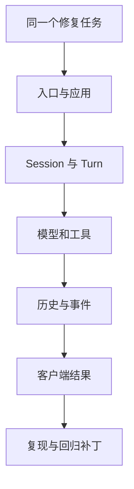

## 这门课要把你带到哪里

你已经有两条学习线：Learn Pi Agent 从一个简单循环开始，把机制写出来；Learn Claude Code 依据还原源码和独立版本实验研究一个产品。MiniMax Code 提供第三种机会：读一个产品级 Agent 的公开实现，找到一个你能解释、复现和修复的问题。

这门课围绕一个问题推进：**一个用户请求，经过哪些边界，才能变成可追踪、可取消、可恢复的模型和工具执行？** 最后的产出是架构理解与贡献材料。贡献被接收、合并以及 contributor 身份，需要上游的真实记录来证明。

## 先锁定研究对象

课程固定在 MiniMax-AI/minimax-code 的 `6e062ae8ca365db34b93a7cdc96ffda3a8b9fffc`，根目录和 TUI 包版本是 `0.7.2`。本地默认源码目录是旁边的 `minimax-code-source`，也可以通过 `MINIMAX_SRC` 指定。

不要把“源码版本 0.7.2”“某台机器安装的 npm 版本”“Desktop 版本”混成一件事。一个 Issue 出现在 Desktop，不代表公开的 CLI 源码包含相同故障。匹配版本字符串也不能证明发布包与源码构建逐字相同。

@source scope

公开仓库覆盖终端 TUI、headless CLI、ACP 及发行工具，包含进程内运行时、工具和相应第三方源码。它没有公开完整 Desktop 前端、全部内部服务和云执行器。后续结论只覆盖实际看过的代码与接口。

## 三类证据，三种措辞

| 证据 | 适合说什么 | 本项目怎样获得 |
| --- | --- | --- |
| 固定提交的代码与契约 | “此版本实现了这个分支” | 从 Git 对象读取并生成带行号的摘录 |
| 真实函数的离线调用 | “这些输入在此函数上得到这些输出” | 擦除 TypeScript 类型后执行完整上游模块 |
| CLI 与模型的集成运行 | “该入口在此环境端到端可用” | 需要单独构建、隔离配置、运行并保存证据 |

当前随课提供前两类证据，没有伪造实时模型录制。`usage` 实验的存储是 fake；SDK 实验输入是合成事件；这些边界会写进输出。它们适合验证局部契约，不能证明云服务、认证或数据库整体可用。

@lab architecture

## 怎样读每一章

先理解具体场景，再看源码入口，沿调用者和被调用者各追一层，最后运行适用的实验。遇到陌生的产品设施，先问“谁拥有状态，谁能修改，谁负责收尾”。暂时不需要把 monorepo 每个包都读完。

每章末尾的面试题用来检查解释是否清楚；实验按需要运行，不要求先完成一套作业。源码不会在构建时被更新：需要升级时，先单独检查新提交，再同步版本锁和正文。

## 贡献政策也是技术约束

截至 2026-11-03，上游只接收 repository collaborators 的代码和文档 PR；外部贡献者先通过 Issue 讨论。本项目已经创建独立贡献任务，让调查、复现和补丁准备可以马上开始。获得提交资格依赖维护者决定，不能绕过，也不能承诺时限。

## 一条贯穿课程的任务

假设你让 MiniMax Code 修复项目里的 normalizeSlug：连续空格应只产生一个连字符，完成后要运行测试。模型循环本身可以很短；产品却需要知道在哪个工作区读文件、当前会话是否忙、这次工具调用属于谁、取消以后能否继续，以及 SDK 何时可以返回。

这门课要把这些问题接起来。第 1 章找到入口，第 2 章进入 Turn，第 3—4 章看模型和工具，第 5—6 章处理状态，第 7—9 章处理控制与生命周期，第 10 章把结果交给客户端，最后把一个边界问题整理成贡献材料。



## 阅读时先分清三种对象

Session 是可持续存在的会话；Turn 是一次有身份、有生命周期的运行工作；Agent 是装配后驱动推理和工具的执行对象。这个版本的 PiTurnRunner 每次运行会新建 Agent，并不要求把 Pi Agent 对象永久挂在 Session 上。

所以“又 new 了一次 Agent”不表示丢失历史。需要检查的是保存的 canonical history 怎样成为 initialMessages，以及运行产生的新尾部怎样提交回宿主。反过来，复用一个 Agent 也不自动等于恢复正确，旧的取消信号和事件监听可能随之泄漏。

## 先把几个工程术语读成具体问题

| 术语 | 在本课程里的含义 | 你应该追问什么 |
| --- | --- | --- |
| admission | 接纳一次工作进入执行 | 谁检查 busy，何时算接纳成功 |
| canonical history | 宿主保存的交互事实 | 谁追加，恢复时怎样找到正确分支 |
| projection | 为某个消费者构造的视图 | 哪些字段被去掉，原事实是否仍保存 |
| snapshot | 本次读取采用的一致材料视图 | 何时捕获，热更新会不会改变它 |
| revision / generation | 某一代插件能力的身份 | 新旧两代是否同时有人使用 |
| lease | 保留某代资源的一份使用责任 | 谁获取，正常和失败时谁释放 |
| drain | 等已经入队的工作完成 | 谁还能产生新工作，何时发终态 |
| committed facts | 存储已提交操作的事实 | 哪个事务提交，哪个上层负责发布 |

后面遇到这些词，先回到右侧的问题。它们不是要背的新名词，而是把“这个 Agent 为什么卡住、为什么出错”拆成能定位的具体责任。

## 准备一个可重复的本地环境

```bash
npm ci
npm run setup:source
npm run lab
npm run check
npm run build
npm run serve
```

第一遍可以只运行 architecture、turn、sdk；第二遍再读 registry、generation、queue 等边界。`check` 与 `build` 会运行目录中声明的离线实验；遇到不一致会失败，网页里的 JSON 因而不是手写的“预期输出”。这里没有消耗模型 API，也没有替你配置真实账号。

## 源码阅读笔记应该长什么样

不要写“TurnRunner 负责运行 Turn”就结束。对每个机制记录一组可以复查的事实：调用者提供什么、函数拥有哪份状态、调用了谁、在哪个 await 前后发布事件、抛错或取消时由谁清理。最后写一个能暴露错误理解的输入。

以 SDK 为例，笔记应写出：ItemAccumulator 按 id 合并；delta 是追加操作；snapshot 是完整替换；相同 snapshot 可去重；重复 delta 不能按字符串去重；没有 completed 就标 incomplete。第 10 章直接运行这个类，所以任何一条理解都可以用新输入检查。

## 先选择学习路线，再选择贡献题

如果你擅长 TypeScript，先读 Turn 与工具适配；如果熟悉后端，先读 queue、usage 与 committed facts；如果熟悉前端或终端，先读事件归并与 TUI 能力检测。贡献题应来自你已经能复现的契约，而不是来自“这个名字看起来容易”。

每章最后的练习都有验收标准。先完成一个闭环，再扩大范围：能复现、能解释、能验证，比一次读完 monorepo 更能证明工程能力。

::: interview 怎样证明自己真正读过一个 Agent 项目？
选择一个机制，解释用户入口、核心状态、调用链和失败边界；展示固定提交的证据，再给一个可以重复运行的实验。若做了修复，还应展示修复前失败、修复后通过的回归测试，以及上游讨论和最终 PR 的实际状态。
:::
