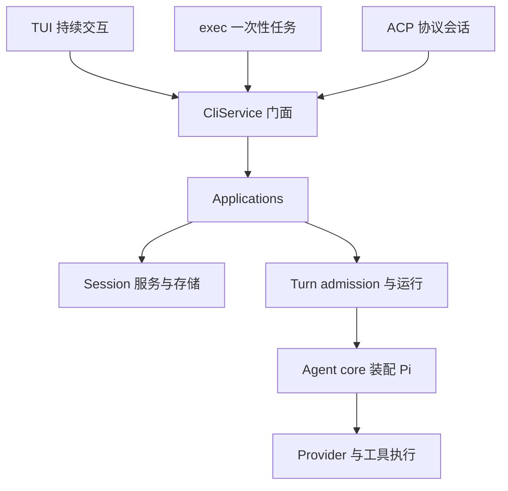

## 从一个请求开始

假设你让 Agent 修复测试。终端界面需要渲染输出，脚本需要退出码，编辑器客户端需要协议事件。这三种界面不应该各写一套模型循环，否则一次权限或取消修复会漏掉另一个入口。

公开架构把它们连接到同一条主干：

```text
TUI / exec / ACP
       ↓
    CliService
       ↓
 local Applications
       ↓
Session / Turn / Agent services
       ↓
Pi / model providers / tools
```

这里的箭头表示职责流向；不表示每个操作都逐层发网络请求。`CliService` 是进程内门面，公开 CLI 不靠一个 Desktop HTTP 前门完成这条路径。

## 命令层只负责把意图交出去

`packages/tui/src/cli/program.ts` 用 Commander 注册命令，把执行函数作为 options 注入。阅读 `createTuiProgram` 时，先找到 `launchTui`、`runExec`、`runAcp`，再去读相应 handler；不要从终端渲染器猜模型在哪调用。

@source cli

同文件中 `init` 会把工作目录转成绝对路径，`exec` 注册一次性运行，`acp` 注册 stdio 服务。命令存在和命令可用是两层证据：源码能证明注册；真实帮助输出与运行检查还需要构建产物。

## 门面后面才是状态所有者

@source bridge

`createSession` 把明确工作目录和缺省创建分到对应 lifecycle 方法。门面做了转发，但 Session 的保存、Turn 的运行和模型解析分别由下游服务负责。排查问题时，先确认它是适配器的翻译错误，还是共享状态本身出错。

例如 ACP 返回 busy，可能是 adapter 自己保留了 active prompt，也可能是运行时还有未结算的 Turn。只改提示文字无法证明后者恢复正常。第 9 章会把取消与后续输入连起来看。

## 发行契约告诉你哪些代码真的属于公开项目

@lab architecture

实验从 `release/extraction.json` 读取 32 个 package roots，包括 vendored Pi 与 sandbox-runtime。这个数字描述发布范围，不是“32 个业务模块”。`release/public-source.json` 则是文件清单；它与 package scope 不是同一个层次。

源码中 `@mavis/*` 是 workspace 包名，公开构建从本地源码解析。看到这样的名字，不应直接认定它还要访问一个私有 npm registry。应继续查 exports、路径映射和 build 的解析规则。

## 和前两门课连接

在 Pi 课程里，你能从 mox 的 CLI 直接走到自己的循环；在 Claude Code 课程里，你能通过 stream-json 观察产品输出。在这里，两条线接起来了：产品入口的状态和事件由运行时组织，底层循环仍可以复用一个独立内核。

## 把三种入口逐个映射到用户体验

TUI 要持续接受键盘输入，模型输出尚未完成时就更新界面；exec 接受一次输入，让脚本能获取结构化结果和退出状态；ACP 则面向客户端，通过标准消息表达会话、请求、取消与权限。它们面对同一套能力，拥有不同的生命周期责任。



图把职责分开，不表示每个箭头都是 RPC。命令入口的 handler 只是把外部意图翻译成运行时调用；它不应该拥有另一份独立模型历史。读到 workspace 包名时，继续查 exports 和实际导入，避免把进程内调用误画成微服务调用。

## 状态归属表，比目录树更能帮助排错

| 状态或资源 | 优先找谁 | 为什么 |
| --- | --- | --- |
| 外部请求 id、协议 pending | TUI/exec/ACP 适配器 | 决定客户端如何理解响应 |
| Session 元数据与持久历史 | session-system | 跨多次运行持续存在 |
| 当前 Turn、取消与结算 | turn-system / runner | 一次工作独有 |
| Pi Agent 状态与事件翻译 | agent-core | 把内核事件变成产品契约 |
| MCP 连接代与插件能力 | plugin-system | 可能同时服务新旧 Turn |
| token 归因与查询 | usage 与存储端口 | 既有写入身份也有读取视图 |

遇到一个“busy 没解除”的问题，先在这些层找哪一份状态还保持 busy。适配器把 pending map 删掉，不能保证共享运行时已经释放；共享运行时完成后，也可能是协议响应没有发回。

## 跟着 createSession 读一条真实边

`CliService` 的 createSession 会根据是否显式提供工作目录，走相应的 lifecycle 创建方法。先记录传入的 workspaceDir，再追到实际创建；不要把门面一行 return 当成状态已经持久化。继续问创建失败怎样向上返回，创建成功后客户端拿到的身份来自哪里。

做练习时可以画出 input、application call 和 returned record 三列。把同一字段在三列里的名称对应起来，尤其是 sessionId、workspaceDir、runtime 和模型信息。身份不一致会让“列表能看到会话，但无法继续它”这类问题很难排查。

## 目录阅读的顺序

先读 program.ts 的注册，再选一种入口的 handler，然后读 CliService 与对应 application。接着进入 service，最后才读 infra/db 或 Pi。若反过来从数据库读起，很容易知道表很多，却不知道哪些行为由哪条用户路径触发。

发布清单也是一个重要反证工具：某个内部架构文档提到的云设施，未必包含在公开 CLI 中。课程只把公开源码里能追到的边画实；没有实现依据的部分保留为边界说明。

## 练习：让一项修复跨入口成立

假设 normalizeSlug 任务在 exec 中可完成，在 ACP 中却卡住。先列共享的 Session/Turn 路径，再列两端不同的输入归一化、权限答复和完成通知。选择三个观测点，记录同一 sessionId/turnId。验收结果应能指出差异第一次出现在哪一层，而不是只说“ACP 有问题”。

::: interview 同一套核心运行时为什么还需要三个适配器？
它们的输入、输出、生命周期不同。TUI 面向持续交互，exec 面向一次运行和进程退出，ACP 面向客户端协议。共享运行时保留 Session、Turn、权限和工具的一致语义，适配器负责把这些语义映射到各自界面。验证共享修复时仍要检查所有相关入口。
:::
