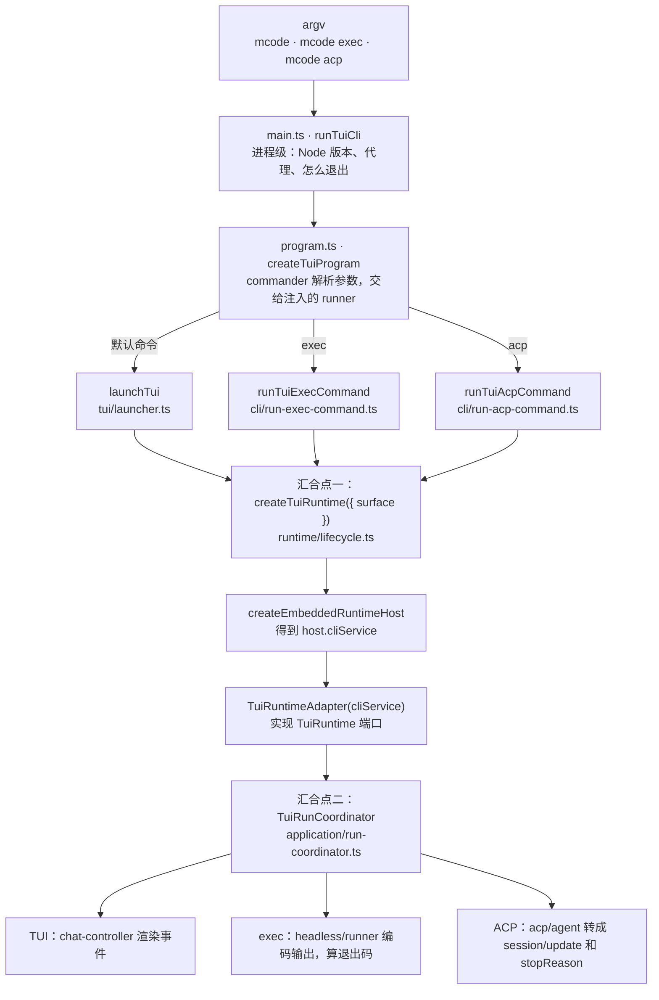
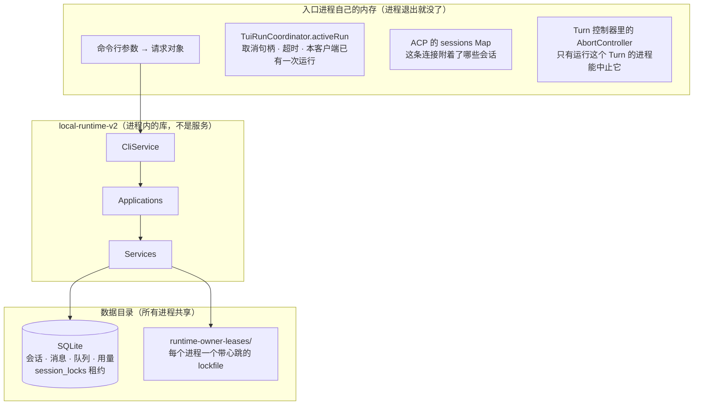
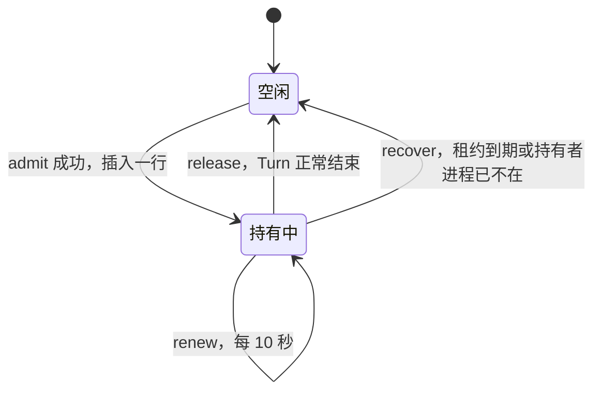
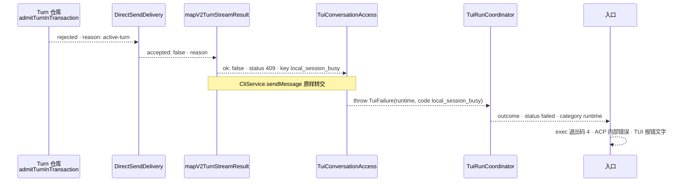

你在终端里开着 `mcode`，让它重构 `slug.js`。它正在改文件、跑命令，还没结束。这时：

- 编辑器（通过 ACP，也就是它拉起的 `mcode acp` 子进程）往**同一个会话**发来一句“顺便把测试跑一遍”；
- 或者你在另一个窗口敲 `mcode exec --session <id> "跑测试"`。

三个进程，三个入口，共用一个数据目录。哪个进程知道这个会话正忙？

Learn Pi Agent 里的答案是一个布尔值。Pi 的 `AgentSession` 有这样一个 getter：

@pi packages/coding-agent/src/core/agent-session.ts#L1494-L1497 hl=1495-1496

`_isAgentRunActive` 是对象上的一个字段，住在这个进程的内存里。Pi 的前提是一个会话由一个进程在用：v1.5.0 的 coding-agent 里用 `proper-lockfile` 的只有 settings、auth-storage 和包更新三个文件，会话文件没有锁。对 Pi 这足够了。

MiniMax Code 是个要卖给用户的产品。用户会同时开好几个窗口，编辑器会拉起自己的子进程，脚本会在后台跑 `exec`。这一章回答三个问题：

1. 三条命令行从哪里分叉，又在哪里汇合？
2. 汇合之后，每一层（`CliService`、Application、Service）各管什么，为什么要分这么多层？
3. “会话正忙”放在哪里，持有它的进程崩了怎么办？


@figure assets/course/ch01-entries.png 三个入口汇到同一个前台，“正在忙”是一把带租约的钥匙

## 先看现象：只在内存里记“忙”，两个进程会同时开工

前几章的 host 里，`Sessions.admit` 是这样写的：

```js
admit(id, turnId) {
  if (this.active.has(id)) throw Error("session busy");
  this.active.set(id, turnId);
  return () => this.active.delete(id);
}
```

在一个进程里它完全正确：`active` 是个 `Map`，同一个会话第二次 `admit` 就抛 `session busy`。可是 `Map` 住在进程的内存里。下面的实验让两个“进程”（各自 `createApplication`，数据目录相同）同时往一个会话发消息：终端里的 P 先发，它的模型很慢；编辑器里的 Q 在 P 还没结束时也发。先用上面的写法，再换成这一章写的租约：

@lab node labs/ch01/busy.mjs | md

第一张表里，Q 被接纳了：两个 Turn 同时在这个会话上跑。Q 的模型开工时只看到 1 条消息，也就是它自己的问题，P 正在重构什么它一无所知。最后的历史看起来很整齐，这恰恰是麻烦所在：每一问一答都是在不知情的情况下写出来的，如果两边都在改同一个文件，后写的就盖掉先写的。

第二张表里，Q 在入口就被拒绝，模型一次都没被调用。持有者记在锁日志里，两个进程都看得到。P 结束、释放以后，Q 重试成功，这次它看到 3 条消息：P 的一问一答，加上自己的新问题。

要让第二张表出现，需要两样东西：入口把请求翻译成同一个调用，再把结局翻译回自己的语言（`adapters.mjs`）；还要有一份所有进程共享、带租约的“忙”（`sessions.mjs`）。MiniMax 两样都有，先读它的入口。

## 三条命令行，两个汇合点

三个入口差别很大：一个要画终端界面，一个要把结果打印出来、再用退出码告诉调用者成败，一个要在 stdin/stdout 上说 JSON-RPC。所以先看它们在哪里**分开**，再看在哪里重新**合在一起**：



### 命令行进程：`main.ts` 管进程，不管 Agent

`runTuiCli` 先做进程级的事：设进程标题、检查 Node 版本、配置网络代理，然后把控制权交给 `createTuiProgram`（第 0 章看过它怎样注册 `exec` 和 `acp`）。真正干活的函数是**注入**进去的，`dependencies.runExec ?? defaultRunExec`。三个默认实现是这样的：

@mm packages/tui/src/cli/main.ts#L273-L296 hl=274,283,292

三个函数形状一样：把对应的模块 `import()` 进来，再调用它。只有被选中的那条命令的模块才会被加载，`launcher.js` 不会因为用户敲了 `mcode exec` 而被拉进来。源码没写这样做的理由，合理的推测是启动时间。注入的另一个好处写在 `RunTuiCliDependencies`（第 43～84 行）里：测试可以把三个 runner 和 `processRef` 都换掉，命令行解析不用真的启动终端界面。

进程怎么结束，也是入口的事。命令跑完以后（第 186～209 行），`runTuiCli` 先排空 stdout 和 stderr（最多等 250ms），再 `processRef.exit(exitCode)`。TUI 的 `completedCommandExitMode` 是 `'force'`，`exec` 和 `acp` 是 `'natural'`；Windows 上 natural 只写 `exitCode`，让进程自己退出。运行时对这些一无所知。

### 把命令行翻译成请求对象

交互模式的参数在 `contract.ts` 的 `resolveInteractiveLaunchRequest`（第 85～133 行）里被收敛成一个 `TuiInteractiveLaunchRequest`：废弃的顶层命令名直接报 `too many arguments`；`--session`、`--continue`、`--resume` 互斥；`--model` 的格式在这里校验；返回的对象只带有值的字段，下游不用再区分“没传”和“传了空串”。

`program.ts` 里还有同样的收口：`mcode init [directory]` 的注释写着 “Session Project resolution only accepts absolute workspace paths”，所以默认的 `.` 和任何相对目录都在 CLI 边界上用 `resolve(directory)` 变成绝对路径。**入口负责把用户可能写出的各种形状，变成运行时认的一种形状**；运行时不看 argv，也不替入口猜“当前目录”。host 的 `Sessions.create` 对相对路径直接报错，就是这条规则。

### 每条命令各自创建运行时

`mcode exec` 解析完参数、找到数据目录之后，创建运行时，把 `runtime.adapter` 交给 `runExec`：

@mm packages/tui/src/cli/run-exec-command.ts#L62-L90 hl=62,71,74,80

- 第 62 行：数据目录由 `prepareTuiDataDir()` 决定，环境变量 `MINIMAX_DATA_DIR` 可以覆盖。TUI 和 ACP 走的是同一个函数，所以三个进程默认看到同一个目录。
- 第 74 行：`surface: 'headless'`。这是入口告诉运行时“我是谁”的唯一方式。
- 第 80 行：`--permission smart|full|off` 在这里变成运行时的 `permissionMode`（`auto`、`bypassPermissions`、`off`）。契约里写着 “ask requires TUI/ACP”：`exec` 没有人可以问。

`mcode acp` 的形状完全一样，只是 `surface` 换成 `'acp'`，驱动换成 `serveTuiAcpStdio`：

@mm packages/tui/src/cli/run-acp-command.ts#L61-L76 hl=61,66,70-71

`finally` 里还有对称的清理：摘掉信号监听、`shutdownRuntime(runtime)`。创建运行时的人负责关掉它。`mcode`（`tui/launcher.ts`）、`mcode provider …` 和 `mcode plugin …` 也是同样的写法。下面的实验在固定提交里把这些汇合点数了一遍：

@lab node labs/ch01/entries.mjs | md

第一张表：五条命令都调用同一个 `createTuiRuntime`，区别只有 `surface`。第二张表：三个入口驱动一次运行的类也是同一个，`TuiRunCoordinator`，各自 `new` 一份。它持有这次运行的取消句柄、超时和“同一个客户端同时只能有一次运行”的保护，三个入口谁也不重写。

### `surface` 到底改了什么

第三张表回答一个更尖锐的问题：汇合之后，入口之间的差别在哪里被读到？整个 `tui` 包和 `local-runtime-v2` 里，拿 `surface` 去比较具体取值的只有 `lifecycle.ts` 里这七行：

@mm packages/tui/src/runtime/lifecycle.ts#L466-L482 hl=467-469,471-475,478

| 开关 | tui | headless（exec 等） | acp |
| --- | --- | --- | --- |
| `questionnaireReply` / `permissionPrompt` / `elicitation` | 开 | 关 | 开 |
| `startupExecutionPolicy` | 默认 | `quarantined` | `quarantined` |
| `promptSuggestionSurface`（输入框里的下一句建议） | 开 | 关 | 关 |

第一行好理解：headless 没有人可以回答问题或点“允许”，这三项能力就关掉。第三行源码注释写得很直白：只有交互式输入框能显示建议，其他入口会白白花一次请求。第二行的 `quarantined` 要追到 cron 模块：`enabled: restoredTaskExecution !== 'quarantined' && !config.disabled`，也就是磁盘上恢复出来的定时任务在这个进程里不启用。一个一次性的 `exec`，或者编辑器拉起的子进程，不该替用户触发定时任务（这是我对设计意图的推断，代码只显示了开关本身）。

所以三个入口不是三个程序，而是**同一个运行时的三种接线方式**。一个更直观的证据是：`createEmbeddedRuntimeHost` 对三个表面传的 `runtimeOwnerKind` 都是 `'tui'`（`embedded-host.ts` 第 90 行）。

## CliService 之下：Application 管用例，Service 管规则和存储

`createTuiRuntime` 返回的 `runtime.adapter` 包着 `host.cliService`。第 0 章看过 `CliService` 的六个动词，这里看它的构造：

@mm packages/local-runtime-v2/src/local/cli-service.ts#L97-L128 hl=98-100,121-127

三个协作者：`applications`（会话、队列这类“实体”的用例）、`conversation`（发送、恢复、中止、插话这类“对话”的用例）、`application`（外围能力：插件、模型、技能、目标……取不到就抛 `Runtime does not expose X Application`）。`CliService` 的每个方法都是一行转发；`createSession` 里唯一的逻辑是“有没有显式工作目录”，选两个 Application 方法中的一个，那是路由，不是业务。注释说它是 “call local Application directly, without HTTP or RPC envelopes”：进程内的函数调用，不是微服务。

往下一层是 Application。以 `sendMessage` 为例：

@mm packages/local-runtime-v2/src/application/conversation/conversation-application.ts#L159-L198 hl=166-167,168-177,188-193,194-197

1. 第 166～167 行：先过准入前的检查（执行期限、保留的 Turn id、Slash Review 的限制），不通过就返回一个打开失败的结果。
2. 第 168～177 行：把请求准备成可提交的输入，主要是登记附件。登记失败按错误映射表翻译成稳定的错误键。
3. 第 188～193 行：交给 `directSend.open`。没被接纳就 `discardCreated`，把刚才登记的附件撤销。
4. 第 194～197 行：抛异常同样撤销，再把异常原样抛出。

Application 的活是：校验、准备输入、失败时清理半成品、把结果翻译成稳定的错误契约。它自己不存会话状态：这个类唯一的字段是构造函数里的 `options`。再往下是 `DirectSendDeliveryService`：

@mm packages/local-runtime-v2/src/application/conversation/direct-send-delivery.ts#L70-L112 hl=71,82,89,97-100

- 第 71 行：先 `reserve` 一个事件流的预约，再去提交。预约在 Turn 被接纳后用 `bindTurn` 绑定到 `turnId`（第 89 行）。这样做的原因源码没写，推测是为了不丢掉 Turn 一接纳就产生的第一批帧。
- 第 82 行：`allowQueue: false`。直接发送遇到忙就失败，不排队；`enqueueMessage` 调的是同一个 `submit`，参数是 `allowQueue: true`。“发送”和“排队”的区别就是这一个布尔值（第 9 章展开）。
- 第 97～100 行：没被接纳，就撤掉预约，把原因（`reason`）往上交。

真正的判断在 Service 层：`submit` 落到 `submitTurn`（`turn-execution.service.ts` 第 511 行），先登记这次提交（注释：“Enroll before the first asynchronous check so an early stop is not lost”，否则提前到的 stop 会丢），再检查会话是否可用，再**准入**，最后启动。准入是整条链上唯一决定“忙不忙”的地方，后面单独读。

现在可以回答“为什么分这么多层”了。每一层只回答一个问题，下面这个实验用 `import` 语句把它们的关系数了出来：

@lab node labs/ch01/layers.mjs | md

- 箭头只往下：`tui` 没有任何文件导入 `agent-core` 或 Pi 的 Agent 包，`agent-core` 反过来导入 `local-runtime-v2` 的是 0 个，Pi 的两个包不导入任何 MiniMax 的包。分层不是画在文档里的，是编译器每次构建都在检查的。
- 入口层对运行时的认识极窄。`CliService` 只以类型出现；运行时导入只有工厂 `createLocalRuntimeHostV2`、配置读取、日志函数、两个枚举，外加 `session-lifecycle-bridge.ts` 直接调用 `turn-system` 的三个插件钩子函数。这最后一条说明边界不是绝对的，但例外只有一处，而且都能数出来。
- `local-runtime-v2` 导入 `agent-core` 的文件有 116 个，几乎所有产品功能都在这一层或它的下面。

| 层 | 管什么 | 不管什么 | 状态放在哪 |
| --- | --- | --- | --- |
| 入口（`tui` 的 cli / headless / acp） | 参数、协议、输出格式、退出码、信号 | 会话和 Turn 的规则 | 一次启动、一次连接、一次运行，进程退出就没了 |
| `CliService` | 给所有入口同一份能力清单 | 任何逻辑 | 无 |
| Application | 用例编排、输入校验、错误翻译、指标 | 持久化规则 | 无（只有协作者） |
| Service | 规则和存储：会话、Turn 准入、队列、权限…… | 怎么呈现 | SQLite 和进程内的控制器 |
| `agent-core` | 把一个 Turn 装配成 Pi 的 `Agent`（第 2 章） | 会话、排队 | 一个 Turn 的生命期 |

分这么多层，是因为同一个能力要被三种完全不同的入口使用，而且入口的数量还会增加（桌面端、SDK）。把“怎么呈现”和“怎么判断”分开，新入口只需要写最外面一层。

### 状态放在哪

这张表更值得记住。凡是“只有这个进程关心”的状态留在入口里，凡是“所有进程都得相信”的状态一律下沉：



ACP 的会话 id 就是运行时的会话 id：`session/new` 调 `runtime.createSession`，把 `session.sessionId` 原样返回，连接里的 `sessions` Map 只记录“这条连接附着了哪个会话”，用一个新的 `TuiRunCoordinator` 驱动它（`acp/agent.ts` 第 566～599 行）。连接断了，附着消失，会话还在数据库里。

## “忙”住在数据库里：一行带租约的锁

Service 层的准入是 `turn.repository.ts` 里的 `admitTurnInTransaction`。它在一个数据库事务里做完所有判断：

@mm packages/local-runtime-v2/src/service/turn-system/persistence/turn.repository.ts#L771-L828 hl=783-788,789,790-796,797-800,820-827

按顺序读：

1. 第 783～788 行：会话本身能不能接纳？不存在、正在被删除、正在被改写，直接拒绝。
2. 第 789 行：**先回收**。已经过期、或者持有者已经死了的锁，在这里被清掉（后面细读）。
3. 第 790～796 行：看锁。如果锁的持有者是“删除会话”，拒绝。
4. 第 797～800 行：重复的请求（同一个 turnId、同一个 `clientRequestId`、同一个队列认领）返回 `duplicate`，不重复接纳；还有锁，就拒绝：`compaction-active` 或者 `active-turn`。
5. 第 801～819 行：队列里有更早的消息、或者产品策略不允许，也拒绝（第 9 章）。
6. 第 820～827 行：都过了，才插入新的锁。

“锁”是数据库里的一行：

@mm packages/local-runtime-v2/src/infra/db/schema/turn.ts#L12-L18 hl=13

主键是 `session_id`，一个会话最多一行，这是数据库替你保证的。插入（`insertAdmission`，第 1128～1136 行）时写下持有者 `ownerId` 和到期时间 `acquiredAtMs + leaseMs`。

而这一整段判断是在 `db.transaction(..., { behavior: 'immediate' })` 里执行的（`turn.repository.ts` 第 260～288 行）：`immediate` 让事务一开始就拿到写锁，两个进程同时准入时，一个先做完“检查、插入”，另一个才开始。注释还有一句值得记住：“Recovery runs even when this candidate is rejected; its facts still commit”，即使这次准入被拒绝，顺手回收的过期锁也照样提交。

### 租约：续得上就一直持有，续不上就过期

`ownerId` 是持有者的身份，`expiresAtMs` 是到期时间，默认租约 30 分钟（`DEFAULT_LEASE_MS`）。正在运行的 Turn 由控制器**每 10 秒**续一次：

@mm packages/local-runtime-v2/src/service/turn-system/persistence/turn.repository.ts#L136-L150 hl=140-146,149

续租是一条带条件的 `UPDATE`：只有 `ownerId` 还是自己、并且没过期（`gt(expiresAtMs, now)`）才会改成功，`changes === 1`。控制器（`turn.controller.ts` 第 105～120 行）拿到 `false` 就用 `lease-lost` 中止这个 Turn，抛异常则用 `lease-renewal-failed` 中止。**丢了租约的 Turn 自己停下**，而不是继续在别人的会话上干活。



### 崩了怎么办：两条回收路径

持有者没来得及释放，锁就留在表里。回收发生在下一次准入的开头（`recoverExpiredInTransaction`，第 61～73 行用 `lte(expiresAtMs, now)` 找出过期的锁）。回收本身长这样：

@mm packages/local-runtime-v2/src/service/turn-system/persistence/turn-lease-recovery.ts#L191-L222 hl=197-205,206-211,212-220

找到这个会话最后一个 `accepted` 的 Turn（第 197～202 行），把它标成 `failed`（第 206～211 行），删掉锁（第 212～220 行），并产生一条终态事实 `terminalFacts`，让界面知道那个 Turn 的结局。**被回收的 Turn 不会悄悄消失，它有一个失败的终态。**

等 30 分钟太久了。如果持有者的进程已经不在，应该立刻回收。判断“还活着吗”的是 `identity.ts`：

@mm packages/local-runtime-v2/src/infra/runtime-owner/identity.ts#L50-L68 hl=61-66

`ownerId` 的形状是 `kind:pid:实例号.操作号`。如果实例号是自己，就活着（第 61 行）；如果这个实例的租约文件已经不存在，死了（第 62 行）；如果 pid 对应的进程不在了，死了（第 63 行）；否则按“活着”处理，注释说得很清楚：一次心跳延迟不能证明对方死了，要等对方的进程自己关掉租约或者退出。每个运行时进程在 `runtime-owner-leases/` 里持有一个用 `proper-lockfile` 加了心跳的文件（stale 为 10 秒，约每 3 秒更新一次），这个文件就是“这个进程还在”的证据。它还防止 PID 被复用：一个新进程拿到了旧进程的 pid，但它没有旧进程的实例文件。

于是有两种回收原因：**租约到期**（持有者可能还活着但卡死了），和**持有者的进程已不在**（立刻回收）。

### 别的进程持有的 Turn：能看，不能动

最后一个问题：TUI 打开了一个正被另一个进程运行的会话，它能做什么？

@mm packages/local-runtime-v2/src/application/conversation/conversation-application.ts#L352-L358

TUI 的 `getActiveRun` 读到 `ownedByOtherRuntime` 就在快照里标上 `runningElsewhere`（`port.ts` 第 656～660 行注释：本进程能读这个会话，但不能插话、排队或停止那个 Turn）。`abortSession` 在 Application 里同样先问一句：持有租约的是不是别的运行时。原因在注释里：“Only the Runtime holding the lease can stop this Turn”，中止一个 Turn 需要它的 `AbortController`，而那个对象只活在运行这个 Turn 的进程里。所以“忙”要写在共享的地方，“能不能停”却只能由持有者决定。

host 的 `Sessions` 实现了同样的规则，实验分两部分：第一部分用假时钟看续租和过期，第二部分用一个真实的子进程持有租约，再 `kill -9` 它：

@lab node labs/ch01/crash.mjs | md

第一张表：续过租的持有者在 1500ms 时仍然挡着 B；到 1700ms 没人续了，B 接管，留下 `expired-lease` 的回收记录。A 这时才“回来”，续不上，也写不了历史：`lease lost`，这就是 MiniMax 里 Turn 丢租约后被中止的 host 版本。第二张表：持有者被杀之后，不用等 30 分钟，下一次准入立刻回收（`owner-dead`）。

## 同一个失败，一路翻译到退出码

回到开头那个问题：Q 发消息的时候会话在忙，用户最后看到什么？这一个失败要穿过六个地方，每个地方都用自己的词：



第一步在上一节读过：仓库返回 `reason: 'active-turn'`。第二步，Application 把原因翻译成错误契约：

@mm packages/local-runtime-v2/src/application/conversation/session-stream-delivery.ts#L453-L474 hl=466-472

`mapV2TurnStreamResult` 只做一件事：没被接纳，就用 `directSendAdmissionError` 把 `reason` 变成 `{ status, key, message }`。表里没有的原因（比如 `active-turn`）落到兜底分支：`409`、`local_session_busy`，消息是 “Session already has an active Turn. Use queue send to deliver the message after it.”。`409` 是 HTTP 风格的状态码，但这里是进程内的函数返回值，没有任何网络。**服务层的词（`active-turn`）不外泄，上面的层只认稳定的 `key`。**

`CliService.sendMessage` 原样转交，下一站是 TUI 包里的适配器：

@mm packages/tui/src/runtime/adapters/conversation-access.ts#L19-L48 hl=26-34,35

第 29～34 行：`opened.ok` 为假，就抛 `TuiFailure('runtime', 消息, { code: key, retryable: status >= 500 })`。409 不是 5xx，所以不可重试。抛出的异常被 `TuiRunCoordinator.execute` 接住，`execError` 把它翻译成结局里的错误，类别只有三种：`config`、`internal`，其余都归 `runtime`。到这里，这次失败是 `{ status: 'failed', error: { category: 'runtime', code: 'local_session_busy' } }`，和入口无关。最后一步由入口自己翻译。`exec` 把结局变成退出码：


@mm packages/tui/src/headless/exit-policy.ts#L41-L57 hl=44-52

ACP 在 `session/prompt` 处理函数的末尾，把结局变成协议里的 `stopReason`，失败则抛出 JSON-RPC 的内部错误：

@mm packages/tui/src/acp/agent.ts#L1219-L1228 hl=1220-1222,1223

`busy` 在 exec 里是退出码 4，在 ACP 里是一个 `-32603` 错误，消息是 “MiniMax Code Runtime failed: Session already has an active Turn…”，在 TUI 里是一行报错。下面的实验在 host 里复现了这条链：同样五种结局，从三个适配器进去，各自怎么说；中间一张表把 host 的退出码映射和 MiniMax **真实的** `exitCodeForExecResult` 逐项对照（那个函数是从固定提交里装载出来直接运行的）：

@lab node labs/ch01/surfaces.mjs | md

这样设计的好处是每一层只依赖相邻的一层。如果 `exec` 直接认 `active-turn`，Service 层给这个原因改个名，所有入口都得跟着改；现在改动只影响 Application 的那张映射表。新增一个入口（比如 SDK）只需要实现最后一步，把同一个结局翻译成自己的语言。

## 对照：Pi 的模式分发，Claude Code 的入口分岔

三个产品都有“交互 / 一次性 / 给程序用”这几种用法，分岔的**时机**不同：

| | Pi（v1.5.0） | Claude Code（2.1.88 还原源码） | MiniMax Code（0.7.2） |
| --- | --- | --- | --- |
| 入口 | 一个 `main()` | `entrypoints/cli.tsx` 做引导，再进 `main.tsx` | `main.ts` → `createTuiProgram` |
| 怎么选模式 | `resolveAppMode`：`--mode`、`--print`、stdin/stdout 是不是 TTY | `isNonInteractive = hasPrintFlag \|\| hasInitOnlyFlag \|\| hasSdkUrl \|\| !process.stdout.isTTY` | 子命令：默认进 TUI，`exec`，`acp`；TUI 要求 TTY |
| 运行时什么时候建 | 分支之前建一个，三个模式拿同一个 | 在同一个命令行 action 里装配，模式是个标志 | 分支之后，每条命令自己 `createTuiRuntime({ surface })` |
| 模式差异散在哪 | `main.ts` 里 `appMode` 出现在 21 行 | `main.tsx` 里 `isNonInteractiveSession` 出现在 19 行 | 整个 tui 包只在 `lifecycle.ts` 比较 `surface`（7 行） |
| 给程序用的口 | `--mode rpc`（自己的 JSONL 协议）、`--mode json` | `--output-format stream-json`、Agent SDK | `exec --output-format stream-json`、ACP（标准协议） |

Pi 的分支很晚：

@pi packages/coding-agent/src/main.ts#resolveAppMode hl=119-120

在 `main()` 的末尾（第 959、962、995 行），`rpc` 调 `runRpcMode(runtime)`，`interactive` 调 `new InteractiveMode(runtime, …)`，其余调 `runPrintMode(runtime, …)`，三个都拿同一个 `runtime`。好处是模式之间共享一切，简单；代价是 `main()` 里要同时满足三种模式，`appMode` 在 21 行里被反复判断。有意思的是，管道输入（`stdinContent !== undefined`）会把交互模式悄悄改成 print。

Claude Code 在 `cli.tsx` 里按 argv 做了一批快速通道（`--version` 一个模块都不加载，MCP 服务器、daemon worker 等各走各的），其余都进 `main.tsx`。在 `main.tsx` 里（第 797～815 行），`isNonInteractive` 在一开始就算好，传给 `initializeEntrypoint`，然后在这个巨大的命令行 action 里被反复读取。这是“一个入口，一个标志，到处判断”。

MiniMax 把分支提到最前面：子命令一选定，后面的代码只属于这一种用法，没有 `if (!interactive)` 满天飞。代价是装配重复（五处 `createTuiRuntime`、三处 `new TuiRunCoordinator`），所以必须把共同的部分压进共享的类和一个 `surface` 参数里，上面几个实验量过这一点。另一个差别：MiniMax 的 `packages/` 里没有出现 Pi 的 `runPrintMode`、`runRpcMode`、`InteractiveMode` 或 `AgentSessionRuntime`，它只拿 Pi 的 coding-agent 包当工具库（`tools`、`shell`、`messages` 这些子路径）。**Pi 的入口三件套，MiniMax 自己重写了一遍，而且多了一层“会话在忙”的数据库。**

## 动手：host 里的三个入口和带租约的 Sessions

`host/src/adapters.mjs` 把上面的三件事都落到了代码里。先看驱动一次运行的 `RunCoordinator`，对应 `TuiRunCoordinator`：

@code host/src/adapters.mjs#RunCoordinator hl=127-129,136-141,155

第 127～129 行是客户端自己的保护，对应 “A run is already active.”；它和会话上的租约互不替代。第 136～141 行：成功返回 `{...result, outcome}`，`app.run` 抛出的预期内失败（会话在忙、不存在……）变成 `status: 'rejected'`、`outcome.status: 'failed'`，和 MiniMax 的 `execError` 一样把任何错误变成结局，而不是让异常漏出去。

三个入口只是在它外面各做一次请求和结局的翻译：

@code host/src/adapters.mjs#adapters hl=179,181-185,189-192,198-210,236-237

`tui` 共用一个协调器，加一句状态行文字；`exec` 每次新建一个协调器，先 `resolveExecSession`（`--session`、`--continue`、新建；相对目录在这里变绝对），再把结局变成退出码（`exitCodeOf` 的数值和 MiniMax 的 `MINIMAX_CODE_EXEC_EXIT_CODES` 一致，实验对照过）；`acp` 在一条连接的闭包里记着每个会话的协调器，`session/prompt` 的结局变成 `stopReason` 或 `-32603`。三个入口没有一行保存历史或“忙”的代码。

“忙”在 `Sessions.admit` 里。顺序和 `admitTurnInTransaction` 一致，先回收再检查：

@code host/src/sessions.mjs#admit hl=203-206,208-217,223-224,234

第 204 行先回收，第 205～206 行再看有没有持有者；拿到之后在锁日志里写一条 `acquire`，启动续租定时器（第 223 行，对应控制器每 10 秒一次的 `renew`）。释放函数只在自己仍是持有者时才写 `release`（第 234 行），租约早已被回收就返回 `false`，不替新的持有者释放锁。回收的两个原因：

@code host/src/sessions.mjs#recoverStale hl=264-265

简化的地方：MiniMax 的锁在 SQLite 里，靠主键和 `BEGIN IMMEDIATE` 事务保证两个进程不会同时拿到锁；host 的锁在只追加日志里，靠同步写入保证顺序，演示的是租约的**规则**，不是并发控制本身。存活判断只用 `process.kill(pid, 0)`，没有 lockfile 心跳，所以防不住 PID 复用。host 的 `Sessions` 够不到 Turn 的控制器，丢租约的 Turn 不会被主动中止，只会在它下一次写历史时被 `append` 挡下，以 `history / persistence` 失败结束（第 2 章的失败归因）。

下面是这一章的回归实验，它把以上每一条都走了一遍：三个入口依次往同一个会话发消息、`exec --continue` 接上最近的会话、相对路径在入口被解析、两个进程抢会话、过期回收和进程死亡回收、五种结局的三种说法，以及退出码与真实函数一致：

@lab node labs/chapters/01-architecture.mjs

## 你来改

::: predict 去掉死亡探测
把 `Sessions.recoverStale` 里 `owner-dead` 那一行（`else if (this.isOwnerAlive(...) === false) reason = "owner-dead";`）删掉，再运行 `node labs/ch01/crash.mjs`。第二部分被 `kill -9` 的持有者，还能被回收吗？
???
不能。第二部分的第二次准入仍然被拒绝（`local_session_busy`），而且要等到租约自然过期，默认租约是 30 分钟。删掉之后只剩 `expired-lease` 一条路径：持有者的进程已经死了，锁却还在，会话在 30 分钟里一直“忙”。这就是 MiniMax 在租约之外还要加一层存活判断（`isOwnerAlive`、实例租约文件）的原因：租约解决“持有者卡死了”，存活探测解决“持有者已经没了”。实验脚本末尾的 `assert.equal(rows[3].结果, "接纳")` 会失败，表格仍然先打印出来。
:::

::: predict 不续租会怎样
把 `Sessions.admit` 里创建 `heartbeat` 的两行和 `clearInterval(heartbeat)` 删掉，再用 `new Sessions(dir, { leaseMs: 100 })` 让 P 的模型跑 300ms，在 150ms 时让 Q 往同一个会话发消息。P 和 Q 各是什么结局？会话历史里有什么？
???
Q 被接纳并完成，P 以 `failed` 结束，历史里只有 Q 的一问一答。没有续租，P 的租约在 100ms 过期；150ms 时 Q 的准入先回收过期的锁（`expired-lease`）再拿到锁。300ms 时 P 的模型回复了，它要把消息写进历史，`Sessions.append` 发现 P 的 turnId 已经被记进回收记录，抛出 `lease lost`，P 的 Turn 在 `history / persistence` 上失败，消息没有写进去。而且这一切发生在 P 以为自己一直持有会话的时候。有续租时 Q 一直被拒绝，P 正常完成。MiniMax 里还多一步：续租失败时 Turn 控制器会主动用 `lease-lost` 中止 Turn，不用等到写历史才发现。
:::

::: predict 客户端的保护不是会话的保护
在同一个进程里，对**两个不同的会话**同时调用 `api.tui(...)`，第二个会怎样？换成两次 `api.exec(...)` 呢？
???
`tui` 的第二个调用被拒绝：`status: 'rejected'`，状态行是 “失败：A run is already active.”，`code` 是 `client_run_active`。`exec` 的两次调用都成功，退出码都是 0。原因：`tui` 共用一个 `RunCoordinator`，它保护的是“这个客户端同时只有一次运行”，跟会话无关（真实的 TUI 同一时刻只显示一个对话）；`exec` 每次新建协调器，租约是按**会话**加的，两个不同的会话互不影响，可以并行。要防止的是“同一个会话上同时两个 Turn”，那是租约的事；“一个界面同时跑两次”是协调器的事。两道保护各管各的，哪个都不能代替另一个。
:::

## 面试题

::: interview MiniMax Code 的三个入口（TUI、exec、ACP）怎样共用一套运行时？每一层各管什么？
入口层（`packages/tui`）只管参数、协议、输出、退出码和信号：`main.ts` 管进程，`program.ts` 解析参数，`run-exec-command.ts` / `run-acp-command.ts` / `launcher.ts` 各自创建运行时，驱动一次运行用同一个 `TuiRunCoordinator`。三条路都调用 `createTuiRuntime({ surface })`，运行时里只有 `lifecycle.ts` 那几行读 `surface`，决定提问类能力开不开、启动时要不要启用恢复的定时任务。`CliService` 是进程内的门面，每个方法一行转发，给所有入口同一份能力清单；Application 管用例编排、输入校验、错误翻译；Service 管规则和存储，会话和 Turn 的准入就在这一层；再往下是 `agent-core` 把一个 Turn 装配成 Pi 的 `Agent`。

依据：`import` 的方向只往下（`tui` 不导入 `agent-core`，下层不导入上层），入口对运行时的运行时依赖只有工厂函数、枚举和几个日志函数。加分点：能说出分层是为了让“怎么呈现”和“怎么判断”分开，新增入口只需要写最外面一层。
:::

::: interview “会话正在忙”为什么不能只是一个内存变量？MiniMax 怎么做？
因为用户会同时开着终端里的 `mcode`、`mcode exec` 脚本和编辑器拉起的 `mcode acp`，它们是不同进程，共用一个数据目录。内存变量只在本进程可见，另一个进程会以为会话空闲，于是两个 Turn 同时在一个会话上跑，谁也不知道对方的存在。

MiniMax 把“忙”写成 SQLite 表 `local_runtime_session_locks` 里的一行，主键是 `session_id`，字段有 `ownerId`、`acquiredAtMs`、`expiresAtMs`。准入在 `BEGIN IMMEDIATE` 事务里做：先回收过期或持有者已死的锁，再检查，没有锁才插入。持有者每 10 秒用带条件的 `UPDATE` 续租（`ownerId` 匹配且未过期），续不上就用 `lease-lost` 中止自己的 Turn。加分点：Pi 的 `isStreaming` 是内存字段，因为 Pi 假设一个会话一个进程。
:::

::: interview 持有租约的进程崩了怎么办？为什么既要过期时间又要存活探测？
租约默认 30 分钟，到期后下一次准入会把锁回收：orphan Turn 被标成 `failed`，产生终态事实，锁行被删掉。这解决“持有者卡死、不再续租”。但如果持有者的进程已经没了，等 30 分钟太久，所以还有存活探测：`ownerId` 里写着 pid 和进程实例号，进程启动时在 `runtime-owner-leases/` 下持有一个带心跳的 lockfile，`isOwnerAlive` 检查实例文件还在不在、pid 是否存在，死了就立刻回收。

一次心跳延迟不能证明对方死了，所以“活着”的判断偏保守：只有实例租约缺失或 pid 不存在才算死。实例文件还能区分“同一个 pid 被另一个新进程复用”。加分点：被回收的 Turn 之后再写历史会被挡下（持有权检查），防止僵尸写入。
:::

::: interview 同一个失败（比如会话正忙）在 exec 和 ACP 里分别是什么样子？为什么翻译放在入口，而不是运行时？
流程：Service 层准入返回 `reason: 'active-turn'` → Application 的 `directSendAdmissionError` 翻译成 `409 / local_session_busy` → TUI 包的 `TuiConversationAccess` 抛 `TuiFailure('runtime', code: local_session_busy)` → `TuiRunCoordinator` 变成 `{ status: 'failed', error.category: 'runtime' }` → exec 的 `exitCodeForExecResult` 给出退出码 4，ACP 的 `session/prompt` 抛 JSON-RPC 内部错误（`-32603`，消息 “MiniMax Code Runtime failed: …”）。成功、取消、超出步数也有各自的映射：exec 是 0 / 130 / 7，ACP 是 `end_turn` / `cancelled` / `max_turn_requests`。

翻译放在边界上，是为了每一层只依赖相邻的一层：Service 改原因的名字只影响 Application 的映射表，新增入口只需要实现最后一步。如果运行时直接输出退出码或 JSON-RPC 错误，它就得认识每一种入口。
:::

::: interview Pi、Claude Code 和 MiniMax Code 的入口设计有什么不同？各有什么取舍？
Pi：一个 `main()`，`resolveAppMode` 根据 `--mode`、`--print` 和 stdin/stdout 是不是 TTY 选模式，分支在最后，三个模式（`InteractiveMode`、`runPrintMode`、`runRpcMode`）拿同一个 `runtime`。共享一切，简单；`main()` 里 `appMode` 被判断 21 次。Claude Code：`cli.tsx` 先按 argv 走一批快速通道（`--version` 零模块加载），其余进 `main.tsx`，`isNonInteractive` 一开始算好，在巨大的 action 里被读 19 行。MiniMax：子命令一选定，分支就彻底分开，每条命令自己创建运行时，只通过 `surface` 参数和共享的 `TuiRunCoordinator` 保持一致，代价是装配重复。

另一个本质差别在状态：Pi 的“忙”是内存字段；MiniMax 因为产品要同时支持多个进程，把它放进了共享数据库，并加了租约与回收。能说出“分叉越早，各路径越干净，但共同部分必须有意识地抽出来”，就答到了点上。
:::
