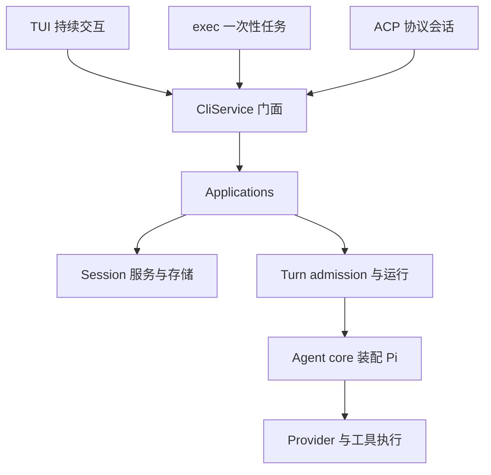

## 本章的问题

同一个修复，在终端里可以完成，在编辑器里却一直 busy。先分清哪个状态由适配器拥有，哪个由共享运行时拥有。只删掉编辑器的一份 pending map，不能证明 Session 已经能够接纳新工作。

host 用三个极小输入适配器转到同一个 app.run。它们翻译参数形状，不私藏另一份历史。Sessions 维护工作区、持久消息与 active Turn，admit 的释放函数只允许原 owner 释放一次。

这一步很像给最小 Agent 安装产品底座：模型还没有变复杂，但状态的生命期已经超过一次函数调用。

## 沿固定源码逐段拆解

@source cli

### createTuiProgram 注入执行入口

Commander 注册的是启动 TUI、exec、ACP 等入口，handler 由外层注入。应先找到注册与参数，再追执行函数，而不是从终端组件倒猜模型请求在哪里。

@source bridge

### CliService 转发到 Application

createSession 按是否提供明确工作目录走对应生命周期方法。门面并不是数据库 owner；它返回的结果需要继续追到 application、service 和存储。进程内转发也不应被画成 HTTP 微服务。

### 逐层记录一份状态归属表

| 层 | 输入和输出 | 避免的错误 |
| --- | --- | --- |
| 适配器 | CLI 参数或协议消息 ↔ 运行时调用 | 每个入口维护一套模型历史 |
| Application | 用户意图 ↔ 服务组合 | 只改 UI 提示而不改状态 |
| Sessions | 会话身份、目录、active owner | 其他 Turn 释放当前 busy |
| Turn runner | 一次执行与收尾 | 模型停了便立即宣告可继续 |

host 的三个适配器只展示参数与共享状态的关系，并不宣称实现完整 ACP 标准或完整 TUI。真实进程入口在第 10 章继续检验。

## 机制总览



## 接入贯穿项目

@implementation 01-architecture

### 逐步跟踪本章实现

三个 adapters 只把各入口的参数变成同一个 app.run(sessionId, text, options)。它们不各自保存聊天数组，也不各自创建 busy 标志；从 exec 切到 ACP 参数入口后，仍会经 Sessions.history 取到同一身份的持久历史。这里的 ACP 是参数适配子集，不是完整协议服务。

Sessions.create 记录绝对且规范化的 workspaceDir；get 先验证 session 存在，再打开它的历史日志。admit 把 active 从“没有 owner”变成当前 turnId，并返回绑定该 owner 的 release。重复 release 无害，错 owner 释放则抛错，避免旧任务清掉新任务占用。

createApplication 的 finally 负责释放 controller、prompt reservation、capability lease 和 session owner。只有整条执行结束才释放 busy；应用关闭还要阻止新请求、取消在途任务并等待 completion。这个顺序会成为后面队列与热更新实验共同依赖的骨架。

## 运行本章实验

```bash
node --disable-warning=ExperimentalWarning labs/chapters/01-architecture.mjs
```

@experiment 01-architecture

## 逐项解释实验结果

三次任务分别从 TUI、exec 和 ACP 适配器进入，最终落在同一条 canonical history。检查三个不同 Turn id，以及会话中 tui、exec、acp 的输入顺序。相对工作目录必须在创建时被拒绝。

随后看 active Map 清空：这证明当前教学应用完成了接纳收尾；它与三条回复文字都正确是不同断言。

## 继续动手与验收

人为让一个任务在 model 端口等待，同时从另一个适配器提交同一 Session。断言 busy，并在第一个结束后重试。再对不同 Session 测试并行，明确锁应按哪个身份划分。

::: interview 为什么三个入口应该共享 Session 和 Turn owner？
入口只适配参数，Session 持有历史与工作区，Turn 持有本次取消、事件序号和资源责任。共享 app.run 避免不同入口各自维护状态；实际跨入口继续同一会话，才证明这个 owner 划分已接通。
:::

::: interview 共享运行时后，为什么仍需分别验证适配器？
参数归一化、权限答复、取消转交和输出协议仍不同。先验证公共状态，再检查每条适配边，才能区分核心错误和翻译错误。
:::

::: interview 为什么不能让后来的请求随便释放 busy？
active 状态代表某个明确 Turn 的所有权。另一个请求释放它会让并发工作重叠；释放函数必须校验 owner，并在完整收尾后只执行一次。
:::
