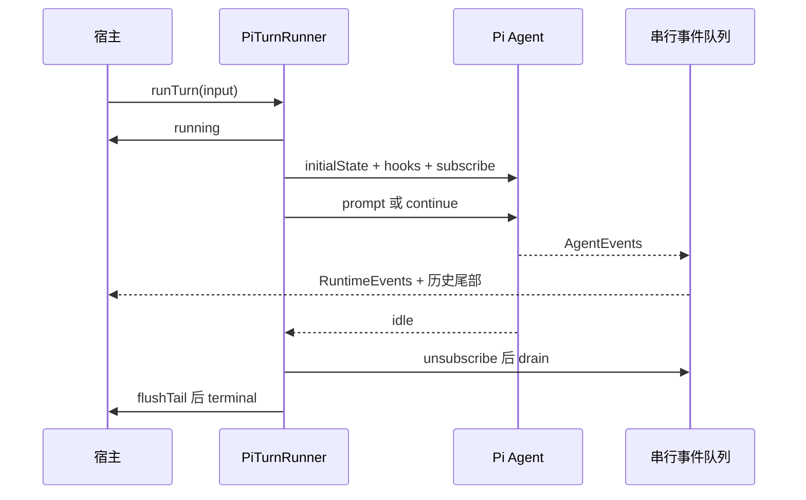

## Session 和 Turn 不是一个生命周期

Session 是可以继续的对话与相关状态；Turn 是一次被接纳的执行。一个 Session 可以承载多个 Turn。进程也可能同时处理多个 Session。因此，把“当前工具列表”“历史游标”“事件计数器”放在进程共享的可变字段中，会让交错执行相互影响。

`PiTurnRunner` 的类实例保存进程级缺省设施，每次 `runTurn` 创建新的 Turn 状态。先读这个装配入口，再读各个 helper，比从底层 Agent 循环反向猜产品状态更容易。

@source runner

## 找到 Pi 真正进入的地方

@source agent

`newAgent` 注入 systemPrompt、model、tools 和 initialMessages；`convertToLlm` 则生成真正面向模型的历史投影。该函数还设置并行工具执行。阅读时区分三个对象：产品中的 Session 历史、一次 Turn 的内存状态、一次模型请求的 messages。

源码中的投影会处理孤立工具结果和图片请求限制。它提示了一个重要设计：为了适配模型而改请求，不必同时改掉保存的原始历史。保留事实和决定本次发什么，可以是两套数据结构。

## 并行执行，串行提交观察结果

继续阅读 `pi-turn-runner.ts` 中的 Step 4–6：先安装工具和 LLM hooks，再订阅事件，把并行 promise 分支产生的 AgentEvent 接入一个串行队列。队列负责翻译 RuntimeEvent、更新历史游标并调用 step-end 逻辑。

这不代表工具变成串行。计算可以并行，而状态提交与观察输出需要一个可解释的顺序。否则 UI、持久历史和最终状态可能分别看到不同顺序。

取消也不是抛一个异常就结束。调用前 signal 已取消，需要避免启动 Agent；执行中取消，需要转发到 `agent.abort()`；结束时还要处理已排队事件、终态输出和 metrics 收尾。源码的 `finally` 路径值得和正常分支一起读。

## 把 runTurn 的八个步骤读成生命周期

这是本项目最值得慢读的函数之一。它先创建 Turn 私有状态，发 running；再创建 Agent 和历史游标，安装工具/LLM hooks，订阅事件，接取消信号，驱动 Agent，最后 drain 事件、flush 历史、发 terminal。把顺序打乱，正常任务也许还能工作，取消与并行工具却会暴露问题。

## 为什么一轮一套对象

PiTurnRunner 实例保存时钟、日志、allocator 等进程级默认值；Turn 内保存 event sequence、bridge、工具上下文和请求历史游标。若这些对象跨 Turn 复用，下一次任务可能继承旧 seq、旧取消状态或未释放监听器。每轮重建的成本换来了更清晰的所有权。

Session 历史仍由宿主提供。newAgent 把 systemPrompt、model、thinking、tools 与 initialMessages 注入 Pi；convertToLlm 则为本次请求投影历史。因此“新 Agent”与“新会话”是两件事。

## 并行事件怎样获得确定顺序

工具完成来自不同 Promise 分支。直接在各分支异步写 RuntimeEvent，可能把 message_end、tool_result 与 terminal 交错。subscribeEvents 用一个串行队列承接事件，后续 drain 等待已入队任务完成。这不保证工具按请求顺序完成，但保证产品事件的提交经过同一条序列化路径。

`idle` 也不等于所有宿主工作已完成。Agent 停止产生新事件后，队列可能仍有写入；history.flushTail 还会补上没有对应边界回调的历史尾部。这就是为什么最终 terminal 必须等这两件事。

@source runner-finalize

## 跑一个可以控制 Agent 的实验

@lab turn

实验从固定源码提取 runAgent、相关恢复函数和用户消息转换函数，用 fake Agent 记录调用。prompt 与 continue 走不同入口；正常返回是 undefined；取消转换为 aborted；抛错走失败分类端口。还可以看到 converge 后再次 waitForIdle。

注意这里没有执行外层 runTurn 的事件队列。实验中的 aborted 行是在驱动函数结束时观察到信号，不能证明已经取消的输入绝不会 prompt；真正的提前拒绝位于外层 runner 的前置检查。把这两层区分开，正是阅读实验的意义。

## 练习：指出四个错误改动的后果

把 terminal 提到 drain 前；把 Agent 存在 runner 字段复用；在订阅事件前调用 prompt；收到 abort 后马上返回而不等队列。逐项写出会丢失什么、污染什么或留下什么资源。答案至少包含一个可观测事件序列，并说明测试该放在内核适配还是宿主结算层。

::: interview 为什么一个 Agent 结束了，产品还可能不能接下一条消息？
模型循环返回、工具子进程退出、事件队列排空、历史提交和 Session busy 状态释放是不同步骤。应按真实执行路径确认最终结算顺序，并测试取消后立即再次发送，而不能只检查界面显示了 cancelled。
:::
