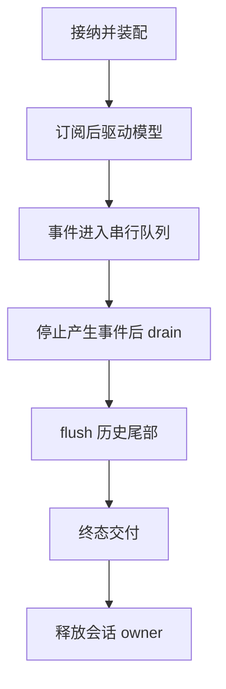

## 本章的问题

模型说完最后一个字，writer 仍在写前一条事件。如果此时先发送 completed，客户端会看到终态越过结果。并行工具和异步存储让这种错误更容易出现。

本章先让第一个 writer 等待，第二个事件已经入队；观察它不能抢先提交。然后让 writer 在 item.updated 处失败，检查运行不会被报告成成功。我们关心的是事件和持久事实的先后，不是 UI 是否暂时停止动画。

## 沿固定源码逐段拆解

@source runner

### runTurn 的前半部按生命周期装配

newTurn 创建不可跨轮复用的工具、bridge、计数器和请求配置；emitRunning 先发布运行状态；newAgent 注入提示、模型、工具和历史；newHistory 建立游标；随后安装 hooks、订阅事件，再连接取消信号。每一步若提前或延后，都可能漏掉第一条事件或复用旧状态。

@source agent

### newAgent 让内核只消费已装配材料

initialState 提供 systemPrompt、model、thinking、tools 和 initialMessages。convertToLlm 负责请求投影。PiTurnRunner 保留进程级默认值，每次 runTurn 再创建 Agent；新 Agent 并不等于新 Session。

@source runner-finalize

### runAgent 返回后仍有三项工作

先 unsubscribe，阻止产生新的订阅交付；drain 等已有串行任务结束；flushTail 补上没有相应边界回调的消息；最后 emitTerminal 选择正常、强制失败或取消原因。

@source event-delivery

### 终态本身也能失败

桥接器生成终态帧，与 writer 提交这些帧，是两个可分别出错的阶段。源码分别记录 translation 和 delivery。host 同样保留 delivered 与 persisted，不用一个 completed 掩盖失败。



## 接入贯穿项目

@implementation 02-turn

### 逐步跟踪本章实现

SerialDelivery 把每次 write 串到前一个 Promise 后面，后到的事件只能排队。runTurn 的 emit 统一添加 sessionId、turnId、递增 seq；序号在宿主侧生成，writer 的快慢不能重新排列事件。writer 一旦失败，交付链保留故障，不把后续 drain 当成成功。

一次迭代先产生 item.started 和可选 delta，再把 assistant 与工具结果写入 messages。historyCursor.flush 成功后才发 item.completed；模型还要工具时继续下一迭代，没有工具才结束。模型的停止条件与外部客户端看见的完成因此有明确的持久化边界。

catch 先分类执行失败或取消，随后仍需 drain、flush 尾部并尝试终态。收尾失败会把最终结果改成 failed，并分别返回 persisted 与 delivered。测试故意拖住第一个 writer，检查第二个事件没有抢跑；这比按同步 mock 的调用次数判断顺序更有说服力。

## 运行本章实验

```bash
node --disable-warning=ExperimentalWarning labs/chapters/02-turn.mjs
```

@experiment 02-turn

## 逐项解释实验结果

先检查 order 在释放首个 writer 前为空，释放后是 1、2。正常 Turn 的最后一帧必须是 turn.completed，历史也已经保存；注入 writer 故障时 result.status 是 failed，delivered 为 false。

这不等于网络 exactly-once。客户端断线后的重放和去重属于第 10 章；存储与外部效果之间的不确定性在第 9 章处理。

## 继续动手与验收

把终态发送挪到 drain 前，让实验失败。再让 persist 而非 writer 抛错，区分两种失败的结果，说明哪一份事实可以重放、哪一项需要人工恢复。

::: interview Agent idle 为什么还不能立即发布 completed？
Agent idle 只说明模型执行停止，已入队事件、历史尾部与终态交付仍可能未完成。应先停止产生事件，再 drain、flush 并交付终态；writer 或 persist 失败必须保留归因，不能提前报告 completed。
:::

::: interview writer 抛错和模型抛错怎样分别归因？
模型失败属于执行结果，writer 失败属于交付边界。两者都不能报告正常成功；应保留哪个阶段失败，以及历史是否已经提交，供重放或协调。
:::

::: interview 为什么每个 Turn 都新建内核状态？
事件序号、取消、bridge 与历史游标只属于本次工作。复用这些对象会继承旧状态；持久 Session 历史则由宿主重新提供，两者不矛盾。
:::
