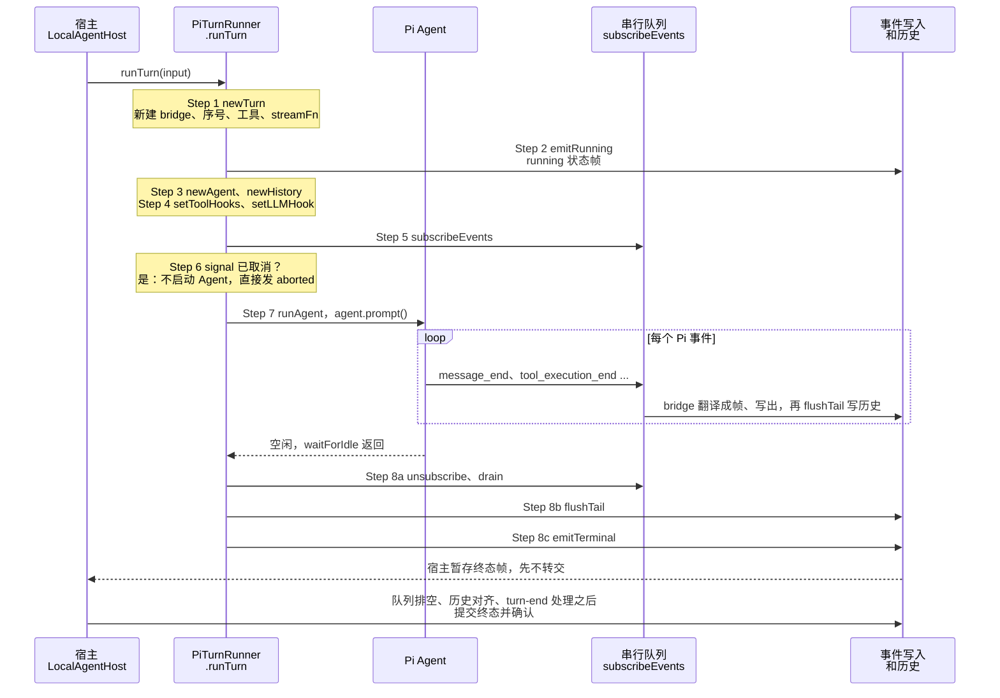
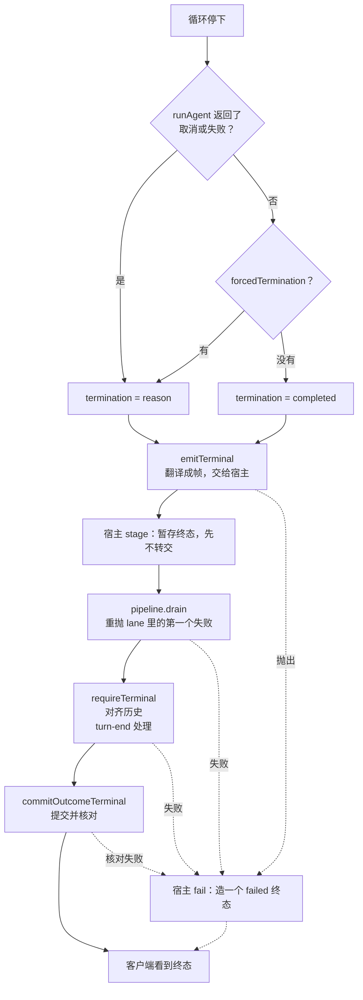

你在 `mcode` 里输入“把失败的测试修好”，按下回车。界面应该立刻显示“正在运行”；模型开始输出，文字一段段出现；它同时读了三个文件，每个文件一行进度；最后输入框重新可用，会话历史里留下完整的一问一答。

Pi 只负责中间最核心的一件事：`agent.prompt()` 让模型和工具轮流转，每走一步广播一个事件，没事可做就变成 idle（第 3 章读过它的循环）。可是产品要对客户端做的承诺，Pi 一条也没有做：

1. 模型开口之前，界面就知道“开始了”；
2. 并行工具的事件，按产生的顺序到达；
3. 客户端看到“完成”时，该送的帧都送齐了，历史也已经写好；
4. 出了错，客户端拿到一个明确的“失败”，而不是一片沉默。

`PiTurnRunner` 就是兑现这些承诺的那一层。这一章沿着它的 `runTurn` 走完一个 Turn 的一生：八步，每一步的位置都有原因，有几处顺序一换就会出事，下面逐个演示。再往外还有宿主 `LocalAgentHost` 的一层：agent-core 发出的终态帧，宿主先不转交，要等所有事情都落地才提交。

::: note Pi 的版本
MiniMax Code 内置的 Pi 是 `third_party/pi-mono` 里的 v0.79.1，不是 Learn Pi Agent 读的 v1.5.0。循环骨架一样，本章的 Pi 代码都摘自 MiniMax 实际使用的这一份。
:::

@figure assets/course/ch02-turn.png 并行产生的事件进同一条队列，终态必须最后一个到

## 先看现象：事件一产生就直接写会怎样

先做最朴素的交付：事件一产生，就直接调 writer。writer 是把帧写进磁盘、转给 TUI 或 ACP 客户端的函数，写一帧要多久并不固定，磁盘同步、网络抖动都会让个别帧特别慢。实验给一个带两个并行工具的 Turn 安排了八个事件，让“工具 a 的开始”和“消息的完成”各慢 100ms，再用本章 host 里的 `SerialDelivery` 交付一遍：

@lab node labs/ch02/order.mjs | md

直写那一列有两处客户端无法容忍的倒序。工具 b 的结束帧先到，客户端看到一个还没开始的工具结束了；`turn.completed` 排在最后一条消息的 `item.completed` 前面，客户端一收到终态就停止读取、放开输入框，那条消息永远不会出现。队列那一列的到达顺序等于产生顺序。代价是队头阻塞：慢帧后面的帧都得等它。MiniMax 接受这个代价，因为错序比慢更糟。

这两种倒序在真实代码里都会发生。Pi 的并行工具在不同的 Promise 分支里各自结束，事件会从多个分支同时冒出来（`subscribeEvents` 的注释就是这么说的）；终态帧是整个 Turn 里唯一会让客户端停止读取的帧，它必须真的是最后一个。

## 八步走完一个 Turn

`LocalAgentHost.run` 在外面备好会话、历史和工具，经过 `LocalAgentTurnRunner` 调用 `PiTurnRunner.runTurn`。`runTurn` 的函数体里按编号写着八步，图里把宿主那一层也画上了：

前三步是装配和宣布开始（中间 L157-L175 是只在开发版桌面 Inspector 里启用的上下文捕获，与主线无关，这里略去）：

@mm packages/agent-core/src/pi-turn-runner/pi-turn-runner.ts#L132-L156 hl=141,151,156

- **Step 1 `newTurn`**（L141）。`PiTurnRunner` 对象可以跨会话复用，但它自己只保存进程级默认值：ID 分配器、时钟、日志、指标客户端。文件头注释写得很明白，每次 `runTurn` 都新建 Agent、EventBridge、事件队列和历史游标。
- **Step 2 `emitRunning`**（L151）。第一个事件是 `session.status`，状态 running，发在模型和任何工具有输出之前，界面因此不用等第一个字。终态帧是同一种事件，只是状态换成 completed、failed 或 aborted（`converters.ts` L648-L689）。这一步的 writer 如果失败，`emitRunning` 会直接抛出（`events.ts` L18-L40），Turn 根本不开始：连“开始了”都说不出去，就不该开始。
- **Step 3 `newAgent`**（L156）。把系统提示、模型、工具和历史交给 Pi 的 `Agent`。

接着是历史游标、两组钩子和事件订阅：

@mm packages/agent-core/src/pi-turn-runner/pi-turn-runner.ts#L176-L190 hl=177,181-182,190

- **Step 3 `newHistory`**（L177）。造出历史游标，记录 `agent.state.messages` 里哪些已经交给了宿主。
- **Step 4 两组钩子**（L181-182）。`setToolHooks` 装在工具执行外面（权限、插件钩子，第 4、7、8 章）；`setLLMHook` 装在每次模型调用外面（压缩、上下文改写，第 5、6 章，改写过的历史也要通过游标交回宿主）。
- **Step 5 订阅**（L190）。`subscribeEvents` 把 Pi 的每个事件都送进同一条队列，在队列里翻译、写出、写历史。后面单独读。

最后三步是取消、驱动和收尾：

@mm packages/agent-core/src/pi-turn-runner/pi-turn-runner.ts#L199-L240 hl=202-216,226-229,237-240

- **Step 6**（L202-216）。信号在启动前就已经取消，就根本不启动 Agent：unsubscribe、drain，直接发 `aborted` 终态。否则把之后的取消转发给 `agent.abort()`，Pi 的 Agent 自己持有一个 AbortController，宿主的信号是被转进去的。
- **Step 7**（L226-229）。`runAgent` 用用户消息 prompt 一下 Agent，等它空闲。只有取消或出错才返回终止原因，正常结束返回 `undefined`。无论成败，`finally` 都要摘掉订阅。
- **Step 8**（L237-240）。`drain`、`flushTail`、决定结局、`emitTerminal`，一行接一行，顺序就是正确性。Pi 会 `await` 监听器，Pi 空闲时队列多半已经空了；`drain` 把“多半”变成“一定”，终态之前队列里不留一帧（这是我对这行 `drain` 用意的推断）。

这几个 `await` 抛出的后果值得记住：Step 2 的 `emitRunning`、Step 8 的 `flushTail` 和 `emitTerminal` 都可能抛（`drain` 不会，它等的队尾永远不 rejected），`runTurn` 随之抛出，agent-core 不会再补发终态帧。谁来告诉客户端这个 Turn 失败了？是外面那层宿主，本章后面会看到。

## 第 1～4 步：每个 Turn 都重新装一遍

`newAgent` 不是 Pi 的分支，只是一份配置。看 Pi 的 `Agent` 能接受哪些选项就明白了：

@mm third_party/pi-mono/packages/agent/src/agent.ts#L97-L124 hl=100,102-103,106-110,114-115,122-123

产品需要的接缝几乎都在这里：`convertToLlm` 决定发给模型的消息长什么样，`streamFn` 换掉请求函数，`beforeToolCall` 和 `afterToolCall` 包住工具，`shouldStopAfterTurn` 让宿主在每一步之后叫停，`unexpectedToolCallFallback` 是给一个根本没有声明工具的对话型宿主兜底。`newAgent` 把这些选项一一填上：

@mm packages/agent-core/src/pi-turn-runner/agent.ts#newAgent hl=37-43,44-45,93,95-97,98-103,105-113

- `initialState`（L37-43）：系统提示、模型、思考档位、工具、历史。Agent 之后往 `state.messages` 里追加，游标盯着的就是这个数组。
- `convertToLlm`（L44-45、L93）：发给模型的消息是历史的一份临时副本，`projectAgentMessagesForModel` 在副本上去掉孤儿的工具结果、给图片数量封顶，函数注释说明“canonical Agent messages are never rewritten”，历史本身不动。host 里对应第 6 章的 `projectOutbound`。
- `streamFn`、`getApiKey`（L95-96）：请求函数在 `newTurn` 里已经套好了重试、超时和指标（第 3 章），这里只是接上。
- `toolExecution: 'parallel'`（L97）：Pi 会并行执行工具，每个工具自己的 `executionMode` 再决定能不能真的并行（第 4 章）。
- `missingToolMessage`、`resolveMissingTool`、`shouldStopAfter*`、`unexpectedToolCallFallback`（L98-113）：全部是宿主传进来的策略，没传就不加。

接缝不够用的地方，MiniMax 直接给 Pi 打补丁。`third_party/pi-mono/MINIMAX_CHANGES.md` 逐条记着原因，和 Turn 生命周期有关的有这几条：

| 补丁 | 原因 | 在 Turn 里的用处 |
| --- | --- | --- |
| `Agent` 暴露 `shouldStopAfterTurn`（07-15） | 循环里本来有，`Agent` 没转发，宿主没法在被拒绝的响应之后立刻停下，排队消息会抢先发起下一次模型调用 | `subscribeEvents` 用它实现 `forcedTermination` |
| `shouldStopAfterSteering`（08-22） | 排队的 `UserPromptSubmit` 钩子在 `turn_end` 之后才返回 `continue: false` | 排队消息被插件钩子拒绝时，不再发起模型请求，也不报失败 |
| `terminateAgent`（08-22） | 钩子要让整个 Agent 停下，而原有的 `terminate` 要求批次里每个结果都同意 | `afterToolCall` 用它结束 PTC 的外层调用（`tools.ts` L127-L129） |
| `unexpectedToolCallFallback`（10-06） | 对话型宿主没声明工具，模型却发来工具调用，默认的“缺失工具”结果会再请求一次模型 | `newAgent` 里按需打开 |

Pi 1.5.0 的循环里已经没有 `shouldStopAfterTurn`，对应的钩子是 `finishTurn`（返回 `end` 或 `continue`），Learn Pi Agent 第 3 章读的是它。名字不同，宿主在每一步之后拥有停止权这件事是一样的。

为什么每个 Turn 都要重装？因为这些东西都带着“这一次运行”的身份。序号计数器放在 `newTurn` 里：

@mm packages/agent-core/src/pi-turn-runner/turn.ts#L190-L194 hl=192-194

序号和事件 ID 默认由本 Turn 自己数，但可以由宿主注入。注入的原因写在 `types.ts` 里：一个逻辑上的 Turn 可能被宿主重试好几次（输出安全检查不通过时重新生成），每一次都是一个全新的 Agent、bridge 和游标，客户端看到的序号却必须接着数，不能从 1 重来。`LocalAgentTurnRunner` 每次 `piRunner.runTurn` 都传同一个 `state.runtimeSeqGenerator`。所以“状态私有”和“序号可以接续”并不矛盾：状态每次重建，身份由宿主统一发放。

## 第 5 步：并行的事件，一条队列

Pi 的 `Agent.processEvents` 对每个事件，先更新自己的状态，再按订阅顺序一个一个 `await` 监听器：

@mm third_party/pi-mono/packages/agent/src/agent.ts#processEvents hl=555-558,574-577,585-591

这里有两个后果。`message_end` 先把消息推进 `state.messages`，监听器才被调用，所以监听器看到的历史已经包含这条消息；监听器返回之前，Pi 不会继续往下走，写得慢的 writer 会拖慢整个 Agent，这是背压。

`subscribeEvents` 注册的监听器很短：

@mm packages/agent-core/src/pi-turn-runner/events.ts#L383-L395 hl=390-392

`queue.then(() => onAgentEvent(...))` 让每个事件等前一个处理完。队尾 `queue` 存的是 `queued.catch(() => undefined)`，永远不会 rejected，一个事件失败不会卡死后面的事件；而 `return queued` 把真实结果还给 Pi 的监听器，所以失败仍然能让 Pi 知道。注释说明了这样做的原因：并行工具的完成事件来自不同的分支，必须在这里重新串成一行。

真正处理事件的 `onAgentEvent` 对两类失败的态度不一样：

@mm packages/agent-core/src/pi-turn-runner/events.ts#L326-L349 hl=334-345,347-349

- 翻译或写出事件失败（L334-345）：记录日志，**不再往外抛**（只有 PTC 工具的生命周期事件例外）。`writeAgentEvent` 里还会调用 `recordDegradation('event_writer', 'delivery', err)` 记一笔指标。
- 写历史失败（L347-349）：`history.flushTail()` 没有任何 `try/catch`，异常直接传回 Pi 的监听器。Pi 的 `runWithLifecycle` 会捕获它，合成一条失败的 assistant 消息，整个运行以出错结束。

事件是给界面看的，丢一帧界面只是少显示一点；历史是下一个 Turn 要读的事实，写不进去就必须停。这是我对设计意图的推断，代码本身只显示两条路径的差别。不过“事件失败不会让 Turn 立刻停”也不等于“没事发生”：宿主那层的队列会记住第一次失败，后面的历史写入会被它挡住，本章后面会读到。

host 里的 `SerialDelivery` 实现这条队列，并带着宿主 lane 的规则：

@code host/src/events.mjs#SerialDelivery hl=42-61

`send` 每次把自己接在 `tail` 后面，写之前先 `structuredClone`，writer 拿到的是快照。第一次失败被记进 `error`，之后的普通帧计入 `skipped`、不再写，只有 `force: true` 的帧还会尝试，这正是宿主 `OrderedAgentEventLane` 里的 `continueAfterFailure`：失败或取消的终态必须尽力送出去，让客户端知道这个 Turn 结束了。`drain()` 先等队尾，再重新抛出第一个错误。

## completed 消息为什么等工具跑完

Pi 在模型生成结束的那一刻就发出 assistant 的 `message_end`，这时所有工具都还没执行。如果 bridge 立刻把这条消息作为“已完成”发出去，里面每个工具调用的状态只能是 `started`。bridge 的注释记下了真实后果：存储层把这条消息原样落盘，之后不会更新，于是历史重放时工具永远停在 `started`，哪怕它们早就跑完了。

所以 bridge 把 `message_end` 拆成两个信号：

@mm packages/agent-core/src/event-bridge/bridge.ts#L636-L693 hl=640-650,652-674,682-693

- **`finish` 块**（L640-650）：立即发出。它的意思是“模型说完了”，UI 和队列门控靠它推进，不管工具有没有跑完。
- **没有工具调用**（L652-674）：没有什么可等，马上同时发出 `finish` 和 `completed`。
- **有工具调用**（L682-693）：只发 `finish`，把这条消息的上下文存进 `pendingCompletedMessage`，`pendingToolCount` 设成调用个数，`activeAssistantMessageId` 保持有效，后面的工具事件才知道自己属于哪条消息。

每个工具结束时，轮到 `onToolEnd`：

@mm packages/agent-core/src/event-bridge/bridge.ts#L867-L887 hl=870-873,881-884

它把这个工具的最终状态记进 `completedToolCalls`，计数减一；减到 0，就带着全部调用的最终状态补发 `completed`（L881-884）。如果 Turn 在工具还没结束时就终止了（取消、失败），三个终态函数 `emitCompleted`、`emitAborted`、`emitFailed` 都会先把挂起的消息冲出去，不让它凭空消失。

下面是 host 里同样的结构。模型第一次回复同时请求两个并行工具，慢的 60ms，快的 5ms。表里列出 writer 和 persist 收到的每一次调用：

@lab node labs/ch02/lifecycle.mjs | md

按步骤读：

1. 步骤 2-3：消息的开始和文字增量先送出去。
2. 步骤 4：**历史先写**。带着两个调用的 assistant 消息在任何工具开始之前就落盘了，下一节说为什么。
3. 步骤 5-8：两个工具各发开始、结束帧。快的 `fast_b` 先结束，但它们的结果在历史里按调用顺序排（`tool a、tool b`，步骤 9）。
4. 步骤 10：assistant 消息的 `item.completed` 到这时才发，带着 `slow_a:completed fast_b:completed`，对应 bridge 的 `pendingToolCount` 归零。
5. 步骤 15：终态帧是最后一帧，序号 12，前面 11 帧没有空洞。

## 历史：在动手之前先写

读 `onAgentEvent` 的时候看到，`message_end` 和 `tool_execution_end` 之后都会 `flushTail`。游标本身很小：

@mm packages/agent-core/src/pi-turn-runner/history.ts#L14-L37 hl=15-18,28,33-37

游标只有两个变量。`lastSnapshotLength` 从 `initialMessages.length` 起步：旧历史属于调用方，不会再通知它一遍。`deliveryFailed` 一旦置位就不再恢复，所有写入都经过 `deliver`：已经失败就直接返回 `false`，这次失败则记一笔 `history / persistence` 的归因（L33-37），再把原始错误抛出。再看 `flushTail`：

@mm packages/agent-core/src/pi-turn-runner/history.ts#L93-L105 hl=94,97,104

它切出游标之后的新消息 `slice(lastSnapshotLength, total)`，交给 `onHistoryChangedHook`，交付成功才把游标推到 `total`。失败之后 `flushTail` 直接返回，不把一次状态不明的写入当作可以重复的操作（`replace` 和压缩的细节在第 6 章）。

时机才是这一节的主角。前面看到 Pi 在调用监听器之前，已经把 assistant 消息推进了 `state.messages`；而工具要等 `message_end` 的监听器全部返回之后才开始执行。所以 `message_end` 里的 `flushTail`，恰好把“回复和它请求的所有调用”写进了历史，那时还没有任何一个工具动过手。

这是“先记录，再动手”。反过来会怎样？工具已经改了文件，然后历史写入失败：磁盘上有改动，会话里没有任何记录，下一个 Turn 的模型不知道自己改过什么。现在的顺序下，写入失败会让监听器抛出，Pi 以失败结束，那条消息里的工具一个都没执行。实验里“历史写不进去”那一行会直接验证这一点。

## 第 7、8 步：谁来宣布结局

循环停下之后，结局从三个来源里选一个。先看 Pi 怎么表达“出错”：

@mm third_party/pi-mono/packages/agent/src/agent.ts#L487-L528 hl=503-506,520-521

`runWithLifecycle` 接住循环里抛出的任何异常，`handleRunFailure` 造一条 `stopReason` 为 `error`（被取消时是 `aborted`）、带 `errorMessage` 的 assistant 消息，当作普通事件广播出去。`processEvents` 在 `turn_end` 分支把这个 `errorMessage` 记进 `agent.state.errorMessage`（前面摘录的 L574-L577）。Pi 的 `Agent` 没有 “failed” 这种状态，对外只留这一个字段。上一节监听器里抛出的历史写入失败，也是这样变成 `errorMessage` 的。

第一个来源，就是读这个字段的 `runAgent`：

@mm packages/agent-core/src/pi-turn-runner/agent.ts#runAgent hl=164-173,177-185,187-202

- **启动**（L164-171）：`prompt` 或者 `continue`（从已有历史续跑），然后 `waitForIdle`。`repeatRecoveredRequest` 处理 afterLlm 钩子的 `recover` 决定：重放一次出错的请求。`convergeAtIdle` 是空闲时最后一次问宿主“有没有排队的插话”，没有才关门（第 9 章）。
- **取消优先**（L177-179）：只要信号已取消，不管循环是不是已经跑完，都返回 `aborted`。用户在最后一毫秒按下 Esc，结局就是取消。
- **失败**（L180-185）：读 `agent.state.errorMessage`。`failureReason` 再把错误文字归类，换成稳定的状态码。
- **抛出**（L187-202）：`prompt` 本身抛出，同样先看是不是取消，不是就记一条日志，按失败处理。
- 返回 `undefined` 表示“没有异常，循环自己结束的”。

第二个来源是 `forcedTermination`，由事件订阅设置。`afterLlmCall` 钩子可以整条否决一个回复（宿主的续跑轮询出错时，`failContinuationPoll` 也会设置它）：

@mm packages/agent-core/src/pi-turn-runner/events.ts#L158-L163 hl=160-161

否决的做法是把回复里的 `toolCall` 块当场剥掉，再记下 `forcedTermination`（注释写的是 “rejected as a whole”）。为什么要“当场”？看 Pi 的循环：

@mm third_party/pi-mono/packages/agent/src/agent-loop.ts#L208-L224 hl=209,219

L209 的 `streamAssistantResponse` 返回时，`message_end` 的监听器已经全部执行完；L219 才从同一个消息对象里取出工具调用。所以监听器里原地剥掉 `toolCall` 块，工具就不会跑；晚一步剥，就已经开始执行了。钩子自己抛错走同一条路（`events.ts` L108-121）：宁可失败，也不放行一个没被检查过的回复。`forcedTermination` 再借前面补丁表里的 `shouldStopAfterTurn` 让循环在这一步之后停下（`events.ts` L89-91）。

于是 Step 8 里那行结局是：`reason ?? events.forcedTermination() ?? { kind: 'completed' }`，取消和运行错误优先，钩子的叫停其次，两者都没有才是 `completed`。host 的 `decideStatus` 是同样的顺序：取消、失败、循环自己的结局。

结局决定之后，`emitTerminal` 才真的把终态帧送出去：

@mm packages/agent-core/src/pi-turn-runner/events.ts#L42-L77 hl=45,47-61,62-76

它是两个可以分别出错的阶段。`turn.bridge.emitTerminal(reason)` 先把终态**翻译**成帧（同时冲出挂起的 completed 消息），失败时记 `event_bridge / translation`；`flushEvents` 再把帧**写出去**，失败时记 `event_writer / delivery`。两者都先打日志、记指标，然后原样抛出。归因必须分开：翻译失败是 bridge 的 bug，写出失败是下游的问题，排查的人去的地方不同。`tryRecordTerminalFailure` 只记第一次（`metrics.ts` L685-692），所以先出错的那一个才是根因。

host 把这套归因保留成 `recordFailure`：`failure = { source, kind, message }`，先到先得，取消不算失败。

## 终态之后还有一层：宿主先暂存，再提交

agent-core 发出的终态帧并没有直接送到客户端。先把从“循环停下”到“客户端看见终态”的整条路径画出来，实线是顺利的路，虚线是任何一环失败时的去向：

宿主给每个 Turn 配了一条 `OrderedAgentEventLane`，事件和历史写入都排在里面：

@mm packages/local-runtime-v2/src/service/turn-system/agent-host/events/turn-commit-pipeline.ts#L401-L431 hl=402-403,421-424,428

host 的 `SerialDelivery` 就是它的缩小版。第一次失败被记进 `firstFailure`（L428），之后的普通操作不再执行，直接以这个失败 reject（L421-424），只有标了 `continueAfterFailure` 的才照常执行。`settle()` 排进一个 `continueAfterFailure` 的空操作，等它跑完，再把 `firstFailure` 重新抛出（L402-403）。

历史写入走的也是这条 lane，而且不带 `continueAfterFailure`：

@mm packages/local-runtime-v2/src/service/turn-system/agent-host/history/history-operation-replay.ts#L69-L78 hl=73-77

这就把前面留下的问题接上了：agent-core 吞掉的那个写出失败，被 lane 记住；下一次 `flushTail` 排进来，被它挡住并以同一个错误 reject；Pi 的监听器抛出，Turn 在这个历史边界停下，不再往下执行。事件丢了一帧不会立刻打断工作，但最迟在下一个历史边界，它就变成了一次停止。

lane 之上，终态是这样进来的：

@mm packages/local-runtime-v2/src/service/turn-system/agent-host/events/turn-commit-pipeline.ts#L120-L148 hl=121,128-133,142-147

终态事件被认出来之后：先 `claim`，一个 Turn 只许有一个终态，第二个终态一律是冲突错误；然后 `stage`，放进 `TerminalEventBuffer`，并不转交。非终态事件才走 `handleRuntimeEvent`。最后一个参数 `isNonNormalTerminalRuntimeEvent` 就是 `continueAfterFailure`：失败和取消的终态即使 lane 已经断了，也要能暂存下来。

暂存之后，由 `LocalAgentHost.settleExecution` 决定什么时候提交：

@mm packages/local-runtime-v2/src/service/turn-system/agent-host/local-agent-host.ts#L438-L487 hl=439,454,471-475,485-487

顺序是这样的：`requireTerminal` 确认暂存的终态和 runner 的结局一致；`settleHistorySideEffects` 对齐历史（取消、网络中断、安全拦截之后，清理这个 Turn 留下的半截尾巴，第 6 章，清理失败会重试一次；结局本身是 failed 时不清理，已经确认写入的历史原样保留）；执行 turn-end 处理器（插件钩子，第 8 章）；最后 `commitOutcomeTerminal` 才把终态交给 `handleRuntimeEvent`，再用 `TerminalConfirmation` 核对被处理的终态和结局一致，失败和取消的终态之前还要先给排队的插话封口（`sealAbnormalTerminal`，第 9 章）。

前面任何一步失败，都走 `this.fail(...)`：宿主自己造一个 failed 终态提交。这就回答了上一节的问题：runner 在 `emitTerminal` 之前抛出时，没有终态，但客户端仍然会收到一个 failed。正常情况下客户端只会看到一个终态，要么是 runner 的，要么是宿主的。

`settleExecution` 的输入来自 `execute`：先 `capture` runner 的结果，再 `capture(pipeline.drain())`，两个结果合并给 `settleCapturedExecution`。这里的 `drain` 不是为了等待，而是为了**报告**：它重新抛出 lane 里记着的第一个失败。agent-core 里那些被吞掉的写出失败，即使 Turn 看起来一路跑到了终态，在这里也变成了 Turn 的失败。

所以终态帧是提交点，三个“之后”缺一不可：队列排空之后，历史对齐之后，turn-end 处理之后。客户端收到它，才可以认为这个 Turn 里的一切都已成定局，并且放开输入框。

## 对照 Pi：产品多做了什么

| 问题 | Pi 的 Agent 提供的 | `PiTurnRunner` 和宿主加的 | 不加会怎样 |
| --- | --- | --- | --- |
| 什么时候说“开始了” | `agent_start` 等事件，在 prompt 之后 | Step 2 在创建 Agent 之前就发 running，写失败则不启动 | 界面等到第一个字才有反应 |
| 事件顺序 | 按订阅顺序 await 监听器；并行分支各自触发 | 单队列、翻译、背压；失败的帧不抛，但被宿主 lane 记住 | 到达顺序和产生顺序不同（本章开头的实验） |
| 完成的消息 | `message_end` 在工具执行之前 | bridge 拆成 finish 和延后的 completed | 持久化的消息里工具永远是 `started` |
| 历史 | 内存里的 `state.messages` | 游标，`message_end` 和 `tool_execution_end` 边界写，先于执行 | 副作用已发生却没有记录 |
| 失败 | `handleRunFailure` 造一条出错的消息 | 分类成状态码、归因到 source/kind、终态 failed | 客户端看到沉默或一条文字 |
| 取消 | `abort()` | 信号转发，aborted 的消息不对外发，终态 aborted，历史对齐 | 取消后界面多出一条内容为“[Error] Request was aborted”的假消息（`bridge.ts` 的注释） |
| 终态 | 没有这个概念 | agent-core 发、宿主暂存、排空对齐后提交并核对 | 客户端在最后一帧到达之前放开输入框 |

这套设计的取舍：

- **队列**换来确定的顺序，代价是队头阻塞，还让慢 writer 拖慢整个 Agent（背压）。MiniMax 认为一个按顺序的慢界面比一个乱序的快界面好。
- **先写历史再执行**换来失败时没有副作用，代价是每一步多一次磁盘写。
- **终态延后提交**换来客户端只看到一个一致的终态，代价是两层各有一套终态逻辑，Turn 结束到输入框解锁之间多了几个步骤。
- **事件失败不立刻停，历史失败立刻停**，是一种有区别的对待：展示可以降级，事实不行。

## 动手：host 里的 runTurn

`host/src/turns.mjs` 把三层压成一个 `runTurn`，保持原来的参数和返回值，新增 `failure`、工具的 `item.*` 帧和 `hooks.afterModel`。文件头的注释写了八步各自对应的函数。先看每个 Turn 私有的状态：

@code host/src/turns.mjs#newTurn hl=76-80,82-85

游标从旧历史末尾开始，序号由 host 数，`SerialDelivery` 的 `onFailure` 接到 `recordFailure`：谁先失败，谁就是根因。一步的主体：

@code host/src/turns.mjs#runStep hl=159-163,166-169,174-185

两个边界对应前面读的源码：没有工具时 `item.completed` 立刻发，然后 `persistTail`；有工具时先 `persistTail` 再执行，工具结果回来后再写一次，最后才发带着调用最终状态的 `item.completed`。写历史的函数里藏着本章最关键的一条规则：

@code host/src/turns.mjs#persistTail hl=305

事件队列已经出过错，就不再写历史，也不再往下执行。收尾：

@code host/src/turns.mjs#settleTurn hl=320,322,325-326,330-331,334-335

`drain`、补写历史、决定结局、发终态（失败和取消的终态 `force`）、确认送达。终态没有送出去时，一个 `completed` 不能算成功，这一行被改写成 `failed`。

简化的地方：Pi 的 Agent 循环换成了一个 `for`；事件不经过 bridge，而是循环直接产出帧；取消时不补发挂起的 completed 消息；宿主那一层的暂存和 runner 的终态合并成了 `settleTurn` 里的一个函数。顺序和失败归因保留了。

## 实验：七种结局

同一个让模型修改 `a.txt` 的 Turn，对不同环节各注入一次故障，看结局：

@lab node labs/ch02/endings.mjs | md

- **正常结束**：`edit` 执行了，文件被改，终态 `completed`。
- **取消**：`wait` 工具被信号中断，终态是 `cancelled`，失败归因为空：取消不算失败。
- **writer 在第一段文字上失败**：失败的归因是 `event_writer / delivery`，**`edit` 没有执行**，因为 `message_end` 边界上的 `persistTail` 看到队列已经出错，抛出了。失败终态仍然送达（`force`），`delivered` 是 false。
- **历史写不进去**：归因是 `history / persistence`，`edit` 没有执行。
- **钩子否决**：整条回复里的工具一个都没跑，Turn 以 `failed` 结束，被剥掉调用的消息照常写进了历史。
- **终态帧写不出去**：循环本来是成功的，但没有送达的 `completed` 不能算成功，状态被改写成 `failed`。表里最后送达的帧是 `item.completed`，客户端永远不会收到终态，`delivered` 是 false。

完整的回归检查在 `node labs/chapters/02-turn.mjs`，它把以上场景和并行队列、首个失败、序号连续性都检查了一遍。

## 你来改

每道题先写下预测，再动手验证。改完直接运行 `node labs/ch02/endings.mjs` 看表格；第 2、3 题会让脚本末尾的断言失败，表格仍然先打印出来。

::: predict 去掉终态的 force
把 `settleTurn` 里发终态那一行的 `{ force: abnormal }` 改成 `{}`，运行 `node labs/ch02/endings.mjs`。“writer 在第一段文字上失败”那一行的“最后送达的帧”会变成什么？
???
变成 `item.started`。writer 在 `item.updated` 上失败之后，队列已经断了，之后的帧全被跳过，包括 `turn.completed(failed)`。客户端永远等不到终态。`force` 对应宿主 lane 里的 `continueAfterFailure`：失败和取消的终态必须越过一条已经断掉的队列，客户端才知道这个 Turn 结束了。正常的终态则不应该越过：它说“一切都好”，而前面已经缺了一块。
:::

::: predict 先执行，后写历史
把 `runStep` 里第一个 `await persistTail(turn)` 挪到 `executeCalls` 之后（没有工具的分支保持原样）。“历史写不进去”那一行里 `edit` 会不会执行？
???
会执行：“执行过的工具”是 `edit`，“文件被改”是“是”，`persisted` 是 false。工具已经动过手，历史里却没有这条回复也没有它的结果。这就是“先记录，再动手”的意义：MiniMax 在 `message_end` 的监听器里 `flushTail`，那时 Pi 还没开始执行这条消息里的任何工具。
:::

::: predict 事件队列和历史各管各的
删掉 `persistTail` 里的 `if (turn.delivery.error) throw turn.delivery.error;`。“writer 在第一段文字上失败”那一行的 `edit` 会不会执行？`persisted` 变成什么？
???
`edit` 会执行（“文件被改”变成“是”），`persisted` 变成 true，`delivered` 仍是 false，Turn 最终还是 `failed`。没有这一行，历史写入不再看事件队列的状态，循环就一直跑到底，活儿干完了，只是客户端没看到。MiniMax 宿主里事件和历史排在同一条 lane，第一次失败挡住后面的所有历史写入，Turn 在下一个历史边界就停下，这一行是在 host 里复现这条规则。
:::

## 面试题

::: interview 一个 Turn 从用户输入到终态，经过哪些步骤？每一步为什么在那个位置？
以 MiniMax 的 `PiTurnRunner.runTurn` 为例，八步：

1. `newTurn`：新建本次运行私有的状态（bridge、序号、工具、请求函数），不能跨 Turn 复用。
2. `emitRunning`：先发“运行中”，早于模型和工具的任何输出；写失败就不启动。
3. `newAgent` + `newHistory`：把提示、模型、工具、历史交给 Pi 的 Agent；建立历史游标。
4. 装钩子：工具钩子包工具，LLM 钩子包每次模型调用。
5. `subscribeEvents`：所有 Pi 事件进同一条串行队列。
6. 接取消：启动前已取消就不启动；否则转发给 `agent.abort()`。
7. `runAgent`：prompt 并等空闲，返回终止原因。
8. 收尾：`drain`、`flushTail`、决定结局、`emitTerminal`。

宿主再在外面暂存终态，等队列排空、历史对齐和 turn-end 处理之后才提交并核对。

加分点：能说出调换顺序的后果，比如终态早于 drain 会让最后一条消息丢失，工具早于历史会产生没有记录的副作用。
:::

::: interview 并行工具的事件为什么要进同一条串行队列？队列有什么代价？
Pi 的并行工具在不同的 Promise 分支里各自完成，`tool_execution_end` 会从多个分支同时发出。如果各自直接调 writer，写得快的帧会超过写得慢的帧：客户端可能先看到工具结束，再看到它开始，甚至先收到终态。

MiniMax 把每个事件接在队尾（`queue.then(...)`），逐个翻译、写出、写历史。因为 Pi 会 await 监听器，慢 writer 还会反过来拖慢 Agent，这是背压。

代价是队头阻塞：一个慢帧让后面的所有帧等待。收益是客户端看到的顺序等于产生顺序，这比速度重要。加分点：队尾存 `queued.catch(() => undefined)`，所以一个失败的事件不会卡死整条队列。
:::

::: interview 为什么 assistant 的 completed 消息要等所有工具结束才发？
Pi 的 `message_end` 在模型生成结束时发出，那时工具还没执行，消息里每个调用的状态只能是 `started`。MiniMax 的存储层会把 completed 消息原样落盘且不再更新，如果立即发出，历史重放时工具永远是 `started`。

所以 bridge 把它拆开：`finish` 块立刻发（表示模型说完，驱动 UI 和队列），completed 消息先挂起，用 `pendingToolCount` 计数，每个 `tool_execution_end` 记下该工具的最终状态，计数归零时才发，带着所有调用的最终状态。Turn 在工具结束前就终止的话，终态函数会先把挂起的消息冲出去。
:::

::: interview 事件交付失败和历史写入失败，Turn 该怎么处理？为什么区别对待？
MiniMax 里，事件的翻译和写出失败会被记录（日志、降级指标），不会立刻让 Turn 停下；历史写入失败没有 `try/catch`，异常回到 Pi，运行以失败结束，那条消息里的工具不会执行。

区别对待的理由：事件是给界面看的，历史是下一个 Turn 要读的事实，也是“记录先于副作用”的保证。但事件失败也不会被忽略：宿主的 lane 记住第一个失败，之后的历史写入被它挡住，最终 `drain` 再把它报告成 Turn 失败。

回答时要分开归因：`event_writer / delivery`、`history / persistence`，第一个先出的失败是根因。
:::

::: interview agent idle 之后，为什么还不能立刻发 completed？
idle 只说明模型和工具不再动了。终态帧是提交点，它之前要做完：队列里的帧全部写完（`drain`）、没有边界回调的历史尾巴写完（`flushTail`）、结局决定好（取消优先，其次失败，最后才是 completed）。agent-core 的 `emitTerminal` 做完这些才发；宿主再把它暂存起来，等队列排空、历史对齐、turn-end 处理结束后才提交，并核对提交的终态和结局一致。

任何一步失败，宿主都会改发 failed 终态，客户端永远只看到一个终态。终态之后不能再有帧，所以顺序不能倒。加分点：说出终态帧还必须真的送达，写不出去的 completed 不能算成功。
:::
