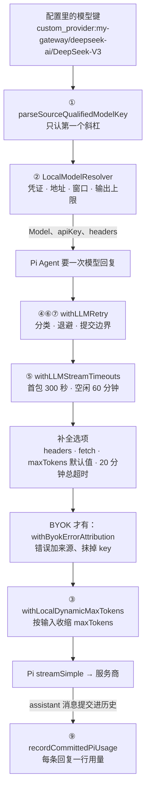
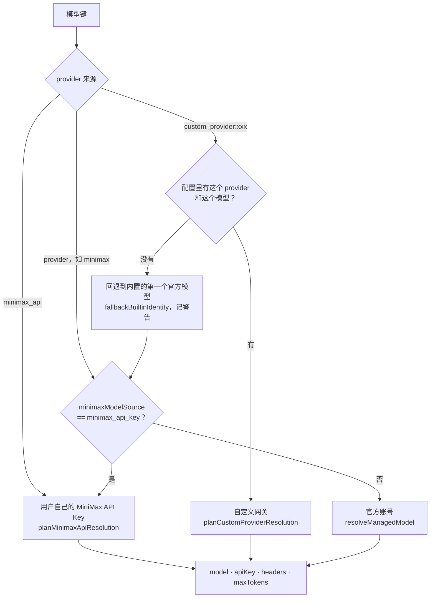
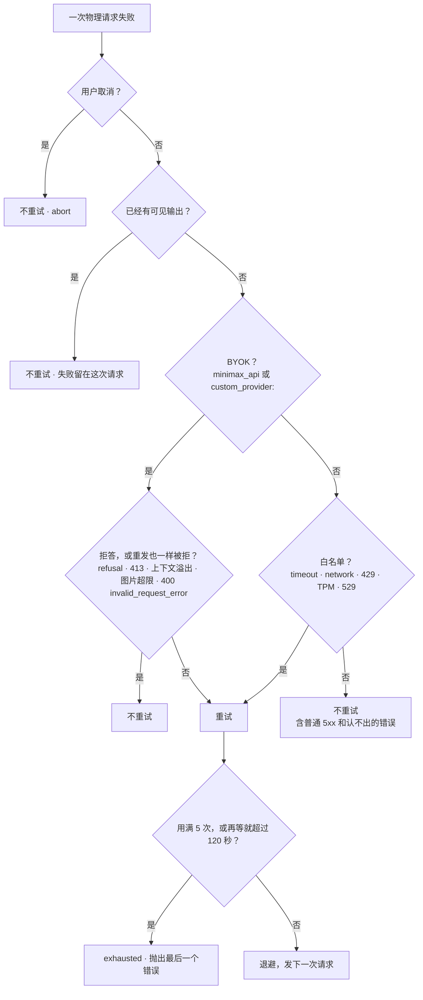

你在 `config.yaml` 里把默认模型写成 `custom_provider:my-gateway/deepseek-ai/DeepSeek-V3`，回到 `mcode` 敲下回车。第一个字出现之前，产品先要回答五个问题：

1. 这个字符串指哪个 provider 的哪个模型？
2. 用谁的凭证、发到哪个地址、窗口有多大？
3. 这次请求最多让模型写多少个 token？
4. 请求失败了，或者流卡住了，谁来重试、重试几次、哪些错误一次都不该重试？
5. 回复回来之后，用量记在谁头上？

Pi 只回答“拿到一个 `Model` 之后怎样和它说话”（它查模型用 `getModel(provider, id)`，两个参数，没有合成一个字符串的键）。MiniMax Code 要同时服务官方账号、用户自己的 API Key 和任意第三方网关，这五个问题只能自己答。下图是一次模型调用经过的地方，编号对应后面的小节：

::: note 版本
MiniMax 内置的 Pi 是 `third_party/pi-mono` 里的 v0.79.1，本章摘录的内核代码都是这一份。`@pi` 摘录的是 Learn Pi Agent 读的 v1.5.0，只用来对照。
:::

@figure assets/course/ch03-models.png 模型键分出凭证路线，预算随输入收缩；重试只能发生在第一个字之前

## 模型键：只认第一个斜杠

最顺手的拆法是 `key.split("/")[1]`。先看它和 MiniMax 的做法在同一批键上各得到什么：

@lab node labs/ch03/keys.mjs | md

第三行是真实网关的常见情形：模型 id 自己就带斜杠（`deepseek-ai/DeepSeek-V3`）。朴素写法拿到 `deepseek-ai`，后半截丢了，后面所有环节——查限额、拼请求、记用量——都在用一个错的身份。第四行反过来：空的 provider 名被它照单全收。

MiniMax 的解析器很短：

@mm packages/local-runtime-v2/src/service/model-system/resolution/model-key.ts#L19-L46 hl=23-24,26-28,30,37-38,41,44-46

- `parseProviderId`（L19-31）先判断 provider 属于哪种来源：`minimax_api` 是用户自己的 MiniMax API Key；`custom_provider:` 开头的是第三方网关，前缀后面才是配置里的 key，前缀后面为空直接拒绝；其余都是普通 provider（官方账号的 `minimax`、`openai-codex` 等）。
- `parseSourceQualifiedModelKey`（L33-42）只用 `indexOf('/')` 找第一个斜杠。斜杠在最前（`slash <= 0`）或最后（模型 id 为空）都返回 `undefined`；其余斜杠留在 `modelId` 里。
- `formatModelKey`（L44-46）是逆运算。后面“用量”一节的用量表就靠它把 `model` 字段拼回原键。

所以 provider 里可以有冒号，模型 id 里可以有斜杠，两者的边界只由第一个斜杠决定。三种来源不只是命名：它们决定下一节走哪条凭证路线。

## 键到凭证：同一个模型名，三条路

解析出键之后，resolver 要把它变成一次请求要用的全部材料：协议、地址、凭证、请求头、窗口、输出上限。选路线的过程是一棵决策树：

同一份配置里放着官方账号的令牌、一把 MiniMax API Key 和一个自定义网关，九个键各走到哪里：

@lab node labs/ch03/resolve.mjs | md

总入口只有八行：

@mm packages/local-runtime-v2/src/service/model-system/resolution/local-model-resolver.ts#L144-L151 hl=146-150

三次判断，前一次有结果就不看后一次：`selectModel` 按来源找 BYOK 方案；没有，`selectMinimaxByok` 看官方键有没有被开关改道；都没有才走官方账号。表里第 1 行和第 3 行是同一个键 `minimax/MiniMax-M3`，一个拿登录令牌发往 `agent.minimax.io`，一个拿用户自己的 key 发往 `api.minimax.io`，区别只在配置里的 `minimaxModelSource`。**键里写的 provider 不决定最终走哪条路，配置可以改道。**

`selectModel` 里藏着一个产品选择：

@mm packages/local-runtime-v2/src/service/model-system/resolution/local-model-resolver.ts#L291-L304 hl=298-303

来源是 `minimax_api` 或 `custom_provider`，却找不到对应的 BYOK 方案（配置被删了、模型不在列表里），不报错，`fallbackBuiltinIdentity`（L302）回退到内置的第一个官方模型，并打一条 warn 日志。删掉一个 provider 不该让所有引用它的会话打不开。代价是用户以为自己在用 A，实际在用 B：表里第 6、8 行就是这样，host 因此把回退写进 `resolved.warning`，不让它悄悄发生。

回退只覆盖“配置里没有它”。配置存在却不完整，要把话说清楚：

@mm packages/local-runtime-v2/src/service/model-system/resolution/model-resolver-byok.ts#L98-L119 hl=105-107,108-113

缺 key 抛 `api_key not configured for provider "…"`，缺地址抛 `base_url not configured`，都不回退（OAuth 型的自定义 provider 是例外，凭证稍后从登录态里取）。窗口和输出上限也在这一步定：自定义网关取模型自己声明的 `limit`，没声明的用 `BYOK_FALLBACK_MODEL_LIMITS`（`model-resolver-byok.ts` L18-21，窗口 200,000、输出 16,384）；官方模型查目录，查不到用 200,000 / 128,000（`local-model-resolver.ts` L87-90）。表里第 5 行的 65,536 / 8,192 就是网关配置里写的限额。

官方账号这条路没有 api key：

@mm packages/local-runtime-v2/src/service/model-system/resolution/local-model-resolver.ts#L775-L783 hl=780-782

`resolveCredentialApiKey` 在 `managed-login` 模式下，用户没配 key 就返回占位符 `sk-xxx`。真正的凭证在同一文件的 `resolveCredentialHeaders`（L799-812）：登录令牌 `authContext.accessToken` 被写进 `Authorization: Bearer …`，而且只在 `managed-login` 模式下才写（L806）。最后 `requireUsableCredentials`（L814-845）关门：占位符却没有 `Authorization`，抛 `managed OAuth bearer is not synced`——表里第 2 行，没登录就用官方模型，请求发出之前就报错。

“官方账号”由 `resolveProviderAuthMode`（`packages/config/src/provider-auth-mode.ts`）判断：显式配置优先，其次看地址是不是三个官方主机的 https origin，都不是就当 api-key；URL 里带用户名密码的一律不算官方，因为真正的授权方是谁说不清（L39-42 的注释）。这个文件没有外部依赖，上面输出的第二张表就是从固定提交装载的真实函数，和 host 的版本逐项对照。

## 输出上限不是常数

窗口和输出上限是两个数。MiniMax-M2.7 的窗口 200,000，输出上限 128,000；输入已经用掉 100,000 时，再要求模型“最多写 128,000”，这个请求本身就超出窗口了。表里“动态预算”一列是真实上游的 `resolveDynamicMaxTokens`：

@lab node labs/ch03/budget.mjs | md

从上往下读：输入 10,000 时预算是配置值 128,000；到 70,000 刚好开始收缩；100,000 时是 97,952；到压缩触发线 142,500 时剩 55,452；输入到 181,568，预算触底 16,384，再大也不降。公式在这里：

@mm packages/agent-modules/context-manager/src/provider-budget.ts#L7-L17 hl=14-16

`remaining` 是窗口减去估算的输入，再减 2,048 的安全余量。结果是 `min(配置值, max(地板, remaining))`，地板 `outputFloor` 取 `min(配置值, 16,384)`（L86-88，16,384 来自 `DEFAULT_CONTEXT_MANAGER_SETTINGS.reserveTokens`）。地板的含义：输入再大也不把输出挤到 16,384 以下，因为输入大到这个程度是**压缩**的事，不是继续压输出的事。181,568 恰好就是 `resolveCompactionTokenBudget` 给出的输入硬上限，两个公式用同一把尺子（`dynamic-max-tokens.ts` L45-48 的注释写明“与压缩触发线的 16k 预留保持一致”）。

包装函数把公式接进每一次请求：

@mm packages/local-runtime-v2/src/service/model-system/resolution/dynamic-max-tokens.ts#L50-L71 hl=54-56,57-63,65-66,67-69

- L54-56：窗口或配置值缺一个，原样放行。
- L57-63：从请求选项里取出重试身份（`LLM_RETRY_CALL_IDENTITY`，一个 symbol 键）；这个身份在 `WeakMap` 里已经有预算，直接用旧的。
- L65-66：否则按当前上下文算一份，有身份就存起来。
- L67-69：算出来不比配置值小，选项原样放行，收缩了才改 `maxTokens`。

收缩时还要处理思考预算：

@mm packages/local-runtime-v2/src/service/model-system/resolution/dynamic-max-tokens.ts#L73-L99 hl=81-85,89-93,96-98

收缩后的值是 `max(1024, desired − thinkingBudgetTokens)`（L89-93）。为什么要减？看 Pi 怎么用 `maxTokens`：

@mm third_party/pi-mono/packages/ai/src/providers/simple-options.ts#L47-L49 hl=48-49

Pi 的 Anthropic 适配器把思考预算**加**在基础 `maxTokens` 上（封顶到模型上限）。MiniMax 先减后加，总量回到 `desired`：上面 budget 实验里 medium 思考（预算 8,192）的 `maxTokens` 是 89,755，Pi 加回 8,192，总量 97,947，等于不开思考时的预算。`thinkingBudgetTokens`（L109-116）只对 `anthropic-messages` 生效，`forceAdaptiveThinking` 的模型不扣。L96-98 是紧急分支：估算本身抛异常，只要 1 个 token 并关掉推理，宁可很快失败，也不发一个没有边界的请求。

Claude Code 走的是反方向：先按配置发出去，服务端用 400 回一句“input length and `max_tokens` exceed context limit: A + B > C”，客户端解析三个数，用 C − A − 1000 作为 `maxTokensOverride`（不低于 3000）再重试（`withRetry.ts` 的 `parseMaxTokensContextOverflowError`）。一个事后补救，多一次往返；一个事前估算，要自己承担估算误差。MiniMax 的余量不够时，服务商返回的上下文溢出会被分类成“重发也一样被拒”，不重试，留给压缩（第 6 章）。

最后一张表是**重试钉住预算**。同一次逻辑调用的所有物理重试共用一个 identity，预算只算第一次；表里刻意在第一次失败之后给请求追加了 7 万 token：同一个 identity 的重试仍用 97,947，换成新的调用才重新算出 27,947。真实流程里请求在重试期间不会变，这个构造只是让“钉住”这个动作看得见。钉住的好处是推断出来的，不是代码写明的：它让“重试就是把同一个请求再发一遍”不依赖估算器是否确定，也省得对整段上下文重新做一次分词估算。

## 重试是谁的事：请求穿过的包装

预算只是链条上的一环。一次模型调用从 Pi 的 Agent 出发到服务商，要穿过一串 `StreamFn` 套 `StreamFn` 的包装。开头那张图的中间一段由 `composeStreamFn` 搭起来：

@mm packages/agent-core/src/pi-turn-runner/llm.ts#L15-L42 hl=22-24,31-32,33-35

变量名从内到外读：`hostClamped`（宿主的输出上限）→ `cacheWrapped` → `maxTokensWrapped` → `headerWrapped` → `fetchWrapped` → `requestBounded`（给每个请求加 20 分钟的总超时，`LLM_REQUEST_TIMEOUT_MS`）→ 最外面的 `withLLMStreamTimeouts`。最里面的 `resolved.streamFn` 就是 resolver 产出的那个，动态预算在它里面；BYOK 的错误归因包在动态预算外面（`local-model-resolver.ts` L703-713）。L33-35 的注释说破了顺序的原因：每一次重试都会重新调用这个函数，所以看门狗放在最外，**每次物理请求都有自己的计时器**。

重试在 `composeStreamFn` 的外面。`newTurn`（`turn.ts` L146-166）把它交给 `withLLMRetry`，而 local-runtime-v2 的执行器总会传一个 `llmRetry` 对象（没配置时是 `{}`，`turn-execution-policy.ts` L48-56），所以默认策略总是生效。压缩请求也走同一套，只是 `scope` 是 `compaction`。

重试只有一个主人。每次尝试都带着 `maxRetries: 0`：

@mm packages/agent-core/src/pi-turn-runner/llm-retry.ts#L371-L385 hl=373,379-384

Pi 的适配器自己也会重试，MiniMax 在这里把它关掉，让“预算、退避、可见的重试事件”都归 `withLLMRetry`（上游有一条测试就叫“disables provider-native retries so the framework owns the request budget”）。同一处还把 `callIdentity` 放进选项：它是 enumerable 的 symbol 键，能穿过中间一层层 `{...options}` 展开的包装，又不会进入 JSON 或发给服务商的请求体（L381-383 的注释）。

Pi v1.5.0 的重试长这样：

@pi packages/ai/src/utils/provider-retry.ts#L24-L36 hl=30-35

@pi packages/ai/src/api/anthropic-messages.ts#L660-L669 hl=661-668

它按状态码判断（408、409、429、≥500，或没有状态码；服务端的 `x-should-retry` 头优先），并且只包住“发出请求、拿到响应”这一步，响应头到了、流开始之后就不再管。MiniMax 的规则两头都不一样：官方账号不重试普通 5xx，重试的边界也不是响应头，而是下面的“第一个可见输出”。

## 卡住的流：两个看门狗

连接没断、也没报错，服务商只是不说话了——这种情况没有异常可抓。`withLLMStreamTimeouts` 给每次物理请求配两个计时器：

| 计时器 | 默认值 | 覆盖方式 |
| --- | --- | --- |
| 整个 HTTP 请求（`timeoutMs`） | 20 分钟（`defaults.ts` L21） | 上游包装已设置的值优先 |
| 等第一个事件 | 300 秒（L34） | `MCODE_LLM_FIRST_EVENT_TIMEOUT_MS`，或模型自己的 `firstEventTimeoutMs`；0 关闭 |
| 两个事件之间的空闲 | 60 分钟（L50） | `MCODE_LLM_STREAM_IDLE_TIMEOUT_MS`，或 `streamIdleTimeoutMs`；0 关闭 |

内置适配器在响应头到达之后才发第一个事件，所以“首包”实际是等响应头。空闲值大得出奇有它的理由：只有解析出来的模型事件会重置计时器，SSE 注释心跳不算，一个缓冲整个回复、只发心跳的网关会让整段生成都像“空闲”，而长思考加大输出可以生成三十多分钟（L36-49 的注释）。

@mm packages/agent-core/src/pi-turn-runner/llm-stream-timeout.ts#L111-L129 hl=115,119-125,128

`arm` 清掉旧计时器、设新的。到点时：`finish()` 收尾；`controller.abort(new LLMStreamTimeoutError(message))` 让里面的请求停下；再往外推一个 `type: 'error'` 事件，`stopReason` 是 `'error'` 而**不是** `'aborted'`（L121）。这一点决定了后面的一切：重试层把 `error` 当传输超时去重试，把 `aborted` 当用户取消去放弃（`withLLMStreamTimeouts` 的注释 L70-73）。用户自己的取消直接穿过，L115 的 `callerSignal?.aborted` 保证它永远不会被说成超时。L128 的 `unref()` 让看门狗不会单独撑住进程。

## 重试的规矩：五次、退避、第一个字之前

看门狗把“卡住”变成了错误，`withLLMRetry` 决定怎么办。先看同一批故障在四种策略下各是什么结果（时间是虚拟的，瞬间跑完）：

@lab node labs/ch03/retry.mjs | md

逐行读：

- **529**：响应头已经到了才在流里报 529，屏幕上还没有字。朴素重试和 MiniMax 都成功；MiniMax 等了 0.75 + 1.5 秒（随机量取中间值），界面依次收到 `waiting`、`waiting`、`recovered`。
- **401**：朴素重试白发 6 次、白等 5 秒；官方账号 1 次就失败。BYOK 那一格 6 次 23 秒，原因见下一节。
- **说了半句话，连接断了**：朴素重试把“我先看看”又说了一遍，屏幕上是“我先看看我先看看入口文件。”；MiniMax 一次都不重试。
- **每次等满 300 秒才超时**：朴素重试耗掉半小时；MiniMax 只发 2 次请求。

后两行是两条规矩，各有一段源码。第一条是次数和时间的上限：

@mm packages/agent-core/src/pi-turn-runner/llm-retry.ts#L276-L302 hl=278,280,281-282,283-294

默认策略写在 L45-50：最多 5 次重试（一共最多 6 次物理请求）、基础延迟 1 秒、延迟封顶 30 秒、总时长 120 秒。这几行做三件事：算延迟 `retryDelayMs`——指数退避，再取一半到全部之间的随机值（`floor(exp/2 + random·exp/2)`，退避表里第 1 次是 0.5～1.0 秒，第 5 次是 8～16 秒），服务端给了 `Retry-After` 就听服务端的，同样封顶 30 秒（L905-914）；记下第一次失败的时刻（`retryStartedAtMs ??= failureAtMs`，**从第一次失败起算**）；若已用满 5 次，或者“当前时刻 + 要等的时间 − 第一次失败时刻”超过 120 秒，就发 `exhausted` 并抛出最后一个错误。每次等 300 秒才超时的请求，第二次失败时离第一次已经 300 秒，所以只发了 2 次。上游测试 “stops before a backoff that would exceed the retry elapsed-time budget” 把这条边界钉死了。

第二条是**提交边界**：

@mm packages/agent-core/src/pi-turn-runner/llm-retry.ts#L460-L475 hl=460-464,465

`preflightAttempt` 读流的时候，每个事件先进 `buffered` 缓冲，不放给调用方。遇到 `commitsOutput` 为真的事件（非空的文字或思考增量、工具参数增量、`toolcall_end`），才“提交”：缓冲的事件连同后面的流一起通过 `replayStream` 交出去。提交之前的任何错误都走 `failureResult` 判断要不要重试，被丢弃的那次请求的缓冲事件永远不会被调用方看到；提交之后的失败留在这次请求上，原样抛给上层。`start` 事件不算，它只说明响应头到了。L460-464 的注释把理由讲透了：调用方一旦看得见输出，悄悄换一次请求，要么得把整条回复缓冲起来，要么会重复内容。对 BYOK 同样适用。

重试的每个状态都往外报：`waiting`（带延迟和 `nextRetryAtMs`）、`recovered`、`exhausted`、`cancelled`。宿主把它们写成全局事件 `session.llm_retry`（`services.ts` L929），TUI 才能显示“4 秒后重试（2/5）”。

## 哪些错误不重试

知道什么时候重试之后，还要知道对什么错误重试。下面十八种错误交给真实的分类器（`llm-error-classifier.ts` 没有任何依赖，直接装载）。BYOK 列是按 `failureResult` 的判断式（下一段的摘录）用真实函数组合出来的：

@lab node labs/ch03/errors.mjs | md

整条判断路径是：

官方账号走的是白名单：

@mm packages/shared/src/llm-error-classifier.ts#L389-L434 hl=393-405,414-415,417-433

先排除：取消、套餐用量、余额、内容过滤和拒答、认证失败，一律不重试（L393-405）。它们的优先级高于外层看起来可重试的状态码——L383-387 的注释写明，产品的配额、余额、认证和显式取消总是压过一个看似临时的 HTTP 状态。然后才是白名单：超时（L414）、网络（L415）、协议码 50111/50150/50151（限流、TPM 限流、集群过载）、429、529。最后一行 `return { retryable: false, … }`，**普通的 500、502 和认不出的错误，一律不重试**：宁可失败，不去猜。

BYOK 的规则相反：

@mm packages/agent-core/src/pi-turn-runner/llm-retry.ts#L592-L607 hl=600-607

`retryAllErrors` 为真时（provider 是 `minimax_api` 或以 `custom_provider:` 开头），输出之前的失败几乎都重试，只排除四种：显式取消、拒答、`isLLMDeterministicRequestRejection`（图片数超限、请求太大、上下文溢出、400 加 `invalid_request_error`，表里最后一组“不重试”）、Pi 判定的上下文溢出。注释给了理由：自定义网关报错的口径五花八门，一个 401 可能是网关抖了一下。代价你在 retry 实验里看到了：配错 key 的用户要等 23 秒才看到 401。这不是推演出来的巧合，上游有一条测试专门钉住：

@mm packages/agent-core/test/unit/pi-turn-runner/llm-retry.test.ts#L567-L582 hl=571,578,581

用 `minimax_api` 的模型，返回 401，`attempts` 是 6——测试的名字叫“不论错误怎样分类，BYOK 最多五次重试”。要补一句：真实调用链里，BYOK 的错误先被 `withByokErrorAttribution` 包成 `BYOK upstream error: {…}`、抹掉 key，再交给重试层（上游测试里有专门的“BYOK-attributed form”用例）。本章实验喂给分类器的是原始错误。

重试层放弃之后，这个失败变成 Turn 的终态错误，上面带着 `retryable` 标志：

@mm packages/local-runtime-v2/src/service/turn-system/runtime-error-retry-policy.ts#L3-L12 hl=4-7

四个协议码里有 `LLM_UPSTREAM_ERROR`（50113，通用的上游失败兜底码），所以 Turn 级的“值得再来一次”比传输层宽。TUI 读这个标志决定要不要给用户提供 `retry` 命令（`chat-controller.ts` L637-L642）。两层各管一件事：传输层把同一个请求再发一遍，Turn 层让用户把同一条消息再发一遍。

## 产品为什么要改内核：两个补丁，一份措辞约定

`third_party/pi-mono/MINIMAX_CHANGES.md` 是 MiniMax 给 Pi 打补丁的台账，每条写明原因、影响范围和是否可回馈上游。和模型协议有关的条目里，有两条把内核和宿主连在了一起：补丁改的是内核发出的**错误措辞**，宿主的分类器靠措辞做决定。

**补丁一：没有 stop_reason 的流**（台账 2026-10-29）。Anthropic 兼容端点会把消息截在思考中途：发一个 `stop_reason` 为空的 `message_delta`，随后 `message_stop`。v0.79.1 的 `streamAnthropic` 把 `stopReason` 初始化成 `"stop"`，`message_delta` 只在值为真时才覆盖，于是截断的回复看起来像正常结束——Turn 悄悄停下，没有报错，也不重试。补丁在读事件的地方加了一道检查：

@mm third_party/pi-mono/packages/ai/src/providers/anthropic.ts#L516-L529 hl=520-528

`sawStopReason` 在任何一个 `message_delta` 带着非空字符串的 `stop_reason` 时置位（L483-485；早先的 delta 可以是 null，所以要看整条流）。流读完，见过 `message_start` 和 `message_stop` 却没见过 `stop_reason`，就抛 `Anthropic stream ended without stop_reason (…)`；`streamAnthropic` 已有的 `catch` 把它变成 `stopReason: "error"` 加 `errorMessage`，已经收到的内容保留。诊断里只放计数和耗时，不放正文。

同一个洞，Learn Pi Agent 第 2 章讲的 v1.5.0 用另一种方式补上了：

@pi packages/ai/src/api/anthropic-messages.ts#L894-L898 hl=896-898

v1.5.0 把初始值改成 `"pending"`（同一文件 L601），流结束时仍是 `pending` 就抛。这是台账里“可回馈上游”那一类条目的典型结局：上游自己用另一种方式修了，第 11 章会教你怎样去核对。

补丁到这里还没完。内核抛出的是一句话，宿主得认得它：

@mm packages/shared/src/llm-error-classifier.ts#L228-L240 hl=228-232,235-240

`normalizeLLMError` 在读状态码和数字之前，先找这两个标记。L235-240 认出“stream ended without stop_reason”之后，只留一个 `incomplete_stream` 信号就返回，注释说得直白：诊断里的计数和耗时（429、1008、2066……）长得像状态码，必须挡在外面。下面的实验把措辞换掉再试一次：

@lab node labs/ch03/patches.mjs | md

前三行是同一个故障。补丁的原话被归为 `unknown`；**诊断数字不变、措辞换一句**，里面的 `1008` 就被读成“余额不足”（这一行是我构造的假设，用来说明措辞就是接口）；Pi v1.5.0 的措辞没有诊断数字，也归为 `unknown`。

**补丁二：拒答详情**（台账 2026-10-01）。Claude 的安全分类器拒答是 HTTP 200 加 `stop_reason: "refusal"`。v0.79.1 把它映射成 `error`，对外只剩一句 “An unknown error occurred”，丢了 `category` 和 `explanation`，还让 BYOK 把它当未知故障重试。补丁让内核发出一句有固定标记的话：

@mm third_party/pi-mono/packages/ai/src/providers/anthropic.ts#L1346-L1354 hl=1347-1348,1350-1353

注释写得清楚：`stop_reason: refusal` 这个标记让宿主**不用解析服务商控制的解释文字**就能认出拒答。宿主的另一半在分类器里：`isLLMProviderRefusalMessage`（L75-80）匹配标记，`normalizeLLMError` 认出之后立刻返回（L228-232），解释文字不再喂给任何启发式。实验的后四行：带标记的拒答归 `content_filter`，两种账号都不重试；解释里碰巧写了 `429`、`timed out`、`ECONNRESET`，结论不变；**没有标记**时（假设）解释里的 `timed out` 就决定了结论，变成 `timeout`，会被重试。最后一行是 v1.5.0 的措辞（`stopDetails?.explanation || "The model refused to complete the request"`，`anthropic-messages.ts` L1671-1675），它没有这个标记，在同一个分类器里是 `unknown`，BYOK 会重试——这是读两份代码得到的推断，不是线上观察到的行为。

这给“升级 Pi 版本”提了个醒：靠措辞维系的接口，最容易悄悄失效。MiniMax 的办法是把测试放在自己的仓库里——台账的 Validation 一栏指向 `@mavis/shared` 的分类器测试和 `@mavis/agent-core` 的重试测试。

同一份台账里还有四条结构相似的补丁（2026-09-19）：Mistral、SiliconFlow、DashScope、Kimi Coding 的网关不认 Pi 在“思考开启”时发的 `developer` 角色，补丁让内核对这几个确切的主机默认用 `system`。内核只能按主机名猜，猜不到的交给配置——`LocalModelCompatOverrides`（`contracts.ts` L24-31 的注释）让用户在 provider 配置里逐个模型声明协议细节，Pi 会让这些字段排在自己的探测之前。

## 用量：每条提交的回复一行

回复回来之后记账。用量记在哪个时机，比记多少更重要：不是每次物理请求，而是每条**提交进历史**的 assistant 消息。真实的 `recordCommittedPiUsage` 对一串消息落账：

@lab node labs/ch03/usage.mjs | md

@mm packages/local-runtime-v2/src/service/session-system/usage/pi-usage.ts#L39-L62 hl=54-56,58-59

`committedPiUsageRows` 遍历消息，每条带 `usage` 的 assistant 消息一行，逐行 `append`。表里“只给 total_tokens”的消息把 total 当作输入（`normalizePiUsage` L161-162），“没有 usage”和“全是 0”的消息直接跳过。`catch` 里只调用 `reportUsageFailure`，不重新抛出（文件里的注释：用量是历史提交之后的尽力投影）。所以用量写不进去，只会少一行账，不会让一次成功的调用变成失败。下半张表是重试的影响：两次 529 之后成功，3 次物理请求只留 1 行；一直失败，没有回复就没有用量。这有源码依据——`LLMCallUsage` 的注释写着“一次成功调用的最后一次尝试的原始用量”（`llm-retry.ts` L74）。

`model` 字段是怎么来的：

@mm packages/local-runtime-v2/src/service/session-system/owner.ts#L819-L825 hl=823

`${provider}/${id}`，provider 取自 Pi 的 `Model`——自定义 provider 是完整的 `custom_provider:my-gateway`，id 带着斜杠——拼出来恰好是配置里的原键（`createUsageProjector`，L699-725，在落下至少一行时才通知订阅者）。第一节的 `formatModelKey` 在这里闭环：按 model 汇总的用量，能直接对上配置里的键。目标（goal）功能另有一套口径：`summarizeCommittedPiGoalUsage` 不含缓存读写，并用 `incomplete` 区分“缺用量”和“用量为零”。

## 为什么这样设计

| 问题 | Pi v1.5.0 | Claude Code 2.1.88 | MiniMax Code 0.7.2 |
| --- | --- | --- | --- |
| 模型标识 | `getModel(provider, id)`，两个参数 | — | 一个字符串键，三种来源前缀，只认第一个斜杠 |
| 输出上限 | 调用方传；思考预算加在 `maxTokens` 上 | 先发；服务端 400 报溢出后解析、调整、重试 | 事前按输入收缩，地板 16,384；同一次调用的重试钉住 |
| 谁重试 | provider 层，按状态码，只包请求阶段，默认次数由调用方给 | `withRetry`：默认 10 次，500 毫秒起指数退避加 25% 抖动，上限 32 秒 | `withLLMRetry`：5 次，1 到 30 秒，总计 120 秒，Pi 自带重试关闭 |
| 过载（529） | 同其他 ≥500 | 后台来源（标题、摘要之类）直接放弃，只有前台来源重试；Opus 上连续 3 次 529 切到备用模型（`MAX_529_RETRIES`） | 官方账号和 BYOK 都重试 |
| 流中途失败 | 不重试 | — | 第一个可见输出之后不重试 |
| 流卡住 | 整个请求的 `timeoutMs` | — | 首包 300 秒、空闲 60 分钟，超时按可重试的传输错误处理 |
| 用量 | 每条回复自带 `usage` | — | 提交后每条回复一行，按原键可汇总 |

取舍：

- **官方账号只重试白名单，BYOK 几乎全重试。** 官方网关的错误口径统一，白名单可以维护；第三方网关的口径各异，与其漏判不如多试。代价是配错 key 要等 23 秒，上游为此写了测试。
- **提交边界换来不重复、不缓冲，代价是中途断流不会自动续。** 用户会看到半句话和一个失败的 Turn，由 Turn 级的 `retryable` 决定要不要提供重试命令。
- **地板换来输出不被无限挤小，代价是压缩没赶上时请求可能被服务商拒绝。** 这类拒绝是确定性拒绝，不重试，等压缩接手。
- **单一重试主人（`maxRetries: 0`）换来预算、退避、事件都在一处，代价是要自己复刻 Pi 和 SDK 本来有的行为**，比如 `Retry-After`。
- **回退到内置模型换来会话不会因为一个被删的 provider 打不开，代价是用户可能没注意到自己换了模型**，所以回退必须带警告。

## 动手：host 里的模型层

`host/src/models.mjs` 把上面八件事各写成一个短函数，文件头的注释说明了每一块对应上游的哪个文件。保持不变的导出（`parseModelKey`、`BudgetResolver`、`scriptedKernel`）仍被第 1、2、9、11、12 章的实验和 `host/src/app.mjs`、`host/src/cli.mjs` 使用。host 的“模型”是一个函数 `kernel(request, signal, call)`，第三个参数 `call` 带着重试层创建的 `identity` 和 `emit`；第 2 章的 `runTurn` 只传前两个参数，不受影响。

键到凭证，对应 `LocalModelResolver.resolveModel`：

@code host/src/models.mjs#resolveModel hl=113,115-118,121-123

先 `selectModel`，再看开关改道，最后才走官方账号。回退产生的警告随 `finishResolve` 一起返回。

预算，对应 `withLocalDynamicMaxTokens` 里的 `WeakMap`：

@code host/src/models.mjs#BudgetResolver hl=265-266,268-269,282,286

`resolve` 查表命中就直接返回；`compute` 里 `input >= window` 的准入检查是 host 的简化（上游把它交给压缩和请求准入），第 286 行减思考预算。

分类，对应 `toLLMRetryDecision` 加 `failureResult` 的 BYOK 分支：

@code host/src/models.mjs#classifyError hl=377-379

重试，对应 `withLLMRetry`：

@code host/src/models.mjs#withRetry hl=416,420,422,427,433-440,449-454

每次物理请求建一个提交缓冲（L420），模型通过 `call.emit` 流出事件；L427 是两条规矩之一：取消，或者已经有可见输出，立刻抛出；L433-440 是次数和 120 秒上限。

组装，顺序与上游一致：

@code host/src/models.mjs#composeModel hl=625,631,632,635

用量(最外) → 重试 → 看门狗 → 预算 → 模型本身。

简化的地方：模型是整条回复的函数，流式事件用 `emit` 回调表达；令牌估算按“字符数 / 4”；错误分类只认平铺的 `status`、`code`、`message`，上游还会顺着 `cause` 和 `responseBody` 往里找；用量在模型边界记账，因为 host 的消息不带 `usage`，效果与上游相同（重试掉的物理请求没有回复，不产生行）。

## 实验：host 与真实上游逐项对照

左边是 MiniMax Code 的原文件（`importSource` 装载，白名单里新增了 `llm-error-classifier.ts`、`provider-budget.ts`、`settings.ts`、`provider-auth-mode.ts`、`pi-usage.ts`，都不依赖外部包），右边是 host 的版本：

@lab node labs/ch03/compare.mjs | md

四项对照没有一个不一致。完整的回归检查（60 项，含看门狗用真实的毫秒级计时器、接进第 2 章 `runTurn` 的 Turn）在 `node labs/chapters/03-models.mjs`。上游的重试循环本身依赖 `@earendil-works/pi-ai`，装载不了，所以重试的次数、延迟和边界是 host 按源码复刻的，数字与上游测试里的断言（退避 500、1000、2000、4000、8000，六次请求后 `exhausted`）一致。

## 你来改

先写下预测，再改代码、运行对应脚本。改完之后脚本末尾的断言会失败，表格仍会先打印出来。

::: predict 取消预算的钉住
删掉 `BudgetResolver.resolve` 里的 `if (pinned) return pinned;`，运行 `node labs/ch03/budget.mjs`。最后一张表第二行（同一次逻辑调用的重试）的预算会变成多少？
???
变成 27,947，和第三行相同。没有查表，重试时按已经变大的请求重新算了一遍。上游用 `LLM_RETRY_CALL_IDENTITY` 做 `WeakMap` 的键，保证同一次逻辑调用的所有物理请求带同一个 `maxTokens`；新的用户消息是新的调用，新的 identity，重新算。这里请求在重试期间被刻意改过，真实流程里它不会变，钉住防的是估算不稳定和重复分词。
:::

::: predict start 事件也算提交
把 `commitsOutput` 改成 `return true`（任何事件都算可见输出），运行 `node labs/ch03/retry.mjs`。第一行“连续两次 529”官方账号一格会怎样？
???
变成 1 次请求、失败（overloaded）。场景里的 529 是在响应头之后（先发了 `start`）才报错，`start` 一旦算提交，失败就被留在这次请求上，不再重试。`start` 只说明响应头到了，屏幕上还什么都没有，不该算可见输出：这正是上游 `commitsOutput` 只认非空文字、思考、工具参数的原因。
:::

::: predict 把普通 5xx 加进官方账号的白名单
在 `MANAGED_RETRYABLE` 里加上 `"server_error"`，运行 `node labs/ch03/errors.mjs`，再运行 `node labs/ch03/retry.mjs`。
???
`errors.mjs` 里 500、502 两行的“host 一致”变成“否”，因为真实分类器对官方账号仍是“不重试”，对照表立刻暴露了偏差。`retry.mjs` 里“自定义网关偶尔返回 500”官方账号一格变成 3 次请求、成功，和 BYOK 一样。MiniMax 不这样做的理由是：官方网关的 5xx 没有统一含义，宁可失败，不去猜；BYOK 才把“多试几次”当作对网关不可靠的补偿。
:::

## 面试题

::: interview 模型键 `custom_provider:my-gateway/deepseek-ai/DeepSeek-V3` 应该怎么解析？为什么？凭证又从哪来？
解析：只用第一个斜杠切开。左边 `custom_provider:my-gateway` 是 providerId，前缀决定来源（`provider`、`minimax_api`、`custom_provider` 三种），后面的 `my-gateway` 是配置里的 key；右边 `deepseek-ai/DeepSeek-V3` 整体是模型 id。`split("/")[1]` 会丢掉后半截，让查限额、拼请求、记用量全部用错身份。任何一侧为空返回 `undefined`，不猜默认归属。

凭证：按来源选路线。官方账号用登录令牌（api key 是占位符 `sk-xxx`，令牌放 `Authorization: Bearer`）；`minimax_api` 和自定义网关用配置里的 key。`minimaxModelSource` 开关能把官方键改道到用户自己的 API Key；provider 或模型被删时回退到内置模型并告警。加分点：配置存在却缺 key 或地址要报错，不回退；URL 带用户名密码不算官方地址。
:::

::: interview 最大输出 token 怎么动态算？为什么要有地板？重试时为什么不重算？
公式：`min(配置值, max(地板, 窗口 − 估算输入 − 2,048))`，地板是 `min(配置值, 16,384)`。输入小时等于配置值，输入变大输出被挤小，挤到地板不再降，再大的输入归压缩处理；181,568（200k 窗口）这个点正好是输入硬上限，与压缩触发线用同一把尺子。思考预算要扣掉，因为 Pi 的 Anthropic 适配器会把它加回 `maxTokens`。

重试不重算：同一次逻辑调用的物理重试共用一个 identity，预算存在 `WeakMap` 里，保证“重试就是同一个请求再发一遍”。新的用户消息是新的调用，重新算。加分点：说明这个理由是推断（代码没写），并对比 Claude Code 的事后解析 400 再调整。
:::

::: interview 请求失败或流卡住时，谁来重试？重试几次？哪些错误不重试？
谁：`withLLMRetry`（agent-core），Pi 自带的重试被 `maxRetries: 0` 关掉，所以只有一个主人。几次：默认最多 5 次重试（共 6 次物理请求），延迟从 1 秒起指数增长、封顶 30 秒、取一半到全部之间的随机值，`Retry-After` 优先；从第一次失败起算，等待会让总时长超过 120 秒就放弃。卡住：首包 300 秒、空闲 60 分钟两个看门狗，超时以 `error`（不是 `aborted`）结束，所以被当作可重试的传输超时。

不重试：官方账号只重试超时、网络、429、TPM 限流、529；普通 5xx 和未知错误不重试，取消、拒答、认证、余额、套餐用量一律不重试。BYOK 输出之前几乎全重试，排除取消、拒答和“重发也一样被拒”的请求（413、上下文溢出、图片超限、400 invalid_request_error）。加分点：BYOK 连 401 也重试，上游有测试钉住。
:::

::: interview 为什么重试只能发生在第一个可见输出之前？
调用方一旦看得见输出，悄悄换一次请求，要么得把整条回复缓冲到结束再放出，要么把前一次已经显示的内容再发一遍。MiniMax 的 `preflightAttempt` 把事件先缓冲，遇到非空文字或思考增量、工具参数增量、`toolcall_end` 才“提交”，之前的失败可以重试，之后的失败留给上层。`start` 事件（响应头到了）不算提交。

代价：流中途断开不会自动续，Turn 以失败结束，由 Turn 级的 `retryable` 决定界面是否提供重试命令。加分点：说出对 BYOK 同样适用，以及实验里“朴素重试把半句话说了两遍”的现象。
:::

::: interview 为什么 MiniMax 要给 Pi 打“没有 stop_reason”和“拒答详情”这样的补丁？这种补丁有什么风险？
因为内核发出的错误文字就是宿主分类器的输入。截断的 Anthropic 流在 v0.79.1 里看起来像正常结束，Turn 悄悄停下，补丁让内核抛出带标记的错误；拒答原来只剩 “An unknown error occurred”，补丁加上 `stop_reason: refusal` 标记，宿主据此不重试，也不让解释文字里的数字干扰分类。

风险：措辞就是接口，换一句话分类就变（实验里同样的诊断数字换措辞被读成“余额不足”）；升级内核时最容易悄悄失效，Pi v1.5.0 已经用 `pending` 初始值修了前一个问题，它的拒答措辞也没有这个标记。对策是把测试放在自己的仓库里，台账记下原因和验证方式。
:::

::: interview 用量是怎么记的？重试会不会重复记账？
用量记在每条提交进历史的 assistant 消息上：`recordCommittedPiUsage` 遍历消息，有 `usage` 的 assistant 消息一行，没有或全为 0 的跳过；只给 `total_tokens` 的服务商，total 当输入；`model` 字段是 `provider/id`，拼回去就是配置里的原键，可以按键汇总。落账是历史提交之后的尽力投影，失败只报告，不影响本次调用。

重试不会重复记账：被丢弃的物理请求没有对应的消息，成功调用的用量只取最后一次尝试。goal 功能另有口径（不含缓存读写，用 `incomplete` 区分缺失和零）。
:::
