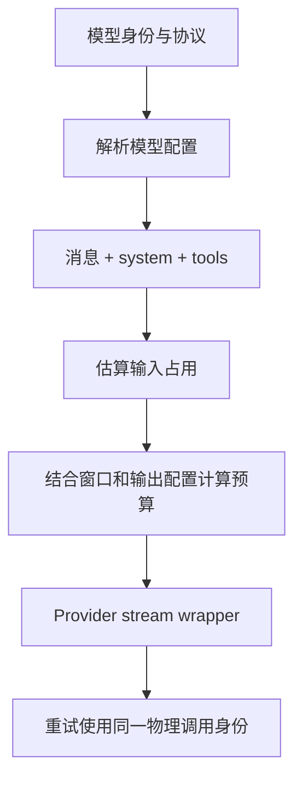

## 本章的问题

配置里是 provider/org/model。用 split 后取第二段，只得到 org；模型命名空间丢失，后续认证、请求和 usage 归因都可能错位。错误很小，却横跨多个产品边界。

另一个问题是重试：如果每次都重新调整输出预算，传输层宣称重试同一请求，实际却不断改变条件。host 为物理调用提供一个 identity 对象，用 WeakMap 保留该次预算；真正的新调用使用新身份。

## 沿固定源码逐段拆解

@source model-identity

### 只用第一个 slash 切身份

parseSourceQualifiedModelKey 先判断输入类型，再找到第一个分隔位置。Provider 与 modelId 都必须非空，其余 slash 保留在 modelId 中。parseProviderId 再解释来源，不是把所有 id 看成同一种配置。

@source budget

### withLocalDynamicMaxTokens 包装实际模型请求

预算需要 system、messages、tools 的整体消耗，不能只看用户文本。模型窗口、configured maxTokens、thinking 和恢复分支共同影响结果。retry identity 让同一物理重试复用预算，避免重试期间出现参数漂移。

@source usage

### 成功推理和正确归因可分别失败

SessionUsageService 在进入 store 前校验时间范围与分组。from=0 不是缺省；非整数、无限值、倒置区间要明确拒绝。即使查询校验通过，也不能证明写入 ledger 的模型字段正确。

host 的 token 估算使用可读的字符近似，目的在于解释预算 owner 与重试身份。它不是模型 tokenizer，也没有声称精确计费。

## 机制总览



## 接入贯穿项目

@implementation 03-models

### 逐步跟踪本章实现

parseModelKey 找第一个斜杠，前半是 providerId，后半完整保留为 modelId。因此 `provider/team/model` 的模型 id 是 `team/model`，按 split 后只取前两项会截断合法身份。没有分隔符或任何一侧为空则返回 undefined，不制造默认归属。

BudgetResolver 用请求对象 identity 作 WeakMap key。相同 identity 的 retry 读取已经决定的预算，即使配置后来变化也不重算；下一次模型调用用新的 identity，就按新请求大小重新计算。预算的 owner 是一次调用，而不是字符串相同的模型名或整个会话。

估算输入后，maxTokens 取配置上限和窗口剩余量中的较小值；thinking 必须非负并严格小于输出预算。资源不足时先拒绝请求，避免发送一个必然无效的配置。本课按字符估算，验证重试一致性和范围约束，不能用该值承诺真实 Provider 的 token 计费。

## 运行本章实验

```bash
node --disable-warning=ExperimentalWarning labs/chapters/03-models.mjs
```

@experiment 03-models

## 逐项解释实验结果

观察 naive=org 与 actual=org/model。相同 identity 返回同一份预算对象；新对象重新估算；窗口耗尽时在 Provider 前抛错。实验输出保留输入估算和输出上限，便于自己计算。

如果请求失败，应先定位是身份、协议、认证还是预算，不用“模型坏了”覆盖所有 400。真实 Provider 验证需要单独保存去凭据结构。

## 继续动手与验收

为自定义 Provider 和带两个 slash 的模型补用例。再把工具 schema 增大，证明预算估算发生变化；使用相同 retry identity 时解释为什么结果保持不变，以及何时应该换身份。

::: interview 为什么模型身份只按第一个 slash 分割？
模型 key 按第一个斜杠切分，后半可以继续包含斜杠。一次调用的重试复用同一预算身份，新调用才重算；窗口不足或 thinking 越界应在请求之前拒绝。字符估算验证范围，不能替代真实 tokenizer。
:::

::: interview 重试为什么需要物理调用身份？
同一次传输重试应保留预算与请求前提。业务上新问一次是新身份；把二者混合会造成预算漂移、归因错误和不清楚的成本统计。
:::

::: interview 推理成功为什么不能证明 usage 归因正确？
配置解析、请求执行、ledger 写入与统计查询是不同路径。应沿具体字段追踪，分别用结构测试、存储测试与实际服务验证。
:::
