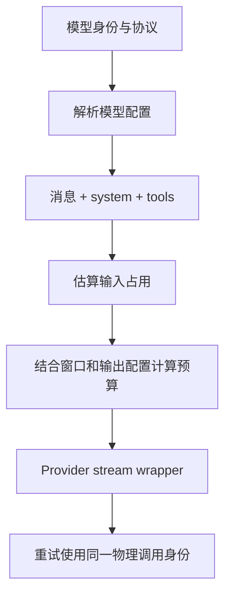

## 模型选择不是一个字符串替换

用户看到一个模型名字，运行时需要更多信息：Provider 来源、协议、地址、凭据、请求头、输入模态、thinking 方式、上下文窗口与输出上限。模型清单管理与实际请求解析也应消费一致的身份规则，否则“连接测试通过”和“实际对话可用”可能走向不同端点。

阅读入口是 `service/model-system/README.md`，接着看 resolution、connectivity、management 三个目录。不要把配置写入、连通性探测和真实推理混作同一个操作。

## Provider 与模型 ID 的边界

@source model-identity

解析器只用第一个 `/` 分开 Provider 与后续 modelId。因此模型本身包含 `/` 时，其余部分仍保留。缺少 Provider、缺少模型名和没有分隔符都是不同于合法引用的输入。

身份最终还会进入 usage、缓存、会话保存等路径。排查“按模型统计为空”时，应该沿解析结果、投影视图、记录函数到存储逐层核对字段形状。看到某个对象有 `id`，不能假定另一层也用同一字段名。

## 请求预算要给输出留位置

@source budget

这个 wrapper 估算完整请求的上下文消耗，并根据 contextWindow 与 configured maxTokens 决定预算。估算包括消息、系统提示和工具定义；只统计用户文字会漏掉很大一部分输入。

源码还用 WeakMap 和 retry identity 保留同一物理调用重试的预算。初次请求与重试若不断改变预算或请求结构，会让“重试同一请求”的假设失效。继续读 `resolveCallBudget`，可以看到 thinking 预算和紧急输出分支也需要考虑。

本节验证到 wrapper 的源码设计，没有调用供应商接口；不能据此断言每家模型都会接受同一种预算或 schema。

## 直接观察 usage 查询边界

@source usage

@lab usage

实验传入负数、非整数、无限值、倒置时间区间和未知分组，断言它们在查询存储前就被拒绝。`from=0` 是合法值；不能用简单 truthy 判断把它丢掉。合法分组包括 model，但该实验没有证明实际 token ledger 的 model 字段一定被正确填写。

这个练习连接了模型身份与可观测性：配置正确、推理成功、统计归因正确，是三个可分别失败的契约。贡献时应选清楚自己修的是哪一个。

## 把模型身份拆成四个问题

Provider 身份说明配置来自哪里；modelId 说明请求哪一个模型；api 协议决定怎样编码消息、工具与 thinking；认证决定凭据怎样注入。名字相似的两个模型，并不保证这四项一致。连接测试若只探测一个 URL，也不能覆盖真实推理的完整请求。

`parseSourceQualifiedModelKey` 使用第一个 slash 分界：`provider/org/model` 的 modelId 应保留 `org/model`。按所有 slash split 再取第二段，会把合法模型 ID 截断。格式化与解析要成对检查，还要覆盖没有 slash、空 Provider、空 modelId、custom Provider 等输入。

## 请求预算来自完整上下文

system prompt、历史和工具定义都占窗口，输出与 thinking 还要预留空间。动态 maxTokens wrapper 的任务，是在真实发请求之前对这些部分进行估计并选择预算；它不负责决定历史事实应该删除哪些，那属于上下文管理。

对重试尤其要谨慎。一次物理请求失败后，wrapper 可以按 retry identity 复用预算，避免每次重试把本来相同的输入变成不同实验。业务上“再问一次”与传输层“重试同一次”应有不同身份；成本和错误统计也依赖这个区分。

## 配置、成功推理和正确统计可以分别失败

假设模型回答正确，但 usage 页按 model 分组为空。先检查写入 ledger 时使用的模型身份，再看查询参数和返回投影。不要因为推理成功便排除身份映射错误；也不要一看到统计为空便修改 API 适配。

本章 usage 实验验证的是查询边界：无效时间范围应在到达存储之前被拒绝，合法的零起点不能被 truthy 判断丢掉。存储端口为 fake，因此它没有验证数据库聚合 SQL 或实际 token 记录。

## 一份可执行的请求排查清单

为失败请求记录 Provider、api 类型、去除凭据后的端点、modelId、角色序列、tool_use/result 配对、工具 schema 摘要、输出与 thinking 预算。先用不含工具的短输入排除认证与基础协议，再加入一个工具，最后恢复长历史。

400 不是“模型坏了”的充分证据：协议不匹配、schema、thinking 限制和消息配对都可能导致它。修复时应定位具体构造分支，用离线结构断言覆盖，再按条件做真实调用。

## 练习：先定义你正在改哪条契约

为 `provider/org/model` 写身份解析预期；为大 system prompt、小用户输入的请求估算哪些部分容易漏算；为“推理成功但 usage 归因为空”画出从 resolution 到 ledger 再到查询的字段流。验收时应分别指出哪个测试验证纯函数、哪个需要 fake storage、哪个需要真实 Provider。

::: interview 模型接口返回 400 时，为什么不能马上说“模型坏了”？
400 可能来自请求协议、工具 schema、thinking 参数、工具消息配对或长度预算。先保存可脱敏的请求结构和具体状态，确认 Provider、端点与协议，再用最小输入复现。修复应该覆盖实际构造请求的路径，并用离线契约测试与必要的实时调用分别提供证据。
:::
