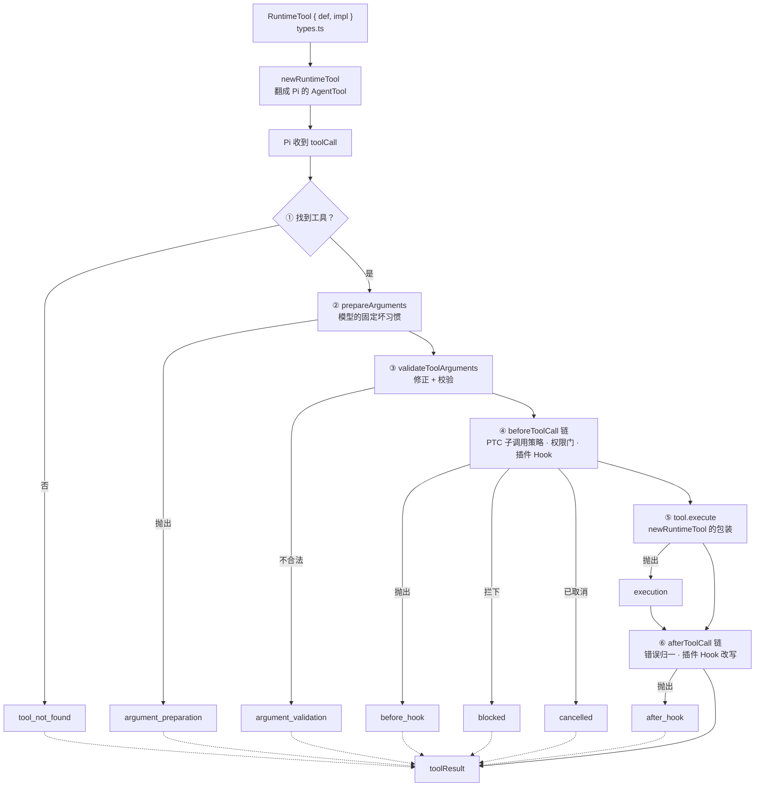
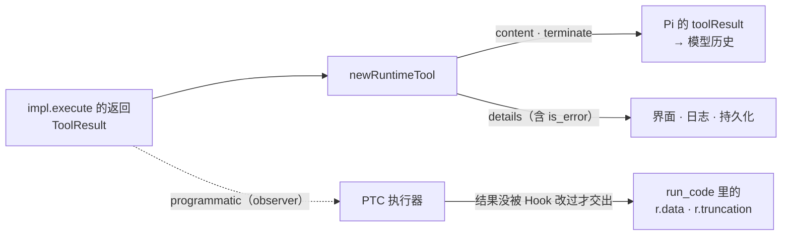
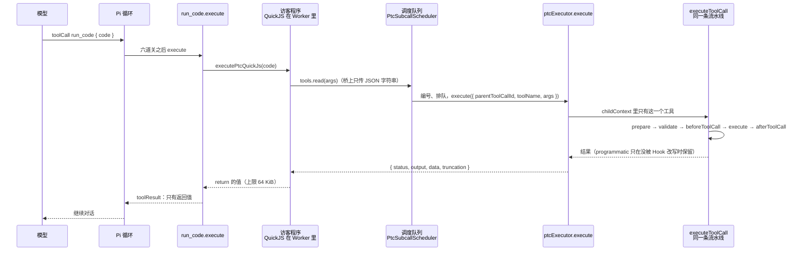

你让 mcode 统计仓库里每个模块的 TODO。模型的第一反应是逐个 `read`：三十个文件，三十次工具调用，三十份文件全文留在对话里，之后每一轮请求都要把它们再发一遍。

下面的实验把同一个任务做了两遍。第一遍，模型直接发三十个 `read`。第二遍，模型写一小段 JavaScript，在程序里调用 `read`，只把统计结果带回来：

@lab node labs/ch04/context.mjs

“常驻上下文”是 MiniMax 自己的 `measureToolContext` 量出来的（`pi-turn-runner/tool-context-size.ts`，实验从固定提交里直接装载运行）。MiniMax 在发给模型的每一次请求上都用它统计历史里所有工具调用的参数和结果，打成 `pi_tool_context_resident_*` 指标：

@mm packages/agent-core/src/pi-turn-runner/metrics.ts#L899-L910 hl=903

一边一百六十多 KiB，一边约 1 KiB。第二种做法叫 PTC（programmatic tool calling）：让模型写程序，在程序里调用工具，子调用的结果留在程序的变量里，只有程序的返回值回到模型的上下文。三十次 `read` 没有消失，每一次都有自己的编号和状态，也走了完整的校验、Hook 和权限，只是它们不再占模型的上下文。

PTC 的每个子调用走的是和普通工具调用同一条路，所以这一章先把一条普通调用走完（定义、六道关、调度、返回值），再回到 PTC。

::: note 两个 Pi 版本
MiniMax 内置的是 pi-mono v0.79.1，Learn Pi Agent 读的是 v1.5.0。本章讲 MiniMax 实际调用的 Pi 代码时，摘录的都是 `third_party/pi-mono/` 里的版本；只有和 Learn Pi Agent 第 4 章衔接时才提 v1.5.0。
:::


@figure assets/course/ch04-tools.png 一份定义，三个读者：模型、界面和 run_code 程序拿到的不是同一份结果

## 一个工具是一对：def 给模型，impl 干活

Learn Pi Agent 第 4 章读过 Pi 的 `AgentTool`：名字、描述、schema 和 `execute` 放在同一个对象里。MiniMax 在它前面又加了一层，把对象拆成两半：

@mm packages/agent-core/src/tools/types.ts#L72-L81 hl=75-76,78-79

@mm packages/agent-core/src/tools/types.ts#L198-L212 hl=207-209

`ToolDefinition` 是模型能读到的一切——`name`、`description`、`schema`、`promptGuidelines`——外加两条给运行时的指令：`prepareArguments`（某个模型对这个工具的固定坏习惯，下一节细讲）和 `executionMode`（能不能和别的调用一起跑，第 4 节细讲）。`RuntimeTool` 把它和 `impl` 配成一对，`source` 标明工具从哪来：`builtin`、`builtin-matrix` 或 `configured`。

为什么拆开？文件头的注释说了两点：同一个 `ToolDefinition` 可以有云端、本地、测试三种 `ToolImpl`，共享同一个 `execute` 签名；`execute` 的第一个参数是宿主每个 Turn 造好的上下文（`sessionId`、`turnId`、`toolCallId`……），注释还特意写明，**绝不通过 `AsyncLocalStorage` 注入每个 Turn 的状态，包装闭包是唯一的注入点**。上下文是明说的参数，不是藏在全局里的隐含状态——并行的几个工具调用才不会互相串台。

新工具推荐用 `defineRuntimeTool` 一个对象声明，它在内部拆成两半：

@mm packages/agent-core/src/tools/define.ts#L41-L58 hl=41-52,54-58

模型可读的字段进 `def`，`execute` 单独进 `impl`，`source` 留在外层。下面是内置的 `edit` 的定义：

@mm packages/agent-core/src/tools/builtin-defs.ts#L84-L103 hl=86,96,98,102

`description` 不是介绍，是使用规则：“写之前**务必**先 read”“**不要**带 read 输出的行号前缀”“每个 `oldText` 尽量短但要唯一”。规则跟着工具走，工具没启用，规则也不会出现在提示里。`executionMode: 'sequential'` 声明它会改文件；`prepareArguments` 是 `prepareEditArguments`，修某些模型对 `edit` 的固定坏习惯。同一份文件里，`read`、`grep`、`glob` 声明 `parallel`，`write`、`edit`、`bash`、`todowrite`、`task` 声明 `sequential`；桌面版 `agent-tools/src/desktop/builtin-defs.ts` 里的同名定义与之一致，`web_fetch`、`task_query`、`task_output`、`skill` 也是 `parallel`。

## newRuntimeTool：翻成 Pi 的工具，每次调用造一份新上下文

每个 Turn 开始时，`newTools` 把 `RuntimeTool[]` 变成 Pi 的 `AgentTool[]`，交给 `new Agent({ initialState: { tools } })`（第 2 章读过 `newAgent`）。核心是 `newRuntimeTool`：

@mm packages/agent-core/src/pi-turn-runner/tools.ts#L154-L204 hl=163-169,179-184,189-195,196-200

- **模型可见的字段原样带上**（L161-164）：名字、描述、`parameters`。Pi 拿 `parameters` 做校验，模型也从它看到参数格式。
- **没声明就是串行**（L168）：`executionMode: b.def.executionMode ?? 'sequential'`。新工具什么都不写，就当成独占的写操作处理，宁可慢不能错。
- **每次调用都造新上下文**（L179-184）：`callCtx = { ...ctx, toolCallId, assistantMessageId }`。`ctx` 是整个 Turn 共享的，调用身份是每次新补的；`assistantMessageId` 通过 `readAssistantMessageId()` 在调用那一刻去 bridge 里取当前的 assistant 消息（第 2 章的 bridge）。三个并行的 `read` 共享同一份定义，各有各的 `toolCallId`。
- **observer 先看原始值**（L189-194）：工具抛出时，Pi 只保留 `error.message`，所以 `observer.onError` 在重新抛出之前先看到原始错误对象；工具返回时，`observer.onResult` 先看到完整的 `ToolResult`。这个 observer 只有 PTC 的执行器装。
- **返回值在这里分流**（L195-200）：只有 `content`、`details` 和 `terminate` 交给 Pi。`details` 由 `toolResultDetails` 补上 `is_error`；`programmatic` 被丢掉，注释写得直白，“model calls never carry it”。

`newTools` 在外面还做两件事：

@mm packages/agent-core/src/pi-turn-runner/tools.ts#L36-L48 hl=39-41,46-47

重名的工具直接抛出 `duplicate tool name`，不让目录里展示一个定义、实际执行另一个；`read`、`write`、`edit`、`bash` 没人绑定时回退到 Pi 自带的实现（回退的工具也带上各自的 `executionMode`；文件里的注释说，生产路径设置了 `disableBuiltinFallback`，实际不会回退）。

还有一个细节和 PTC 有关。每个 Turn 里，执行器是这样挂上去的：

@mm packages/agent-core/src/pi-turn-runner/pi-turn-runner.ts#L190-L197 hl=191,197

`ptcExecutor` 被挂到整个 Turn 共享的 `toolConfig.context` 上（Turn 结束的 `finally` 里再摘掉，L242-244）。`newRuntimeTool` 每次调用都 `...ctx` 展开一次，所以 `run_code` 恰好在 Turn 执行期间才拿得到它。`ToolExecutionContext` 的注释也这么写：“available only while the turn is executing”。

## 一次调用要过六道关，八种失败各停在哪里

Pi 的循环收到一个 `toolCall` 之后，到交回 `toolResult` 之前，会依次过六道关。把问题放进不同的关，看谁拦下它：

@lab node labs/ch04/failures.mjs



::: steps 一次 edit 调用过六道关
--- 每个 Turn 开始时，`newRuntimeTool` 已经把 `RuntimeTool { def, impl }` 翻成了 Pi 的 `AgentTool`。模型发来一个 `edit` 的 `toolCall`，Pi 的 `prepareToolCall` 先过第 ① 关：按名字找工具，找到了。找不到就是 `tool_not_found`。
flowchart TD
  D["RuntimeTool { def, impl }<br/>types.ts"]:::done
  N["newRuntimeTool<br/>翻成 Pi 的 AgentTool"]:::done
  L["Pi 收到 toolCall"]:::on
  F{"① 找到工具？"}:::on
  E1["tool_not_found"]:::dim
  P["② prepareArguments<br/>模型的固定坏习惯"]:::dim
  E2["argument_preparation"]:::dim
  V["③ validateToolArguments<br/>修正 + 校验"]:::dim
  E3["argument_validation"]:::dim
  B["④ beforeToolCall 链<br/>PTC 子调用策略 · 权限门 · 插件 Hook"]:::dim
  E4["before_hook"]:::dim
  E5["blocked"]:::dim
  E6["cancelled"]:::dim
  X["⑤ tool.execute<br/>newRuntimeTool 的包装"]:::dim
  E7["execution"]:::dim
  A["⑥ afterToolCall 链<br/>错误归一 · 插件 Hook 改写"]:::dim
  E8["after_hook"]:::dim
  R["toolResult"]:::dim
  D --> N
  N --> L
  L --> F
  F -->|否| E1
  F -->|是| P
  P -->|抛出| E2
  P --> V
  V -->|不合法| E3
  V --> B
  B -->|抛出| E4
  B -->|拦下| E5
  B -->|已取消| E6
  B --> X
  X -->|抛出| E7
  X --> A
  E7 --> A
  A -->|抛出| E8
  A --> R
  E1 -.-> R
  E2 -.-> R
  E3 -.-> R
  E4 -.-> R
  E5 -.-> R
  E6 -.-> R
  E8 -.-> R
--- 第 ② 关 `prepareArguments`：留给单个工具，在通用校验之前修某些模型的固定坏习惯。`edit` 的 `prepareEditArguments` 就在这里。它抛出就是 `argument_preparation`。
flowchart TD
  D["RuntimeTool { def, impl }<br/>types.ts"]:::done
  N["newRuntimeTool<br/>翻成 Pi 的 AgentTool"]:::done
  L["Pi 收到 toolCall"]:::done
  F{"① 找到工具？"}:::done
  E1["tool_not_found"]:::dim
  P["② prepareArguments<br/>模型的固定坏习惯"]:::on
  E2["argument_preparation"]:::dim
  V["③ validateToolArguments<br/>修正 + 校验"]:::dim
  E3["argument_validation"]:::dim
  B["④ beforeToolCall 链<br/>PTC 子调用策略 · 权限门 · 插件 Hook"]:::dim
  E4["before_hook"]:::dim
  E5["blocked"]:::dim
  E6["cancelled"]:::dim
  X["⑤ tool.execute<br/>newRuntimeTool 的包装"]:::dim
  E7["execution"]:::dim
  A["⑥ afterToolCall 链<br/>错误归一 · 插件 Hook 改写"]:::dim
  E8["after_hook"]:::dim
  R["toolResult"]:::dim
  D --> N
  N --> L
  L --> F
  F -->|否| E1
  F -->|是| P
  P -->|抛出| E2
  P --> V
  V -->|不合法| E3
  V --> B
  B -->|抛出| E4
  B -->|拦下| E5
  B -->|已取消| E6
  B --> X
  X -->|抛出| E7
  X --> A
  E7 --> A
  A -->|抛出| E8
  A --> R
  E1 -.-> R
  E2 -.-> R
  E3 -.-> R
  E4 -.-> R
  E5 -.-> R
  E6 -.-> R
  E8 -.-> R
--- 第 ③ 关 `validateToolArguments`：先把意图没有歧义的错误修好（`"20"` 变 `20`），再对照 schema 校验。不合法就是 `argument_validation`，错误信息写给下一轮模型看。**前三关都在任何 Hook 之前**，参数不合法的调用，Hook 和权限门永远看不到。
flowchart TD
  D["RuntimeTool { def, impl }<br/>types.ts"]:::done
  N["newRuntimeTool<br/>翻成 Pi 的 AgentTool"]:::done
  L["Pi 收到 toolCall"]:::done
  F{"① 找到工具？"}:::done
  E1["tool_not_found"]:::dim
  P["② prepareArguments<br/>模型的固定坏习惯"]:::done
  E2["argument_preparation"]:::dim
  V["③ validateToolArguments<br/>修正 + 校验"]:::on
  E3["argument_validation"]:::dim
  B["④ beforeToolCall 链<br/>PTC 子调用策略 · 权限门 · 插件 Hook"]:::dim
  E4["before_hook"]:::dim
  E5["blocked"]:::dim
  E6["cancelled"]:::dim
  X["⑤ tool.execute<br/>newRuntimeTool 的包装"]:::dim
  E7["execution"]:::dim
  A["⑥ afterToolCall 链<br/>错误归一 · 插件 Hook 改写"]:::dim
  E8["after_hook"]:::dim
  R["toolResult"]:::dim
  D --> N
  N --> L
  L --> F
  F -->|否| E1
  F -->|是| P
  P -->|抛出| E2
  P --> V
  V -->|不合法| E3
  V --> B
  B -->|抛出| E4
  B -->|拦下| E5
  B -->|已取消| E6
  B --> X
  X -->|抛出| E7
  X --> A
  E7 --> A
  A -->|抛出| E8
  A --> R
  E1 -.-> R
  E2 -.-> R
  E3 -.-> R
  E4 -.-> R
  E5 -.-> R
  E6 -.-> R
  E8 -.-> R
--- 第 ④ 关 `beforeToolCall` 链：PTC 子调用策略、工具安全检查、插件 PreToolUse Hook、plan mode 和权限门，按顺序，**第一个 `block` 说了算**。抛出是 `before_hook`，拦下是 `blocked`，已取消是 `cancelled`。Hook 返回 `updatedInput` 时，MiniMax 还会对照权威 schema 再校验一次。
flowchart TD
  D["RuntimeTool { def, impl }<br/>types.ts"]:::done
  N["newRuntimeTool<br/>翻成 Pi 的 AgentTool"]:::done
  L["Pi 收到 toolCall"]:::done
  F{"① 找到工具？"}:::done
  E1["tool_not_found"]:::dim
  P["② prepareArguments<br/>模型的固定坏习惯"]:::done
  E2["argument_preparation"]:::dim
  V["③ validateToolArguments<br/>修正 + 校验"]:::done
  E3["argument_validation"]:::dim
  B["④ beforeToolCall 链<br/>PTC 子调用策略 · 权限门 · 插件 Hook"]:::on
  E4["before_hook"]:::dim
  E5["blocked"]:::dim
  E6["cancelled"]:::dim
  X["⑤ tool.execute<br/>newRuntimeTool 的包装"]:::dim
  E7["execution"]:::dim
  A["⑥ afterToolCall 链<br/>错误归一 · 插件 Hook 改写"]:::dim
  E8["after_hook"]:::dim
  R["toolResult"]:::dim
  D --> N
  N --> L
  L --> F
  F -->|否| E1
  F -->|是| P
  P -->|抛出| E2
  P --> V
  V -->|不合法| E3
  V --> B
  B -->|抛出| E4
  B -->|拦下| E5
  B -->|已取消| E6
  B --> X
  X -->|抛出| E7
  X --> A
  E7 --> A
  A -->|抛出| E8
  A --> R
  E1 -.-> R
  E2 -.-> R
  E3 -.-> R
  E4 -.-> R
  E5 -.-> R
  E6 -.-> R
  E8 -.-> R
--- 第 ⑤ 关 `tool.execute`，也就是 `newRuntimeTool` 的包装：每次调用造一份新上下文 `callCtx = { ...ctx, toolCallId, assistantMessageId }`，observer 先看原始结果，再把 `content`、`details`、`terminate` 交给 Pi。抛出是 `execution`，但仍然会走第 ⑥ 关。
flowchart TD
  D["RuntimeTool { def, impl }<br/>types.ts"]:::done
  N["newRuntimeTool<br/>翻成 Pi 的 AgentTool"]:::done
  L["Pi 收到 toolCall"]:::done
  F{"① 找到工具？"}:::done
  E1["tool_not_found"]:::dim
  P["② prepareArguments<br/>模型的固定坏习惯"]:::done
  E2["argument_preparation"]:::dim
  V["③ validateToolArguments<br/>修正 + 校验"]:::done
  E3["argument_validation"]:::dim
  B["④ beforeToolCall 链<br/>PTC 子调用策略 · 权限门 · 插件 Hook"]:::done
  E4["before_hook"]:::dim
  E5["blocked"]:::dim
  E6["cancelled"]:::dim
  X["⑤ tool.execute<br/>newRuntimeTool 的包装"]:::on
  E7["execution"]:::dim
  A["⑥ afterToolCall 链<br/>错误归一 · 插件 Hook 改写"]:::dim
  E8["after_hook"]:::dim
  R["toolResult"]:::dim
  D --> N
  N --> L
  L --> F
  F -->|否| E1
  F -->|是| P
  P -->|抛出| E2
  P --> V
  V -->|不合法| E3
  V --> B
  B -->|抛出| E4
  B -->|拦下| E5
  B -->|已取消| E6
  B --> X
  X -->|抛出| E7
  X --> A
  E7 --> A
  A -->|抛出| E8
  A --> R
  E1 -.-> R
  E2 -.-> R
  E3 -.-> R
  E4 -.-> R
  E5 -.-> R
  E6 -.-> R
  E8 -.-> R
--- 第 ⑥ 关 `afterToolCall` 链：`toolResultErrorPatch` 先把“工具自己报错”归一成 `isError: true`，之后每个 Hook 逐个改写，后一个看到前一个改写后的结果。Hook 自己抛出是 `after_hook`。
flowchart TD
  D["RuntimeTool { def, impl }<br/>types.ts"]:::done
  N["newRuntimeTool<br/>翻成 Pi 的 AgentTool"]:::done
  L["Pi 收到 toolCall"]:::done
  F{"① 找到工具？"}:::done
  E1["tool_not_found"]:::dim
  P["② prepareArguments<br/>模型的固定坏习惯"]:::done
  E2["argument_preparation"]:::dim
  V["③ validateToolArguments<br/>修正 + 校验"]:::done
  E3["argument_validation"]:::dim
  B["④ beforeToolCall 链<br/>PTC 子调用策略 · 权限门 · 插件 Hook"]:::done
  E4["before_hook"]:::dim
  E5["blocked"]:::dim
  E6["cancelled"]:::dim
  X["⑤ tool.execute<br/>newRuntimeTool 的包装"]:::done
  E7["execution"]:::dim
  A["⑥ afterToolCall 链<br/>错误归一 · 插件 Hook 改写"]:::on
  E8["after_hook"]:::dim
  R["toolResult"]:::dim
  D --> N
  N --> L
  L --> F
  F -->|否| E1
  F -->|是| P
  P -->|抛出| E2
  P --> V
  V -->|不合法| E3
  V --> B
  B -->|抛出| E4
  B -->|拦下| E5
  B -->|已取消| E6
  B --> X
  X -->|抛出| E7
  X --> A
  E7 --> A
  A -->|抛出| E8
  A --> R
  E1 -.-> R
  E2 -.-> R
  E3 -.-> R
  E4 -.-> R
  E5 -.-> R
  E6 -.-> R
  E8 -.-> R
--- 六道关都过了，交回一条 `toolResult`。任何一关的失败（虚线）也都变成一条 `isError` 的 `toolResult` 回到模型，而不是让异常冲出循环。
flowchart TD
  D["RuntimeTool { def, impl }<br/>types.ts"]:::done
  N["newRuntimeTool<br/>翻成 Pi 的 AgentTool"]:::done
  L["Pi 收到 toolCall"]:::done
  F{"① 找到工具？"}:::done
  E1["tool_not_found"]:::dim
  P["② prepareArguments<br/>模型的固定坏习惯"]:::done
  E2["argument_preparation"]:::dim
  V["③ validateToolArguments<br/>修正 + 校验"]:::done
  E3["argument_validation"]:::dim
  B["④ beforeToolCall 链<br/>PTC 子调用策略 · 权限门 · 插件 Hook"]:::done
  E4["before_hook"]:::dim
  E5["blocked"]:::dim
  E6["cancelled"]:::dim
  X["⑤ tool.execute<br/>newRuntimeTool 的包装"]:::done
  E7["execution"]:::dim
  A["⑥ afterToolCall 链<br/>错误归一 · 插件 Hook 改写"]:::done
  E8["after_hook"]:::dim
  R["toolResult"]:::on
  D --> N
  N --> L
  L --> F
  F -->|否| E1
  F -->|是| P
  P -->|抛出| E2
  P --> V
  V -->|不合法| E3
  V --> B
  B -->|抛出| E4
  B -->|拦下| E5
  B -->|已取消| E6
  B --> X
  X -->|抛出| E7
  X --> A
  E7 --> A
  A -->|抛出| E8
  A --> R
  E1 -.-> R
  E2 -.-> R
  E3 -.-> R
  E4 -.-> R
  E5 -.-> R
  E6 -.-> R
  E8 -.-> R
:::

虚线是失败出口：每个出口都变成一条 `isError` 的 `toolResult` 回到模型，而不是让异常冲出循环。前三关在 Pi 的 `prepareToolCall` 里：

@mm third_party/pi-mono/packages/agent/src/agent-loop.ts#L751-L801 hl=759-770,775,790,796-799

失败分类写在 `failure.kind` 里：

@mm third_party/pi-mono/packages/agent/src/agent-loop.ts#L637-L653 hl=637-645,647

八个值，注释说：“来源自己拥有的失败分类，宿主不得从文字里推断”。分类是“哪一关拦下的”，不是从错误文字里猜的。对照实验表：

- **前三关发生在任何 Hook 之前。** “缺少必填参数”那行，前置 Hook、`execute` 都是“没跑”。参数不合法的调用，Hook 和权限门永远看不到——Claude Code 同样如此（Claude Code 课程第 3 章：校验失败的调用 Hook 看不到）。
- **意图没有歧义的错误被修好，不算失败。** `limit: "20"` 是字符串，schema 要整数，Pi 的校验器在校验前先修正；`"abc"` 修不了，才报 `argument_validation`。错误信息是写给下一轮模型看的：逐条列出路径和问题，最后附上收到的原始参数（Pi 的 `validateToolArguments` 对这点的做法与 Learn Pi Agent 第 4 章讲的一致，也是先 `structuredClone` 再修正）。
- **工具抛出时，后置 Hook 仍然运行。** “工具抛出”那行，后置 Hook 是“跑了”：Pi 把抛出变成一条错误结果，然后照常交给 `afterToolCall`。所以后置 Hook 必须会处理 `isError`。
- **“工具自己报错”没有 `failure.kind`。** 工具返回 `isError: true` 或在 `details` 里写 `ok: false`，是工具自己的判断，不是哪一关拦下的。`setToolHooks` 里有专门的一步把它归一成错误（下面读）。

### 准入：Hook、权限和来源

第 ④ 关的 `beforeToolCall` 不是一个函数，而是一条链。`ptc-tool-executor.ts` 里有一段注释把链上有什么列了出来：

@mm packages/agent-core/src/pi-turn-runner/ptc-tool-executor.ts#L731-L741

“PTC child policy、工具安全检查、插件 PreToolUse Hook、plan mode 和权限门”都在这条链上，权限门的审批卡片会一直等用户点击。链由 `setToolHooks` 装到 Pi 的 `Agent` 上：

@mm packages/agent-core/src/pi-turn-runner/tools.ts#L72-L132 hl=73-86,91-102,115-120,121-126,127-130

- **来源跟着调用走**（L73-86）。先建一张“工具名 → source”的表，每次 Hook 被调用时，把 `source` 补进 `toolCall`。权限判断因此能区分“内置的 `read`”和“某个 MCP 服务器恰好也叫 `read` 的工具”，不会被重名骗过；PTC 子工具与现有工具来源冲突时直接抛出。
- **前置链按顺序，第一个 `block` 说了算**（L91-102）。被拦下的调用如果带 `blockedBy`（类型里目前只有 `'permission'` 一个取值），并且有 step-end Hook 在听，就记进 `blockedToolCalls`。这是“可信的准入来源”（`hooks.ts` 的注释：“trusted admission provenance”），不是从工具输出里猜的。
- **后置链逐个改写，后一个看到前一个改写后的结果**（L115-126）。`toolResultErrorPatch` 先把“工具自己报错”（`details.is_error === true` 或 `details.ok === false`）归一成 `isError: true`，来源标 `tool`；之后每个 Hook 的补丁通过 `applyToolResult` 应用到上下文，下一个 Hook 看到的是改写之后的版本。Hook 设置的错误来源标 `hook`。
- **run_code 的终止要上升到外层**（L127-130）。子调用要求结束整个 Turn 时，外层 `run_code` 的结果里带着 `terminates_turn` 标记，这里把它翻成 `terminateAgent`。

Pi 在 `beforeToolCall` 之后不会再校验参数——`prepareToolCall` 的 L803 之后只有取消检查，没有第二次 `validateToolArguments`。如果 Hook 原地改写了 `args`，改写的值就直接进了 `execute`。MiniMax 的插件 Hook 可以返回 `updatedInput`，所以在应用之前对照**权威的 schema** 再校验一次：

@mm packages/agent-core/src/tools/input-validation.ts#L97-L105
@mm packages/local-runtime-v2/src/service/turn-system/agent-host/execution/plugin-hook-tool-lifecycle.ts#L870-L881 hl=876-878

改写后的输入不合法，就拦下这次调用，把“Hook 返回了不合法的输入”写给模型。实验里“Hook 把参数改写成非法值”那行就是这条规则的 host 版本。

### 修参数：模型的固定坏习惯

第 ② 关留给单个工具：`prepareArguments` 在通用校验之前，针对一个工具修正某些模型的固定坏习惯。MiniMax 的 `edit` 就有两个：

@mm packages/agent-core/src/tools/edit-prepare-arguments.ts#L1-L15

下面这张表运行的是上游真实的函数：

@lab node labs/ch04/prepare.mjs

不是所有坏习惯都值得修。嵌套载荷（比如 `mcp_invoke` 的 `input`）用的是更窄的规则：

@mm packages/agent-core/src/tools/input-validation.ts#L36-L46

只接受“规范写法的数字字符串”（`"2"` → `2`），布尔字符串继续拒绝，注释给的理由是带副作用的开关（比如 cron 的 `enabled`）必须明说。顶层调用用 Pi 的宽修正，嵌套载荷用窄修正：越是可能触发副作用的参数，越不能替模型猜。

## 一批调用怎么排：整批规则，和 run_code 的屏障队列

模型在一条回复里发了四个调用：读 a、读 b、改 a、再读一次 a。MiniMax 创建 `Agent` 时传的是 `toolExecution: 'parallel'`，具体怎么排由 Pi 的 `executeToolCalls` 决定：

@mm third_party/pi-mono/packages/agent/src/agent-loop.ts#L424-L440 hl=433-438

规则只有一句：**批次里只要有一个工具声明了 `sequential`，整批串行；否则整批并行。** 再加上 `newRuntimeTool` 的默认值（没声明就是串行），含有 `edit`、`bash` 或任何没写 `executionMode` 的工具的批次，每一个调用都一个接一个。并行批的结果按调用顺序交回，和谁先完成无关。

Claude Code 不一样：只把**相邻的**并发安全调用并成一批，写操作自己一批，像一道栅栏（Claude Code 课程第 3 章读过 `partitionToolCalls`）。`run_code` 又不一样：程序可以随时发出子调用，没有“一批”的概念，MiniMax 为此写了一条队列：

::: tabs
@@ MiniMax
@mm packages/local-runtime-v2/src/service/turn-system/agent-host/execution/ptc/subcall-scheduler.ts#L82-L98 hl=83,90-95
屏障队列：串行调用等前面的全部结束，并挡住后面所有调用。
@@ Pi
@mm third_party/pi-mono/packages/agent/src/agent-loop.ts#L424-L440 hl=433-438
整批规则：有一个 `sequential` 整批串行，否则整批并行。
@@ host
@code host/src/tools.mjs#SubcallScheduler
`pump` 的写法和 MiniMax 一致：独占调用既是独占者，也是栅栏。
:::

`pump` 在每次有调用进来、有调用结束时被叫醒。队头是串行调用，必须等正在跑的全部结束才开始；开始之后队列里的所有调用（哪怕是并行的）都得等它；队头是并行调用，只要没到并发上限就开始。类上面的注释说得清楚：“一个等待中的串行调用会挡住后面的并行调用，写操作因此独占，而读的洪流也不会把写饿死。”

三种做法放到同一个场景里：

@lab node labs/ch04/schedule.mjs

整批规则里读与读之间也没有重叠，换来的是规则简单、结果顺序确定；相邻分批和屏障队列保住了读与读的并行，得到同样的形状。host 的 `SubcallScheduler` 和 MiniMax 的 `PtcSubcallScheduler`（实验里跑的是真实代码）事件顺序完全一致。最后一行是反例：`edit` 被误标成 `parallel`，末尾那次读在改写生效之前就读完了，拿到旧内容——一次没有报错、模型也不会发现的错。

## 返回值有三个读者

`ToolResult` 的定义写在 `types.ts` 里：

@mm packages/agent-core/src/tools/types.ts#L100-L136 hl=102-104,107-109,122,134-135



三条通道各有各的读者：

- `content`（和便于使用的 `text`）给**模型**，进历史，每一轮都要为它付费。
- `details` 给**界面和日志**，“read by the UI / caller, not the LLM”。编辑的 diff、工具的原始退出码放这里。
- `programmatic` 给**写程序的模型**，也就是 `run_code` 里的访客代码。注释写得毫不含糊：“Pi tool adapter 从不把它复制进 `content` 或 `details`，所以它到不了任何模型历史、展示记录和持久化的细节”；PTC 执行器从工具自己的返回值里读它，被 Hook 改写之后就扔掉。

为什么需要第三条？工具文本是写给模型读的，有行号前缀、截断提示、状态说明，程序不该去解析它们。`run_code` 的描述里有一句话和一段注释，是一个真实的事故：

@mm packages/local-runtime-v2/src/service/turn-system/agent-host/runner/ptc/run-code-tool.ts#L794-L806 hl=794-795,803-805

评测里的模型直接改了 `read` 的 `.output`，把行号前缀也写回了文件。`.output` 是显示文本，`data.content` 才是文件。`programmatic.data` 就是给程序留的“文件本身”。

下面的实验把一个内置工具的返回值走一遍 `newRuntimeTool`，看每个字段去了哪里：

@lab node labs/ch04/channels.mjs

上半张表是三个读者各自看到什么；下半张是同一段程序里八个子调用拿到的 `status`，留到 PTC 一节解释。

还有第四条细线：`terminate`。工具结果里的 `terminate: true` 只是建议循环结束，Pi 的规则是**批次里每个结果都同意**才结束。MiniMax 的 Hook 需要“无条件结束”，于是给 Pi 打了一个补丁（`MINIMAX_CHANGES.md` 的 2026-08-22 条目：`terminateAgent`，“已有的 terminate 要求整批都同意，表达不了混合并行批里的全局 Hook 决定”），`shouldTerminateToolBatch` 因此是：

@mm third_party/pi-mono/packages/agent/src/agent-loop.ts#L730-L735 hl=732-733

有人 `terminateAgent`，或者全体 `terminate`。另外，`terminate` 本身不写进持久化的 `toolResult`，只有 `content` 和 `details` 留得下来：

@mm packages/agent-core/src/tools/turn-termination.ts#L1-L15 hl=4-8,13-15

所以主动结束 Turn 的工具另外往 `details` 里写一个 `terminates_turn` 标记，让之后读历史的代码能分清“有意结束”和“被打断”（否则 Turn 续跑会提议继续做已经做完的事）。

## PTC：让模型写程序，工具结果留在程序里

### 它要解决的问题

直接调用有两个代价，实验已经量过第一个：工具结果常驻上下文。第二个是往返：每个 `read` 都是一次完整的模型请求。MiniMax 在 `output-limit.ts` 里把这件事写进了注释：

@mm packages/agent-tools/src/desktop/output-limit.ts#L3-L28 hl=4-5,17-21,26-28

给模型的上限（`read` 24 KiB、`grep` 16 KiB、`bash` 24 KiB）是为了保护上下文。但子调用的结果去的是程序，不是模型，那些上限只会让程序“分很多次小调用去翻同一份数据”，注释里写：“一个被报告的会话，同一个文件读了 92 次”。PTC 的子调用于是整个绕开这些上限（`isPtcChildCall`：上下文里有没有 `parentToolCallId`）。

官方文档对 PTC 的定位也在这里：

@mm docs/tui-capabilities.md#L360-L380 hl=364-366,368-371,379-380

三点要记住：它是 beta，默认关闭（配置 `beta.ptc` 或 `mcode --ptc`）；是否生效只由 Session 的 tool-call mode 决定，会话创建时定下，压缩之后才刷新，“这样一个 Session 的提示前缀在各轮之间保持稳定”（我的推断：稳定的前缀对提示缓存有利）；权限、审批、取消的行为与直接调用一致。

### 模型看到的目录变了

打开 PTC 之后，模型看到的工具目录由 `buildPtcCatalog` 重新组装：

@mm packages/local-runtime-v2/src/service/turn-system/agent-host/assembly/local-turn-tool-catalog.ts#L489-L526 hl=490,495,525

大部分工具成为 `childTools`，藏进 `run_code`；`isPtcDirectTool` 挑出的少数工具留在外面直接调用：`ask_user`、`skill`、`task`、`tool_search`、计划模式相关的那些，还有 `run_code` 自己。我的归纳：它们要么要和用户交互，要么会改变控制流，不适合藏进一个看不见的程序（源码只给了 `tool_search` 一条理由：它的结果是模型写下一个程序之前要读的定义，放进程序里只能原样返回）。返回值是 `[runCode, ...directTools]`：模型看到的目录里，只有 `run_code` 和这几个。`reminder` 是一段告诉模型“哪些工具现在只能在 run_code 里调用”的提示，同一个字符串既放进用户消息的前缀，也登记在 `run_code` 上（`registerPtcTurnReminder`），压缩把用户消息丢掉之后，执行器能原样放回去（L509-L512 的注释）。

`run_code` 的描述里还有每个子工具的 TypeScript 签名（`renderPtcToolSdk` 从 schema 渲染），所以同一份 schema 有两种读法：直接调用时是 JSON Schema，在程序里是一行类型声明。host 的版本如下：

@lab node labs/ch04/catalog.mjs

### 子调用走同一条流水线

模型写好程序，Pi 把 `run_code` 当成普通工具调用执行（它自己也过六道关）。程序里每次 `tools.read(...)` 经过这条路：



一步一步看这条路：

::: steps run_code 里的一次 tools.read
--- 模型写好程序，发来一个 `run_code` 调用。Pi 把它当成普通工具调用，自己也过六道关，之后才执行 `run_code.execute`。
sequenceDiagram
  participant M as 模型
  participant P as Pi 循环
  participant R as run_code.execute
  participant G as 访客程序<br/>QuickJS 在 Worker 里
  participant S as 调度队列<br/>PtcSubcallScheduler
  participant E as ptcExecutor.execute
  participant L as executeToolCall<br/>同一条流水线
  rect rgb(255, 237, 224)
  M->>P: toolCall run_code { code }
  P->>R: 六道关之后 execute
  end
--- `run_code` 把程序交给 QuickJS（在 Worker 线程里）。程序里每次 `tools.read(...)` 都经过桥，桥上只传 JSON 字符串。
sequenceDiagram
  participant M as 模型
  participant P as Pi 循环
  participant R as run_code.execute
  participant G as 访客程序<br/>QuickJS 在 Worker 里
  participant S as 调度队列<br/>PtcSubcallScheduler
  participant E as ptcExecutor.execute
  participant L as executeToolCall<br/>同一条流水线
  M->>P: toolCall run_code { code }
  P->>R: 六道关之后 execute
  rect rgb(255, 237, 224)
  R->>G: executePtcQuickJs(code)
  G->>S: tools.read(args) · 桥上只传 JSON 字符串
  end
--- 调度队列给这次子调用**编号**并排队（`PtcSubcallScheduler`），轮到它时调用 `ptcExecutor.execute`，带上可信的 `parentToolCallId`。
sequenceDiagram
  participant M as 模型
  participant P as Pi 循环
  participant R as run_code.execute
  participant G as 访客程序<br/>QuickJS 在 Worker 里
  participant S as 调度队列<br/>PtcSubcallScheduler
  participant E as ptcExecutor.execute
  participant L as executeToolCall<br/>同一条流水线
  M->>P: toolCall run_code { code }
  P->>R: 六道关之后 execute
  R->>G: executePtcQuickJs(code)
  G->>S: tools.read(args) · 桥上只传 JSON 字符串
  rect rgb(255, 237, 224)
  S->>E: 编号、排队，execute({ parentToolCallId, toolName, args })
  end
--- `ptcExecutor.execute` 构造的 `childContext` 里只有这一个工具，访客程序没法借子调用去调第二个工具。然后进 Pi 的 `executeToolCall`：走的是**同一条流水线**，用的是 Agent 自己装好的 Hook，权限门一个不少。
sequenceDiagram
  participant M as 模型
  participant P as Pi 循环
  participant R as run_code.execute
  participant G as 访客程序<br/>QuickJS 在 Worker 里
  participant S as 调度队列<br/>PtcSubcallScheduler
  participant E as ptcExecutor.execute
  participant L as executeToolCall<br/>同一条流水线
  M->>P: toolCall run_code { code }
  P->>R: 六道关之后 execute
  R->>G: executePtcQuickJs(code)
  G->>S: tools.read(args) · 桥上只传 JSON 字符串
  S->>E: 编号、排队，execute({ parentToolCallId, toolName, args })
  rect rgb(255, 237, 224)
  E->>L: childContext 里只有这一个工具
  L->>L: prepare → validate → beforeToolCall → execute → afterToolCall
  end
--- 结果回来：`programmatic` 只在没被 Hook 改写时保留，执行器把 `{ status, output, data, truncation }` 交给访客程序。
sequenceDiagram
  participant M as 模型
  participant P as Pi 循环
  participant R as run_code.execute
  participant G as 访客程序<br/>QuickJS 在 Worker 里
  participant S as 调度队列<br/>PtcSubcallScheduler
  participant E as ptcExecutor.execute
  participant L as executeToolCall<br/>同一条流水线
  M->>P: toolCall run_code { code }
  P->>R: 六道关之后 execute
  R->>G: executePtcQuickJs(code)
  G->>S: tools.read(args) · 桥上只传 JSON 字符串
  S->>E: 编号、排队，execute({ parentToolCallId, toolName, args })
  E->>L: childContext 里只有这一个工具
  L->>L: prepare → validate → beforeToolCall → execute → afterToolCall
  rect rgb(255, 237, 224)
  L-->>E: 结果 · programmatic 只在没被 Hook 改写时保留
  E-->>G: { status, output, data, truncation }
  end
--- 程序 `return` 的值（上限 64 KiB）成为 `run_code` 的结果，只有它回到模型的上下文，三十次 `read` 的内容都留在程序的变量里。
sequenceDiagram
  participant M as 模型
  participant P as Pi 循环
  participant R as run_code.execute
  participant G as 访客程序<br/>QuickJS 在 Worker 里
  participant S as 调度队列<br/>PtcSubcallScheduler
  participant E as ptcExecutor.execute
  participant L as executeToolCall<br/>同一条流水线
  M->>P: toolCall run_code { code }
  P->>R: 六道关之后 execute
  R->>G: executePtcQuickJs(code)
  G->>S: tools.read(args) · 桥上只传 JSON 字符串
  S->>E: 编号、排队，execute({ parentToolCallId, toolName, args })
  E->>L: childContext 里只有这一个工具
  L->>L: prepare → validate → beforeToolCall → execute → afterToolCall
  L-->>E: 结果 · programmatic 只在没被 Hook 改写时保留
  E-->>G: { status, output, data, truncation }
  rect rgb(255, 237, 224)
  G-->>R: return 的值 · 上限 64 KiB
  R-->>P: toolResult · 只有返回值
  P-->>M: 继续对话
  end
:::

关键一站是 `ptcExecutor.execute`：

@mm packages/agent-core/src/pi-turn-runner/ptc-tool-executor.ts#L185-L241 hl=188,196-213,228-241

- **只有一个工具的上下文**（L185-189）。`childContext.tools` 里只放这个子工具，名字查不到就是 `tool_not_found`——访客程序没法借子调用去调第二个工具。
- **用的是 Agent 自己的 Hook**（L196-213）。`lifecycleConfig` 里的 `beforeToolCall`、`onToolExecutionStart`、`afterToolCall` 全是 `options.agent` 上已经装好的那一套——`setToolHooks` 装的权限门、插件 Hook、来源映射，一个不少。`beforeToolCall` 外面包了一层 `pauseClockDuringAdmission`：程序的 wall clock 在子调用处于准入阶段时停表，免得用户慢慢看审批卡片的时间算进程序的预算（上一节读的那段注释）。
- **`executeToolCall`**（L228-241）。它是 Pi 里的一个函数：

@mm third_party/pi-mono/packages/agent/src/agent-loop.ts#L1007-L1030 hl=1008-1011,1022-1030

  “执行一个调用并走完 Pi 的完整生命周期，但不生成模型历史里的 toolResult 消息”，带上可信的 `parentToolCallId`；它发出的 `tool_execution_*` 事件也带这个 id，界面据此把子调用归成一组。Learn Pi Agent 读的 v1.5.0 里没有 `executeToolCall` 这个导出，对应的是 `runToolCall`，注释是“工具调用工具时用它，这样权限检查这类 Hook 同样适用于这些调用”。

结论是实验里那几行：

@lab node labs/ch04/program.mjs

“程序里的 edit 也要过权限”那行，`edit` 被拒绝，错误码 `PTC_PERMISSION_DENIED`，只让这一次调用失败，后面的 `read` 照常执行；“同一个 Hook 也拦程序里的子调用”那行，被拦下的 `read` 根本没有执行。如果子调用绕过流水线，模型把 `rm -rf` 包进脚本就能躲过权限。MiniMax 的文档也写明：拒绝一个子调用“只让这个调用失败，像原生拒绝一样”，停止 Turn 才会停止整个程序。

### 程序拿到的，和模型拿到的不是同一份

PTC 需要 `read` 对子调用不设上限，而 Pi 的 `read` 把 2000 行 / 50 KB 的截断写死在函数里。MiniMax 给 Pi 打了一个补丁：

@mm third_party/pi-mono/MINIMAX_CHANGES.md#L16-L21

`ReadToolOptions` 多了一个可选的 `truncation`，原来写死的 2000 行 / 50KB 变成参数。台账里标的是“generic, upstreamable”，“Upstream PR: not opened”——一个小而通用的接缝。MiniMax 的 `LocalReadTool` 因此手里有两个 `read`，按调用方选：

@mm packages/agent-tools/src/desktop/local-pi-tools.ts#L250-L262 hl=253

`isPtcChildCall(ctx)` 为真，并且文件没超过 8 MiB，就用不限行数的那个；其余走给模型的那个，超过 24 KiB 被截成 `limitDesktopPrefixLines` 的一页。实验里运行的就是这两个真实的函数：

@lab node labs/ch04/readcap.mjs

同一个 3000 行、200 KiB 的文件，模型要翻 9 页，程序一次拿到。host 的 `read` 复刻了这条规则，页数一致。

返回值的第三条通道还有一条规矩：**`status: complete` 必须是工具自己说的。** 这是 MiniMax 里最细的一条：

@mm packages/agent-tools/src/desktop/ptc-result-projection.ts#L381-L409 hl=388-391,403-408

工具名不能作为证据：MCP 或插件工具完全可以也叫 `read`，返回长得像样的 `details`，所以**来源**必须是宿主登记过的 `builtin`；就算来源可信，没有截断标记也不等于完整——“`complete` 现在需要工具自己的陈述”，一条忘了标记截断的返回路径（2026-10-12 的 grep 提前返回）就会显示成 unknown，而不是 complete。再加上执行器的“所有权”规则：

@mm packages/agent-core/src/pi-turn-runner/ptc-tool-executor.ts#L542-L581 hl=549-553,559-562

程序要拿到工具的 `programmatic`，结果必须“还是工具自己的”：后置 Hook 改过内容（比如把密钥隐去）或错误状态，工具自带的 `data` 就必须扣下，否则 Hook 隐去的内容可以从结构化数据里原样绕回来。前面“channels”实验的下半张表是这条规则的 host 版本：内置工具报告了没截断的，是 `complete`；报告没截断但只读了前 50 行的，`complete` 并给出续读位置；没有报告（`silent`）、来源不是内置（`mcp_echo`）、结果被 Hook 改写（`lookup`）的，都只能是 `unverified`，`data` 是空的。

### 程序的边界

访客程序在 QuickJS（WebAssembly）里跑，放在 Worker 线程中，没有 `process`、`require`、网络和定时器。它和宿主之间的桥只传 JSON 字符串。宿主给它的预算写在 `PTC_LIMITS` 里：

@mm packages/local-runtime-v2/src/service/turn-system/agent-host/execution/ptc/contracts.ts#L11-L44 hl=12-14,20,24,26,34,40-43

| 限制 | 值 | 超出时 |
| --- | --- | --- |
| 程序源码 | 64 KiB | 直接拒绝 |
| 堆 | 64 MiB | QuickJS 的内存上限，超出程序失败 |
| 纯计算时间 | 1 秒 | 打断同步死循环 |
| wall clock | 默认 120 秒，最大 1 小时（`timeout_ms`，换算规则在 `ptc.ts` 的 `resolvePtcWallClock`） | `wall_clock_exceeded` |
| 子调用次数 | 100 | 之后的调用被拒绝、不执行，程序继续 |
| 并行子调用 | 16 | 排队 |
| 一次子调用的结果 | 16 MiB | 只让这一次调用失败（`PTC_RESULT_TOO_LARGE`），工具已经执行了 |
| console 输出 | 16 KiB | 截断并注明 |
| 返回值 | 64 KiB | 保留开头并注明，完整值另存为会话的工具输出文件 |

“超出预算的调用被拒绝、不执行，程序继续”这类设计的共同点是：**预算耗尽不能让整个程序死掉**，因为已经执行过的子调用（比如写过的文件）没法撤销，程序重跑一遍可能把写重复一次。同一个原因出现在崩溃恢复里：

@mm packages/local-runtime-v2/src/service/session-system/messages/ptc/crash-recovery.ts#L12-L17

进程在 `run_code` 中途重启，已经开始的子调用记为 `PTC_OUTCOME_UNKNOWN`：“它的结果未知，不得自动重放”。这是 `describe()` 在子调用动手之前就给它分配好身份、写进记录的原因（`PtcToolBridge.describe` 的注释：“在副作用开始之前分配宿主可见的子调用身份”）。host 的 `createChildBridge` 做同样的事，子调用记录先写 `status: "unknown"`，结束后再改。

### 打开 PTC 的代价

- **多了一类要审的东西。** 模型写的程序本身不过权限，每个子调用才过；用户在审批卡片里看到的是“这个程序里的某个调用”，所以 `run_code` 的 `description` 参数会传到审批界面。
- **提示前缀要稳定。** 开关是 Session 级的，不能在一轮对话中间切换。
- **访客看不到的就是看不到。** 没有定时器，不能“等一等”；要等窗口出现，就返回，在下一次 `run_code` 里再查——源码描述里直接写着这一条，原因是评测里模型真的 `await setTimeout`，还有一次忙等 `Date.now()` 把 100 次调用预算耗光。
- **子调用结果不可见。** 模型只看得到返回值，调试程序的唯一办法是 `console.log` 和 `return`。

## 三家的做法

Pi v1.5.0 有一个同类功能，Claude Code 的还原源码里有一个内部版本，三者思路相同：

| | MiniMax PTC | Pi codemode（v1.5.0） | Claude Code REPL（2.1.88 还原源码） |
| --- | --- | --- | --- |
| 沙箱 | QuickJS（WASM），Worker 线程 | QuickJS（WASM），Worker 线程（`packages/codemode`） | `REPLTool` 的实现不在还原源码里 |
| 其他工具是否隐藏 | Session 级开关，子工具藏起来，少数留在外面 | 设置 `codemode.mode`：`on`（默认，直接工具仍然声明）或 `only`（全部藏进脚本） | `isReplModeEnabled()` 为真时隐藏 `REPL_ONLY_TOOLS`（Read、Write、Edit、Glob、Grep、Bash、NotebookEdit、Agent）；默认只对 `USER_TYPE === 'ant'` 的 CLI 开启 |
| 工具入参 | JSON：`code`、`description`、`timeout_ms` | 原始 JavaScript 文本，不是 JSON | — |
| 子调用失败 | 永不抛出，返回带 `status`、`error.code` 的对象 | 对应的 Promise reject（`Promise.allSettled` 保留成功的） | — |
| 跨调用状态 | 没有 | `store` / `load`，写进会话 | — |
| 子调用记录 | `details.ptc`：编号、状态、保留事实，崩溃后标记 unknown | 工具结果消息上的 `nestedCalls`，最多 256 条 | — |

两点说明：MiniMax 内置的 Pi（0.79.1）里没有 `packages/codemode`（`third_party/pi-mono/packages` 只有 agent、ai、coding-agent、tui），PTC 是 MiniMax 自己在 `local-runtime-v2` 和 `agent-tools` 里写的；Claude Code 那一列只能说明“把原语工具藏到 VM 里”的设计在那里也有，REPL 本身怎么执行没法从还原源码读出来。

三家的取舍的共同点：把工具结果留在程序里省上下文和往返，代价是模型要写对程序，失败要自己处理，审批和调试都更难。MiniMax 在这个基础上做得最多的是**边界**——预算耗尽的行为、崩溃之后的状态、`complete` 的证据——因为它要把一个“模型写代码执行”的功能放给真实用户。

## 动手：host/src/tools.mjs

host 的 `tools.mjs` 分六块，自上而下就是一次调用的一生。第一块是适配，对应 `newRuntimeTool`：

@code host/src/tools.mjs#newRuntimeTool hl=154,156,161-164,166-170

流水线是 `runToolCall`，六道关、八种 `failure.kind` 都在这里；`wrapTool` 在它外面包一层，保持第 2 章 `runTurn` 使用的签名：

@code host/src/tools.mjs#runToolCall hl=204,209,223,228,232,239-241,252-258,273-290

两处值得看：Hook 返回 `updatedInput` 之后再走一遍 `validateArguments`（L232），后置 Hook 在工具抛出之后仍然运行（L252-L270、L273-L290）。run_code 的执行器和“所有权”判断各只有几行：

@code host/src/tools.mjs#createPtcExecutor hl=649-651
@code host/src/tools.mjs#ownsResult hl=631-635

`createPtcExecutor.execute` 调的是 `wrapTool`，不是子工具的 `execute`——这一行决定了子调用有没有权限。程序和宿主之间的桥是 `createChildBridge`：

@code host/src/tools.mjs#createChildBridge collapse=true

简化的地方：参数 schema 是 JSON Schema 的小子集；`run_code` 用 `node:vm` 跑访客代码，而 `node:vm` 不是安全边界，它只用来演示“桥上只传 JSON 字符串”这条通路；`node:vm` 也管不住 `await` 之后的同步死循环，所以没有 `maxComputeMs`，QuickJS 的中断处理器才能打断；没有 Tool Search 的长尾工具、媒体结果、后台 Bash、批次共享的 wall clock 和审批暂停。

host 的 `read` 复刻了“同一个工具，两种读者”，和 MiniMax 的 `LocalReadTool` 对照着看：

::: tabs
@@ MiniMax
@mm packages/agent-tools/src/desktop/local-pi-tools.ts#L250-L262 hl=253
手里有两个 `read`，`isPtcChildCall(ctx)` 为真并且文件没超过 8 MiB，就用不限行数的那个。
@@ host
@code host/src/tools.mjs#readFile hl=476-477
同一条判断：run_code 子调用整个窗口交给程序，模型直接调用超过上限就分页。
:::

## 实验

每个机制一个脚本，都在 `labs/ch04/` 下，离线、确定，几秒钟跑完：

```bash
node labs/ch04/context.mjs    # 30 个文件，直接读 vs run_code，用真实的 measureToolContext 量上下文
node labs/ch04/channels.mjs   # 一个返回值，三个读者；谁有资格说 complete
node labs/ch04/failures.mjs   # 六道关，八种失败
node labs/ch04/prepare.mjs    # 真实的 prepareEditArguments
node labs/ch04/schedule.mjs   # 整批规则、相邻分批、屏障队列
node labs/ch04/readcap.mjs    # 同一个 read，24 KiB 和全文
node labs/ch04/program.mjs    # run_code 的边界：失败、权限、预算、返回值、超时
node labs/ch04/catalog.mjs    # PTC 打开之后模型看到的目录
npm run lesson -- 4           # 本章的回归实验（60 多项检查）
```

其中运行 MiniMax 真实代码的有：`measureToolContext`、`limitDesktopPrefixLines` 与 `isPtcChildCall`、`PtcSubcallScheduler`、`prepareEditArguments`、`resolvePtcWallClock`（`lab/source.mjs` 的白名单为此新增了几个纯模块）。

## 你来改

每道题先写下预测，再动手。

::: predict 子调用绕过流水线
把 `createPtcExecutor` 里的 `wrapTool(child, …)(call)` 换成直接调用 `child.execute(call.input, { …context, toolCallId: call.id })`，运行 `node labs/ch04/program.mjs`。“程序里的 edit 也要过权限”和“同一个 Hook 也拦程序里的子调用”两行会变成什么？
???
`edit` 不再被拒绝：`rules` 里没放行 `edit`，权限检查在 `wrapTool` 里，绕开它就没有人问了，文件被改成 `FILE 0`；读 `secret.txt` 的 Hook 也不再触发，程序读到 `classified`。这是 PTC 最要紧的不变量：子调用必须走和直接调用同一条流水线。MiniMax 用 Pi 的 `executeToolCall`，把 Agent 自己的 `beforeToolCall` / `afterToolCall` 传进去；Pi v1.5.0 的 `runToolCall` 注释说的是同一件事。
:::

::: predict Hook 改写之后不再校验
把 `runToolCall` 里 `verdict.updatedInput` 分支的 `validateArguments(definition, structuredClone(verdict.updatedInput))` 改成直接 `structuredClone(verdict.updatedInput)`，运行 `node labs/ch04/failures.mjs`。“Hook 把参数改写成非法值”那行呢？
???
`failure.kind` 变成空，`execute` 是“跑了”，模型收到的是 `peek 42 limit=abc`：路径是数字、`limit` 是字符串，全都进了工具。校验只发生在 Hook 之前，Hook 之后再没有人看。MiniMax 的插件 Hook 可以返回 `updatedInput`，所以 `applyPluginToolRewrite` 在应用前用 `isRuntimeToolInputValid` 对照权威 schema 检查一次——Pi 自己不会（`prepareToolCall` 在 `beforeToolCall` 之后只检查取消）。
:::

::: predict 扣下 data 的那一行
把 `ownsResult` 末尾的 `return (own.text ?? "") === result.text;` 改成 `return true;`，运行 `node labs/ch04/channels.mjs`。`lookup（后置 Hook 改写了文本）` 那行的 status 和 data 字段变成什么？
???
status 变成 `complete`，`data 字段` 变成 `claimed`：后置 Hook 把文本里的密钥换成了 `[redacted]`，但 `lookup` 自带的 `programmatic.data` 没被改写，没有这一行，它原样交给了程序。Hook 隐去的内容就从结构化通道里绕回来了。所以 MiniMax 的所有权规则宁可误扣：内容或错误状态只要变了，整个 `programmatic` 都不给。
:::

## 面试题

::: interview 为什么要把工具定义拆成给模型的 def 和干活的 impl？MiniMax 的 RuntimeTool 怎样变成 Pi 的 AgentTool？
1. **拆的理由**：`def` 只含模型能读到的东西（名字、描述、schema、提示规则）和两条给运行时的指令（`prepareArguments`、`executionMode`）；`impl` 是干活的函数。同一份 `def` 可以配云端、本地、测试三种 `impl`，签名一致。上下文作为 `execute` 的第一个参数显式传入，注释要求不用 `AsyncLocalStorage`。
2. **翻译**：`newRuntimeTool` 把 def 的字段搬到 Pi 的 `AgentTool` 上，`executionMode` 缺省为 `sequential`；`execute` 每次调用造新上下文（补 `toolCallId`、`assistantMessageId`），observer 先看原始返回值，再把 `content`、`details`（补 `is_error`）、`terminate` 交给 Pi，`programmatic` 丢掉。
3. **加分点**：说出 `newTools` 对重名的处理，和 `ptcExecutor` 靠 `...ctx` 每次展开才在 Turn 期间出现在上下文里。
:::

::: interview 一次工具调用要过哪几关？Hook 看得到参数不合法的调用吗？Hook 改写了参数怎么办？
六道关：找工具、修参数、校验、前置准入（Hook、权限、取消）、执行、后置 Hook。八种失败：`tool_not_found`、`argument_preparation`、`argument_validation`、`before_hook`、`blocked`、`cancelled`、`execution`、`after_hook`。

前三关在任何 Hook 之前，所以 Hook 看不到不合法的调用。Pi 在前置 Hook 之后不再校验，Hook 改写参数就可能让不合法的值进入 `execute`；MiniMax 对插件 Hook 的 `updatedInput` 用权威 schema 重新检查，不合法就拦下。加分点：工具抛出之后后置 Hook 仍然运行，所以后置 Hook 要会处理 `isError`；失败分类写在 `failure.kind`，是哪一关拦下的，不靠错误文字。
:::

::: interview 一条回复里的多个工具调用怎么调度？比较 Pi、Claude Code 和 run_code。
- **Pi / MiniMax**：看整批——有一个 `sequential` 整批串行，否则整批并行；未声明的工具默认串行。规则最简单，代价是读读之间也不并行。
- **Claude Code**：只合并相邻的并发安全调用，写操作自己一批当栅栏，读写之间的顺序保住，读读并行。
- **run_code**：子调用是程序随时发出的，没有“一批”，用 FIFO 队列：串行调用等前面的全部结束，并挡住后面所有调用；并行调用受并发上限（16）约束。
- **依据**：实验里同一个四调用场景给出三种形状；把 `edit` 误标成 `parallel` 的反例，让末尾的读拿到旧内容，没有任何报错。
:::

::: interview 什么是 PTC？解决什么问题，带来什么新问题？
PTC 让模型写一段 JavaScript，在 QuickJS 沙箱里调用被藏起来的工具；子调用的结果留在程序的变量里，只有返回值（≤64 KiB）回到上下文。解决的是两个成本：工具结果常驻上下文（实验里 161 KiB 对 1 KiB），以及每次读取一个模型往返（源码注释里“同一个文件读了 92 次”）。

新问题：①权限——每个子调用要走同一条流水线，拒绝只让这一次调用失败；②预算——次数、并发、wall clock、结果大小，耗尽不能杀死程序；③可观测与恢复——子调用要有记录，崩溃后“结果未知，不得自动重放”；④提示前缀——开关是 Session 级的；⑤模型必须写对程序，失败要自己处理。
:::

::: interview 为什么工具结果要有给程序的第三条通道？run_code 里的 status: complete 凭什么？
文本是写给模型读的（行号前缀、截断提示），程序不该解析；而程序需要“文件本身”和“有没有被截断”这样的机器可读事实。`programmatic` 只交给 observer，不进 `content`、`details`，因此到不了模型历史和持久化。

`complete` 的证据有三层：来源必须是宿主登记的 `builtin`（工具名不算证据，MCP 工具可以重名）；工具自己报告 `truncated: false`（没有报告就是 unknown）；结果没被后置 Hook 改写（改写了，`programmatic` 整个扣下，否则隐去的内容能从结构化数据绕回来）。加分点：嵌套载荷用更窄的数字修正，布尔字符串不接受，因为带副作用的开关必须明说。
:::

::: interview 把 Pi 的 read 的截断上限做成可配置，MiniMax 为什么要这么做？
Pi 的 `read` 把 2000 行 / 50 KB 的截断写死在函数里，显式的 `limit` 也突破不了。PTC 的子调用结果是给程序的，不进模型上下文，要整个窗口，否则程序要分很多次小调用去翻同一份数据。MiniMax 给 Pi 的 `ReadToolOptions` 加了可选的 `truncation`（台账 2026-10-28，“generic, upstreamable host seam”，未向上游提交），`LocalReadTool` 手里有两个 `read`，用 `isPtcChildCall(ctx)` 按调用方选，超过 8 MiB 的文件仍然回退到给模型的分页版本，避免耗尽内存。

这个例子说明：产品的功能（PTC）向内核提了新要求，MiniMax 的做法是给内核加一个小而通用的接缝，而不是在宿主里重写 `read`。
:::
