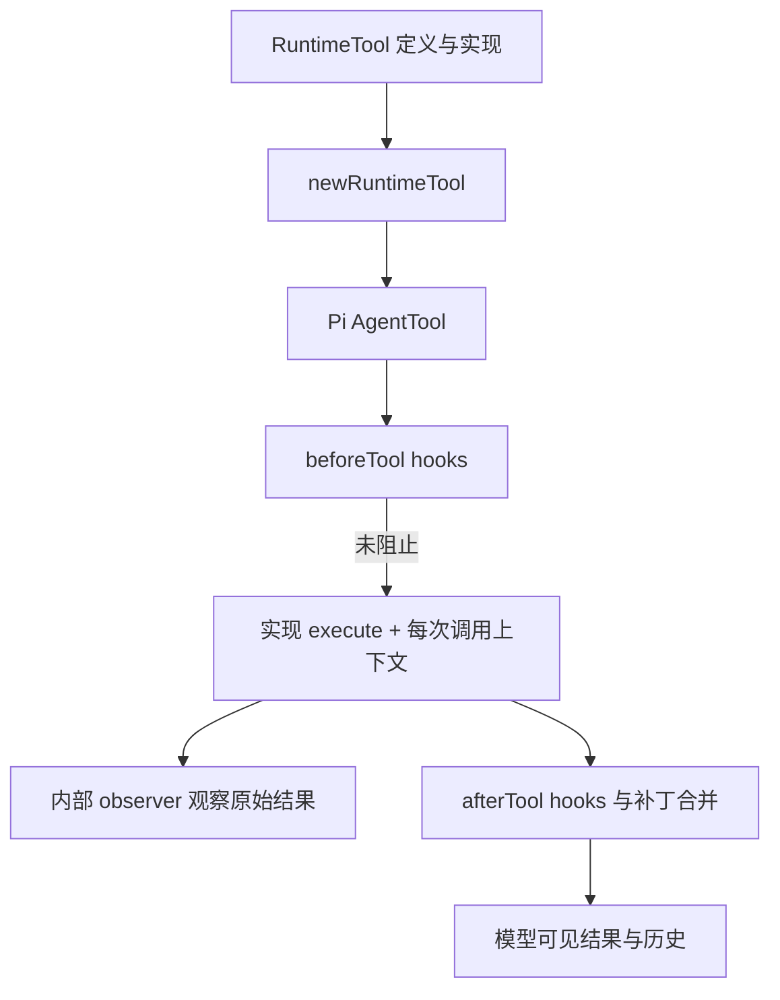

## 本章的问题

工具返回了文本、结构化 details 和供程序使用的 programmatic 数据。把整个对象直接写进模型历史，看似省事，却可能把不属于模型的通道一起泄漏出去。

本章用 observer 接收原始结果，模型视图只保留明确允许的字段。每次调用还要绑定 sessionId、turnId、assistantMessageId 与 toolCallId，否则并发时即使文字正确，结果也可能归错任务。

## 沿固定源码逐段拆解

@source tool-wrapper

### newRuntimeTool 是两套契约的接缝

def.name、description、schema 与 executionMode 转成 Pi AgentTool 字段；execute 每次构造新的 callCtx，加入 toolCallId 与当前 assistantMessageId，再调用真实实现。observer 先看到原始返回值，programmatic 刻意不复制给 Pi。

错误既可能由 throw 表达，也可能在 details.is_error 或 ok=false 表达。适配层要归一化，不能把“Promise resolved”当成业务成功。

@source tool-hooks

### setToolHooks 保留来源与顺序

它先建立名称到 source 的映射；PTC 同名来源冲突会失败。before hook 依次执行，遇到 block 返回；after hook 逐次把 patch 应用到当前 context，后一个观察前一个改写后的结果。

### 调度策略还来自每个工具

newAgent 的 parallel 不意味着所有工具随意并行。runtime wrapper 默认 sequential，定义可以显式声明，fallback 也有不同默认值。newTools 对重复名称提前报错，避免名称冲突悄悄选中错误实现。

host 只提供 read、edit、test 三个本地工具，Test 直接使用 Node argv，不开放任意 shell。更大的工具面需要更完整的 schema 与授权。

## 机制总览



## 接入贯穿项目

@implementation 04-tools

### 逐步跟踪本章实现

toolCatalogue 先拒绝重名，避免工具目录里展示一个定义、实际执行另一个定义。wrapTool 每次调用重新复制 input，校验并检查取消，执行 before hooks 和 authorize，再把 session、turn、assistantMessageId 与 toolCallId 交给实现。共享 definition 不等于共享调用身份。

工具原始返回先交给 observe，再只挑 text、details、terminate 形成对外结果。programmatic 不随普通消息返回；`isError` 则归一到 details.is_error，最终与 details.ok 一起决定 error。实验用带私有字段的返回值检查这两个通道，不能只验证 text 相等。

read 声明 parallel，edit 与 test 构成顺序边界。edit 要求旧文本恰好命中一次，test 运行真实 argv 子进程；失败会成为同 id 的工具结果而不是吞掉异常。权限拒绝必须发生在 execute 之前，实验还检查拒绝时磁盘与执行计数都没有变化。

## 运行本章实验

```bash
node --disable-warning=ExperimentalWarning labs/chapters/04-tools.mjs
```

@experiment 04-tools

## 逐项解释实验结果

原始 observer 得到 programmatic.secretChannel，模型结果没有这个字段；调用上下文保留正确 id。details.ok=false 会成为错误结果。未经允许的 edit 被拒，磁盘仍为 old。

对一次调用同时检查“谁看到了什么”和“磁盘发生了什么”，可以防止只看返回文字时遗漏信息或效果边界。

## 继续动手与验收

增加两个 after Hook，分别改写文本和错误标记，验证后一个消费前一个的结果。再定义两个同名不同来源工具，断言在模型请求前就失败。

::: interview 为什么原始工具结果不能原样进入模型历史？
工具原始值先交给私有 observer，对外结果只投影公开字段；programmatic 不应因对象展开泄漏。每次执行独立携带 toolCallId，错误位统一映射，拒绝发生在副作用前。用带私有字段的真实返回值检验这几条边。
:::

::: interview after Hook 能随意并行吗？
不能先假定可以。后一个 patch 可能依赖前一个已经改写的结果，来源与错误标记也需要确定顺序；应按契约声明独立性再优化。
:::

::: interview Promise resolved 为什么仍可能是工具失败？
业务失败可以由 is_error 或 ok=false 表达。适配层需要把结构化失败归一化成模型可理解的结果，而不只依赖 JavaScript 异常。
:::
