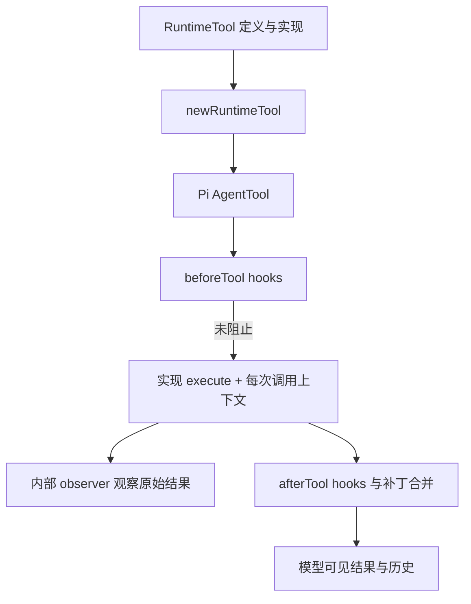

## 工具调用跨越了副作用边界

模型返回工具名称与参数，并不等于文件已经修改。完整路径还涉及：名称解析、schema 校验、权限决策、before hook、具体执行、结果截断或转换、after hook，以及 call/result 写入历史。

把这个流程画出来，可以避免两类常见修复：只改给模型看的说明，却没有约束执行器；只在 UI 拒绝，却让 headless 或 ACP 绕过同一个边界。

## 找到工具钩子的装配处

@source tool-hooks

`setToolHooks` 把宿主策略接进 Pi 的工具生命周期。继续读同文件的 `newRuntimeTool`，观察运行上下文、工具执行和返回结果如何被包装。然后从具体工具查到 `packages/agent-tools/src/shared/` 中的读文件、替换编辑与写入捕获设施。

不要仅凭函数名推断所有工具都受完全相同的规则保护。原生文件工具、bash 中的文件命令、MCP 工具可能走不同路径。修复需要列出受影响的执行入口，再核对每条真实 sink。

## 一个路径为什么需要多次判断

@source paths

@lab paths

这个真实函数把 POSIX 路径、Windows 驱动器路径与 UNC 路径识别为 absolute，把 `C:relative`、`./relative`、`~/project` 判为非绝对。即使实验在 macOS 上运行，也能验证它的 Windows 字符串分类。

但分类不等于权限。`\\server\share` 可以在语法上是 absolute，同时被本地硬安全策略拒绝；`/tmp/project` 可以是 absolute，同时根本不存在。软链接展开、工作区范围、授权、文件实际编码都是后续独立问题。

## 面向编辑工具的故障矩阵

| 输入条件 | 需要观察的结果 |
| --- | --- |
| old text 没匹配 | 明确失败，原文件字节保持不变 |
| old text 匹配多处 | 单次替换的歧义是否被拒绝 |
| replace_all | 实际替换数量与结果报告是否一致 |
| 文件含非 UTF-8 字节 | 是否拒绝或按明确契约处理，不能默默损坏 |
| 同时修改同一文件 | 是否有并发冲突、覆盖或提交次序问题 |

这些是调查方法，不是声明当前版本存在五个 bug。复现应调用真实实现，使用临时文件，在前后比较字节与返回值。一个能稳定复现的小问题，通常比重做整个工具系统更适合作为第一次贡献。

## 先区分 RuntimeTool 和 Pi AgentTool

产品层的 RuntimeTool 同时携带定义、实现和来源；Pi 的 AgentTool 面向内核执行契约。newRuntimeTool 是两者的接缝：把 def.schema 映射成 parameters，把实现包装成 execute，并为每次调用加入 toolCallId 与可用的 assistantMessageId。

@source tool-wrapper

包装器没有把整个 ToolResult 原样扔进模型历史。它保留 content、转换后的 details 与终止信号，并刻意不复制 programmatic。后者可以给程序化工具执行器使用，却不应该意外进入模型消息或持久细节。设计返回类型时要知道每个消费者应该看到什么。

## 工具来源也是检查的一部分

setToolHooks 先建立工具名到 source 的映射，PTC 工具出现同名但不同来源时直接报错。来源随后被附到 hook 的 toolCall 上。没有这一步，策略可能把配置工具误当 builtin，或者因为名字相同而给予不恰当的待遇。

before hooks 按顺序运行，遇到 block 就返回；after hooks 则逐个把 patch 应用到当前 context。后一个 hook 看到的不是最初结果，而是前面 patch 后的结果。这使顺序具有真实语义，不能把有状态处理器随意并行化。

## 并行不是一个总开关就能决定

newAgent 选择 parallel 工具执行，但 newRuntimeTool 默认 executionMode 为 sequential。绑定工具自己也可以声明模式；fallback read、write、edit、bash 的默认值各有差异。不能看到 Agent 设置 parallel 就宣称所有修改都会并发。

newTools 会拒绝重复名字；是否启用 builtin fallback 也由配置控制。注释明确描述 fallback Bash 与产品实际绑定路径的差别。读 fallback 时必须检查它是否在你研究的公开入口可达，不把兜底实现当成正常生产路径。

## 为什么路径分类实验不足以验证工具安全

`isTuiAcpAbsolutePath` 只分类字面路径，支持 POSIX、Windows drive 与 UNC。它不检查文件存在、不解析符号链接，也不授予访问权限。第 7 章再把分类与权限分开讨论；这里把它作为输入边界的小实验。

## 练习：给一个工具设计四种结果

为 normalizeSlug 的测试工具设计成功、可交给模型修正的失败、抛出的异常与要求终止 Turn 的结果。逐项说明 observer、after hook 和模型历史分别看到什么；再加一个 programmatic 字段，检查为什么它不应该进入模型 content。验收答案要标出结果转换发生的文件，而不是只给一个接口名字。

::: interview 为什么测试编辑工具不能只检查返回了 success？
返回消息可能与真实落盘内容不同。需要检查文件字节、替换数量、错误情况下文件是否保持原样，以及并发或编码边界。若工具还有 UI、exec、ACP 等消费者，还应确认它们收到一致的成功或失败语义。
:::
