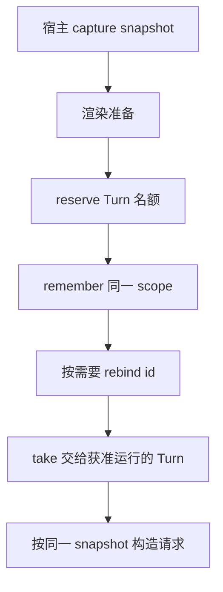

## 模型看到的不是整个工作区

文件存在于磁盘，不意味着它已经进入模型请求。对话历史、用户指令、项目说明、Skill、工具定义与记忆需要被读取、裁剪、组合，再投影到本轮上下文中。把这些步骤分开，就能解释“文件里明明有，模型却不知道”一类问题。

先看 `turn-system/agent-host/preparation/`：它包含配置、prompt surface、memory composer 等设施。再回到第 2 章的 `convertToLlm`，区分准备时组装的上下文和真正发给模型的消息。

## 记忆可以分成索引、尾部和按需读取

@source memory

`buildMemoryTailBlock` 把最近记忆包在带路径的块中。相邻函数负责 summary、超预算提示与 topic 列表；它们说明持久记忆和本轮注入内容并非逐字等同。

这是一种容量管理取舍：全部注入简单，却消耗更多上下文；只注入索引或尾部，成本小，但模型必须能定位并读取旧信息。继续追 `memory-prompt-composer.ts`，才能判断本版本如何分配具体注入预算，不能从 block formatter 推断完整策略。

还应区分 recall 和 write。允许读取历史经验，并不必然允许本次任务写入长期记忆。Session memory policy 里分别保存这些状态。隐藏子任务、legacy 来源等上下文也可能有不同写入指导。

## 同一次模型调用需要一致的 prompt 读取

想象 admission 前读到了一个模板，开始 Turn 时模板又更新了。如果前后随意重读，用户、日志与实际请求很难对应。`PromptReadScope` 把 host source 和一次 snapshot 绑在一起；Registry 负责把它交给对应的内部 Turn。

@source registry

@lab registry

观察实验中四个性质：reservation 计入容量；remember 必须对应已预留的 Turn；rebind 把同一读取交给新 ID；take 消费之后就不能重复取出。`close` 清空并禁止后续预留。

这是一段进程内交接代码。它没有 WAL、数据库事务或进程重启后的读取逻辑，所以不能把它称为 durable checkpoint。先明确一个对象承诺的生命周期，才能知道应该在哪里修恢复问题。

## 和已有实验接起来

Learn Claude Code 的金丝雀实验回答“哪段文字进入了哪次请求”。这里可以沿 composer 和 snapshot 路径解释原因。一个完整调查可以同时保存：配置、文件内容的非敏感标记、请求中的出现位置、读取时机与源码版本。

## 同一次模型调用应该看到一份一致的材料

假设用户在内部摘要任务排队期间更新了提示模板。若准备阶段读 R1，执行阶段又随手读最新 R2，就可能把两份不一致的规则拼进同一次请求。PromptReadScope 把 source 与 immutable snapshot 放在一起，表达“本次调用使用哪次捕获”。

快照不是把整个数据库永久复制出来。它是一个明确的读取视图：生产宿主选择快照，消费者按这个视图读模板。若快照失效，错误类型还能告诉外层应重建内置提示；不要把这种情况简单处理成空字符串后继续推理。

## Registry 的五个方法，各自对应一种所有权变化

reserve 先占容量；remember 把预留转成有值条目；rebind 在条目已有值后改身份；take 取出并删除；discard 放弃；close 清空并阻止后续预留。未填值的 reservation 也占容量，避免准备中的任务无限堆积。

rebind 不是任意 rename。目标被 entries 或 reservations 占用时会失败；源只有 reservation、还未 remember 时也不能通过同一分支重命名。把方法按一个状态表展开，比把它叫“缓存”更准确。

| 状态 | 允许的主要动作 | 需要守住的约束 |
| --- | --- | --- |
| 没有条目 | reserve | 总容量不能超限 |
| 只有预留 | remember / discard | 不能无预留注入值 |
| 已保存 scope | take / rebind / discard | 身份不能冲突；take 只交一次 |
| 已关闭 | 清理结束 | 不再接受新的预留 |

## 记忆文本与状态快照是两件事

buildMemoryTailBlock 决定记忆如何表现为请求文字；PromptReadScope 决定模板读取的一致视图；Session history 保存实际交互事实。三者可能出现在同一次 preparation 中，但不能混成一个“记忆系统”。

当模型忘了上一步的测试结果，先检查历史投影；当项目指令没有生效，检查发现与注入；当模板热更新后偶现行为不一致，检查快照捕获与交接。给不同故障找不同 owner，才能提出局部修复。

## 练习：把有限容量设计成反例

容量设为 1。先 reserve A，不 remember，就尝试 reserve B；随后 remember A、rebind 到 C、take C，再试 B。写出每一步返回值与占用。再测试目标身份冲突、重复 take、close 后 reserve。课程离线实验已经覆盖核心路径，你应增加一个自己的冲突用例并说明不变量。

::: interview 为什么“持久记忆写成功”不能证明“下一轮会记得”？
持久存储、召回选择、注入预算和模型实际使用是不同步骤。要核对读写 owner、Session policy、裁剪策略与最终请求。用合成金丝雀验证是否进入请求，再解释它在上下文中的位置；不能只看磁盘文件或模型的一次回答。
:::
