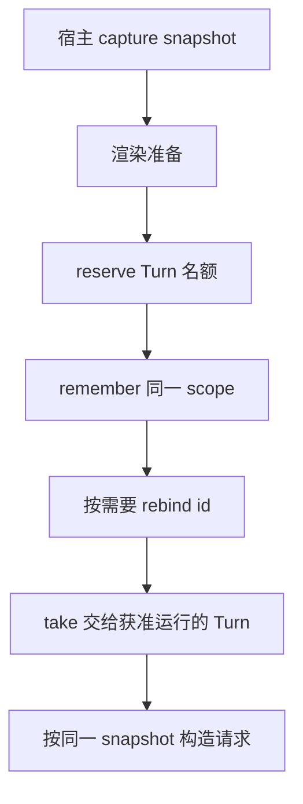

## 本章的问题

准备任务时读取 R1，排队期间用户更新模板为 R2，执行时又读最新值，就会把两代材料混进一次请求。解决办法不是全局锁住所有更新，而是明确本次调用使用哪份 snapshot。

host 的 Templates 捕获不可变视图，实际 Prompt Registry 负责把提前准备的 scope 交给正确 Turn。另一个投影保留 canonical history，按本次请求限制排除孤立结果和旧图片。

## 沿固定源码逐段拆解

@source memory

### buildMemoryTailBlock 决定记忆怎样成为请求文字

来源文本进入 prompt 尾部是一个投影步骤，不是把所有记忆数据库都复制到模型。记忆内容、模板 snapshot 与会话事实各有 owner；“忘了测试结果”要查历史，“项目规则没进入”要查注入。

@source registry

### BoundedInternalTurnPromptReadRegistry 的六个动作

reserve 在准备开始前占容量；remember 只能填入已有预留；rebind 移动已保存 scope 且拒绝目标冲突；take 同时取出并删除；discard 放弃；close 清空并阻止后续 reserve。只有预留、没有值的条目也占名额。

| 状态 | 允许变化 | 不变量 |
| --- | --- | --- |
| 未存在 | reserve | entries+reservations 不超容量 |
| 预留 | remember 或 discard | 不能没有预留就注入 scope |
| 已保存 | rebind、take、discard | 身份不冲突，只交接一次 |
| 已关闭 | 不再接纳 | 后续准备不能复用旧 registry |

图片投影要同时反向遍历消息与同消息内图片，才会保留最新项。仅把外层消息倒序，内层仍正序 map，会留下旧图而删除新图。这是本章实验能抓到的真实错误基线。

## 机制总览



## 接入贯穿项目

@implementation 05-context-memory

### 逐步跟踪本章实现

Templates.capture 复制当前键值并冻结快照，read(snapshot, key) 只从那份值中取材料。更新 Templates 本体不会改变已经捕获的 system。preparePrompt 再把模板与带来源的记忆合成请求材料，并计算摘要，以便直接比较 A、B 两个 Turn 的视图。

Prompt Registry 在 app.run 里先 reserve，准备好后 remember，消费时 take，最后 discard。它限制的是未完成的准备与读取责任，不能只按“已经存了多少正文”判断容量。课程直接装载固定上游实现，实验分别覆盖占位、快照、重复读取和淘汰边界。

projectMessages 复制历史，追踪 assistant calls 与 tool results，过滤无归属结果并补中断错误，再从后向前保留最新图片预算。原 Session 的图片和消息不被裁剪；同一条消息里的多张图也要逆序检查。实验曾让这条分支暴露保留旧图的问题，现用新旧图断言约束它。

## 运行本章实验

```bash
node --disable-warning=ExperimentalWarning labs/chapters/05-context-memory.mjs
```

@experiment 05-context-memory

## 逐项解释实验结果

捕获 R1 后更新模板，旧 snapshot 仍读 R1，新 snapshot 读 R2。容量为 1 时未填的 A 阻止 B，rebind 后 take 只成功一次。投影结果省略 old、保留 new，原始历史两个图都还在。

实验直接运行上游 Registry；模板和投影为原创教学实现。输出中的 scope 身份只是合成材料，不是持久 Session 恢复。

## 继续动手与验收

制造 rebind 的目标预留冲突，并确认旧 scope 仍可取出。再让同一消息有三张图片、前一消息有两张，只允许最新两张，断言原历史没有变化。

::: interview 提示快照和记忆正文为什么不是同一种状态？
同一 Turn 读取捕获时的材料视图，后续更新只影响新捕获者；Prompt Registry 管理准备责任与有界容量。请求投影可裁剪图片或补中断结果，原日志保持完整，不能把这两层混作同一份数组。
:::

::: interview 为什么未填入值的 reservation 也占容量？
准备中的工作同样消耗资源。若只统计 entries，大量未完成准备会绕过容量限制；reserve 必须先占名额，remember 再转换状态。
:::

::: interview 图片投影为什么要连同消息内数组一起倒序？
最新图片可能位于同一消息的后面。只倒序遍历消息、内部正序处理，会保留旧图删除新图；应按完整时间顺序从新到旧消耗预算，且不改 canonical history。
:::
