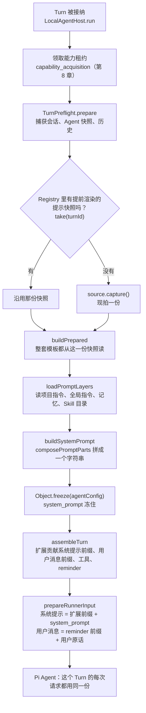
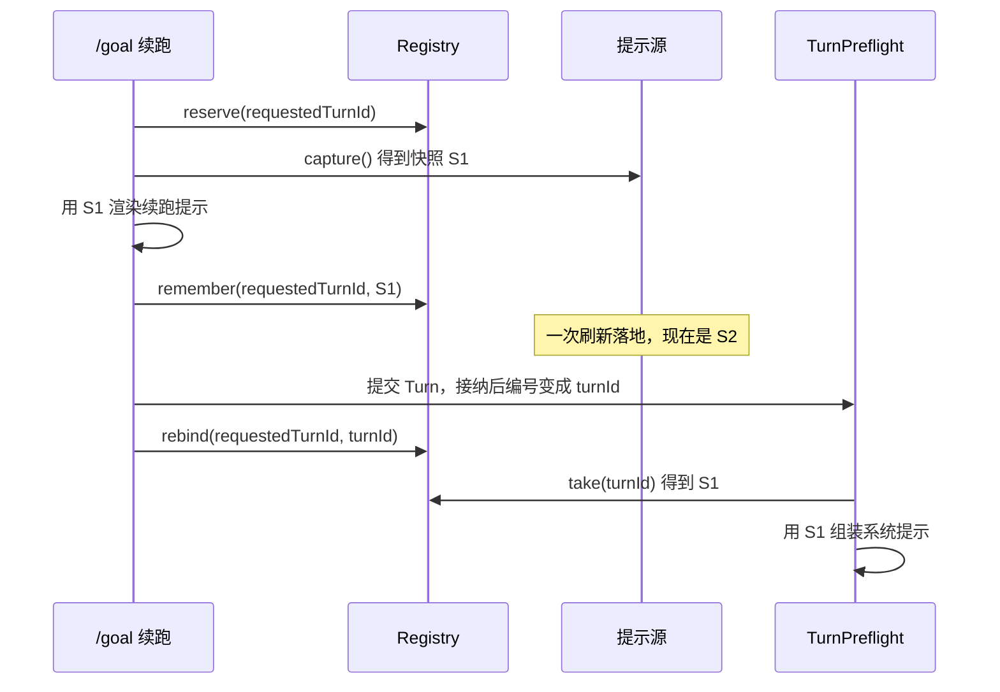

你在一个有 `AGENTS.md` 的仓库里启动 `mcode`，输入“把失败的测试修好”。这一个 Turn 里，模型会被请求十几次：读文件、跑测试、改代码、再跑测试。

每一次请求都带着同一个开头：系统提示。它不是磁盘上的某个文件，而是 MiniMax 在 Turn 开始时用七八份材料现场拼出来的：随包发布的主提示、运行时规则、你的全局偏好、项目的 `AGENTS.md`、环境信息、记忆、Skill 目录。这些材料来源不同，变化的快慢也不同。

于是有三个很具体的问题。第四次请求之前，你在编辑器里改了 `AGENTS.md`，Agent 自己也往 `MEMORY.md` 写了一条笔记：第四次请求用哪一版？日期放在哪里，才不会每过一天就让提示缓存整个失效？你用 `--system-prompt` 换掉了身份，运行规则还在不在？

Pi 的答案你在 Learn Pi Agent 第 6 章读过：分节的系统提示，会话中途变了就追加一条“某一节已更新”的消息。MiniMax 走了另一条路，而且一行 Pi 的提示构造代码都没用：整个 `packages/` 里只有 `agent-tools` 引用 Pi 的 `coding-agent` 包（取它的工具实现）；Pi 的 `Agent` 在这里只收一个字符串 `systemPrompt`，字符串怎么来的，全是 MiniMax 自己的事。


@figure assets/course/ch05-context.png Turn 开始时拍一次照，之后材料再变也不影响；会变的东西放进消息里

## 先看现象：每次请求前都重新拼一遍

最朴素的做法：每次请求模型之前调一次 `preparePrompt`，从磁盘和模板里现读。下面的实验用 host 的 `context.mjs` 把同一个 Turn 跑两遍，一遍每次请求都现读，一遍在 Turn 开始时读一次。Turn 里请求 4 次：第 2 次之前有人改了 `AGENTS.md`（用户在编辑器里改，或者 Agent 自己的写文件工具改），第 3 次之前一次提示刷新落地，身份模板换了新版；然后下一个 Turn 开始。

@lab node labs/ch05/snapshot.mjs | md

现读那张表有三个问题。

1. **同一个 Turn 里模型见过三个版本。** 请求 1 说“用 pnpm”，请求 2 变成“用 npm”，请求 3 连身份提示都变了。任务进行到一半，模型读到的指令被悄悄换掉，没有任何一条消息告诉它。
2. **缓存被反复打断。** 系统提示在请求最前面，提示缓存按前缀匹配。请求 3 改的是开头的身份模板，前缀复用掉到 5%。这里只数了系统提示；真实请求里它后面跟着整段历史，前缀一断，历史也按原价重新计费。
3. **没法复现。** 出了问题想知道“第 8 次请求到底用的哪版提示”，现读的做法没有答案，因为它根本没有“这个 Turn 的提示”这个东西。

拍照那张表里，Turn 1 的四次请求指纹相同。变化没有消失：`AGENTS.md` 和模板的两处变化在下一个 Turn 开始时一起生效，合并成一次缓存断点，而且断在 Turn 的边界上。代价是用户的修改晚一个 Turn 才生效。

最后一张小表是另一种事故。渲染一份提示要读两个模板，中间等了一会儿（真实代码里是磁盘或网络），等待期间一次刷新落地。每次读都现拍，开头是 v1、结尾是 v2：一份提示里拼进了两代材料。拍一次、反复读，两段永远同一代。

::: insight 快照的意思
读一次，之后只用这一份，不去管源头现在是什么样。MiniMax 把这个办法用在了三个不同的时间尺度上，本章按这条线索往下读。
:::

## 一个 Turn 的提示从哪里来

`LocalAgentHost.run` 在一个 Turn 被接纳以后，依次做三件事：领能力租约（第 8 章），`TurnPreflight.prepare` 捕获并准备好提示材料，`assembleTurn` 让插件和扩展贡献自己的部分。

@mm packages/local-runtime-v2/src/service/turn-system/agent-host/local-agent-host.ts#L190-L216 hl=195,204,208,211-215

`capability_acquisition` 在最前面：这一轮能用哪些插件、Skill 和工具，先定下来（第 8 章）。第 204 行的 `preflight.prepare` 是本章的主角。第 208 行的 `runtime_assembly` 在它之后，拿着 preflight 的产物 `assemblyContext` 去问各个扩展“你要往提示里加什么”。三步任何一步抛错，`run` 直接用 `this.fail` 结束这个 Turn，模型一次都不会被请求（第 2 章的终态逻辑）。

整条链路画出来：



各种材料的来源和位置汇总如下，后面几节逐个打开：

| 材料 | 来源 | 什么时候读 | 放在请求的哪里 |
| --- | --- | --- | --- |
| 主提示 | 包里的模板，TUI 用 `_v2/tui/SYSTEM.md.hbs`（约 15KB） | 文件读一次，渲染每个 Turn 做一次 | 系统提示开头 |
| 运行时规则 | `prompt-blocks.ts` 里的常量，由 `addRuntimeRules` 插进主提示 | 写死在代码里 | 并入主提示 |
| 全局指令 | `<数据目录>/AGENTS.md` | 每个 Turn 开始 | 系统提示 |
| 项目指令 | `<工作区>/CLAUDE.md` 或 `AGENTS.md` | 每个 Turn 开始 | 系统提示 |
| 环境信息 | 工作目录、是否 git 仓库、平台、shell、模型、数据目录 | 每个 Turn 开始 | 系统提示 |
| 记忆 | 用户档案、`MEMORY.md`、主题清单 | 每个 Turn 开始 | 系统提示 |
| Skill 目录 | 每个 Skill 的名字和描述，有 token 预算 | 每个 Turn 开始 | 系统提示末尾 |
| 日期、记忆增量、会话编号 | reminder 链 | 每个 Turn 开始 | 这一轮用户消息的开头 |
| 插件和扩展的贡献 | `assembleTurn` | 每个 Turn 开始 | 系统提示最前面、用户消息前缀 |
| 工具声明 | 第 4 章 | 每个 Turn 开始 | 请求的 `tools` 字段 |

## Turn 开头：能变的东西先捕获，再使用

打开 `TurnPreflight.prepare`：

@mm packages/local-runtime-v2/src/service/turn-system/agent-host/preparation/turn-preflight.ts#L120-L173 hl=123,134-137,138-143,147,148-162,164-173

- **第 120～137 行**：会话所有者和 Agent 快照只捕获一次。注释写明了原因：并发的 Agent 名册刷新，不能把一个正在跑的 Turn 拉回旧所有者，所以“下面没有任何地方再重新解析这两个名字”。这是 Agent 层面的同一个想法。
- **第 138～146 行**：读历史。续跑（`continuation`）模式下，发给模型的历史会省掉被中断的那一次 assistant 尝试，所以单独存成 `runnerHistory`。
- **第 147 行**：`internalTurnPromptReads.take(turnId)`。如果有人提前为这个 Turn 渲染过提示（`/goal` 续跑、`/review` 这类先写提示、后提交 Turn 的流程），这里取走他留下的快照。后面有一节专门讲。
- **第 148～162 行**：`preparation.prepare` 才是真正拼提示的地方。拿到 `promptRead` 的话一并传进去。
- **第 164～173 行**：把准备好的材料整理成 `assemblyContext`，交给扩展。这份上下文是“无密钥”的：`assembly-context.ts` 里有一份字段白名单 `AGENT_CONFIG_ALLOWLIST`，凭证类的键（`isSensitiveConfigKey`）一律剔除。插件拿到的是一份过滤过的副本。

`prepare` 进到 `LocalAgentConfigBuilder.buildPrepared`：

@mm packages/local-runtime-v2/src/service/turn-system/agent-host/preparation/config/local-agent-config-builder.ts#L181-L213 hl=187-189,201-202,206-211

第 188～189 行决定这个 Turn 用哪份快照：preflight 带来的 `input.promptRead` 优先，否则 `source.capture()` 现拍一份。接下来模板读取（输出修订指令、重试续跑提示、工作流提示的校验）和 `buildForPromptScope` 里的渲染，用的都是这同一个 `promptRead`。

第 201～211 行是整套回退：任何一次读取抛出 `PromptSnapshotInvalidError`，就改拍 `captureBuiltin()`（随包的内置快照），**整套重来**，返回值里的 `promptRead` 也换成内置那份，让后面的环节知道实际用了哪一份。不会出现“大部分用新版、缺的那个用内置”的拼凑。

`prepare` 的出口把结果冻住：

@mm packages/local-runtime-v2/src/service/turn-system/agent-host/preparation/local-agent-preparation-service.ts#L99-L116 hl=100,108,114

第 108 行 `Object.freeze({ ...builtAgentConfig })`：系统提示字符串就在这个配置里（`system_prompt`）。执行器后面用 `readPreparedSystemPrompt` 把它读出来，交给 Pi 的 `Agent`。从这一刻起，这个 Turn 的每一次模型请求用的都是这一个字符串。类的注释说，这个准备服务被正常 Turn、手动压缩、归档标题和 Context Debug 共用；构造器里 PTC 那处的注释还特意写明“提示前缀不取决于是什么发起了这个 Turn”。

## 三种钟：进程、Turn、消息

“快照”在这里不是一个动作，而是三个时间尺度。最小的一个，是随包发布的提示文件本身：

@mm packages/local-runtime-v2/src/service/agent/builtin/catalog.ts#L103-L122 hl=104-105,110-112,114-119

`frozenPromptSource` 返回一个提示源，它的 `capture()` 和 `captureBuiltin()` 永远交出同一个句柄 `Object.freeze({})`。这个句柄是个空对象，它的身份就是全部意义：`read` 先检查传进来的句柄是不是自己发的（第 115 行），再去一张 `Map` 里取内容。这张 `Map` 来自 `frozenAssets()`，它调用 `captureLocalPromptAssets`，注释写的是“在这次运行里渲染任何模板之前，先把整个包读完”。受管的键找不到时返回 `invalid`，而不是 `missing`，这是整套回退的触发条件。

这份冻结的包是怎么接到命令行上的？看接线的地方：

@mm packages/local-runtime-v2/src/application/session/runtime-prompt-support.ts#L22-L36 hl=22,24-26,36

第 26 行 `enabled: false`，注释是一条 Hotfix：让随包的提示和这个客户端配对，即使已有的配置里打开了自动更新，也不要绑定旧的磁盘缓存。也就是说，0.7.2 的命令行**把远程提示刷新关掉了**，用的是第 22 行的冻结源。提示文件在渲染任何模板之前就整包读进内存，一次渲染不会一半读到旧文件、一半读到新文件（比如包正在被升级覆盖的时候）。

远程刷新的那套实现（`PromptConfigService`、`EncryptedPromptStorage`）还在源码里，它揭示了快照的另一种形态：新版本先写进暂存目录，校验通过后 `rename` 成 `versions/<cacheId>`，最后原子地替换 `current.json`；`PromptReadContext` 记着自己的 `directory`，旧快照永远读旧目录。第三种形态是前面见过的 `Object.freeze({})`：句柄不透明，内容在源里。接口一致，所以调用方（`buildPrepared`、Registry）不关心背后是哪一种。

三个时间尺度放在一起：

| 钟 | 冻住什么 | 靠什么冻住 | 什么时候换新 |
| --- | --- | --- | --- |
| 进程 | 随包的提示文件；`--system-prompt-file` 的内容；会话的 PTC 模式 | `captureLocalPromptAssets` 一次读进 `Map`；`resolveSystemPromptOverrides` 启动时读一次；PTC 模式在会话创建时定下 | 进程重启 |
| Turn | 会话和 Agent 快照、历史、项目与全局指令、记忆、环境、Skill 目录，以及拼成的 `system_prompt` | `TurnPreflight` 捕获，`Object.freeze(agentConfig)` | 下一个 Turn 开始 |
| 一条消息 | reminder 前缀：日期、记忆增量…… | 写进用户消息正文，随这条消息进入历史 | 不再换 |

PTC 那一行的依据在构造器的注释里：会话的工具调用模式“在会话创建时确定，只在摘要压缩后刷新”，所以切换 `beta.ptc` 开关不会改动一个进行中的会话的提示前缀。连一个开关都要为前缀稳定让路，可见这件事被看得有多重。

## 系统提示的配方：顺序就是设计

材料读齐了，由 `buildSystemPrompt` 按固定顺序拼：

@mm packages/local-runtime-v2/src/service/turn-system/agent-host/preparation/config/local-agent-config-builder.ts#L759-L789 hl=761-764,774,776-788

- **第 761～764 行**：先判断是不是“交互界面”。根会话是，后台任务的子 Agent 不是。这个布尔值决定后面两件事：启动参数覆盖对谁生效（第 774 行），子 Agent 要不要多一段 `# Session Context`（第 779～785 行）。
- **第 776～788 行**：交给 `composePromptParts` 的顺序是：主体（身份加规则）、环境块、（仅子 Agent 的会话上下文）、记忆块、Skill 目录。
- 第 786 行给记忆块打上 `MEMORY` 标记，第 787 行给 Skill 目录打上 `SKILLS` 标记。后面讲 `composePromptParts` 时会看到这些标记的用途。

“主体”由 `buildIdentityPrompt` 拼：

@mm packages/local-runtime-v2/src/service/turn-system/agent-host/preparation/config/local-agent-config-builder.ts#L798-L843 hl=806-807,821-823,836-842

- 第 821～835 行：身份有两条路。给了 `customPrompt` 就用它（经过 `addRuntimeRules`，下一节细看），否则是“人设 + 核心提示（也经过 `addRuntimeRules`）+ 基础提示”。
- 第 836～842 行是收尾的顺序：**身份 → 追加的提示 → 指令前言 → 全局指令 → 项目指令**。全局在前、项目在后，和 Pi 一样“从通用到具体”：越靠后的越像对前面的细化。
- 第 806～807 行：前言（`INSTRUCTIONS_CONTEXT_PREAMBLE`）只在至少有一层指令时才出现，注释说得直白，空工作区不该声称“下面是指令”。

最后一步 `composePromptParts`，host 里的对应实现：

@code host/src/context.mjs#composePromptParts hl=454,458-459,462-463

空段跳过。上一段只是一行标题时，下一段紧跟在后面（一个换行），否则隔一个空行。每个带 `kind` 的段落会记下自己在整段文字里的起止位置。上游的 `composePromptParts`（`local-agent-config-builder.ts` 第 845～867 行）是同样的逻辑，只是用 `reduce` 写，还要平移嵌套的范围。这些范围是为上下文用量统计留的：`MEMORY`、`SKILLS`、`OTHER` 三类各占多少字符，TUI 的上下文可视化按这三类上色。

把前面的材料全部拼起来看一遍：

@lab node labs/ch05/assemble.mjs | md

三点值得看。顺序和配方一致：身份和规则、前言、全局指令、项目指令、环境、记忆、Skill 目录。第二，系统提示里**没有日期**，日期在用户消息的 reminder 里（下一节细看）。第三，记忆块占了系统提示的将近三分之一，所以它们有严格的预算，下面两节细看。

## 项目指令：先到先得，三十二 KB 封顶

读项目指令的函数很短：

@mm packages/local-runtime-v2/src/service/turn-system/agent-host/preparation/static-prompt-reader.ts#L120-L130 hl=124,127

三条规则都在这十几行里。名字列表是 `[LEGACY_AGENT_INSTRUCTIONS_FILE, 'AGENTS.md']`，那个常量在源码里写成十六进制转义，解出来是 `CLAUDE.md`，所以顺序是 `CLAUDE.md` 在前、`AGENTS.md` 在后。路径只是 `join(workspaceDir, name)`：**只看工作区根目录，不往上找**。`if (content)` 一行：找到的第一个**非空**文件就返回，另一个根本不读，**不合并**。

内容的读取和预算在下面：

@mm packages/local-runtime-v2/src/service/turn-system/agent-host/preparation/static-prompt-reader.ts#L177-L221 hl=184-189,200-203,206-221

第 184～188 行把内容 `trim` 之后按**字节**数衡量，不超过 32KB 原样返回。超过就进 `truncateProjectInstructions`（第 206～221 行）：给末尾的说明留出空间，取一个完整 UTF-8 字符边界之内的前缀；如果前缀里最后一个换行落在后 20% 的位置，就退到那个换行，免得切断半行；最后接上一条说明，告诉模型“省略的部分请直接去读源文件”。这条说明很关键：预算是为了控制成本，不是要对模型隐瞒，被截掉的部分模型可以自己用 Read 补。第 200～203 行：文件不存在算“没有”，其他错误（比如路径是个目录）会抛出来，让这个 Turn 失败。

全局指令走另一条函数 `readBoundedTextOrEmpty`（同一文件第 238～247 行）：文件超过预算，**整份丢弃**，不截断。这是故意的不对称：全局指令有专门的写入口，`GlobalInstructions.write` 本来就拒绝超限内容，读到一份超限的文件说明它在外面被改过，截断一份来历不明的文件没有意义。

@lab node labs/ch05/instructions.mjs | md

对照 Pi 的做法，差别一目了然：

@pi packages/coding-agent/src/core/resource-loader.ts#loadContextFileFromDir

Pi（v1.5.0，Learn Pi Agent 读的那一版）在每个目录里依次找 `AGENTS.override.md`、`AGENTS.md`、`CLAUDE.md` 这几个名字，取第一个**存在**的，空文件也算；然后从当前目录一路向上，把各层目录的文件按“全局、仓库根、子项目”的顺序合并。MiniMax 的取舍是：只看一个目录，空文件不算数，大小有硬上限。

Claude Code（本地还原源码 2.1.88 的 `utils/claudemd.ts`）则分四层：托管策略、用户、项目（从当前目录向上遍历，`CLAUDE.md`、`.claude/CLAUDE.md`、`.claude/rules/*.md`）、本地私有的 `CLAUDE.local.md`，文件里还能用 `@路径` 引用别的文件（深度上限 5）。它的 40000 字符只是“推荐上限”，用来在诊断里标出过大的文件，不截断。有意思的是，MiniMax 的指令前言有两句话，第一句和 `utils/api.ts` 里 `prependUserContext` 的开头逐字相同，第二句“这些指令覆盖默认行为，必须逐字遵循”和 `claudemd.ts` 里的常量逐字相同。

::: warn 指令是注入面
指令进的是**系统提示**，前言还明确要求“覆盖默认行为”。克隆一个陌生仓库再启动 Agent，等于让仓库作者给你的 Agent 下了一份高优先级指令。Pi 的信任机制只管项目里的可执行扩展，管不到这段文字；真正的防线是权限和沙箱（第 7 章）。
:::

## 记忆：系统提示里放一份快照，之后只送增量

记忆块的组装集中在 `buildCanonicalMemoryBlocks`：

@mm packages/local-runtime-v2/src/service/turn-system/agent-host/preparation/config/memory-prompt-composer.ts#L176-L207 hl=184-193,194-200,201,203-205

`MEMORY.md` 没有超限时（`MEMORY_TAIL_INJECTION_CAP_CHARS` 是 10KB），只放一个尾部块，其实就是全文。超限时分两种：有摘要索引的话（第 184～193 行），先放摘要块（取前 4KB），再放**尾部**块（`slice(-CAP)`，最新的 10KB）；没有摘要的话（第 201 行），尾部块后面跟一条“预算用完了”的说明。主题文件（第 203～205 行）**只放名字、描述和路径**，正文由模型需要时自己读。取尾部是因为记忆文件是追加写的，最新的条目在最后。

用户档案块的处理类似，同一文件里还有每日摘要：最近 8 天，前两天各放最多 10KB 的原文，更早的每天压成 500 字符的摘要。

这些块是系统提示的一部分，所以一个 Turn 开始时是什么，整个 Turn 就是什么。Agent 在 Turn 中间用 `memory` 工具写了笔记，系统提示里的记忆块要到下一个 Turn 才会更新（模型自己当然记得，工具调用就在历史里）。至于“**变了什么**”，由另一条路径告知：

@mm packages/local-runtime/src/memory/local-data-collector.ts#L160-L182 hl=160-164,165-182

`LocalDataCollector` 为每个会话保存一份**基线**：上一轮看到的记忆内容。每次 `collect` 都用当前内容和基线比，然后把基线推进到当前内容（第 169～182 行）。

@mm packages/local-runtime/src/memory/local-data-collector.ts#L426-L453 hl=437-439,449-453

差异的计算在 `diffMemory`：`MEMORY.md` 只是在末尾追加了，就只送新增的那一段（`suffix`）；被改写过，送全文；摘要和用户档案变了也送最新内容。`baseline` 不存在（第一轮）就不送：系统提示里已经有完整内容。

@lab node labs/ch05/memory.mjs | md

第一张表里，块的**拼装逻辑是 host 的，块的文字是上游 `prompt-blocks.ts` 的真实构造器生成的**，最右一列确认 host 的块顺序和上游完全一致。第二张表是五个 Turn 里增量的变化，包括“什么都没变就什么都不送”。末尾那个块是上游真实的 `agentMemoryUpdateProvider` 的输出，文字写的是“新条目已追加到你的 MEMORY.md”。

要说清楚一个容易混的点：下一个 Turn 开始时，`MEMORY.md` 的新内容**既**出现在重新渲染的系统提示里，**又**以增量的形式出现在 reminder 里。前者是材料，后者是“刚刚变了什么”的提示。源码没有解释为什么两处都留着，我的推测是 reminder 模块被多种运行形态共用（`scene` 字段区分 local 和 cloud），在系统提示不会每轮重建的形态里，增量是必需的。这和 Pi 的“系统提示不动、追加一条更新”不同：MiniMax 的系统提示在 Turn 边界上会跟着文件变，这次变化会让缓存断一次。Claude Code 的做法又不一样：`constants/prompts.ts` 里 `memory` 是一节用 `systemPromptSection` 声明的系统提示，在会话内缓存，直到 `/clear` 或压缩才重算。

## 会变的东西不进系统提示：reminder

系统提示在一个 Turn 里不变，所以“每一轮都不一样”的东西不能放进去。它们变成 `<system-reminder>` 块，写在**这一轮用户消息的最前面**。生成 reminder 的是 `SystemReminderService`：

@mm packages/agent-modules/system-reminder/src/service.ts#L170-L213 hl=170-172,175-177,182-190,210-213

第 133 行（不在摘录里）`collector.collect(...)` 一次性收集好这一轮的全部材料，所有 provider 读的是同一份 `data`，不会各自再去读磁盘：这又是一次“拍照”。然后按注册顺序跑 provider（第 182～190 行），返回非空的块用空行隔开，包进一个 `<system-reminder>`（第 210～213 行）。第 170～172 行是一个开关：某些模型关掉了 reminder，这时只跑标了 `critical` 的几个，其余都不跑。整个 `buildReminder` 包在 `try/catch` 里（第 226～231 行）：任何 provider 抛错，只记一条日志、丢掉这一轮的 reminder，不让 Turn 失败。

provider 本身很简单，看日期所在的那个：

@mm packages/agent-modules/system-reminder/src/providers.ts#L192-L199 hl=195-198

第 1 轮给完整的 `<agent-context>`，第 2 轮起给精简版；日期（`date:` 一行）每轮都在。系统提示里没有日期，TUI 的主提示反倒专门指路：

@mm packages/local-runtime-v2/assets/agents/_v2/tui/SYSTEM.md.hbs#L40-L45 hl=42-43

第 42～43 行要求模型把“today”“latest”“now”对照“上下文里的当前日期”，这个日期就是 reminder 里的 `date:`。

运行上游真实的默认链（26 个 provider，其中 4 个 critical），看每一轮到底触发了谁：

@lab node labs/ch05/reminders.mjs | md

第 1 轮触发三个：`agentContext`，以及两个按间隔退避的提醒（`mediaOutputReminder`、`asyncAudit`：第 1 轮提醒一次，之后分别隔 10、20、40 轮和 5、10、20 轮才再提醒）。第 2 轮只剩精简的 `agent-context`，字符数从 970 降到 169。重复的提醒每轮都要付 token，所以链上的 provider 大多自带节奏。第 3 轮记忆有更新，两个更新块出现。最后一行是关掉 reminder 的模型：26 个 provider 里只跑 4 个，`agent-context`（含日期）也被关掉了。

reminder 有了，怎样拼进这一轮的用户消息？

@mm packages/local-runtime-v2/src/service/turn-system/agent-host/execution/executor.ts#L552-L594 hl=552,558-564,572-582,586-591

这一段把两边的拼装放在一起看。第 552 行：**系统提示 = 扩展贡献的前缀 + 配置里冻住的 `system_prompt`**。第 558～564 行是一个更彻底的“覆盖”：轻量会话（`mcode --mode lightweight`）会把整个系统提示换成一小段固定文字，同时不带工具。第 572～582 行拼用户消息的前缀：扩展和工具目录贡献的前缀、扩展的 reminder、host 的 reminder（`SystemReminderService` 的输出，加上附件和斜杠 Skill 的提示）、插件钩子的上下文。第 586～591 行把前缀和用户原话接在一起。

接起来以后，怎么知道哪一段是用户原话？

@mm packages/local-runtime-v2/src/service/turn-system/agent-host/execution/user-input-control.ts#L377-L393 hl=381-387,388-392

`withGenuineQueryProvenance` 给这条消息记下 `canonicalTextRange`：用户原话在整段正文里的起止偏移。压缩（第 6 章）要收集“最近的用户消息”，就是从存下来的正文里按这个范围切出原话，而不是把 reminder 当成用户说的话（`checkpoint-format.ts` 的 `readGenuineUserQueryText`）。发给模型之前，`stripHostOnlyFields` 会把这个字段去掉。

这里的设计对缓存很友好：reminder 写进了消息正文，随这条消息进入历史，之后永远不再重算。历史里的老消息逐字节不变，缓存才能一直命中到它们；如果每次请求前都重新渲染一遍老消息的 reminder，前缀就变了。

## 覆盖系统提示：身份换掉，规则留下

用户可以在启动时覆盖主 Agent 的提示：`--system-prompt`、`--system-prompt-file` 替换身份；`--append-system-prompt`、`--append-system-prompt-file` 在身份后追加。读取在启动时：

@mm packages/tui/src/cli/system-prompt-options.ts#L107-L129 hl=107-108,112-123,124

文件在进程启动时**读一次**，读不到或者是空文件就**让启动失败**，不会悄悄带着没打补丁的提示跑。覆盖只存在进程内存里，不写进会话，也不写进配置（`systemPromptRestartArguments` 在登录后重启时把原来的参数带上）。内联文本和文件是同一个槽位的两种写法，不能同时给；写在离 `exec`、`acp` 这类子命令最近的位置的那个槽位，整体优先于更靠外的。

读进来的覆盖项交给构造器。前面的 `buildIdentityPrompt` 第 821～823 行已经显示：`customPrompt` 不是原样放进提示，而是要先过 `addRuntimeRules`：

@mm packages/local-runtime-v2/src/service/turn-system/agent-host/preparation/config/runtime-prompt-rules.ts#L8-L39 hl=13,20-26,27-37

`addRuntimeRules` 往提示里插三组规则：`# Harness`（说明 `<system-reminder>` 是 harness 注入的，不是用户说的，加上文件操作规则）、`## Response Style`（语言规则）、交互界面才有的 `## Preamble messages`（调用工具之前先说一句话）。哪个标题已经在提示里，规则就插在它下面；没有就在末尾新建。运行真实的上游函数：

@lab node labs/ch05/override.mjs | md

第一张表是同一个工作区在不同启动参数下的提示成分：`--system-prompt` 换掉的只有“身份”一列，运行时规则、项目指令、环境、记忆、Skill 目录都在；`--append-system-prompt` 只多一段文字；在后台任务的子 Agent 上两个参数都不生效，它们保留自己的专用提示（仓库文档 `docs/tui-capabilities.md` 里也这样写）。中间是上游真实的 `addRuntimeRules` 给一句话的“海盗”提示做的事，最后一张表证明 host 的简化版和上游函数逐字一致。

为什么规则要留下？`<system-reminder>` 的规则是整套机制的前提：如果身份被换掉后，模型不知道这种标签是 harness 注入的，那 reminder 里的内容（日期、记忆增量、任务提醒）就会被当成用户的话。用户换掉的是“你是谁”，不是“这个运行环境怎么工作”。

Pi 在这个问题上取了更干脆的做法：`customPrompt` 一设，工具清单、规则、文档指引整节都不生成，只剩你写的那一段加上项目上下文和 Skill；`appendSystemPrompt` 成为独立的 `addendum` 节。简单，代价是用户得自己负责写对规则。

## 提前渲染的提示：Registry 与整包回退

还有一类提示不是用户输入，而是系统自己生成的：`/goal` 续跑的“请继续推进目标”、`/review` 的审查提示。它们的特点是**先渲染提示文字，后创建 Turn**：提示要等到进队列、被接纳才变成 Turn，这中间模板可能已经刷新过。



如果 preflight 重新 `capture()`，就会拿到 S2：提示是用 v1 渲染的，系统提示却是 v2 的，两代材料又拼到了一个请求里。Registry 的任务就是把 S1 递过去：

@mm packages/agent-core/src/prompt-read.ts#L54-L101 hl=62-65,69-70,73-82,84-89,96-100

这个类有六个方法，每一个都小心地守着一个边界：

- `reserve` 先占名额。已经预留或存在的编号不能再占（第 62 行）；**预留也算容量**（第 63 行）：`entries.size + reservations.size`。
- `remember` 只能填入已有的预留（第 69 行 `!this.reservations.delete(turnId)` 就返回）。没有预留硬塞，什么都不会发生。
- `rebind` 把已存的快照挪到新编号，因为被接纳的 Turn 的编号可以和提前占位时用的不同（第 73～82 行）。目标编号已有条目或预留就拒绝，原来的不动。
- `take` 取出的同时删除（第 84～89 行）：只能取一次，预留和条目一起清掉。
- `discard` 放弃，`close` 清空并拒绝以后的 `reserve`。

调用方这一头长这样：

@mm packages/local-runtime/src/review/prompt-read-handoff.ts#L13-L36 hl=18-21,24-26,28-32,34-36

`reserveReviewPromptRead` 在提交子 Turn 之前就占位，注释写得清楚：让 preflight 消费它渲染时的那份快照。占不到名额就返回 `undefined`，`hosted-capability.ts` 随即让这次审查以 `failed` 结束（“代码审查的提示快照交接不可用”）：宁可失败，也不拿一份对不上的快照继续。接纳后的编号和占位时的不同才需要 `rebind`，出错的路径统一 `discard`。`goal` 那一路（`thread-goal/prompt.ts` 第 72～80 行）同样是 `reserve`、`remember`，任何失败路径都 `discard`。

提示怎么“读一整包”也有讲究：

@mm packages/local-runtime/src/runtime/prompt-read.ts#L30-L47 hl=34-39,41-46

先在传进来的那份快照里把**所有**要用的模板读完（`readPromptBundle` 对每个键调用 `source.read`，只要有一个 `invalid` 就整包作废，第 66～67 行）。作废以后改拍内置快照，把整包再读一遍。注释的原话是：不让调用者在一个模型请求里拼出两个版本的模板。

@lab node labs/ch05/handoff.mjs | md

第一张表走通了时间线：续跑提示在 v1 时渲染，刷新之后，经 Registry 取走快照的 preflight 仍然用 v1，不经 Registry 重新拍的会用 v2。第二张表是**上游真实的** Registry 在容量 2 时的行为：预留算容量、`rebind` 拒绝撞车、`take` 只能取一次。第三张表是整包回退：新的一套里缺了一个受管的模板，两个都读内置，而逐键回退会拼出“新的一半加内置的另一半”。

要实话实说：0.7.2 的命令行里提示源是冻结的，两次 `capture()` 拿到同一个句柄，这条保护眼下不会被触发。它是为“提示可以在运行中刷新”的运行形态准备的，接口、Registry 和调用点都已经到位。把它读透的价值在于，你以后读到任何“先算好、稍后再用”的设计，都会去问同一个问题：中间源头变了怎么办。

## 怎样知道提示稳不稳：指纹

前缀稳定如此重要，MiniMax 把它做成了线上指标：

@mm packages/agent-core/src/pi-turn-runner/assembly-fingerprint.ts#L19-L36 hl=24-26,31-35

只对提供商看得见、并且影响缓存的两样东西算指纹：系统提示和工具声明。历史被**故意排除**，否则正常的消息增长会被当成“提示变了”。注释还写了一句：“空白也精确保留，缓存看得见，人眼看不见。”

@mm packages/agent-core/src/pi-turn-runner/metrics.ts#L339-L366 hl=339-346,352,359-366

每次请求前，用本次的指纹和同一会话、同一模型的上一次比。`previous.turnId === diagnostics.turnId` 决定标签是 `within_turn` 还是 `across_turn`，结果是 `stable` 或 `changed`，计入 `pi_llm_assembly_stability_total`。`within_turn` 的 `changed` 应该永远是零（快照保证的），`across_turn` 的 `changed` 是正常的：用户改了指令、Agent 写了记忆、换了 Skill。前者出现就是 bug，后者飙升就该追问是谁让前缀乱了。第一个实验表里的“系统提示指纹”一列，用的就是 host 里同样思路的 `fingerprintPrompt`。

## 为什么这样设计

三个设计，都是同一种取舍：**让材料在需要一致的地方一致，让变化在可以预期的地方发生。**

| | Pi（v1.5.0） | Claude Code（2.1.88） | MiniMax Code（0.7.2） |
| --- | --- | --- | --- |
| 谁拼系统提示 | `coding-agent` 的 `buildSystemPromptSections`，分节、带标签 | `constants/prompts.ts` 加 `systemPromptSection`（会话内缓存） | `LocalAgentConfigBuilder.buildSystemPrompt` |
| 项目指令放在哪 | 系统提示的 `<project_context>` 节 | 第一条用户消息（`prependUserContext`，包在 `<system-reminder>` 里） | 系统提示，身份之后、环境之前 |
| 指令文件 | `AGENTS.override.md`、`AGENTS.md`、`CLAUDE.md`，逐层向上合并 | 四层加 `@include` | `CLAUDE.md`，否则 `AGENTS.md`；只看工作区根目录，加一份全局 |
| 预算 | 没有字节预算（读取和拼装的代码里没有截断逻辑） | 40000 字符是警告阈值 | 项目、全局各 32KB：项目截断，全局整份丢弃 |
| 日期 | 不放 | `currentDate` 随用户上下文放进第一条用户消息 | 在每轮的 reminder 里（用户消息） |
| 会话中途改了指令 | 追加一条“某节已更新”的系统消息 | 指令读取被缓存，`/clear` 和压缩之后才重读 | 下一个 Turn 重读；Turn 内冻结 |
| 覆盖系统提示 | `customPrompt` 连规则一起替换 | 本章没读 | 只换身份，运行时规则留下 |

三个值得展开的取舍：

- **指令放系统提示还是用户消息。** Claude Code 把 `CLAUDE.md` 放在第一条用户消息里，`getUserContext` 被 `memoize`，注释写的是“整个会话期间缓存”，前缀因此整个会话不变，代价是改了不会立刻生效。MiniMax 放进系统提示：权威更高，每个 Turn 重读，修改下一个 Turn 就生效，代价是每次指令或记忆变化都让缓存在 Turn 边界上断一次。这是同一个问题的两个合理答案。
- **Turn 级冻结。** 同一个 Turn 里一致，换来可复现、可归因（指纹、日志）；代价是变化要等一个 Turn。Pi 选的是追加更新消息，缓存不断，代价是模型要在历史里拼出“最新的指令是什么”。
- **整包回退。** 宁可用内置的、旧的、完整的一整套，也不拼两代。新鲜度输给一致性。

reminder 的设计也是同一种思路：把易变的东西从系统提示里搬走，放进“写一次就不再改”的用户消息里，并给每个 provider 配上退避的节奏，控制重复提醒的成本。

## 动手：host 里的 context.mjs

`host/src/context.mjs` 是这一章的实现。文件顶部的注释列出了它对应的每一处上游代码，以及三种“钟”。先看快照的基础，`Templates`：

@code host/src/context.mjs#Templates hl=54-62,68-72

`capture()` 拷贝并冻结，返回之后无论 `update` 多少次，旧快照读到的还是拍照时的值；`captureBuiltin()` 是内置那份，整包回退要靠它。`read` 在快照里找不到键就抛错，对应 `invalid`。

系统提示的配方：

@code host/src/context.mjs#buildSystemPrompt hl=484-488,489-499

第 484～485 行：覆盖只对交互界面生效。第 488 行：覆盖提示和模板提示走同一条路 `addRuntimeRules`。第 489～499 行就是前面读过的那个顺序，一行一段。`preparePrompt` 在它外面做最后一步：

@code host/src/context.mjs#preparePrompt hl=549-556,558-566

`templates.read(snapshot, "system")` 从传进来的快照读身份模板，返回的对象整个冻结（第 558 行起）。`system` 是分节数组，`text` 是拼好的字符串，`ranges` 是分账用的范围，`fingerprint` 是稳定性指纹。`memories` 参数和 `system` 数组都是第 5 章最初的接口，保持不变，`app.mjs` 和 `turns.mjs` 不用改。

简化的地方：读磁盘用同步 API；`addRuntimeRules` 不处理代码围栏里的标题；规则文字是自己的短版本，实验里换成上游原文验证一致；远程刷新没有实现。保留下来的是顺序、预算、冻结的位置和回退的规则。

本章还留了一个入口，让你把整个机制接起来：

```js
const snapshot = templates.capture();                       // 拍照 1：模板
const layers = loadPromptLayers({ workspaceDir, dataDir, memory });  // 读磁盘：指令、记忆
const prompt = preparePrompt(templates, snapshot, [], { ...layers, environment, skillsCatalog });
const reminder = buildReminder({ turnCount, sessionId, workspaceDir, date });
const message = buildUserMessage({ prefixes: [reminder], userText });
```

回归实验 `node labs/chapters/05-context-memory.mjs` 把上面所有场景都跑一遍并检查；`npm run lesson -- 5` 效果相同。

## 你来改

每道题先写下预测，再动手验证。改完直接运行对应的实验脚本，表格会先打印出来，脚本末尾的断言会失败。

::: predict 先到先得的顺序
把 `readProjectInstructions` 里的 `PROJECT_INSTRUCTION_FILES` 改成 `["AGENTS.md", "CLAUDE.md"]`，运行 `node labs/ch05/instructions.mjs`。“CLAUDE.md 和 AGENTS.md 都有”那一行读到的文件是哪个？
???
读到 `both/AGENTS.md`。名字列表的顺序就是优先级：第一个**非空**文件胜出，另一个整个被忽略，不合并。这就是为什么一个同时为多种 Agent 写了说明文件的仓库，在 MiniMax 里读到的是 `CLAUDE.md` 的内容。Pi 的列表把 `AGENTS.override.md` 和 `AGENTS.md` 放在前面，选择不同，机制一样。
:::

::: predict 子 Agent 也吃启动参数
把 `buildSystemPrompt` 里 `const custom = interactive ? overrides?.customPrompt?.trim() : undefined;` 改成不看 `interactive`，运行 `node labs/ch05/override.mjs`。表格最后一行（后台任务的子 Agent）的“身份提示”变成什么？
???
变成“海盗（被换掉）”，“追加的文字”变成“有”。上游只对交互界面生效（第 774 行的 `interactiveSurface ? overrides : undefined`），文档里也写明：子 Agent 保留随包的提示。原因是后台任务、验证者这些子 Agent 各有专用的角色提示，主 Agent 的 `--system-prompt` 只该改“你正在和用户对话的这个 Agent”，不能顺手改写别人的角色。
:::

::: predict 不拷贝的快照
把 `Templates.capture` 里的 `values: Object.freeze({ ...this.values })` 改成 `values: this.values`（不拷贝）。运行 `node labs/chapters/05-context-memory.mjs`，哪几项检查会失败？
???
“旧快照仍读到 R1”失败，读到了 R2；`preparePrompt` 里“以身份模板开头”的检查也会连带出问题。原因是快照和模板共用同一个对象，`update` 直接改了它。`replaceAll` 因为是整个换对象，旧快照还留着旧的，所以“混合两代”的小实验反而不受影响。这说明“拷贝”和“冻结”是两个独立的保护：拷贝防止源头改动影响快照，冻结防止使用者改动影响快照。MiniMax 的做法更彻底：句柄是一个不透明的空对象，数据根本不在句柄里。
:::

## 面试题

::: interview 一个 Turn 的系统提示由哪些材料按什么顺序拼成？为什么这样排？
以 MiniMax 的 `buildSystemPrompt` 为例，顺序是：身份提示（加运行时规则）、追加的提示、指令前言、全局指令、项目指令、环境信息、记忆块、Skill 目录。

排序的依据是越稳定越靠前、越具体越靠后：身份和规则几乎不变，全局指令比项目指令更通用，记忆和 Skill 目录变化最频繁，放在后面，前面部分的缓存不会被它们连累。每个 Turn 变化的东西（日期、记忆增量）根本不进系统提示，进用户消息。

加分点：能说出前言只在至少有一层指令时才出现，以及 `composePromptParts` 还顺手记下了 `MEMORY`、`SKILLS`、`OTHER` 的字符范围，供上下文用量统计使用。
:::

::: interview 为什么要在 Turn 开始时拍快照？不拍会出什么问题？拍了有什么代价？
不拍的问题有三个：同一个 Turn 里模型会看到不同版本的指令（中途改 `AGENTS.md`、Agent 自己写记忆、模板刷新）；提示缓存被反复打断，系统提示在最前面，一断就连历史一起重新计费；读多个文件、多个模板时可能读到两代材料，拼成一份没人写过的提示。

MiniMax 的做法是三个时间尺度各冻一次：进程级（随包的提示、启动参数文件）、Turn 级（指令、记忆、环境、Skill 目录，拼成 `system_prompt` 后 `Object.freeze`）、消息级（reminder 写进用户消息正文）。

代价是用户的修改要晚一个 Turn 才生效，并且会在 Turn 边界上让缓存断一次。多次中途变化被合并成一次，反而比现读更省。加分点：提到 `fingerprintAssembly` 把 `within_turn` 的变化当 bug、`across_turn` 的变化当常态。
:::

::: interview MiniMax 怎样读项目指令？和 Pi、Claude Code 有什么不同？
MiniMax：在工作区根目录里依次找 `CLAUDE.md` 和 `AGENTS.md`，取第一个非空的，不合并、不往上找；加一份 `<数据目录>/AGENTS.md` 的全局指令。各自 32KB 预算：项目指令超限按完整行截断并附上“请直接读源文件”的说明，全局指令超限整份丢弃。内容放进系统提示，前言要求“覆盖默认行为”。

Pi：每个目录取第一个存在的文件名（含 `AGENTS.override.md`），一路向上合并全局、仓库根、子项目。Claude Code：托管、用户、项目（向上遍历）、本地四层，支持 `@` 引用，放在第一条用户消息里并在会话内缓存。

取舍：MiniMax 简单、可预期、有硬预算，但 monorepo 的子目录读不到父目录的规则；Claude Code 灵活但前缀要等 `/clear` 或压缩才刷新。加分点：指令是注入面，真正的防线是权限和沙箱。
:::

::: interview 日期和记忆变化这类每轮都变的信息应该放在哪里？为什么？
放在这一轮用户消息的开头，用 `<system-reminder>` 包起来，不要放进系统提示。系统提示是请求的最前面，一变就让后面的全部缓存失效；用户消息一旦写进历史就不再变，老消息逐字节稳定，缓存可以一直命中。

MiniMax 的实现：`SystemReminderService` 一次收集材料，按顺序跑 provider，输出包进一个 `<system-reminder>`；`executor` 用 `joinUserPrompt` 把它和用户原话接成一条消息，`canonicalTextRange` 记下原话位置，压缩和标题生成靠它切出原话。系统提示里用一条规则告诉模型这种标签是 harness 注入的；TUI 主提示还要求“today”之类对照上下文里的日期。

加分点：provider 带退避节奏（第 1 轮提醒，之后隔 5、10、20 轮），因为重复提醒每轮都要付 token。
:::

::: interview 用户用 --system-prompt 覆盖了系统提示，哪些东西保留，为什么？
被替换的只有“身份”：`customPrompt` 取代主提示和人设。保留的有运行时规则（`addRuntimeRules` 仍然把 `# Harness` 等规则插进去）、项目和全局指令、环境、记忆、Skill 目录。后台任务的子 Agent 不受启动参数影响。

保留规则的原因：`<system-reminder>` 的解释规则是机制前提。没有它，模型不知道这种标签是 harness 注入的，会把日期、记忆增量、任务提醒当成用户的话。启动参数在进程启动时读一次，文件读不到就让启动失败，覆盖只存在内存里。

对比：Pi 的 `customPrompt` 会连工具清单和规则一起换掉，简单但把责任交给了用户。
:::

::: interview 先渲染提示、后创建 Turn 的内部流程，怎样保证两处读的是同一份提示快照？
用 `BoundedInternalTurnPromptReadRegistry`，一个进程内的有界信箱：流程在提交 Turn 之前 `reserve` 占位，渲染提示时拿到快照 S1 并 `remember`；Turn 被接纳后编号变了就 `rebind`；`TurnPreflight` 用 `take(turnId)` 取走，只能取一次；任何失败路径 `discard`，关闭时 `close`。预留也算容量，防止没填值的占位绕过上限。

另一层保护是整包回退：同一份快照里读完所有模板，只要有一个 `invalid` 就整包改读内置快照，绝不拼两代。

加分点：能指出 0.7.2 的命令行里提示源是冻结的，这条保护暂时不会被触发，它是为“提示可以运行中刷新”的形态准备的接口。
:::
