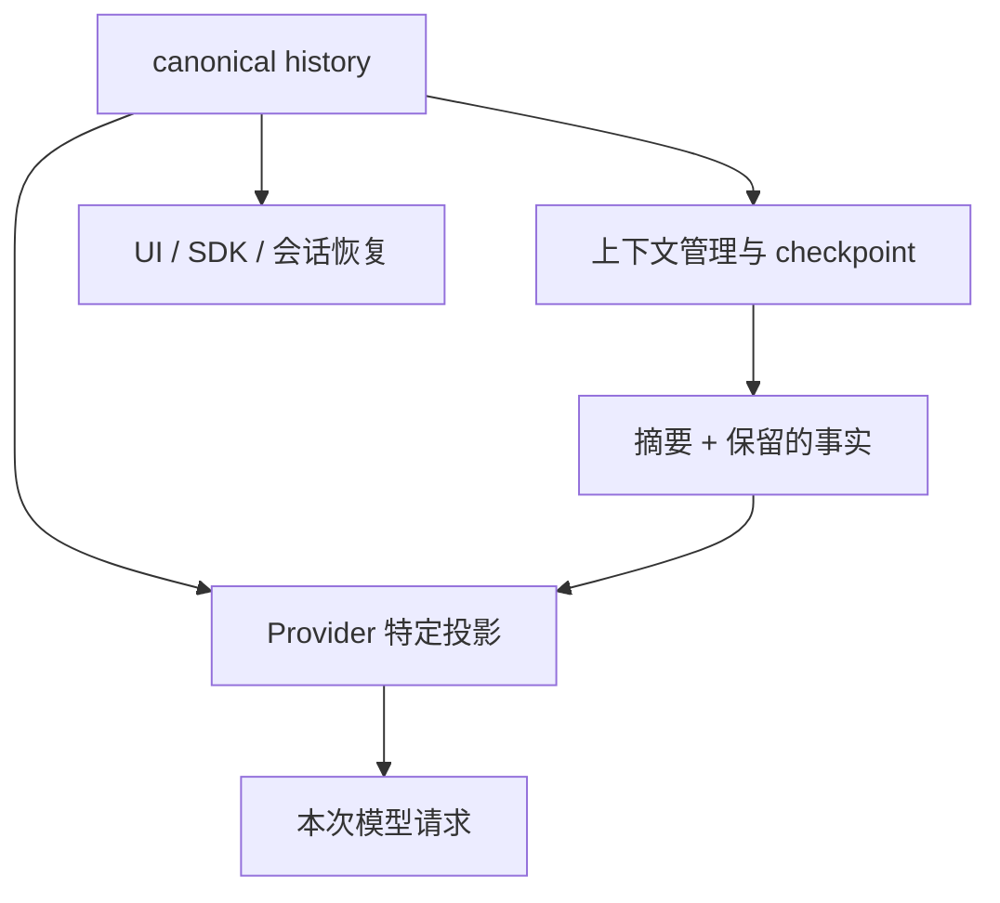

## 本章的问题

Agent 产生一条消息，onHistoryChanged 写入失败。若游标仍然向前推进，后续 flush 会认为这条已经保存，恢复时事实就永久丢失。反过来，每次都从零提交会产生重复。

host 用 initial length 跳过调用方已有历史，成功持久化以后才更新 cursor。失败进入 sticky 状态，不把重试不确定性隐藏起来。压缩则单独创建模型视图，必须在用户边界保留后缀。

## 沿固定源码逐段拆解

@source history-cursor

### newHistory 的游标归属

lastSnapshotLength 从 initialMessages.length 开始，因为初始历史属于调用方，不应再次通知。flushTail 只切出游标后的 delta，deliver 成功才更新长度。replace 也必须在交付成功后推进。

### 持久化失败与日志失败不能互相覆盖

deliver 把 deliveryFailed 置位，记录 history/persistence，再尽力输出有限诊断；即使诊断自身失败，也重新抛出原始持久化错误。后续 flushTail 发现失败就返回，避免把不确定写入当成可以无条件重复。

@source checkpoint

### parseCheckpointHeadings 消除两份协议清单

提示要求哪些 section，校验也应从相同来源读取。解析器取尾部标题协议，前面的示例标题不能被误认成要求。解析出八个标题，只证明格式来源一致，不证明摘要内容真实。

@source outbound-projection

### 请求视图独立于 canonical history

Provider 的工具配对与图片限制在投影中处理。UI、SDK 和恢复仍需要保留原事实。压缩、协议修复与持久存储是相连但不同的职责。

## 机制总览



## 接入贯穿项目

@implementation 06-session-compaction

### 逐步跟踪本章实现

historyCursor 的 position 表示“已经持久化到哪”，不是“准备发给存储到哪”。flush 先复制 messages.slice(cursor)，await persist 成功后才前移；抛错就置 failed，后续调用不偷偷越过故障重试。这样同一个尾部不会被正常收尾再次写入，也不会把失败数据算成已提交。

checkpoint 从固定上游协议读取章节标题，检查摘要实际包含这些必需节。仅生成一段流畅文本仍可能漏掉决策、未完成工作或验证状态，标题约束让恢复材料有最低结构。这里验证的是格式契约，事实准确性仍需任务和测试来证明。

compactView 要求 keepFrom 是合法 user 边界，摘要替换较早视图，之后的消息复制保留。原日志仍完整存在，便于审计与重新投影。把压缩视图直接写回覆盖日志，会把“减少模型上下文”错误扩展成“删除唯一持久事实”。

## 运行本章实验

```bash
node --disable-warning=ExperimentalWarning labs/chapters/06-session-compaction.mjs
```

@experiment 06-session-compaction

## 逐项解释实验结果

同一个尾部 flush 两次只交付一次；注入磁盘失败以后游标停在原位置，并保留 failed。随后用上游真实标题列表生成完整 checkpoint，再删除 section 验证拒绝。

compactView 接受用户边界，不能拿任意数组下标切分。格式实验没有调用摘要模型；内容质量需要后续任务评测。

## 继续动手与验收

让 persist 在真实追加后抛错，讨论为什么盲目重试会产生重复，以及需要哪一种提交身份来协调。再给压缩加一个包含 tool call/result 的原子后缀测试。

::: interview 持久化失败以后，历史游标应该推进吗？
只有 persist 成功才能前移 cursor，失败后不能把尾部误标已提交。压缩在完整 user 边界形成新请求视图，保留旧事实；checkpoint 标题提供最低恢复结构，内容准确性仍需任务证据支持。
:::

::: interview 为什么不能盲目重试一次写入失败？
写入可能已经提交，只是答复丢失。没有提交身份时重复会造成双写；应显式保存不确定性，使用幂等提交或恢复协调。
:::

::: interview checkpoint 标题齐全能证明摘要质量吗？
只能证明格式符合协议。内容是否忠实、是否保留失败原因、恢复后是否能完成任务，需要固定历史和后续任务做效果评估。
:::
