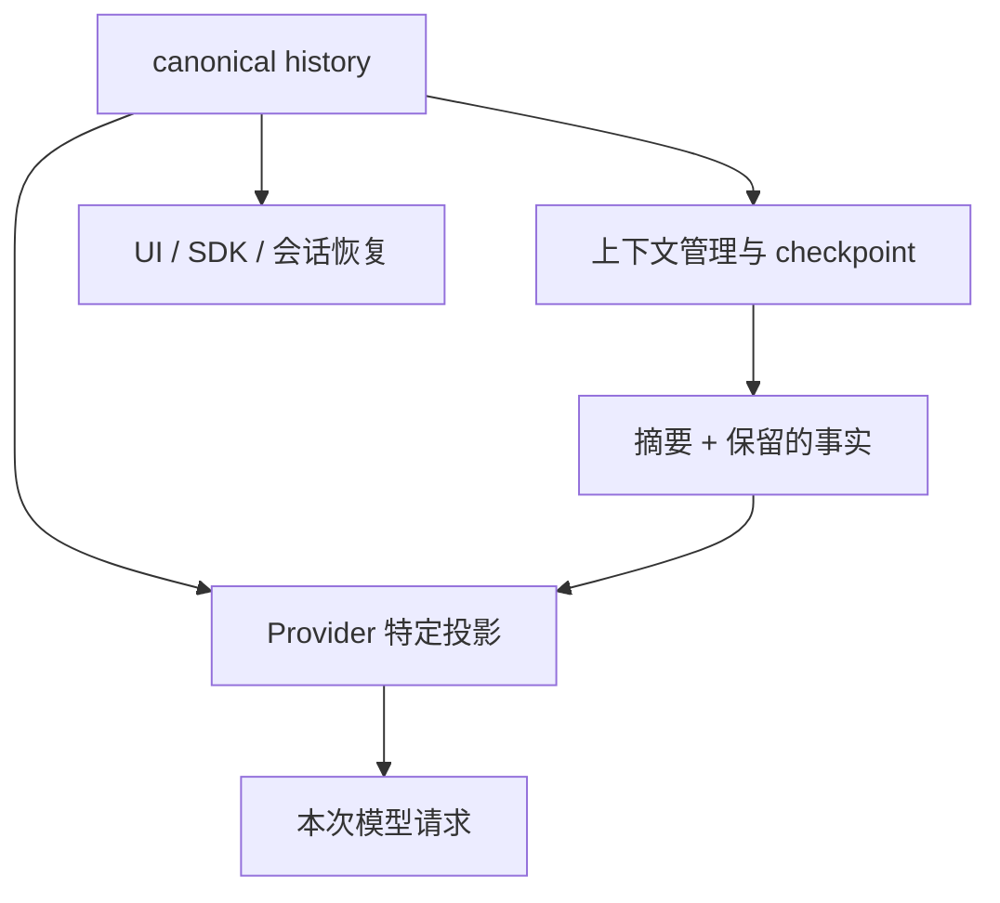

## 三份相关、但不同的数据

canonical history 保存已接纳的对话事实；provider-bound messages 是某次请求的模型兼容投影；checkpoint 用更短的结构保留继续任务需要的信息。把它们当成一份可随意覆盖的数组，会让恢复、重试与审计互相冲突。

从 `session-system/messages/history/` 和 `turn-system/agent-host/history/` 读持久历史边界，再从 `turn-system/compaction/` 读压缩。先弄清写入承诺，随后追摘要请求、校验与提交。

## checkpoint 也是协议

本版本的 checkpoint 系统提示规定八个有序 section。它要求保留目标、约束、已完成工作、当前状态、阻塞、决定、待答问题和关键上下文；Todo/Plan 状态由 host 另行保存。这里描述的是提示契约，实际摘要是否完整仍需验证。

最有意思的一点是：section 列表从 prompt 尾部直接推导，算法层和执行层共用这一来源，避免“生成时要求八段、校验时却检查旧的七段”。

@source checkpoint

@lab checkpoint

实验直接执行 `parseCheckpointHeadings`：正式提示解析为八个标题；前文示例标题不混入最终连续标题块；完全没有标题列表时明确抛错。这个测试没有调用摘要模型，所以不能证明事实保留质量。

## 摘要成功也不等于压缩提交成功

可以把压缩理解成一笔状态变更：读取特定历史、生成候选、验证候选、发布新的历史视图。任何一步失败，旧的可继续状态应如何保留，都需要明确契约。

适合追问的故障包括：模型超时、摘要标题缺失、提交前又有新消息、摘要写入失败、重试拿到旧 lineage。它们不必都由同一层解决。修改“失败后重试”之前，应确认第一次尝试是否已经留下不可见的部分状态。

## 一个可操作的验证层次

| 层次 | 证明什么 |
| --- | --- |
| 解析函数实验 | 标题协议如何识别 |
| 压缩算法单元测试 | 保留区间、工具配对、裁剪规则 |
| 临时存储集成测试 | 提交失败与恢复的一致性 |
| 隔离 CLI 运行 | 用户入口在长上下文下能继续 |
| 多轮事实检查 | 摘要之后关键约束是否仍被遵循 |

只跑第一层，就只能报告第一层。面试时主动讲清楚覆盖范围，比把局部测试包装成“压缩已经可靠”更可信。

## 为什么 canonical history 不该为每个 Provider 单独改写

同一会话可能换模型，UI 和 SDK 也需要查看原始事实。如果为了某家 Provider 的协议限制直接改掉 canonical history，后续消费者就失去了完整材料。newAgent 的 convertToLlm 选择在请求副本上投影：例如清除孤立工具结果，或在图片超过本模型限制时用占位替代旧图片。

@source outbound-projection

这条边解释了一个看似矛盾的现象：历史里仍有图片，某一次请求却不带全部图片。它不一定是保存丢失；也可能是模型特定投影的结果。调查时同时记录原历史与实际 outbound messages 的结构。

## 工具结果不能脱离它对应的调用

若裁剪把 assistant 的 tool call 删除，却留下其 tool result，Provider 可能拒绝这段消息。历史压缩因此必须顾及协议单位，不能简单取最后 N 条。这个项目把投影与压缩协议分开，你需要分别检查“本次请求合法”和“未来能继续工作”。

## checkpoint 的标题为什么来自同一个协议

摘要提示要求模型按固定标题组织 Goal、当前进度、关键决定等信息；校验器需要知道这些标题。若提示与校验各维护一份列表，很容易一个改了另一个没改。parseCheckpointHeadings 从协议提示的尾部标题块取结构，课程实验验证它取的是协议块，不是前面举例中的标题。

这是一种消除双份事实源的办法。但 parse 成功只证明格式列表存在，不证明模型真的按它写，也不证明内容准确。真实摘要质量仍需用历史和恢复任务评估。

## 一次恢复应回答哪些问题

用户目标是什么，哪些文件修改过，测试运行到哪里，失败是什么，下一步是什么，有哪些不能覆盖的用户修改。把这些材料放回上下文，才能让恢复后的 Agent 继续工作，而不是从头搜索或重复坏的尝试。

对 normalizeSlug，你可以保存一份真实测试失败输出和当前 diff，再人为写一个省略失败原因的摘要。比较恢复任务是否能继续，这比只检查摘要字数更接近工程目标。注意该人工比较属于学习练习，不是随课宣称已完成的模型评测。

## 练习：设计一次压缩回归测试

构造一个包含两次工具调用和结果的历史，中间加入重复摘要标题。分别断言协议标题来源、工具配对与保留顺序；再列出必须调用模型才可验证的摘要质量问题。验收材料要将格式、协议合法性和任务效果三项结果分开。

::: interview 为什么压缩不能只是“让模型总结，然后替换历史”？
还要处理摘要格式、保留最新用户意图、工具调用配对、事实丢失、并发写入和失败原子性。历史事实与模型请求投影应区分，候选摘要在校验与提交完成前不能破坏仍可继续的旧状态。应按故障点分别注入失败来验证。
:::
