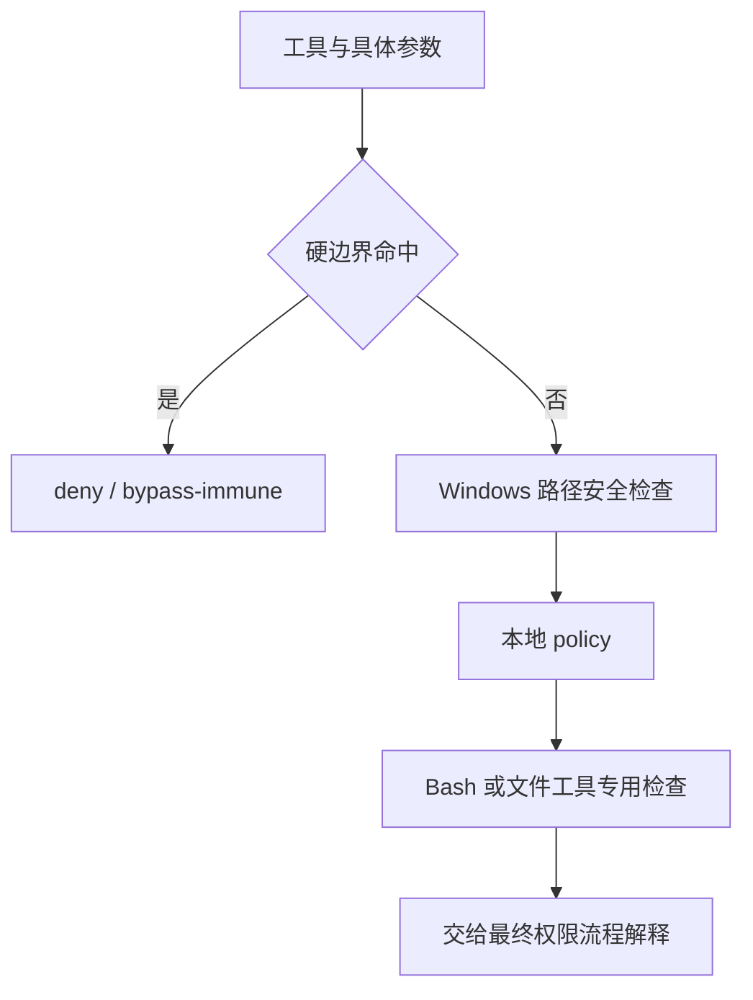

## 决策发生在执行之前，隔离约束执行本身

权限系统决定某项操作是否允许、需要询问或拒绝；沙箱限制进程实际能够接触的文件和网络。提示模型谨慎、检查工具参数、弹出审批和操作系统隔离，分别解决不同层面的问题。

这里先研究真实的本地检查器。完整权限流程还要追 `packages/local-runtime/src/permissions/` 及 `packages/agent-modules/permission/`；沙箱实现则在 `third_party/sandbox-runtime`，不能把一段 deny 函数当成完整安全系统。

@source permission

## 注意检查顺序和不可绕过的拒绝

这个 checker 先判断 bypass-immune deny，再检查 Windows 路径安全与本地 policy，然后把 bash 和文件工具送进不同分支。`undefined` 表示此检查器没有给出结论，不意味着“自动批准”。应继续追调用者怎样合并结果。

源码注释还区分不同 deny 等级。一个模式允许跳过某些询问，不代表所有硬性检查都消失。验证权限模式时，需要检查最终行为，不能只凭名字推断。

## 路径语法与权限是独立维度

@source paths

@lab paths

实验里 UNC 路径被判为 absolute，而前面的 checker 对直接访问网络共享另有硬性限制。两者没有矛盾：前者解析形状，后者做策略决定。

类似地，“字符串位于工作区前缀内”也不能保证真实文件位于工作区内。软链接、大小写规则、`..` 规范化和操作时文件变化都可能影响实际目标。是否由权限层或沙箱解决，要沿最终文件操作核对。

## 选择有信息量的验证

最小权限调查应记录：输入入口、tool name、参数、workspace、模式、命中的规则、是否请求批准、是否真正执行，以及返回结果。对同一目标，原生 read 与 bash 的读取命令可能走不同 checker；只有覆盖实际 sink，才能知道修复是否完整。

本课不执行破坏命令来“试权限”。使用临时文件与合成输入即可观察大多数本地边界。需要操作系统隔离验证时，应单独建立受控环境，并注明只测过的操作系统。

## 从返回类型读清“没有结论”

本地 checker 可以返回 deny、ask 或 undefined。undefined 说明这一个检查器没有给出结论，不等于整个调用已经获得授权。最终 facade 和 engine 仍有模式与规则处理。把局部结果直接当 allow，会放大一个辅助检查器的权限。

源码的顺序也有含义：bypass-immune 检查在前，接 Windows 路径安全，再看 policy，随后才按 Bash 或文件工具做具体检查。读完函数后应继续追调用者如何解释 denyKind，而不是只看 behavior。

## 硬边界与可授权策略为什么要分开

这个版本把网络共享直接访问、根或 home 的递归删除等放入窄的 bypass-immune 范围；敏感凭据路径属于 policy 层，调用 facade 可能按模式把它解释为需要确认。名字里带 hard safety 的提示文字，不一定等于相同的 denyKind，必须看结构化结果。

这是读产品源码时一个很好的训练：不要用一条错误消息概括完整安全语义。消息服务于用户，字段服务于调用链；真正决定行为的是后者如何被消费者处理。

## 绝对路径不等于授权路径

课程路径实验把 `/tmp/project`、Windows drive、UNC 分类为 absolute；`C:relative`、`~` 和普通相对路径不属于同一类。分类只描述路径语法。继续执行之前还要确认归一化基准、真实路径、可用平台、文件范围与规则。

因此不能拿 paths 实验通过作为“沙箱安全”的证明。它验证的是一个解析边界，沙箱验证必须观察真实进程对受限资源的访问。两种测试应分别报告。

## shell 检查要理解代码与数据

checkers 引入 shell source 分段和 heredoc 处理。提交说明中的字符串可能包含看起来危险的命令，但只是传给 cat 或 git 的数据；而传给 shell 的 heredoc 又确实会执行。只用一个正则扫全部文本，很容易误拒绝或漏检。改这一层时应准备成对的代码/数据反例。

## 练习：为规则做边界用例

准备普通源码读取、敏感路径、Windows drive root、UNC 和 heredoc 数据五种输入。只做纯分类或 checker 测试，不执行危险命令。为每条写出输入形状、预期 denyKind/ask/无结论、最终需要哪层解释。再指出哪一条需要 Windows 环境验证，哪一条在当前机器只能验证字符串处理。

::: interview 工具权限校验通过后，为什么还可能需要沙箱？
字符串与参数检查很难覆盖复杂程序的所有后续行为，脚本还可能调用其他进程。权限层表达用户授权与产品规则，沙箱在系统层收紧进程能力。两者配合仍需要验证实际文件与网络边界；任何一层的单元测试都不能代替另一层的执行验证。
:::
