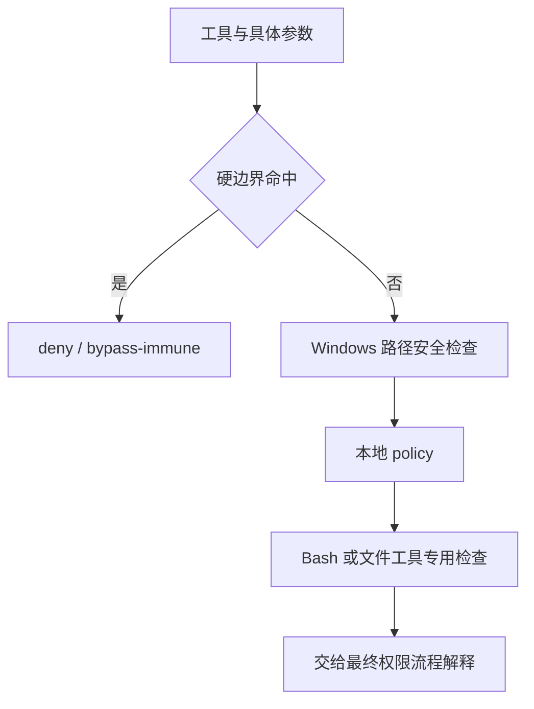

## 本章的问题

一个 Windows 绝对路径可以被正确识别，却不代表当前平台能访问，更不代表获得许可。UNC、相对路径、盘符相对路径和符号链接又各有不同风险。

本章先拿实际上游路径分类做差分，再把物理路径约束接到 authorize。显式 allow 也不能让工具通过符号链接访问工作区外。OS 沙箱另有真实执行端口，不能用路径字符串测试冒充系统隔离。

## 沿固定源码逐段拆解

@source paths

### isTuiAcpAbsolutePath 分类字面语法

POSIX 与 Windows 的判定可以在同一机器上测试，~ 不会自动变绝对路径，C:relative 也不同于 drive root。这一步没有解析物理文件，没有检查存在性，没有执行授权。

@source permission

### evaluateLocalPermissionCheck 保留结构化 denyKind

先看 bypass-immune，再看 Windows 硬检查，再看 policy，最后按 Bash 和文件工具分流。undefined 是本检查器没给结论，消费者还要继续最终权限流程。

硬边界与策略级拒绝不同：源码将窄范围危险根删除、网络共享等放在 bypass-immune，敏感路径等 policy 由 facade 按模式解释。不能只看提示文字包含 hard safety 就推断相同效力。

### shell 的代码与数据也要分开

上游引入 source stages 与 heredoc 分析，提交说明里的危险字符串不一定会执行，喂给 shell 的文本则可能是代码。host 不宣称实现完整 shell 检查；测试工具只启动固定 Node 文件，缩小了教学执行面。

同目录的 sandboxCommand、runSandboxed 还提供真实平台探针。不可用时明确失败，绝不静默退回无隔离执行。

## 机制总览



## 接入贯穿项目

@implementation 07-permissions

### 逐步跟踪本章实现

absoluteClientPath 同时识别 POSIX 与 Windows 绝对路径，解决客户端参数形状；workspacePath 则在本机文件系统解析实际目标，解决工具访问边界。二者目的不同，不能因为字符串以斜杠开头就判定它属于已授权工作区。

localCheck 把越界路径标为 bypass-immune。authorize 先处理它和显式 deny，再处理 ask，最后才看只读、allow 或 acceptEdits。课程没有隐式确认 UI，因此 ask 返回拒绝；扩大到交互审批时，需要新增真实控制协议，而不能把 ask 当成允许。

对子进程，路径校验只约束入口文件，文件内部仍可发起其他系统调用。sandboxTool 和 sandboxRequired 因此把实际运行交给 OS 后端；缺后端时拒绝降级。实验把路径分类与符号链接逃逸分开检查，不拿一次正常读取证明整个进程已经隔离。

## 运行本章实验

```bash
node --disable-warning=ExperimentalWarning labs/chapters/07-permissions.mjs
```

@experiment 07-permissions

## 逐项解释实验结果

路径表同时喂给原创分类和真实上游函数。随后验证工作区写入需要允许，显式 allow 仍不能覆盖符号链接越界。重点是比较“语法判断通过”和“最终授权通过”的两列结果。

本章的权限实验不代表所有操作系统隔离已验证。系统探针的正负对照与平台状态单独报告，避免混合证据。

## 继续动手与验收

增加工作区中指向内部目录的合法符号链接，再增加指向外部的链接，比较物理解析。为 Bash heredoc 写代码/数据成对样例，说明为什么不能只扫一个危险字符串。

::: interview 绝对路径语法通过以后，为什么仍要授权？
客户端绝对路径检查与物理工作区检查分属参数形状和实际访问边界。bypass-immune 拒绝先于 allow，ask 不能静默放行；OS 沙箱进一步限制子进程效果，路径校验本身不提供这种隔离。
:::

::: interview 为什么 denyKind 比一条提示文字更重要？
调用方按结构化类别决定哪些边界可授权、哪些不可绕过。提示文字可能相似，不能替代真实返回类型与消费者的逻辑。
:::

::: interview shell 检查为什么要区分代码和数据？
提交说明或给 cat 的 heredoc 可能只是文本，交给 shell 的内容才执行。只扫描危险词既容易误拒绝，也容易漏掉真正执行结构。
:::
