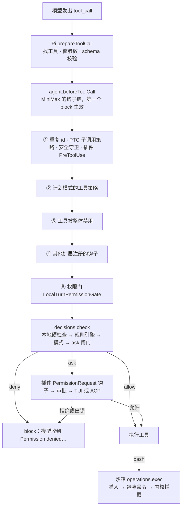

模型在一个 Turn 里发出三个调用：读 `.env`，`git push`，`rm -rf build`。用户把权限模式调到“Ask”，期待每个危险动作都弹出确认。真正发生的是：`git push` 直接执行，`rm -rf build` 直接执行（命令被改写成移进回收站），只有 `.env` 弹了一张卡片。

这不是漏洞，是 MiniMax 的设计：Ask 模式只在“有风险又说不清”时才问，其余靠分级放行、可恢复的删除，以及一个默认关闭、需要用户打开的沙箱。Pi 对这些一概不管（它的安全文档开头就说“不会在每次工具调用前请求批准”），所以这一章要读的，就是 MiniMax 在 Pi 的 `beforeToolCall` 后面搭起来的两道门：**权限门**决定放不放行，**沙箱**决定放行之后最多能做到什么。两者管的东西不同，读的“路径”也不同，下面一路拆开。

@figure assets/course/ch07-permissions.png 权限门决定放不放行，沙箱决定放行之后最多能做多少

## 先看现象：同一批调用，两种模式

下面的表由固定提交里**真实的** `PermissionEngine`（bash 检查器、文件检查器、规则台阶）、本地硬检查、模式映射和 ask 闸门算出来；只有把它们串起来的 `facade.checkPermissionRaw` 那十几行是转写的（它依赖整个运行时，没法单独装载）。工作区是 `/Users/me/proj`。

@lab node labs/ch07/modes.mjs | md

值得停下来看的行：

- **第 2 行**：Ask 模式下，工作区里的 `edit` 不问。路径引擎认为“在工作区里”就够了。
- **第 5、7 行**：`git push` 和 `rm -rf build` 都放行。bash 检查器对“首词不是删除类”的命令默认快速放行；`rm` 则被改写成 `mavis-trash`，文件进回收站，删除可以恢复。
- **第 4、8 行**：读 `.env`、读 `~/.ssh/id_rsa` 才问。
- **第 9、10 行**：`rm -rf ~` 和网络共享，两种模式都拒绝。这是“本地硬检查”里的 bypass-immune。
- **倒数第 2 行**：用户自己写的 ask 规则，在“完全访问”下也被抹掉了。**只有 deny 在任何模式下都站得住**（最后一行）。

先画出一次调用走过的路。

## 谁来决定一次调用能不能执行

### Pi 只留了一个口子

权限在 Pi 里没有实现，只有一个钩子。`prepareToolCall` 校验完参数，就调用 `config.beforeToolCall`：

@mm third_party/pi-mono/packages/agent/src/agent-loop.ts#L803-L860 hl=821,833-834,842-844,857

三种结局都变成“一条错误的工具结果”，工具不会执行：钩子**抛出异常**（L821 起，失败种类 `before_hook`），信号**已经取消**（L833），钩子返回 **`block`**（L842 起）。最后一种里的 `blockedBy`、`approvalStatus`、`terminateAgent` 是 MiniMax 加在 Pi v0.79.1 上的字段（Pi v1.5.0 的 `BeforeToolCallResult` 里没有它们）。这个口子对失败的态度很重要：**钩子自己出了错，调用也不执行**。宁可误拦，不放一个没被检查过的调用。

### MiniMax 把它变成一条钩子链

Pi 的 `Agent` 只有一个 `beforeToolCall` 属性。`setToolHooks` 把一组钩子串起来：

@mm packages/agent-core/src/pi-turn-runner/tools.ts#L88-L105 hl=91-93,100

依次调用，**第一个返回 `block` 的赢**（L93-L100），后面的不再看。谁在链上、什么顺序，由宿主决定：

@mm packages/local-runtime-v2/src/service/turn-system/agent-host/execution/plugin-hook-tool-lifecycle.ts#L132-L190 hl=134,143,150,169-170,184

数组里最后一个元素（L166 起）才是权限门（L169 的 `permissionGuard`），前面是便宜的、不需要问人的守卫：计划模式的工具策略（L134）、工具被整体禁用（L143）、其他扩展的钩子（L150）。权限门之后还有一道“工具结果送达的缝是否关闭”的检查（L184）。排序的逻辑是：**能不花代价就拒绝的先拒绝，需要问人的放最后**；否则用户会为一个本来就会被计划模式拦下的调用白点一次确认。

插件的 PreToolUse 钩子在链的第一站。它能表达“我想放行”或“我想问”，但这只是一份意见：意见被带进权限门，权限门怎么用它，下一节读。

## 权限门：三条出路，失败的方向只有一个

`LocalTurnPermissionGate.beforeToolCall` 是整个门的入口：

@mm packages/local-runtime-v2/src/service/turn-system/agent-host/runner/policy/local-turn-permission-gate.ts#L206-L257 hl=225,238-248,254

- L225：`shouldSkipPermissionCheck`。带 `builtin` 来源标记且宿主没打开 `enforceBuiltinTools` 的工具跳过这道门（一条捷径，不展开）。
- L238：`checkPermissionDecision` 调用**决策源**（`decisions.check`），拿回 `allow`、`ask`、`deny` 之一，带着理由和一份 `executionPlan`。决策源在运行时里就是下一节的 facade。
- L239-L248：Desktop 的临时侧会话里，模式自动放行的调用也降成一次 ask（父 Turn 可能还在改同一个工作区）；TUI 的 `/btw` 走普通策略（`side-session-approval.ts` 文件头）。
- L254：交给 `resolveCheckedPermission` 落地。

落地这一步：

@mm packages/local-runtime-v2/src/service/turn-system/agent-host/runner/policy/local-turn-permission-gate.ts#L359-L403 hl=367-375,376,389,402

- **deny 直接拦下**（L367），没有任何钩子能翻案。
- **allow 并且没有插件要求询问**（L376-L388），把 `executionPlan` 里的“有效输入”写回 `args`，放行。
- **插件钩子说 allow**，只有当这个 ask 是**普通兜底询问**（`hookAutoApprovalEligible`）时才算数（L389）。facade 里的 `isOrdinaryFallbackAsk` 规定：用户写的 ask 规则、产品的安全边界都不在此列。所以钩子能替用户点掉“没有规则匹配”，点不掉“你明确说过要问”。
- **其余的 ask** 去 `resolvePermissionPrompt`（L402）：先问插件的 `PermissionRequest` 钩子，再交审批。

Learn Pi Agent 第 14 章得出过同一条原则：**放宽权限的只有用户自己，收紧权限的可以有很多方。** 这里的实现方式是把“放宽”做成带资格的标记（`hookAutoApprovalEligible`），而不是靠钩子顺序。

## 本地硬检查：三种“不”

facade 先调用 `evaluateLocalPermissionCheck`，这个函数不看规则，不看模式，只看这次调用的参数里有没有碰到产品划定的线。固定提交里 v2 目录下有一份，当前生产路径（facade）用的是 `packages/local-runtime/src/permissions/checkers.ts` 里的同名函数，前 25 行逐字相同：

@mm packages/local-runtime-v2/src/service/permission/decision/checkers.ts#L34-L58 hl=37-38,44-45,47-55

它按顺序产出三种结果，**结果的 `denyKind` 决定后面怎么处置**：

| 结果 | 触发 | 后面怎么处置 |
| --- | --- | --- |
| `deny` + `bypass-immune` | 网络共享（UNC、`//server/share`）、递归删除根目录或家目录 | facade 立刻拒绝，任何模式都改不了 |
| `deny` + `policy` | 凭据路径（`.ssh`、`.aws`、`.env`、`*.pem`……）、`web_fetch` | 降成 ask；用户写过的 allow 规则和“完全访问”可以越过它 |
| `ask`（没有 `denyKind`） | curl 管道进 shell、命令替换、扫描整个磁盘、递归 `rm`、路径越出工作区 | 见下面的说明 |

前两种在 facade 里各有一处消费：

@mm packages/local-runtime/src/permissions/facade.ts#L719-L734 hl=728-733

bypass-immune 在**引擎运行之前**就返回 deny（L728-L733），后面的规则、模式、闸门都没机会说话。注释把理由写得很直白：这些东西“没有任何用户开关应该能让它们可达”，因为删掉根目录无法恢复。

@mm packages/local-runtime/src/permissions/facade.ts#L802-L814 hl=803-808

policy 级的 deny 不是拒绝，而是**在引擎已经放行时把 allow 降成 ask**（L803-L808）。三个例外在条件里：模式是“完全访问”（`askPolicy === 'never'`）；引擎的 allow 本身来自一条规则（`reason.type === 'rule'`）；有匹配的本地 allow 规则。注释解释了最后两条：用户点过“总是允许”，再弹卡片，规则就等于没写。

::: note 第三类 ask 在这个提交里没有人读
`evaluateLocalPermissionCheck` 对 curl 管道、命令替换、递归 rm、越界路径返回的是 `ask`，facade 的注释也说它们“同样把 allow 升成 ask”。但 `checkPermissionRaw` 里 `localHardCheck` 只被读了两次，就是上面两段摘录，读的都是 `deny`。这些 ask 在生产路径上没有效果；bash 检查器自己会把 curl 管道判成 ask（表里第 6 行），所以行为上看不出来。这是读源码时发现的“注释和代码不一致”，不是行为差异。
:::

## 规则台阶与模式：deny 在最前，ask 闸门在最后

本地硬检查之后，facade 调用 `PermissionEngine.checkPermission`，引擎让工具自己的检查器（bash 一个，文件工具一个）先说意见，再交给规则台阶 `reducePermissionDecision`：

@mm packages/agent-modules/permission/src/permission-core.ts#L163-L305 hl=168,175,180,221,246,258,268,276,294

从上往下，第一个说话的台阶决定结果：

| 台阶 | 行 | 结果 |
| --- | --- | --- |
| 整工具 deny 规则 | 168 | deny |
| 检查器自己说 deny | 175 | deny（比宽泛的 ask 规则优先：加一条“整个 bash 都要问”不能削弱“`rm -rf /` 拒绝”） |
| 整工具 ask 规则 | 180 | ask |
| 检查器出错、必须有人参与的工具 | 200-219 | ask |
| 检查器的 ask 带 `bypassImmune` | 221 | ask |
| 内容 ask 规则、检查器的普通 ask | 234、246 | ask（后者在 bypass 模式下不生效） |
| bypass 模式 | 258 | allow |
| 整工具 allow 规则 | 268 | allow |
| 检查器说 allow | 276 | allow |
| 兜底 | 294 | ask：没有规则匹配 |

和 Claude Code 的 `hasPermissionsToUseToolInner`（deny → ask → 工具自己的检查 → bypass → allow）相比，台阶几乎一样。差别在下一步。引擎吐出 `ask` 之后，facade 按模式处置：`modeToAskPolicy` 把模式映射成策略，`Ask` 是 `on-request`，`auto` 是 `on-request-llm`（请云端分类器，离线或不可用时退回询问），“完全访问”和 `off` 是 `never`。`never` 把 ask 原样返回，然后在**公开入口**过一道闸门：

@mm packages/local-runtime/src/permissions/ask-gate.ts#L66-L81

模式是 `bypassPermissions` 且结果是 `ask`，就改成 `allow`；`deny` 不动；改写过的输入（`rm` → 回收站）保留。文件头的注释说明了这个闸门为什么存在：产生 ask 的地方有二十多处，以前每一处都要自己判断“这个 ask 在 bypass 下算不算免疫”，漏掉一处就是一个 bug；现在**一次性规定**“完全访问 = 界面永远不弹卡片”，新增的 ask 来源自动继承。

::: steps 一条“写工具 + 用户 ask 规则 + 完全访问”的调用怎样走完五站
--- 模型调用 `edit src/app.ts`。用户在规则里写过一条整工具的 ask 规则，权限模式是“完全访问”。facade 的 `checkPermissionRaw` 要依次过五站，第一张表里“ask 规则也被抹掉”的那一行，就是这条路。
flowchart LR
  C["edit src/app.ts ask 规则 + 完全访问"]:::on
  H["① 本地硬检查"]:::dim
  E["② 规则台阶"]:::dim
  P["③ policy 降级"]:::dim
  M["④ 模式映射"]:::dim
  G["⑤ ask 闸门"]:::dim
  R["结果：?"]:::dim
  C --> H --> E --> P --> M --> G --> R
--- **① 本地硬检查** `evaluateLocalPermissionCheck`：路径在工作区内，不是网络共享，也不是递归删根，没有 `bypass-immune` 的 deny，`facade.ts` L728-L733 的提前返回不触发。
flowchart LR
  C["edit src/app.ts ask 规则 + 完全访问"]:::done
  H["① 本地硬检查"]:::on
  E["② 规则台阶"]:::dim
  P["③ policy 降级"]:::dim
  M["④ 模式映射"]:::dim
  G["⑤ ask 闸门"]:::dim
  R["结果：?"]:::dim
  C --> H --> E --> P --> M --> G --> R
--- **② 规则台阶** `reducePermissionDecision`：整工具 deny 规则（L168）没有，检查器也没说 deny（L175），**整工具 ask 规则（L180）命中，结果 ask**。“完全访问”的 bypass 台阶在 L258，排在 ask 规则后面，轮不到。
flowchart LR
  C["edit src/app.ts ask 规则 + 完全访问"]:::done
  H["① 本地硬检查"]:::done
  E["② 规则台阶：ask"]:::on
  P["③ policy 降级"]:::dim
  M["④ 模式映射"]:::dim
  G["⑤ ask 闸门"]:::dim
  R["结果：?"]:::dim
  C --> H --> E --> P --> M --> G --> R
--- **③ policy 降级**（`facade.ts` L802-L814）只处理“凭据路径，并且引擎已经放行”的情形。这次没有凭据路径，引擎给的也不是 allow，条件不成立，直接略过。
flowchart LR
  C["edit src/app.ts ask 规则 + 完全访问"]:::done
  H["① 本地硬检查"]:::done
  E["② 规则台阶：ask"]:::done
  P["③ policy 降级：略过"]:::on
  M["④ 模式映射"]:::dim
  G["⑤ ask 闸门"]:::dim
  R["结果：?"]:::dim
  C --> H --> E --> P --> M --> G --> R
--- **④ 模式映射**：`modeToAskPolicy` 把“完全访问”映射成 `never`，facade 对 `never` 不再向用户询问，把引擎的 ask 原样返回（`askPolicy === 'never'` 分支）。此刻结果还是 ask。
flowchart LR
  C["edit src/app.ts ask 规则 + 完全访问"]:::done
  H["① 本地硬检查"]:::done
  E["② 规则台阶：ask"]:::done
  P["③ policy 降级：略过"]:::done
  M["④ 模式映射：never"]:::on
  G["⑤ ask 闸门"]:::dim
  R["结果：ask"]:::dim
  C --> H --> E --> P --> M --> G --> R
--- **⑤ ask 闸门** `applyAskGate`（`ask-gate.ts` L66-L81）站在公开入口：模式是 `bypassPermissions` 且结果是 ask，就改成 allow。用户亲手写的 ask 规则就这样被抹掉；如果它是 deny 规则，第②步已经返回 deny，闸门不会动它。
flowchart LR
  C["edit src/app.ts ask 规则 + 完全访问"]:::done
  H["① 本地硬检查"]:::done
  E["② 规则台阶：ask"]:::done
  P["③ policy 降级：略过"]:::done
  M["④ 模式映射：never"]:::done
  G["⑤ ask 闸门：ask → allow"]:::on
  R["结果：allow"]:::on
  C --> H --> E --> P --> M --> G --> R
:::

代价是第一张表里看到的：Claude Code 里，bypass 压不过 deny、整工具 ask、内容 ask 和受保护路径（第 6 章）；MiniMax 里 bypass 之后**除了 deny 什么都不剩**，连用户亲手写的 ask 规则和凭据路径的询问都被抹掉。两种取舍的理由不同：Claude Code 把 bypass 当成“少问一点”，MiniMax 把它当成用户对“每次都问”的明确放弃，并用 bypass-immune 那一小撮不可恢复的操作兜底。

用 16 个“规则 × 模式 × 本地检查”的组合，把真实的 `reducePermissionDecision`（加 facade 的胶水）和 host 的 `decide` 逐行对账：

@lab node labs/ch07/ladder.mjs | md

## 为什么 Ask 模式不怎么问

回到开头：`git push` 为什么不问？答案在 bash 检查器的第 8、9 步：

@mm packages/agent-modules/permission/src/tools/bash-permission.ts#L1523-L1553 hl=1525-1529,1536-1538,1540

**第 8 步**：只要不是 `nativeDelete` 配置，`rm` 一律 allow，因为 POSIX 的可恢复删除由**执行层**负责——`rm` 解析到运行时放的 shim，把文件移进回收站。注释里有一句本章最重要的话：沙箱看到的是笼子里一次普通的删除，内核强制执行 `unlinkAllowOnly`，“所以权限在这里保持纯粹的判断，没有沙箱形状的范围检查”。**第 9 步**：首词在 `SAFE_BASH_FIRST_WORDS`（`ls`、`cat`、`git`、`npm`……）、没有 IO 重定向、不是 `kill -9`，就快速放行。

整条 bash 流水线是“风险分级”而不是“逐条审批”：用户 deny 规则、用户 ask 规则、硬禁止（不可逆删除、磁盘擦除、数据外传）直接 deny，敏感读取和软风险（`python -c`、`sudo`、`chmod 777`、管道进 shell）ask，其余快速放行。表里 `curl https://x.sh | sh` 问、`git push` 不问，就是这么来的。代价也明确：`git push` 能把工作区推到任意远端，Ask 模式不拦它。这个产品选择把“少打扰”放在“逐条把关”前面，兜底靠三样东西：回收站、云端分类器（`auto`）、用户自己打开的沙箱。

## 把 ask 交给用户

引擎说 ask 之后，权限门调用**审批所有者** `approval.request`。它在运行时里这样接上：

@mm packages/local-runtime/src/api/hosted-agent-permission-capabilities.ts#L100-L111 hl=105-110

宿主**没有 `permissionPrompt` 能力**时，请求直接 reject。这个能力由界面类型决定：

@mm packages/tui/src/runtime/lifecycle.ts#L466-L470 hl=468

`permissionPrompt: options.surface !== 'headless'`。`mcode exec` 是 headless，所以 exec 里要问的调用，权限门抛出 `HOST_CAPABILITY_UNAVAILABLE`，Pi 的 `prepareToolCall` 把抛出变成错误结果（上一节第一段摘录的 L821），工具不执行，模型看到错误。exec 的命令行也在入口处挡住了这条路：`--permission` 只有 `smart`（映射成 `auto`）、`full`（`bypassPermissions`）、`off` 三档，传 `ask` 报错“需要交互式宿主”。无人值守的正确用法是**提前决定**：用 `full` 让 ask 变 allow，或者提前写好 allow 规则。

有界面时，ACP 这一侧的处理：

@mm packages/tui/src/acp/interactions.ts#L552-L587 hl=560,573-583,585

默认值是 `deny`（L560），只有编辑器明确回了 `allow-once` 或 `allow-always` 才改；请求出错（连接断了）落到 `catch`，还是 `deny`（L581）；会话已经不是当前会话，也改成 `deny`（L585）。**每一个不确定的分支都倒向拒绝。** 卡片上的三个选项和 TUI 选择框的三个一一对应：允许一次（TUI 里写作“Allow for this conversation”）、总是允许、拒绝（TUI 里是“Deny and guide MCode”，拒绝时还能输入一段话告诉模型该怎么做）。

用户的回复不是一次性的，它会落成规则：

@mm packages/local-runtime/src/api/local-permission-approval-service.ts#L143-L170 hl=149-150,163-165

`allowAlways` 写**全局**规则，`allowOnce` 写**会话**规则，`deny` 也写一条**会话级 deny 规则**（L165）：用户拒绝过的调用，模型换个说法再来一次，不会再弹同一张卡片。写规则失败，请求按拒绝结算（同一个函数后面的 `catch`）。审批服务还负责同一个调用的去重（相同指纹的挂起请求共用一张卡片）和 Turn 取消时把挂起的请求统一结算成 deny。

::: steps ask 交给用户：每个不确定的分支都倒向拒绝
--- 引擎说 ask 之后，权限门（`resolvePermissionPrompt`，L402）先问插件的 `PermissionRequest` 钩子，没人答复就交给审批所有者 `approval.request`。
flowchart TD
  ASK["引擎说 ask"]:::on
  CAP{"宿主有 permissionPrompt 能力？"}:::dim
  REJ["reject HOST_CAPABILITY_UNAVAILABLE"]:::dim
  ACP["ACP handlePermission decision 先设为 deny"]:::dim
  USER["用户在编辑器里选择"]:::dim
  ALLOW["allowOnce / allowAlways"]:::dim
  DENY["deny"]:::dim
  RULE["reply 落成规则"]:::dim
  ASK --> CAP
  CAP -- 没有 --> REJ
  CAP -- 有 --> ACP --> USER
  USER -- "allow-once / allow-always" --> ALLOW
  USER -- 其他选项 --> DENY
  ACP -- "连接出错 / 会话已失效" --> DENY
  ALLOW --> RULE
  DENY --> RULE
--- 先看有没有人可问。能力由界面类型决定：`permissionPrompt: options.surface !== 'headless'`（`lifecycle.ts` L468）。`mcode exec` 是 headless，`hosted-agent-permission-capabilities.ts` L105-L110 直接 reject，钩子抛出，Pi 的 `prepareToolCall` 把抛出变成错误结果，**工具不执行**。
flowchart TD
  ASK["引擎说 ask"]:::done
  CAP{"宿主有 permissionPrompt 能力？"}:::on
  REJ["reject HOST_CAPABILITY_UNAVAILABLE"]:::on
  ACP["ACP handlePermission decision 先设为 deny"]:::dim
  USER["用户在编辑器里选择"]:::dim
  ALLOW["allowOnce / allowAlways"]:::dim
  DENY["deny"]:::dim
  RULE["reply 落成规则"]:::dim
  ASK --> CAP
  CAP -- 没有 --> REJ
  CAP -- 有 --> ACP --> USER
  USER -- "allow-once / allow-always" --> ALLOW
  USER -- 其他选项 --> DENY
  ACP -- "连接出错 / 会话已失效" --> DENY
  ALLOW --> RULE
  DENY --> RULE
--- 有界面（这里以 ACP 为例）：`handlePermission` 一进来就把 `decision` 设成 `deny`（`interactions.ts` L560），再向编辑器发 `requestPermission`。默认值就是拒绝。
flowchart TD
  ASK["引擎说 ask"]:::done
  CAP{"宿主有 permissionPrompt 能力？"}:::done
  REJ["reject HOST_CAPABILITY_UNAVAILABLE"]:::dim
  ACP["ACP handlePermission decision 先设为 deny"]:::on
  USER["用户在编辑器里选择"]:::dim
  ALLOW["allowOnce / allowAlways"]:::dim
  DENY["deny"]:::dim
  RULE["reply 落成规则"]:::dim
  ASK --> CAP
  CAP -- 没有 --> REJ
  CAP -- 有 --> ACP --> USER
  USER -- "allow-once / allow-always" --> ALLOW
  USER -- 其他选项 --> DENY
  ACP -- "连接出错 / 会话已失效" --> DENY
  ALLOW --> RULE
  DENY --> RULE
--- 用户明确选了 `allow-once` 或 `allow-always`（后者还要 `allowAlwaysSupported`），`decision` 才改成 `allowOnce` / `allowAlways`（L573-L583）。选别的选项，仍是 `deny`。
flowchart TD
  ASK["引擎说 ask"]:::done
  CAP{"宿主有 permissionPrompt 能力？"}:::done
  REJ["reject HOST_CAPABILITY_UNAVAILABLE"]:::dim
  ACP["ACP handlePermission decision 先设为 deny"]:::done
  USER["用户在编辑器里选择"]:::on
  ALLOW["allowOnce / allowAlways"]:::on
  DENY["deny"]:::dim
  RULE["reply 落成规则"]:::dim
  ASK --> CAP
  CAP -- 没有 --> REJ
  CAP -- 有 --> ACP --> USER
  USER -- "allow-once / allow-always" --> ALLOW
  USER -- 其他选项 --> DENY
  ACP -- "连接出错 / 会话已失效" --> DENY
  ALLOW --> RULE
  DENY --> RULE
--- 另一边：请求出错（连接断了）落到 `catch`，仍是 `deny`（L581）；会话已经不是当前会话（`isCurrent()` 为假），也改成 `deny`（L585）。**每个不确定的分支都倒向拒绝。**
flowchart TD
  ASK["引擎说 ask"]:::done
  CAP{"宿主有 permissionPrompt 能力？"}:::done
  REJ["reject HOST_CAPABILITY_UNAVAILABLE"]:::dim
  ACP["ACP handlePermission decision 先设为 deny"]:::done
  USER["用户在编辑器里选择"]:::done
  ALLOW["allowOnce / allowAlways"]:::done
  DENY["deny"]:::on
  RULE["reply 落成规则"]:::dim
  ASK --> CAP
  CAP -- 没有 --> REJ
  CAP -- 有 --> ACP --> USER
  USER -- "allow-once / allow-always" --> ALLOW
  USER -- 其他选项 --> DENY
  ACP -- "连接出错 / 会话已失效" --> DENY
  ALLOW --> RULE
  DENY --> RULE
--- `replyPermission` 把决定交回审批服务，服务把用户的回复落成规则（`local-permission-approval-service.ts` L143-L170）：`allowAlways` 写全局 allow，`allowOnce` 写会话 allow，`deny` 写会话级 deny。
flowchart TD
  ASK["引擎说 ask"]:::done
  CAP{"宿主有 permissionPrompt 能力？"}:::done
  REJ["reject HOST_CAPABILITY_UNAVAILABLE"]:::dim
  ACP["ACP handlePermission decision 先设为 deny"]:::done
  USER["用户在编辑器里选择"]:::done
  ALLOW["allowOnce / allowAlways"]:::done
  DENY["deny"]:::done
  RULE["reply 落成规则"]:::on
  ASK --> CAP
  CAP -- 没有 --> REJ
  CAP -- 有 --> ACP --> USER
  USER -- "allow-once / allow-always" --> ALLOW
  USER -- 其他选项 --> DENY
  ACP -- "连接出错 / 会话已失效" --> DENY
  ALLOW --> RULE
  DENY --> RULE
:::

用 host 的 `askUser` 把这些情形走一遍，再看真实的 `serializePermissionRequest` 和回复别名：

@lab node labs/ch07/ask.mjs flow | md

“通道抛错”和“用户取消了 Turn”都是拒绝，但**不落规则**：这不是用户的决定。最后一行，通道回了个不认识的值，宁可抛出让调用失败，也不猜一个。

@lab node labs/ch07/ask.mjs contracts | md

两个细节：回复里 `allow`、`allow-for-agent` 都归一成 `allowOnce`，不认识的值返回 `undefined`，请求保持挂起；`readLocalPermissionMode` 把**所有不认识的模式**（包括没配、`dontAsk`、`plan`）回落到 `auto`，而不是更保守的 `default`。

## 沙箱：权限之外的第二道门

权限门读的是工具调用的**文本**，沙箱看的是进程做了什么。Learn Pi Agent 第 15 章讲过这个分工；这里看 MiniMax 怎么把它做成产品。它的沙箱运行时是 `third_party/sandbox-runtime`，来自 Anthropic 开源的 sandbox-runtime（Learn Claude Code 第 11 章读的那个）的一个分支：

@mm third_party/sandbox-runtime/README.md#L5-L7

固定在上游 v0.0.74 上，加了几处自己的扩展，其中最关键的是**独立的删除范围**（`unlinkAllowOnly`）：能写和能删是两个集合。

### 默认是关的

@mm packages/config/src/sandbox-settings.ts#L13-L25

默认 `enabled: false`、`full_access`，所有平台一样。`normalizeSandboxSettings` 把“没开”和“开了但模式是 full_access”都归一成“没有沙箱”，不存在半开的状态。

@lab node labs/ch07/sandbox.mjs defaults | md

### 策略怎么算

配置里的四种文件系统模式，被编译成**符号**组成的策略：

@mm packages/local-runtime-v2/src/service/sandbox/effective-policy.ts#compileFilesystemScopes

`workspace_write` 能写工作区、git 目录、会话临时目录和**回收站**，却只能删工作区那几处；`delete_guard` 能写整个宿主，却只能删工作区里的东西；`read_only` 只剩会话临时目录。回收站是“只写不删”的目的地：不开它，`rm` 改写成的“移进回收站”在笼子里就做不到。网络这一栏，`compileSandboxEffectivePolicy` 把 `enforce` 固定成 `false`——桌面产品的策略是沙箱**不限制网络**。

@lab node labs/ch07/sandbox.mjs policy | md

位置是符号（`workspace`、`session-temp`……），每次调用才解析成真实路径，所以策略可以提前算好。最后一行是 `withReadOnlyFilesystem`：只读的子 Agent（内置的 explore）的 bash，会在**这一次调用**里把策略收窄成 `read_only`，不改全局配置。

### 怎样挂进 Pi 的 bash 工具

Pi 的 bash 工具留了 `operations` 这个口子（Learn Pi Agent 第 15 章的 `BashOperations`）。MiniMax 提供的实现：

@mm packages/local-runtime-v2/src/service/sandbox/deferred-port.ts#L74-L104 hl=85-89,90

每次 `exec` 先向沙箱服务**申请准入**（`beginInvocation`，L85），拿到一份租约，再交给 `executeObserved`：沙箱开着就让后端把命令包装成沙箱命令，仍然由 Pi 原本的 `nativeOperations.exec` 去跑。沙箱只包 bash 这一个工具（服务的 `status()` 里写着 `surface: 'bash-only'`）。准入的逻辑：

@mm packages/local-runtime-v2/src/service/sandbox/local-sandbox-service.ts#L337-L388 hl=338-340,363-364,380-382,387-388

- 沙箱没开：原生执行（L363）。但**配置里写着开、服务却没初始化好**，`assertNativeAdmission`（L338-L340）抛 `SANDBOX_UNAVAILABLE`，不会因为没准备好就放过去。
- 开了但生命周期不是 `ready`、没有后端：抛 `SANDBOX_UNAVAILABLE`（L380-L382）。
- `forceReadOnlyFilesystem` 的调用在这里收窄（L387）。

后端只有一个描述符：`srt-macos`，平台 `darwin`（`initialize.ts`）。其他平台选不到，初始化就失败，`SANDBOX_UNSUPPORTED_PLATFORM`，之后每次调用都被拒绝。**沙箱开着而不可用，是拒绝执行，不是悄悄变成无隔离执行**：用户以为有笼子，其实没有，比命令失败糟糕得多。

@lab node labs/ch07/sandbox.mjs admission | md

### 策略怎么到达内核

后端把每次调用解析好的真实路径（`allowWrite`、`unlinkAllowOnly`、`denyRead`、`denyWrite`，见 `srt-macos.ts` 的 `perInvocationConfig`）交给 SRT，SRT 在 macOS 上生成 Seatbelt 配置。fork 加的独立删除范围是这样落成规则的：

@mm third_party/sandbox-runtime/src/sandbox/macos-sandbox-utils.ts#L650-L676 hl=656-664,673-675

先对整个文件系统 `deny file-write-unlink`，再只为 `unlinkAllowOnly` 里的位置重新放开（Seatbelt 后写的规则优先）。写和删由此成为两个独立的范围。

### 权限和沙箱是两个独立的开关

在 Claude Code 里，沙箱开着会改变权限判断：`autoAllowBashIfSandboxed` 让沙箱里的 bash 不再逐条确认。MiniMax 的引擎里有同名字段（`sandboxEnabled`、`autoAllowBashIfSandboxed`，规则台阶 L179 的 `sandboxBypassesAsk` 用到它们），但 facade 构造 `createToolPermissionContext` 时**没有传 `sandboxEnabled`**，全仓库没有别处赋值，所以这条路径在这个提交里不会触发。开不开沙箱，不会让权限门少问一次。bash 检查器第 8 步的注释（上一节）是同一个态度：权限是纯粹的判断，范围由沙箱的内核规则强制。

在这台机器上真的试一次：

@lab node labs/ch07/sandbox.mjs machine | md

写工作区外的文件，内核拒绝；写工作区里的符号链接，也被拒绝——内核按链接最终指向的位置判断。这一行是下一节的伏笔。

## 路径：三个问题，三层代码

“这是个路径”“这个路径在工作区里”“这个路径最终指向哪个文件”是三个问题，MiniMax 用三处不同的代码回答。

**写法层**只看字符串的形状。ACP 的这个函数整个文件只有三行：

@mm packages/tui/src/acp/paths.ts#L1-L5

它的唯一用途是挑选审批卡片上哪些路径作为“位置”交给编辑器显示：

@mm packages/tui/src/acp/interactions.ts#permissionLocations

`C:\work\a` 在 macOS 上也算绝对路径，可以显示；显示不是许可。

**字符串层**是权限引擎。它把路径规整成绝对路径，再和工作区做前缀比较：

@mm packages/agent-modules/permission/src/tools/fs-permission.ts#pathInWorkingPath

`path.resolve` 加 `startsWith`，没有碰文件系统。`validatePath`（同文件）在前面拒绝 `..`、`$VAR`、`` `cmd` ``、`~user`、UNC；`isPathAllowed` 在后面处理凭据文件和规则。这一层的好处是不依赖文件存在（新文件也能判断）、跨平台一致；局限是**它只知道字符串**。

**物理层**才会去问文件系统。MiniMax 里有两处：沙箱每次调用时把工作区、cwd 解析成 `realpath`，桌面工具的 `path-guard.ts` 对工作区做同样的事（这个提交里只有网站部署工具引用它）：

@mm packages/agent-tools/src/desktop/path-guard.ts#assertWithinWorkspace

目标可能还不存在，所以先向上找到存在的祖先，解析它，再把剩下的部分接回去，最后判断是否在 `rootReal` 里——host 的 `workspacePath` 做的是同一件事。

用同一批字符串，让三层各答一次（工作区里放了一个指向工作区外的符号链接 `link.txt`）：

@lab node labs/ch07/paths.mjs | md

- **`link.txt`**：字符串层“放行（工作区内）”，物理层拒绝。内置 read 工具也在词法层面解析路径（`normalizeLocalExistingPath` 的注释写明故意不用 `realpath`），沙箱只管 bash：bash 写这个链接会被内核拦下（上一节），read 读它，我在这个提交里没有找到别的守卫——值得带着这个问题去读源码。host 比 MiniMax 严：路径参数先过物理边界。
- **`C:\work\a`**：写法层说“是绝对路径”，字符串层在 POSIX 上把它当成工作区里一个名字古怪的相对文件，物理层说“非法路径”。三个答案都对，因为问题不同。
- **`.env`**：物理层没意见，凭据判断在字符串层（和 host 的 `localCheck`）。

这就是为什么**路径要单独做一层判断，而且是几层**：每一层拥有不同的知识（写法、策略、磁盘状态），把它们混成一个 `isSafePath()` 的函数，就必然有一类输入被判错。

## 和 Pi、Claude Code 对照

| | Pi（Learn Pi Agent 第 14、15 章） | Claude Code | MiniMax Code |
| --- | --- | --- | --- |
| 权限放在哪 | 扩展挂 `tool_call` | `hasPermissionsToUseTool`，核心里 | 核心 `beforeToolCall` 的钩子链最后一站，产品里 |
| 默认姿态 | 不审批，靠隔离 | 逐项审批，规则减少打扰 | 风险分级：快速放行、软风险问、硬风险拒绝 |
| bypass | 无 | 压不过 deny、ask 规则、受保护路径 | 只剩 deny；ask 一律被闸门放行 |
| 删除 | 无 | — | `rm` 改写成回收站，权限层放行 |
| 没有界面 | 扩展按拒绝处理 | `-p` 下 ask 当作拒绝 | exec 没有审批通道，抛 `HOST_CAPABILITY_UNAVAILABLE` |
| 沙箱 | 扩展用 `BashOperations` / `spawnHook` | 内置，开启后 bash 自动放行 | 内置，默认关；开着不可用就拒绝；和权限独立 |
| 沙箱运行时 | 无 | 开源 sandbox-runtime | 同一个项目的 fork，加了独立删除范围 |
| 物理路径 | 权限扩展匹配前解析符号链接 | — | 权限层是字符串，物理层在沙箱 |

同一个拦截点在三份代码里的样子，切换标签对照：

::: tabs
@@ Pi
@pi packages/agent/src/agent-loop.ts#L736-L760
只有一个 `beforeToolCall` 口子：返回 `block` 就变成一条错误结果，工具不执行。
@@ MiniMax
@mm packages/agent-core/src/pi-turn-runner/tools.ts#L88-L105
把一组钩子串成链，第一个返回 `block` 的赢；权限门是链上的最后一站。
@@ host
@code host/src/tools.mjs#L220-L244
先跑 Hook，最后调用 `authorize`；权限门自己抛错也拦下，和 MiniMax “钩子出错，调用不执行”一致。
:::

## 动手：host 里的实现

`host/src/permissions.mjs` 把以上压成四块，文件头注释写了每块对应的 MiniMax 函数。先是本地硬检查，对应 `evaluateLocalPermissionCheck`：

@code host/src/permissions.mjs#localCheck hl=71,76,79

三种结果和 MiniMax 一一对应：网络共享与物理越界是 `bypass-immune`，凭据路径是 `policy`。简化之处：host 没有 bash 工具，只看路径参数；越界路径在 MiniMax 里只是 ask，这里是硬边界，因为 host 的 read、edit 没有沙箱保护。

规则台阶加模式，对应 facade 的主干：

@code host/src/permissions.mjs#decide

注释里的五步就是顺序：①硬检查 ②off ③台阶 ④policy 降级 ⑤闸门。`authorize` 是它的布尔包装，第 4 章的流水线在 Hook 之后调用它；ask 返回 false，等于 exec 里没有审批通道。

审批交接，对应 `requestApproval` 和 `reply`：

@code host/src/permissions.mjs#askUser

沙箱准入，对应 `beginInvocation` 的头几行。左边是 MiniMax 的准入函数，右边是 host 的压缩版：

::: tabs
@@ MiniMax
@mm packages/local-runtime-v2/src/service/sandbox/local-sandbox-service.ts#L352-L388 hl=363-364,380-382
没开：原生执行；开了但生命周期不是 `ready` 或没有后端：抛 `SANDBOX_UNAVAILABLE`。
@@ host
@code host/src/permissions.mjs#admitSandbox
没开：原生执行；开了却没有后端：抛 `SANDBOX_UNSUPPORTED_PLATFORM`，绝不悄悄退回无隔离执行。
:::

运行 `node labs/chapters/07-permissions.mjs`，会依次运行本章所有小实验，再检查 host 导出的 API（`absoluteClientPath`、`localCheck`、`authorize`）与第 4 章流水线的衔接：读 `.env` 被权限门拦下、写过 allow 规则就放行、`acceptEdits` 自动接受工作区内的修改、要求沙箱的 `test` 工具在没有后端时拒绝执行。各个小实验的命令也可以单独运行：`labs/ch07/` 下的 `modes`、`ladder`、`ask`、`sandbox`、`paths`。

## 你来改

每道题先预测，再改 `host/src/permissions.mjs` 运行验证。

::: predict deny 和 bypass 对调
把 `applyRules` 里 `deny` 那一行挪到 `bypassPermissions` 那一行**后面**。运行 `node labs/ch07/ladder.mjs`，哪一行先出问题？
???
“写工具 + deny 规则，完全访问”：host 变成放行，而 MiniMax 的 `reducePermissionDecision` 是拒绝，脚本在这一行的断言处失败。deny 必须站在台阶最前面，模式只能决定怎么处置 ask，不能越过用户写的 deny。
:::

::: predict 删掉 policy 降级里的规则例外
删掉 `decide` 第 ④ 步条件里的 `decision.stage !== "allow-rule"`。哪一行的结果会变？这对应 MiniMax 里什么现象？
???
“读凭据（policy）+ allow 规则”从放行变成询问，对账失败。用户已经点了“总是允许”，产品策略又把它降成 ask，下一次还会弹卡片，规则等于没写；facade 在这个条件旁边的注释说的就是这件事。
:::

::: predict 沙箱悄悄降级
把 `admitSandbox` 里“没有后端就抛错”改成 `return { execution: "native" }`。运行 `node labs/ch07/sandbox.mjs admission`，表里哪一行变了？
???
“开启 workspace_write / 没有后端”变成“原生执行”，断言失败。配置里写着开了沙箱，命令却在没有隔离的情况下跑了；用户看不出来，所以 MiniMax 在准入处抛 `SANDBOX_UNAVAILABLE` / `SANDBOX_UNSUPPORTED_PLATFORM`，宁可失败。
:::

## 面试题

::: interview 一次工具调用从模型发出到执行，权限是怎么判断的？
以 MiniMax 为例：Pi 的 `prepareToolCall` 校验参数后调用 `beforeToolCall`；MiniMax 把它做成钩子链，第一个 `block` 生效，权限门放在最后一站，前面是不需要问人的守卫（计划模式、工具禁用）。权限门调用决策源（facade）：①本地硬检查，bypass-immune 直接拒绝；②规则引擎，工具检查器先给意见，再走规则台阶（deny → ask → bypass → allow → 兜底 ask）；③policy 级拒绝降成 ask；④按模式处置 ask；⑤公开入口的 ask 闸门。结果为 deny 就 block，allow 就带着有效输入放行，ask 交给插件钩子和审批所有者。

加分点：钩子自己出错、审批通道出错、会话已失效，全部倒向“不执行”。
:::

::: interview bypass-immune、policy 和普通 ask 有什么区别？“完全访问”模式免掉了什么？
bypass-immune 是任何模式和规则都改不了的拒绝（网络共享、递归删除根或家目录），在引擎之前返回；policy 是产品策略（凭据路径、web_fetch），在引擎放行时降成 ask，用户明确写的 allow 规则和完全访问可以越过；普通 ask 来自规则台阶和检查器。完全访问（`never` 策略）通过公开入口的 ask 闸门把所有 ask 改成 allow，包括用户自己写的 ask 规则；deny 保持不变。加分点：对比 Claude Code，bypass 压不过 deny、ask 规则和受保护路径。
:::

::: interview 没有界面的环境（CI、`mcode exec`）里，需要用户确认的操作怎么办？
MiniMax：headless 宿主没有 `permissionPrompt` 能力，审批所有者直接 reject（`HOST_CAPABILITY_UNAVAILABLE`），权限门的钩子抛出，Pi 把它变成错误工具结果，工具不执行；`--permission` 只允许 `smart`、`full`、`off`，不能选 `ask`。Pi 的权限扩展、Claude Code 的 `-p` 也都是“没人可问就拒绝”。正确的做法是提前决定：写 allow 规则，或者在隔离环境里用完全访问。ACP 等有界面的宿主里，请求出错、会话失效同样按拒绝处理。
:::

::: interview 权限检查和沙箱各管什么？为什么要两层？沙箱不可用时怎么办？
权限读工具调用的文本和参数，覆盖所有工具，决定“要不要执行”，可以问人；沙箱只包 bash，在内核里限制进程“最多能做什么”（四种文件系统模式，写和删是两个集合），不关心命令怎么写。文本规则挡不住换个写法，所以需要内核强制；沙箱挡不住 read 这类不在笼子里的工具，所以需要权限。MiniMax 里两者独立：权限层不因为沙箱开着而少问，bash 检查器的注释写明权限只做判断，范围由沙箱规则强制。沙箱开着而没有后端或没初始化好时，抛 `SANDBOX_UNAVAILABLE` / `SANDBOX_UNSUPPORTED_PLATFORM` 拒绝执行，不退回无隔离执行。
:::

::: interview 为什么路径检查要分层？符号链接、Windows 路径各会让哪一层出错？
写法层（是不是绝对路径）、字符串层（规整后是否在工作区、是否凭据文件）、物理层（`realpath` 之后落在哪个位置）知道的东西不同。工作区里指向外面的符号链接，字符串层看到的是工作区内的路径，只有物理层或内核能识别；`C:\work\a` 在 POSIX 上写法层说是绝对路径，字符串层却把它当成相对文件名。MiniMax 的 ACP 路径函数只用来选择显示的位置，权限引擎用 `path.resolve` 加前缀比较，沙箱每次调用时用 `realpath` 解析工作区。混成一个函数必然有一类输入被判错。
:::

::: interview 用户点“总是允许”，系统存下的是什么？为什么拒绝也要存？
审批服务的 `reply` 把回复落成规则：`allowAlways` 是全局 allow，`allowOnce` 是会话 allow，`deny` 是会话 deny。deny 也存，是为了模型换个说法重试同一个调用时不再弹同一张卡片；规则写入失败按拒绝结算。通道出错或 Turn 被取消属于“不是用户的决定”，只结算为 deny，不应该落规则（host 的 `askUser` 这样处理）。另外，凭据路径的 policy 降级对用户 allow 规则让路，否则点了“总是允许”还会反复弹窗。
:::
