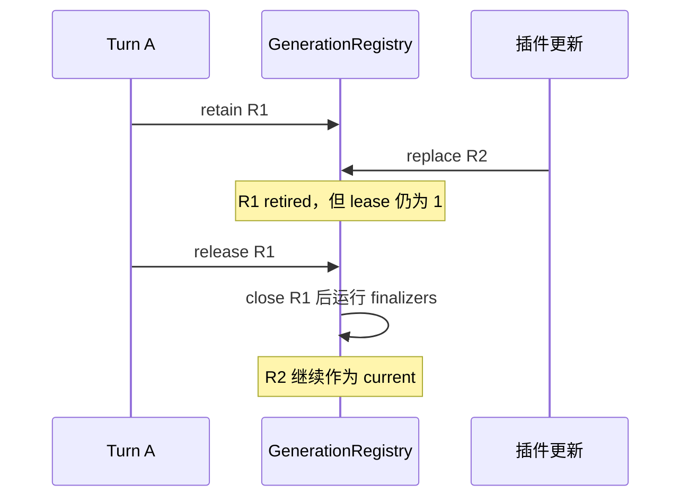

## 本章的问题

Turn A 用 R1 的工具执行，更新后 B 应看到 R2。直接在 replace 时关掉 R1 会中断 A；永不关闭则泄漏资源。再加一个竞态：连接完成了，但 tools/list 还没发布，第一轮就捕获了空清单。

host 用 discovery Promise 作为捕获屏障，发现完成后才发布新 revision；旧能力代由真实上游 GenerationRegistry 计租约，最后一个使用者释放后才清理。

## 沿固定源码逐段拆解

@source skills

### Skill 包内容先过读取与格式边界

parseSkillFrontmatter 要求起始和闭合块、mapping 形状，并拒绝重复键与过度 alias。格式错误应在读取包时被解释，不要等模型调用才变成模糊失败。host 使用更小的标量方言，明确不支持完整 YAML。

@source mcp-generation

### retain 与 release 管正在使用的旧代

构造时保存 current generation；retain 按 revision 增计数，缺代就报错；replace 创建新 current，把 prior 标 retired；release 递减并调用 tryCleanup。清理必须同时满足 retired、leaseCount 为零且还没开始。

cleanup 先关闭 runtime，再跑该代 finalizers；失败隔离让其他收尾仍可继续。dispose 是系统级收尾，不能被单个 Turn 当作释放自己租约的替代。

### host 的发布屏障与租约分别解决什么

capture 等待 pending discovery，解决新 Turn 捕获过早；retain/release 解决旧 Turn 仍在使用。前者不能代替后者。发现失败让当前捕获失败，下一次显式更新可以重新准备，不偷偷发布半成品。

Plugin、Skill、Hook、MCP 可以组合，但不能共享一个含糊的 ready 布尔值。每种能力需要明确发现、发布、执行和清理的条件。

## 机制总览



## 接入贯穿项目

@implementation 08-plugins-mcp

### 逐步跟踪本章实现

update 把 discovery 串在 pending 后，先等新 runtime 完成发现，才发布 revision。capture 也等待同一 barrier，再 retain 当前 generation，避免拿到新版本号配旧目录。发现失败会阻止这次 capture；显式下一次 update 可以重新尝试。

发布 R2 时，已经 capture R1 的 Turn 继续持有它的 tools 与 runtime。release 只释放那份租约，归零后旧 runtime 才 close。finalizer 捕获的是 retired revision，不能闭包引用会继续变化的 current，否则晚到的清理可能删掉新视图。

mcpRuntime 真正启动 stdio peer，完成握手和 list 后把目录变成 configured tools。调用错误映射为工具 isError，初始化失败则关闭进程。课程同时验证 registry 状态和真实 peer 生命周期：只有引用数变化而子进程仍泄漏，不能算热更新验收通过。

## 运行本章实验

```bash
node --disable-warning=ExperimentalWarning labs/chapters/08-plugins-mcp.mjs
```

@experiment 08-plugins-mcp

## 逐项解释实验结果

真实 MCP fixture 的发现被人为挂起，capture 必须等待。R2 发布后，新的快照能立即调用 mcp_echo，旧快照仍保留 old；R1 直到 release 才关闭，重复 release 不会再次关闭。

实验执行了完整上游 generation 及其纯依赖；发现屏障和 host 编排是原创教学层，不把它写成已经向上游修复的证据。

## 继续动手与验收

同时持有两个 R1 lease，只释放一个时断言连接存活。让 close 延迟，再检查该代 finalizer 在 close 之后。最后取消 discovery，定义下一次更新怎样恢复。

::: interview 更新插件时为什么不能立即关闭全部旧连接？
先完成 discovery 再发布 R2，新 Turn 等 barrier 后捕获它；已持有 R1 lease 的任务继续使用旧 runtime。引用归零才清理旧资源，finalizer 必须绑定被退休的版本。真实 MCP 退出是资源回收的直接证据。
:::

::: interview 发现屏障和 generation lease 能互相替代吗？
不能。前者保证新 Turn 捕获前发现已完成；后者保证旧 Turn 结束前资源仍存活。它们分别约束准备时序与资源寿命。
:::

::: interview 为什么不能在一个任务 finally 里 dispose 整个插件系统？
系统还可能服务其他 Turn。单个任务只释放自己的 lease；系统 dispose 应在应用停止接纳并等待活动工作收尾之后进行。
:::
