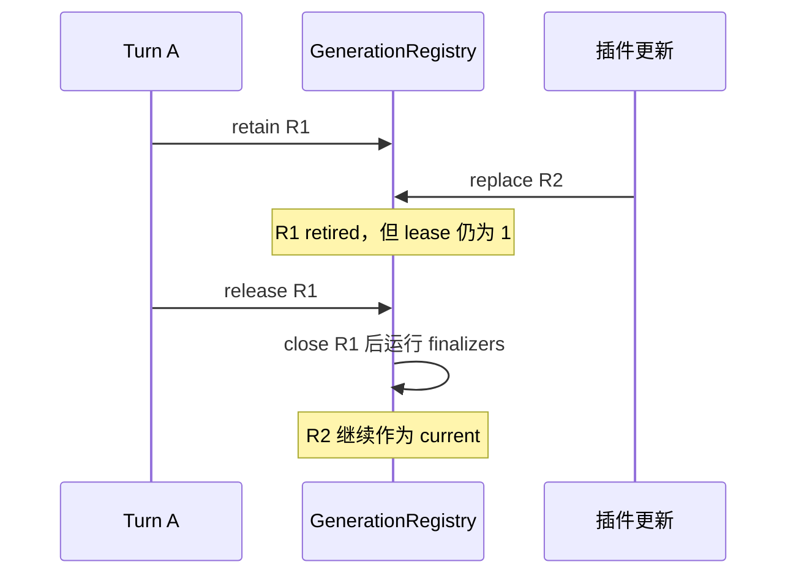

## 四个概念放在正确位置

| 概念 | 主要职责 | 追踪时关注什么 |
| --- | --- | --- |
| Plugin | 分发与组织一组能力 | 来源、安装、启用、版本与生命周期 |
| Skill | 让 Agent 按需获得做事方法 | metadata、正文读取、权限及来源 |
| Hook | 在生命周期节点参与处理 | 触发时机、输入输出、失败语义 |
| MCP | 对外部能力进行协议交互 | 发现、调用、结果、连接与清理 |

它们可以组合：一个 Plugin 同时携带 Skill、Hook 与 MCP 配置。支持一种能力，不等于同一 Plugin 的所有能力都已经完成发现并进入当前 Turn。

## Skill 首先是一个需要校验的包内容

@source skills

`parseSkillFrontmatter` 要求起始 YAML 块与闭合分隔符，并要求解析结果是 mapping。后续 YAML 解析拒绝重复键，限制 alias 展开。配置格式的错误应在读包边界被解释，避免到模型执行时才变成一个模糊失败。

继续追 `skill/reader.ts` 和 package readers，核对名称、目录、相对路径与启用状态的处理。只有成功读取并发布，才谈得上可供 Agent 选择。

## MCP 连接不能随着配置更新被立刻销毁

假设 Turn A 读取了插件版本 R1 的工具快照；用户更新后，Turn B 开始使用 R2。若切换时立刻关闭 R1 的连接，A 已经看到的工具可能在调用时消失。

@source mcp-generation

`PluginCapabilityGenerationRegistry` 按 revision 保存运行时并计数 lease。replace 把旧代标为 retired；release 减少引用，满足条件后才清理。它解决的是能力快照与资源生命周期的协调。

这与第 5 章 prompt Registry 有相似的所有权问题，但不是同一个类，也没有被那个离线实验覆盖。要验证 MCP generation，需要调用它自己的实现和相关测试，覆盖 retain/release、替换与最终清理。

## “连接成功，但第一轮没有工具”怎样调查

把时间线拆成：Plugin enabled → MCP tools/list 完成 → 发现结果发布 → Turn 捕获 capability snapshot → 工具定义投影到模型请求。每一步记录 revision 与 owner，找到具体哪一条因果边没有完成。

公开 Issue #570 就报告过这种竞态，并由原作者提供补丁线索。本课程把它作为阅读案例；独立贡献任务需要检查现有提案，避免把已有修复当成自己的首次贡献。

## 一个真实的热更新竞态

Turn A 捕获了插件 R1 的 search 工具并开始执行；用户更新插件后，Turn B 应该看见 R2。若 replace 的同时关闭 R1，A 的工具连接会在半途中消失；若永不关闭 R1，长时间使用就会积累旧连接。

GenerationRegistry 用 revision 识别一代能力，用 lease 记录还有谁使用。replace 把旧代标成 retired；release 让引用减一；只有 retired 且无租约，才启动清理。新版本发布与旧资源销毁被分成两个时刻。

@lab generation

这里实际执行完整 Registry 及其纯依赖模块，只把 runtime.close 换成记录器。替换时旧代没有关闭，释放后关闭一次，dispose 还会清理新代。关闭 R1 与关闭 R2 可以交错，finalizer 只要求在所属 R1 close 之后，不能据一份输出臆造所有代之间的全局串行保证。

## lease 是责任，必须对应释放

捕获快照就 retain，Turn 在任何退出路径都要 release。缺一次 release，旧代就一直留着；提前 release，会把仍在使用的连接关掉。测试应覆盖正常结束、模型报错、用户取消和更新过程中退出，不只检查 retain/release 两个方法各自能调用。

Registry 的 dispose 是进程或系统级收尾，不是每个 Turn 都应调用的快捷清理。它会把代标退休、清空 lease 并等清理任务。把它放在某个任务 finally 中，会影响其他还在运行的任务。

## Skill 校验与 MCP 生命周期怎样关联

Plugin 可以分发 Skill、Hook 和 MCP；这些能力不共享同一个“完成发现”的时刻。Skill YAML 先要解析、拒绝重复键与不合格结构；MCP 要完成连接和 tools/list；最终能力视图还要发布给 Turn。配置 enabled 只是起点。

遇到“第一轮没有工具，第二轮出现”时，按 revision 记录连接完成、发现结果发布、Turn 捕获与请求投影四个时间点。若没有这份时间线，延迟启动只是把竞态隐藏起来。

## 练习：写一个旧代存活测试

retain R1 两次，replace R2，release 一次，断言 R1 尚未关闭；release 第二次，断言关闭一次；重复 release 不应再次关闭；dispose 后 R2 关闭。把 close 人为延迟，再确认 finalizer 仍在 close 后面。它是一个明确的资源生命周期测试，不需要真实 MCP 服务。

::: interview 热更新插件时，为什么需要 capability generation？
正在运行的 Turn 需要继续使用它捕获时的工具契约和连接。用 revision 区分代，用 lease 保留仍被使用的旧运行时，等最后一个使用者结束再清理。验证不能只看新版本工具列表，还需要检查旧 Turn 是否能完成以及资源是否最终释放。
:::
