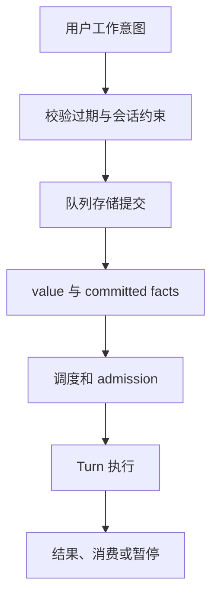
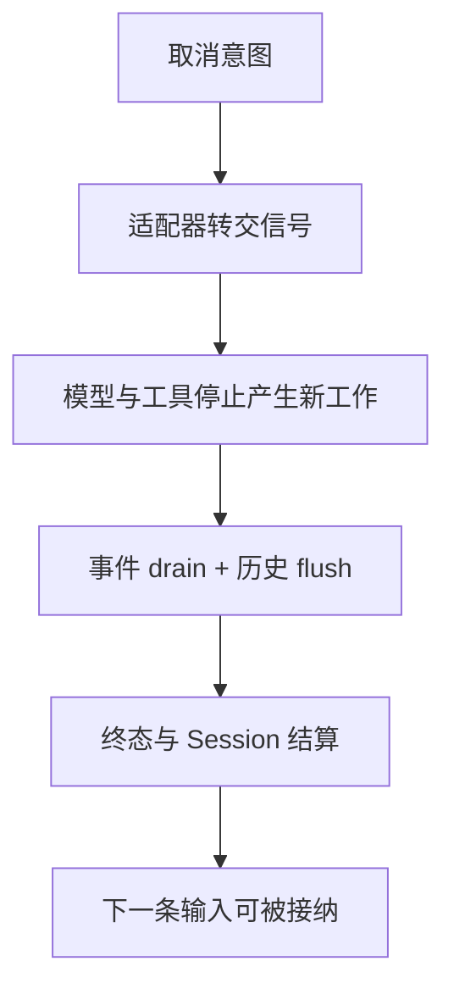

## 忙碌时收到新输入，是一个产品决策

当一个 Session 仍在运行 Turn，新消息可以被拒绝、排队，或者用于 steering 当前执行。三者语义不同。排队承诺稍后处理，steering 需要定义在哪个边界送入，拒绝则应明确告诉客户端未接纳。

不能只在 UI 中保存一段文字就宣称队列可靠。消息需要身份、顺序、状态、取消与过期规则，并在适当的提交边界确认已接纳。重复发送相同请求，还要考虑幂等性。

@source queue

`QueueService` 将操作交给 store，多个方法返回 `CommittedQueueResult`。继续追 repository contract 与 admission 代码，核对 busy、只读 Session、模型覆盖和 expiry 的处理。方法名里的 enqueue 不能证明 ACP 的 prompt handler 已经调用它。

## 子任务完成不等于父任务已消费结果

子任务需要自己的运行状态与输出；父任务还要知道何时、以何种可信度接收报告。后台完成通知、模型上下文中的报告和工具读取结果，是不同交付环节。

从 `service/background-bash/shared-task/local-task-subagents.ts` 追公开委派路径，再到 `turn-system/agent-host/history/background/` 看结果提醒与读取结算。源码架构文档明确，公开 TUI 使用当前 task services；不能误读为被排除的旧 `@mavis/team` cycle engine 仍负责执行。

## 取消要测试下一次操作

只看到 `stopReason: cancelled`，只能说明协议返回了一个终态。还要确认底层 Turn 释放、工具进程回收、队列状态更新、后续 prompt 被接纳。否则用户看到“已取消”，马上再问仍可能得到 busy。

公开 #569、#574 等 Issue 是适合追踪 adapter 与运行时边界的阅读入口；它们是用户报告，是否仍存在于固定基准，需要真实复现，不能直接当成课程已验证结论。

## 用一个小型所有权实验理解收尾

关于进程内准备材料的交接，见[第 5 章](05-context-memory.md)；下面直接验证队列服务自己的契约。

这个实验只验证 prompt Registry 的 reservation、take 与 close。它让“占用—交接—释放”变得可见，不能替代队列持久性、ACP 取消或真实子进程测试。真正的取消回归应覆盖：启动 → 执行中取消 → 收到终态 → 立即发下一条 → 确认下一轮成功接纳。

## 队列里保存的是工作意图，不是又一份当前 Turn

运行时忙碌时，用户输入可能排队。队列需要支持取消、排序、过期、暂停和模型覆盖；真正开始执行时还要做 admission。已入队、已被 claim、被执行系统持久接受、最终消费，是不同阶段，不能用一个 running 布尔值包办。

QueueService 很多方法会把操作委托给 store，并保留 CommittedQueueResult 的 value 与 facts。facts 表示已经提交的事实，供上层继续发布或更新视图。服务方法返回成功，不代表相应模型 Turn 已经执行完成。

@source queue-contract

## 让服务边界承担它能确定的错误

@lab queue

实验使用真实 QueueService、policy 与 contract 模块，fake store 记录访问。等于 now 的过期时间会在进入 store 前同步抛错；合法未来时间返回原始 committed result。缺会话、只读会话、unsupported runtime 是不同 failure reason；底层损坏和 admission 错误则被映射为服务错误。

这个实验没有验证数据库事务、claim 恢复或调度器的 exactly-once。它恰好界定了服务层负责什么。若要修“重启后重复执行”，必须继续读 store 的持久 claim 与接受确认，而不是只修改这个门面。

## 取消是一个收尾过程

用户点取消后，适配器收到答复、信号传给 Agent、模型流结束、工具进程退出、事件队列 drain、历史尾部提交、Session busy 释放，可能发生在不同时间。第 2 章已经看到 runner 为什么要先等待再发 terminal。

如果只测试“界面显示 cancelled”，遗漏的资源可能继续占用 Session，下一条就报 busy。更强的集成验收是取消后立即提交下一条无害任务，检查被接纳、运行并只完成一次；同时确认上一条没有迟到事件覆盖新状态。

## 练习：对迟到结果做归属检查

设 Turn A 正在结束，B 已开始，A 的最后一个工具事件晚到。哪些 id 能避免它被归入 B？谁决定事件是否仍可发布？谁拥有 active Turn？把 sessionId、turnId、toolCallId 画在一条时间线上。再为队列项增加 clientRequestId，说明重试入队时为什么不能只生成新 id。

::: interview 队列输入与 steering 为什么不能简单共用“追加消息”实现？
队列承诺未来某次执行使用输入；steering 可能改变当前 Turn 的后续模型上下文。两者的接纳时机、持久记录、权限、取消和重复处理语义不同。可以共享底层契约，但要明确何时成为 canonical history，以及失败后由谁重试。
:::
