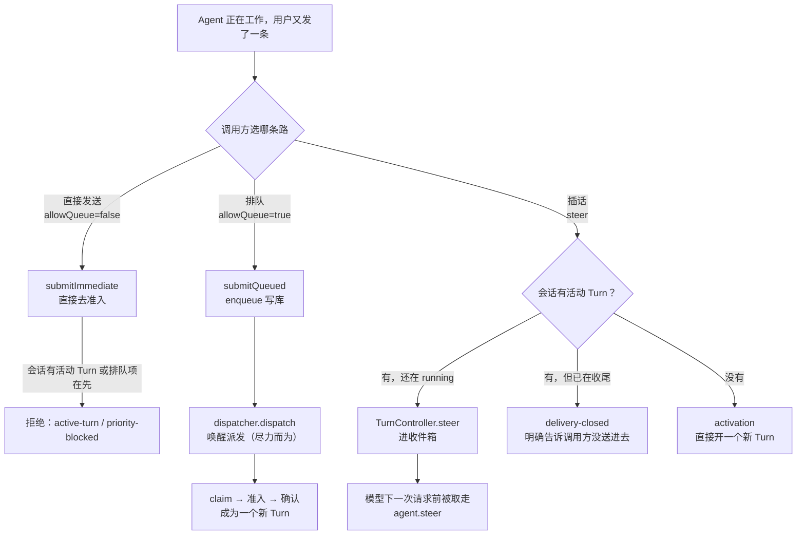
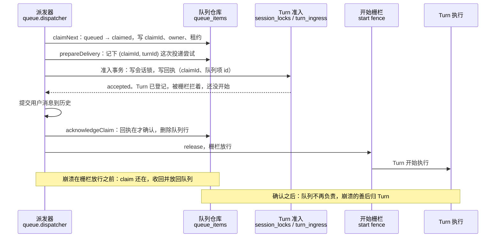
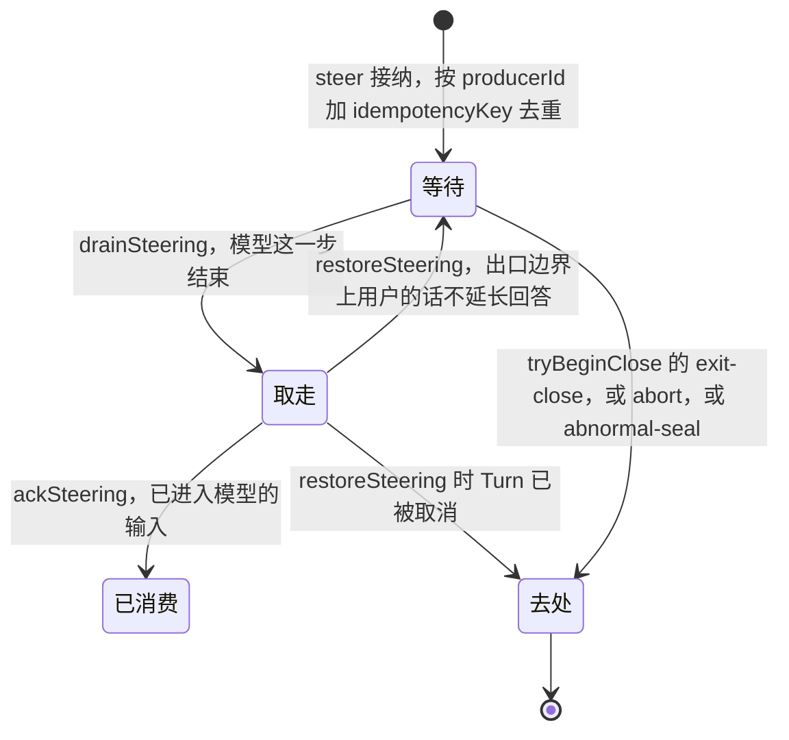
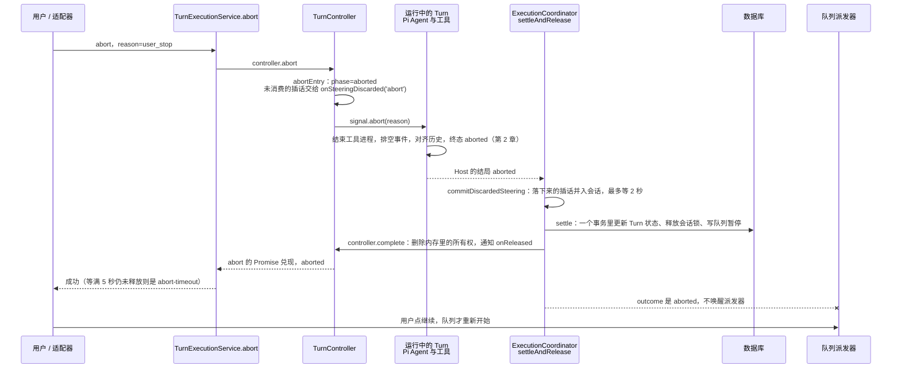

你让 Agent 重构一个模块，它正在跑第三个工具。你又敲了一句：“别动 tests 目录。”

这句话有三种可能的命运：

- **拒绝**：Agent 正忙，请稍后再发。
- **插话**：塞进正在运行的这一轮，模型下一次请求就能读到。
- **排队**：等这一轮做完，单独开一轮处理。

MiniMax Code 三种都有，由调用方选。Pi 的 `Agent` 只有后两种的内存版本：`steer` 队列和 `followUp` 队列，忙的时候 `prompt()` 直接抛错（Learn Pi Agent 第 3 章）。内存队列够内核用，不够产品用，产品要回答另一类问题：

- 客户端超时，把同一句话发了两遍，会执行两次吗？
- 调度器把消息取走之后进程崩了，这句话在哪里？
- 插话递给了模型，可这一轮恰好在这一刻结束，它去哪里？
- 你按了停止，队列里的下一句会不会马上自己跑起来？

这一章把一条消息当成一件**要交接的东西**来读：每一次交接，新的负责人必须已经把账记在日志里，旧的负责人才能松手。第 2 章讲的是一个 Turn 内部的终态顺序，这一章讲 Turn 之间。

::: note Pi 的版本
本章摘录的 Pi 代码来自 MiniMax 内置的 pi-mono v0.79.1（`third_party/pi-mono`），不是 Learn Pi Agent 读的 v1.5.0；两个队列的形状没有变。
:::

@figure assets/course/ch09-queue.png 忙的时候来的消息要么排队、要么插话；每次交接先记账，取消要等收尾完再放行下一个

## 先看现象：只有内存的队列会怎样坏

最朴素的队列是一个数组：`push` 入队，取走就 `splice`。Pi 的两个队列就是这个形状。下面的实验让它和本章 host 里的 `WorkQueue`（全部状态由一个只追加的日志重放得到）面对同样四种情况。“崩溃”的意思是：旧进程做到这一步就没了，新进程读同一个日志。

@lab node labs/ch09/durability.mjs | md

内存队列那一列只有两种结果：重复，和丢了。第一行重复，因为数组不知道两条是“同一条”；后三行丢了，因为取走即删除。第四行最糟：消息已被 Turn 接纳，文件也许改了一半，重启后没有人知道发生过什么。

`WorkQueue` 那一列有三种处理：重发靠 `clientRequestId` 认出来；取走之后、确认之前崩溃，放回队列重跑；确认之后崩溃，不重试，只报告。为什么第二、三行可以放心重跑，第四行不行？分界线在“确认”这一步的位置。下面一站一站读 MiniMax 是怎么做的。

## 忙的时候来了一条消息：三条路

先看 Pi 怎么对待“忙”：

@mm third_party/pi-mono/packages/agent/src/agent.ts#L355-L362 hl=357-360

`prompt()` 发现已经有一个 run 在跑，直接抛错，错误信息让调用方改用 `steer()` 或 `followUp()`。这两个方法只是往内存里的 `PendingMessageQueue` 推一个数组，取出的时机由 Pi 的循环决定（第 3 章）。MiniMax 的 `Agent` 就是它，只是把“忙的时候怎么办”这个决定提到了循环外面。

### 排队：承诺在 enqueue 返回的那一刻兑现

`createTurnSubmissionService` 里 `submit` 只做一次选择：`input.allowQueue ? submitQueued : submitImmediate`（`turn-submission.service.ts` L55-L58）。TUI 把 Agent 工作时提交的消息交给 `enqueueMessage`，它带着调用方生成的 `clientRequestId`，调到 `submit({ allowQueue: true })`（`conversation-application.ts` L411；TUI 的 `steerNext` 再把队首改成插话）。

@mm packages/local-runtime-v2/src/service/turn-system/turn-submission.service.ts#L127-L168 hl=139,142-145,154-160

- **L139**：先登记一个“完成句柄”（Promise）。此刻 Turn 还不存在，句柄要等将来那个 Turn 跑完才兑现。先登记，是为了不管这条消息什么时候被派发，调用方手里的句柄都对得上号。
- **L142-145**：先确认会话存在且可写（`requireMutableSession`），再 `enqueue`。`await` 返回时这条消息已经在数据库里，后面的任何失败都不会让它消失；入队本身失败（L146-153）才撤销句柄。
- **L154-160**：如果这是一次重试，队列返回的是第一次留下的那一行，行里带着第一次的 `requestedTurnId`。这里用它重新绑定句柄，重试和第一次共用同一个 Turn 身份。
- 摘录之外的 L161：入队**之后**才唤醒派发器，而且是“尽力而为”：`dispatchBestEffort` 把唤醒失败只上报、不抛出，因为承诺已经在 L143 兑现了。返回值是 `mode: 'queued'`，带位置和“前面还有几项”。

直接发送走 `submitImmediate`，交给准入事务：会话忙就是 `active-turn`，而且一条新消息不能越过已经在排队的老消息（`priority-blocked`，下面读 `blocksQueueCandidate` 时再看）。

### 插话：三种成功，一种明确的失败

@mm packages/local-runtime-v2/src/service/turn-system/execution/steering/steer-session.service.ts#L65-L83 hl=69-76,77-82

- **L69-76**：先查收据。收据的身份是 `steeringReceiptId({ producerId, idempotencyKey })`，`steering-identity.ts` 一共 13 行，就是把这两个字段拼起来。查到了就返回 `duplicate`，不再投递第二次。
- **L77-82**：有活动 Turn 就尝试加入（`deliverToActive`）；没有，或者加不进去，就 `activateOrSteerRace`：直接用这条消息开一个新 Turn（`activated`）；开的瞬间别的 Turn 抢先了，回头再试一次加入。

所以成功有三种：`steered`（加入了正在跑的 Turn）、`activated`（自己开了一个新 Turn）、`duplicate`（之前已经投递过）。收据存在 `turnIngressClientRequests` 表里（`turn.repository.ts` L618-L660 的 `reserveSteeringReceipt`），而 Turn 准入时登记 `clientRequestId` 用的是同一张表（L1167-L1176）：一个请求 id 至多对应一个 Turn，不管它是被加入的还是被激活的。

@mm packages/local-runtime-v2/src/service/turn-system/execution/steering/steer-session.service.ts#L142-L160 hl=148,153-158,159

- **L154-158**：controller 明确回答“没收”（Turn 在收尾、不是这个 Turn……），说明内容没有进入任何 Turn，就把收据退掉。注释把话说得很满：“definitive non-acceptance”。
- **L159**：只有 `delivered` 或 `delivery-closed` 作为结果返回；其他情况返回 `undefined`，回到上面的激活分支。`delivery-closed` 是一个**明确的失败**：调用方知道这句话没进去，收据已经退回，可以改走排队。
- 连退收据的写入也失败时，收据留着，这句话以后重发会被当成 `duplicate`。`releaseKnownUndeliveredReceipt`（L294-L304）的注释把这叫作“已记录的至多一次丢失边界”：宁可偶尔丢一句，也不重放一条不确定有没有送达的插话。

MiniMax 对 Pi 的这两个队列只用了一个。`enqueueSteering` 调 Pi 的 `agent.steer`（有批次标记时是 `steerBatch`，`events.ts` L422-L428）；`agent.followUp` 在整个 MiniMax 里只出现一处（`events.ts` L135），用来在回复被钩子否决后让模型重试。**用户排队的话不走 Pi 的追加任务队列，而是写库，变成自己的 Turn。**原因源码没有直接写出来，我的推断是：追加任务留在同一个 run 里，没有自己的终态、历史提交点和取消边界，也活不过进程重启；而这些正是用户排的每一条话需要的。

## 入队：重发拿回的是同一行

@mm packages/local-runtime-v2/src/service/session-system/queue/service.ts#L106-L122 hl=107,110-118

- **L107**：过期时间先于一切检查。`isFutureQueueExpiry` 要求 `expiresAt` 是有限数并且晚于现在，否则抛 `expiry-invalid`，仓库根本不会被碰到。
- **L110-118**：在仓库里按 `clientRequestId` 找这个会话里已有的行（排队中和已被取走的都算）。找到了，用它**当时存下的 model**；没找到，才解析一次。重试不会因为这几秒里会话设置变了，就换成另一个模型：同一个意图，同一份配置。

`QueueService`、`policy` 和 `contract` 是纯模块，实验直接从固定提交里读出来执行。仓库换成了一个内存里的假货（只实现 `findByClientRequestId` 和 `enqueue`），所以下面每一行的判断都是上游代码自己做的：

@lab node labs/ch09/service.mjs | md

第二行最关键：重试时 `resolveModel` 没有再被调用，入队的仍是 `m-old` 解析出的那份。第四行的四种非法过期时间（包括 `NaN` 和 `Infinity`）都在 `QueueService` 这一层被拦下，仓库被调用 0 次。最后一行是它把仓库的错误翻译成调用方能处理的原因。

## 取走、接纳、确认：每一步之前先记账

消息躺在队列里，调度器把它取走变成一个 Turn。这一步涉及三方：队列、Turn 的准入、Turn 的开始。MiniMax 用三个动作把它们串起来，崩溃可能发生在任意两个动作之间：

### 第一步：claim

@mm packages/local-runtime-v2/src/service/session-system/queue/repo/drizzle.ts#L297-L320 hl=304-307,312-318

整段在一个 `behavior: 'immediate'` 的数据库事务里（`transaction` 辅助函数，L573-L587）。

- **L304-306**：队列处于暂停就不给（除非点名某一项，或者调用方明确要“继续”）。暂停是第 3 小节“取消”要用到的东西。
- **L307**：这个会话已经有一个 claim 在手，也不给。同一时刻，一个会话最多一条消息在被派发——这个互斥在数据库里，派发器不需要任何内存锁。
- **L312-317**：生成 `claimId`，写上 owner（谁取走的）和租约（`leaseExpiresAt`，默认 30 秒）。这三样是崩溃之后判断“这个 claim 还有没有人管”的依据。

每次唤醒只是把 `requestedWake` 加一，排空循环一次只跑一个，期间有新唤醒就再转一圈（`queue.dispatcher.ts` L81-L99、L241-L280），十次唤醒不会变成十个并发的派发。

### 第二步：准入，回执写在 Turn 一侧

claim 之后，派发器带着 `claimId` 去请求 Turn 准入。准入是一个事务，里面按顺序做所有检查：

@mm packages/local-runtime-v2/src/service/turn-system/persistence/turn.repository.ts#L783-L828 hl=797-800,801-807,820-827

- **L797-798**：按 `turnId`、`clientRequestId`、`claimId` 找已有的回执。完全一样是 `duplicate`（幂等，不是错误）；身份相同、内容不同是 `ingress-conflict`。
- **L799-800**：会话锁。`session_locks` 以 `session_id` 为主键，已经有一行就是 `active-turn`（或 `compaction-active`）。“一个会话同一时刻只有一个 Turn”是数据库里的约束，不是进程里的布尔值。
- **L801-812**：优先级围栏（下面读 `blocksQueueCandidate`）：暂停中的普通候选，或者想越过老排队项的候选，是 `priority-blocked`。
- **L820-827**：都通过了才 `insertAdmission`：同一个事务里写会话锁，再写一行 `turn_ingress`，行里有 `claimId`、`claimSource` 和队列项 id（L1142-L1153）。**这一行就是回执。**它属于 Turn，不属于队列。

准入被拒时，派发器按原因处理（`queue.dispatcher.ts` L583-L598 的 `settleRejected`）：`invalid-session`、`ingress-conflict`、`invalid-input` 是这条消息本身有问题，`reject`（删除并上报）；`active-turn`、`priority-blocked` 这类是“现在不行”，`release`，放回队列等下次。

### 第三步：先放着不让跑，记完账再放行

@mm packages/local-runtime-v2/src/application/conversation/user-message-turn-delivery.ts#L144-L177 hl=148,158-164,171-173,175-177

- **L148**：造一个“开始栅栏”（`createStartFence`）。**L161** 把它当 `executionStart` 交给准入。Turn 一登记完，`executeAgentTurn` 在调用 `host.run` 之前会先 `await executionStart`（`execution.coordinator.ts` L101-L113）：Turn 已经持有会话锁，却被拦在门外。
- **L158**：`beforeSubmit`，对应队列的 `prepareDelivery`。
- **L171**：`completeAcceptedDelivery` 先把用户消息提交到历史，再调 `beforeStart`。派发器在 `beforeStart` 里调 `acknowledgeAccepted`（`queue.dispatcher.ts` L385-L388），队列才确认。
- **L172**：`start.release()`，栅栏放行，Turn 才开始调用模型。**L175-177**：确认之前任何一步出错，栅栏以失败收场，Turn 当成启动前失败结算，错误抛回派发器，由它放回 claim。

这和第 2 章“历史先写，工具后跑”是同一个原则，放大到了队列：**Turn 的第一个副作用发生之前，该记的账都已经记完。**

### 确认：问 Turn，不问自己

@mm packages/local-runtime-v2/src/service/session-system/queue/repo/drizzle.ts#L346-L369 hl=359-363

确认也是一个事务。它先找出这个 claim 的所有行，然后问 Turn 一侧的 `acceptanceLookup`（实际是 `turn.repository.ts` 的 `findAcceptedQueueTurn`，L1003-L1018）：`turn_ingress` 里有没有一行，`claimId`、`claimSource`、队列项 id 都对得上？没有就抛 `QueueClaimNotAcceptedError`。有，才给回执打上确认时间、删除队列行，发出一条 `removed: accepted` 的事实。**队列不能自己宣布“这条已经有人接手了”。**

host 的 `WorkQueue` 把这三步原样搬了过来。下面的实验让一条消息走完全程，每一步之后打印队列的状态，并故意做两个会被拒绝的操作：

@lab node labs/ch09/lifecycle.mjs | md

- 第二个 `claim` 返回 `undefined`：一个会话同一时刻一个 claim。
- 没有回执就 `acknowledge` 抛错，没有确认就 `consume` 抛错。每一步都要求上一步已经记在日志里。
- 消费之后客户端又重发，拿回 `consumed` 的旧行。MiniMax 的队列行确认后就删了，挡重发的是准入的 `findDuplicate`（L797），效果相同。暂停那张表留到“取消”一节。

## 崩溃之后：谁认领，谁收回

崩溃之后留在表里的 claim，可能是派发器还活着、只是慢，也可能进程已经死了。区分它们的是 `activeClaim`（`drizzle.ts` L1167-L1181）：owner 还活着、租约没过期，才算有人在管。启动时的扫描更严：`recoverDispatcher`（`queue.dispatcher.ts` L127-L140）带着 `claimedAtOrBeforeMs: processStartedAtMs`，这次启动之前取走的 claim，不管 owner 看起来活不活，一律当成旧世界的遗留。扫描到的 claim 怎么处理：

@mm packages/local-runtime-v2/src/service/session-system/queue/repo/drizzle.ts#L477-L501 hl=479-482,487-488

两个分支：没有投递尝试而且 Turn 一侧有回执，补做确认；其他情况放回队列（发一条 `requeued` 事实）。

第 1 分支的前提是 `!pendingDelivery`。`prepareDelivery` 会在行上记下 `(claimId, turnId)` 这次投递尝试，派发器（`beforeSubmit`）和“立刻发送”（`queueSteer.prepareDelivery`，`initialize.ts` L219-L227）都先调它。按这段代码推下来，它们留下的 claim 都带着投递尝试，**崩溃后一律走第 2 分支**：放回队列，下次投递换新的 `turnId`，旧的记为 `unstartedFromTurnIds`（`queue.dispatcher.ts` L649-L658）。第 1 分支留给没有投递记录的 claim（我的推测：旧版本留下的行）。

放回去为什么安全？因为确认发生在开始栅栏放行**之前**。claim 还在表里，说明确认没做完；确认没做完，Turn 一定还没动过手。确认完了的消息已经不在表里，崩溃的善后归 Turn：它的会话锁有租约，`TurnController` 每 10 秒续一次（`turn.controller.ts` L21-L22、L105-L125），进程死了没人续，锁过期，下一次准入事务开头的 `recoverExpiredInTransaction`（`turn.repository.ts` L762）会把那个 Turn 结算成失败、释放锁。

回头看开头的实验：取走之后（第 2 行）和回执写好之后（第 3 行）都是“确认没做完”，放回队列；确认之后（第 4 行）队列不再负责，`recover()` 只报告。host 的 `recover()` 比 MiniMax 少一个分支，按上面的推理这是对的。

## 插话：给正在跑的 Turn 递一张纸条

排队的话要活过进程重启，插话不需要：它进入的是**正在运行的这个 Turn**，Turn 活在内存里（`TurnController` 的 `ActiveTurnEntry`），进程死了 Turn 也死了，上一节说过它的锁会过期、被结算成失败。插话要保证的是另一件事：Turn **活着的时候**怎样结束，每一条被接纳的话都有明确的去处。

一条插话在 controller 里有三种位置：

### 接纳

@mm packages/local-runtime-v2/src/service/turn-system/execution/turn-controller/turn.controller.ts#L286-L318 hl=296-304,308-317

- **L296-304**：只有 controller 登记的这个 Turn、并且 `phase` 还是 `running` 才收。Turn 已经在收尾（`closing`）或被取消（`aborted`），都回 `closing`，上层把它翻译成 `delivery-closed`。
- **L308-317**：身份是 `producerId` 加 `idempotencyKey`。重复投递直接认账（返回 `accepted`），不重复放入；新的才进 `entry.steering`，并唤醒正在等插话的人。

### 取走：模型每一步结束后问一次

runner 在 Pi 的每个 `turn_end` 之后问宿主要插话，并且告诉它“现在是哪种边界”：

@mm packages/agent-core/src/pi-turn-runner/events.ts#L216-L239 hl=222-225,227-234

- **L222**：这一步有工具调用，或者 Pi 里还排着别的消息，说明后面还有模型请求，边界是 `mid-turn`，插话可以搭便车；否则这是最后一步，回答已经写完，边界是 `exit`。
- **L223-225**：取到的插话立刻交给 Pi 的 `agent.steer`；有插话，或者后面还有活，就返回，让循环继续。
- **L227-234**：没有插话，也没有后续，runner 才试着“关门”（`tryBeginClose`）。关上了，之后 controller 不再接收插话。

宿主这一侧的 `getSteeringMessages` 实现了出口边界的规则：

@mm packages/local-runtime-v2/src/service/turn-system/agent-host/execution/user-input-control.ts#L46-L73 hl=47,53,63-69,72

`drainSteering()`（L47）把等待中的插话全部取走，记在 `steeringClaims` 里。**L53、L72**：边界是 `exit` 时，用户的插话跳过，不进入模型。没消费的在 `restoreUnconsumed`（L63-L69）里放回队首。注释把理由写得很直白：用户的插话不能延长一条已经写完的回答，否则用户看到的最终回答在他“说完话”之后又被改写了一遍。

### 关门

@mm packages/local-runtime-v2/src/service/turn-system/execution/turn-controller/turn.controller.ts#L415-L443 hl=429,434-436,440-442

三个条件决定能不能关：

1. **L429**：有插话正在被消费（取走了但还没 `ack`，或者在工具结果的尾巴上），不能关，返回 `steer-pending`，runner 再 poll 一次。
2. **L434-436**：机器产生的插话（定时任务、通知）还在等，也不能关：注释说得很明白，没有出口，宁可让回答晚一步结束，也不丢。
3. **L440-442**：剩下的是用户的插话，交给 `onDiscarded(…, 'exit-close')`，然后 `phase = 'closing'`。回答不被延长，话也没丢。

下面的实验把同一组操作先交给**上游真实的 `createTurnController`**，再交给 host 的 `SteeringBuffer`，逐行对照：

@lab node labs/ch09/steering.mjs | md

十五行里没有一行不一致。读表时注意三件事：重复的 `m1` 只被取走一次；`tryBeginClose` 在 `m1` 被取走但没确认时返回 `steer-pending`，在只剩机器插话时同样；关门之后的 `steer` 以及取消之后的 `steer` 都得到 `closing`。

### Pi 的补丁

插话进模型之前还要过 `UserPromptSubmit` 插件钩子，钩子可以拒绝，可 Pi 原有的停止检查在 `turn_end` 就跑完了。`MINIMAX_CHANGES.md` 为此记了一条补丁：

@mm third_party/pi-mono/MINIMAX_CHANGES.md#L157-L163 hl=159

它在 steering 取出之后加了检查点（`agent-loop.ts` L270），Agent 不发新请求、也不报失败地结束。另一条（L402-L408）加了 `Agent.steerBatch`，让一批“立刻发送”的消息在同一次请求里被读到，又各自保留身份。

## 递晚了：没来得及消费的插话去哪里

上面出现过两个“去处”：`exit-close`（Turn 正常结束，用户的话还留在收件箱里）和 `abort`（被取消，还有话在等或者已被取走）。它们的处理方式不同，源码注释里有这条规则：

@mm packages/local-runtime-v2/src/service/turn-system/execution/steering/steering-requeue.ts#L123-L129 hl=124-127

- **`exit-close`：回到队列的最前面。**`toRequeueInput` 里写着 `queuePlacement: 'front'`（L608），一批插话合成一个队列项（`batchIdentity`，L493，身份来自会话、Turn 和每条的 `producerId`/`idempotencyKey`，所以重复处理仍是同一项），然后唤醒派发器。用户的话变成了下一个 Turn，排在原有的排队项之前。
- **`abort` 和 `abnormal-seal`：并入对话，不进队列。**用户刚按了停止，如果这些话进了队列，队列一唤醒就自己跑起来，违背了“停止”。所以把它们直接写成会话里的用户消息（先是显示用的 `steered_user` 行，再是规范历史里的用户行），下一次请求模型就能读到。
- 机器的插话在两条出口上都丢弃（注释：“Non-user producers keep drop semantics on both lanes”）。

`resolveRoute`（L358-L360）就一句话：`resolveCause(batch) === 'exit-close' ? 'requeue' : 'teardown'`。host 的 `routeDiscardedSteering` 是它的缩小版：

@lab node labs/ch09/exits.mjs | md

第一行：两条用户的话合成一个排队项，排在“稍后再做的事”前面；`c1` 被丢弃；同一批再处理一次仍是同一项。第二行：取消前最后一句话进了会话历史，队列里仍是两项，一项没多。

## 取消：先收尾，再放行

用户按了停止。这一刻到下一条消息能开始之间，有一串事情必须按顺序发生。先看总图：

### abort 要等 Turn 真的放手

@mm packages/local-runtime-v2/src/service/turn-system/execution/turn-controller/turn.controller.ts#L145-L184 hl=151,159-164,177-183

- **L159**：`abortEntry` 同步完成三件事：`phase` 变成 `aborted`，未消费的插话交给 `onSteeringDiscarded`，然后 `abortController.abort(reason)`，信号这才发出去。
- **L160-164**：`abort()` 不是发出信号就返回，而是 `waitForRelease(entry.released, abortTimeoutMs)`，等 Turn 真的释放，最多 5 秒。等到了是 `aborted`，等不到是 `abort-timeout`——**超时不是释放**，下面的实验会看到会话此时仍然忙。
- **L152-158**：如果 Turn 已经在收尾（`closing`），abort **不去打断它**，只等它释放，返回 `released`。
- **L174-184**：`complete` 才是释放的瞬间：删掉内存里的所有权，同步通知 `onReleased` 监听者，最后 resolve `released`。注释说明了“同步”的意义：删除和通知之间没有任何空隙，下一个 Turn 不可能插进来。

`abortSession` 把 `aborted`、`released`、`not-running` 翻译成成功，`abort-timeout` 翻译成 409 `local_turn_abort_timeout`（`conversation-application.ts` L368-L384）。调用方拿到成功，才能认为会话空了。

@lab node labs/ch09/ownership.mjs | md

这张表跑的也是上游真实的 `TurnController`：`abort` 已发出、Turn 还没 `complete` 时，`activeTurnId` 仍是旧 Turn，注册下一个会抛 `Turn already active`；`complete` 之后新 Turn 才注册得进去。收不了尾的 Turn 让 `abort()` 等满超时，返回 `abort-timeout`，`activeTurnId` 还是它。

### 收尾的次序

Host 的结局出来之后，协调者按固定次序结算：

@mm packages/local-runtime-v2/src/service/turn-system/execution/execution.coordinator.ts#L278-L332 hl=299,301-308,313,321-327

1. **L299**：`commitDiscardedSteering`：落下来的插话在释放之前并入会话。注释说原因是 stop 之后马上 send 的那个新 Turn，读历史时必须已经能读到它们；这一步最多等 2 秒（`PRERELEASE_COMMIT_TIMEOUT_MS`），超时不阻塞释放。
2. **L301-308**：`settleRepository` 在**一个事务**里更新 Turn 状态、释放会话锁，并写队列暂停（上面 `terminalQueuePauseCause` 算出的原因）。失败会重试一次。
3. **L313**：数据库结算成功，才 `controller.complete`，释放内存里的所有权。结算和释放挨着，是为了不留空隙：注释说，如果让准入在两者之间插进来，它会通过仓库的检查，却在 `controller.register` 上失败，把一条排队的消息白白消耗在启动之前。
4. **L321-327**：最后才决定要不要唤醒派发器。

@mm packages/local-runtime-v2/src/service/turn-system/execution/execution.coordinator.ts#L429-L444 hl=434-443

暂停的原因有两个：前台 Turn 最终失败（`turn-final-failure`），或者前台 Turn 被取消而且来源是“用户停止”。后者由一个单独的谓词判断：

@mm packages/local-runtime-v2/src/service/turn-system/execution/queue-pause-on-abort.ts#L15-L18 hl=17

只有 `user_stop` 和 `session_leave`（TUI 里 `/clear`、切换会话）暂停队列；`immediate_send`、`input_safety`、`output_safety`、`lifecycle`，以及没有被识别的原因都不暂停（`queue-pause-on-abort.test.ts` 逐个列了出来）。`shouldWakeQueue` 的最后一个条件是 `outcome !== 'aborted'`（同文件 L453-L465）：**被取消的 Turn 结算之后，不唤醒派发器。**

这两条合在一起，就是“停止之后，队列里的下一句不会自己跑起来”：写下暂停，也不唤醒。下一次由谁来重启？

@mm packages/local-runtime-v2/src/service/session-system/queue/turn-priority-fence.ts#L152-L190 hl=159-167,175-188

准入事务（上面 L801）调用的就是它。

- **L159-167**：会话处于暂停，而候选的优先级不在豁免名单里（继续队首、点名某一项、重试续跑……），就挡住。这不只管队列派发的消息：用户在暂停状态下**直接发送**的新消息同样要受它约束，除非走“暂停时发送”这类明确的意图。
- **L175-188**：没暂停时，也不能越过老消息：队列里有任何排队中或已被取走、创建时间不晚于候选的项，候选就被挡成 `priority-blocked`。**队里的话先于新来的话。**

用户点“继续”才解除（`continueQueue`），或者直接再发一条前台消息，也会在准入时消除暂停（`consumeQueuePause`，`turn-execution.service.ts` L979-L986）。

### 用一次真实的取消看全过程

下面的实验用 host 的真实应用：工具是一个真的子进程（`slow.cjs`），终态帧故意写得很慢（60ms）。A 在跑，用户排了一条 B，然后按停止：

@lab node labs/ch09/cancel.mjs | md

按步骤读：

1. 步骤 5：取消之后**立刻**尝试 `next()`，被拒绝，因为 A 还占着会话。这时 A 的工具进程正在被结束，终态帧正在慢慢写出去。
2. 步骤 6 先于步骤 7：终态帧送达在先，busy 释放在后。第 2 章讲过终态帧是提交点，这一章看到它的另一个后果：**会话不会在终态之前被放开。**
3. 步骤 9-10：A 完全收尾之后，队列暂停，`claim` 不给。MiniMax 是在 settle 的事务里一起写的；本章实验直接调用 `pauseIfPending` 单独演示这一步，第 12 章总装时 host 也在收尾阶段自动暂停。
4. 步骤 11-15：用户点“继续”，B 才开始，正常完成。

## 子任务与分叉

Agent 工作到一半，可以从一个会话里长出另一个会话。MiniMax 里有两种，源码在两个地方。

### 子任务：新会话，同一条队列，取消分两步

Task 工具启动的子任务是一个新的隐藏会话：

@mm packages/local-runtime/src/api/local-task-runner.ts#L88-L97 hl=91-93

带着 `sessionKind: 'task'`、`parentSessionId`，隐藏。它的工作不直接执行，而是提交给子会话的队列：`allowQueue: true`，`clientRequestId` 是 `task-turn:${turnId}`（`injected-conversation-task-turn.ts` L66-L68）。内置的 `explore` 角色只读：受信任的内置 explore 会打开 `forceReadOnlyFilesystem`（`local-turn-execution-preparation.ts` L263-L264）。

父任务被取消时：

@mm packages/local-runtime/src/api/injected-conversation-task-turn.ts#L180-L206 hl=187-192,196-198

- **L187-192**：用同一个 `task-turn:…` 身份找到还在排队的那一项，撤销它。入队时的 `clientRequestId` 在这里又当“找人的凭据”用了一次。
- **L196-198**：不管上一步成不成功，都**按确切的 `turnId`** 取消子会话的 Turn。注释把理由写出来：队列这一步失败不能跳过精确取消，因为被 claim 的子 Turn 可能已经在跑。
- 两步分别记录失败，最后一起抛出（L202-205）。

取消要覆盖三个时刻：还在排队，已被 claim 但没开始，已经在跑。第一步管第一个，第二步管后两个。

### 会话分叉：一个分阶段、能续跑的复制

`/fork`（以及旁路会话 `/btw`）把一个会话到某个位置为止的历史复制到新会话。它不是一次复制，而是一个有阶段的工作流：

@mm packages/local-runtime-v2/src/application/session/conversation-fork-service.ts#L581-L608 hl=582-592,594-603,605-606

- 调用方给一个 `operationId`，和 `clientRequestId` 是同一个思路。`fork()`（同文件 L512-L518）先查：已经完成过，直接返回上次的结果并标成 `duplicate`；做到一半的，从落盘的阶段 `resumePending` 继续；都不是才新开始。
- 新开始时（L582-592）先校验来源会话和分叉点，并拒绝落在没有执行完的工具调用中间的分叉点（`assertHistoryBoundarySettled`，错误码 `assistant-not-settled`），再写下第一个阶段 `validated`。
- 之后每个阶段落盘：`worktree-prepared`（可选的隔离 git worktree）、`session-created`、`history-published`、`display-assets-published`、`child-visible`（`conversation-fork-recovery.ts` 的 `RecoverableForkStage`）。
- **L605-606**：任何一步失败，`compensateStart` 把已经创建的东西清理掉：子会话、资产、worktree。

host 的 `forkTask` 和 `forkSession` 各取一半。实验先看子任务：

@lab node labs/ch09/fork.mjs task | md

子任务调用 `edit`，得到的是 `unknown tool`：工具目录里没有。父任务在子任务开始前取消，排队项被撤销，没有 Turn 被创建；在运行中取消，工具进程被结束，子 Turn 以 `cancelled` 收尾，排队项已经被接纳过，不会自己再跑。隔离的边界要说清楚：新会话隔离的是历史和任务身份，工作目录仍然是父会话的，这不是 worktree。

再看分叉：

@lab node labs/ch09/fork.mjs session | md

来源历史最后一个 `edit` 调用没有结果，已收尾的前缀只有三条。同一个 `op-1` 再来一次得到 `duplicate`；`op-2` 在 `session-created` 之后崩溃再重试，沿用那个子会话，没有造出第二个；`op-3` 在 `history-published` 之后崩溃，重试时子会话已有历史，所以不再复制第二遍（总数仍是 3）；切在没有结果的调用上，或者同一个 `operationId` 换了请求，都被拒绝。

## 对照 Pi 和 Claude Code

| 问题 | Pi | Claude Code | MiniMax Code |
| --- | --- | --- | --- |
| 忙时又来一条 | `prompt()` 抛错；`steer` / `followUp` 推进内存队列 | 一个进程内的 `commandQueue`，优先级 now > next > later；工具跑完后，非斜杠命令作为附件在同一轮里被模型读到（`query.ts` L1558-L1585） | 三条路：直接发送被拒绝、排队写库、插话进收件箱 |
| 队列在哪 | `Agent` 对象里的数组 | 模块级数组 `messageQueueManager.ts`；操作被记进 transcript（`recordQueueOperation`） | 数据库表 `queue_items`；host 里是只追加的日志 |
| 下一条什么时候开始 | 调用方决定 | “调用方负责保证此时没有查询在跑”（`queueProcessor.ts` 注释），之后 `processQueueIfReady` | 准入事务里 `session_locks` 没有这一行，加上内存里 controller 已 `complete` |
| 停止 | `abort()` 发信号 | Esc：有任务在跑就取消（`useCancelRequest.ts` 的 Priority 1），`queryGuard.forceEnd()` 先让界面认为结束；空闲时 Esc 把排队的命令弹回输入框（Priority 2） | 等 Turn 真的释放才算停；写队列暂停，不唤醒；用户继续才重新开始 |
| 没送进去的插话 | 留在队列里 | 同一个队列，不区分 | 明确的 `delivery-closed`；收件箱里剩下的按出口规则：`exit-close` 回队首，`abort` 并入会话 |

Learn Pi Agent 第 3 章留下过一个问题：取消之后，排队的消息怎么办？Pi 把它们退回输入框，Claude Code 的文档说停止后接着发。MiniMax 选了第三种：**暂停**。队列里的话一条不少，也不自己跑，等用户明确说继续。代价是多一个“暂停”状态要在界面上说明白；收益是按下停止之后，不会被刚才排的指令追着跑。

## 动手：host 里的 WorkQueue 和 SteeringBuffer

`host/src/queue.mjs` 和 `host/src/fork.mjs` 保持原来的导出（`WorkQueue`、`forkTask`），新增 `SteeringBuffer`、`routeDiscardedSteering`、`forkSession`、`settledPrefix`；`app.mjs` 照常使用 `claim`、`accept`、`consume`。文件顶部的注释写了每一块对应哪个源码函数、简化了什么。

回执和确认是两个动作，分在两个方法里，崩溃窗口就在它们之间：

@code host/src/queue.mjs#L176-L198 hl=181,184,194-197

`recordIngress` 是 Turn 一侧的动作（对应 `insertAdmission`），`acknowledge` 是队列一侧的动作（对应 `acknowledgeClaim`）：`acknowledge` 在回执缺失时抛错。`accept(id, turnId)` 是旧接口，先后调用这两个，所以 `app.mjs` 不用改。

恢复：

@code host/src/queue.mjs#recover hl=256-258

只有两行有内容。claim 的主人不是自己、或者租约过期，就放回队列；已经 `accepted` 的不动，只在返回值里报告。

收件箱的“关门”：

@code host/src/queue.mjs#tryBeginClose hl=378-381,382-384

三个条件和上游 L429、L434-436、L440-442 逐行对应，上一节的实验已经证明了两边的结果一致。出口的路由：

@code host/src/queue.mjs#routeDiscardedSteering hl=422-428,430

最后是分叉：

@code host/src/fork.mjs#forkSession hl=110-111,121-129,132-136,139-145

每个阶段先落盘再往下做；崩溃之后重来，沿用已经创建的子会话，历史已经复制就不再复制。

简化：行在确认后不删（保留 `accepted`/`consumed` 方便回放）；没有 `dedupeKey`、重排、编辑和 `toolResultTail`；`forkSession` 没有补偿，因为 `Sessions` 不能删除会话。

整章的检查一次跑完：`node labs/chapters/09-queue-cancel.mjs`（或 `npm run lesson -- 9`），打印每个场景的表格和全部检查。

## 你来改

每道题先写下预测，再改代码运行对应的实验脚本；断言失败时，表格仍然先打印出来。

::: predict 确认没做完，要不要补上确认
把 `WorkQueue.recover()` 改成旧版的逻辑：claim 的主人不在时，如果 `receipts` 里有它的回执，就 `transition(item.id, "accepted", …)`，没有才放回队列。运行 `node labs/ch09/durability.mjs`，“Turn 写了回执、队列还没确认就崩溃”那一行会变成什么？
???
变成不重试：状态是 `accepted`，重新执行 0 次，脚本末尾的断言失败。这条消息永远不会被执行：回执写好的那一刻 Turn 还没开始（`app.run` 里 `accept` 先于 `runTurn`），补上“确认”等于宣布它已经有人在做，其实没有。这正是 `recoverClaims` 第 1 分支要求 `!pendingDelivery` 的原因。
:::

::: predict 关门时不看有没有插话正在被消费
删掉 `SteeringBuffer.tryBeginClose` 里 `if (this.claimed.size > 0) …` 那一行，运行 `node labs/ch09/steering.mjs`。哪一行的“一致”会变成“否”？host 一列是什么？这会在真实的 Turn 里造成什么后果？
???
“运行中 / 插话正在被消费时 tryBeginClose”那一行：上游是 `steer-pending`，host 变成 `closed`。真实后果是同一条插话被送两遍：它已被取走、正在变成模型的输入，关门时又被当成“没消费的”交给 `exit-close`，回到队首变成下一个 Turn。上游的 `hasInFlightConsumption`（`turn.controller.ts` L494-L500）就是防这个。
:::

::: predict 分叉不检查子会话是否已有历史
去掉 `forkSession` 里 `if (app.sessions.history(state.childId).length === 0)` 这一层判断（保留里面的复制），运行 `node labs/ch09/fork.mjs session`。哪几行的“子会话历史条数”会变？
???
`op-3` 那一行变成 6。它在 `history-published` 落盘之后才崩溃，重试时历史已经复制过，没有这层判断就再复制一遍。阶段落盘只说明“做到哪一步”，不保证这一步里的动作只做一次，所以每一步自己也要幂等。`op-1`、`op-2` 不受影响：前者直接返回上次结果，后者崩溃在复制之前。
:::

## 面试题

::: interview 用户在 Agent 工作时又发了一条消息，系统有哪几种处理方式？各适合什么场景？
三种，MiniMax 都有：

1. **拒绝**：直接发送（`allowQueue: false`）会话忙就是 `active-turn`。适合脚本和 SDK，调用方自己决定怎么办。
2. **排队**：写库，变成自己的 Turn。适合“做完这个再做那个”，要活过重启，所以持久化。
3. **插话**：进正在运行的 Turn 的收件箱，模型下一次请求就能读到。适合“别动 tests 目录”这种纠正。

加分点：出口边界规则（回答已写完，用户的话留给下一个 Turn）、`delivery-closed`（明确告诉调用方没送进去，可以改走排队）；MiniMax 只用 Pi 的 steering 队列，用户排队的话不走 `followUp`。
:::

::: interview 怎样保证一条消息只被接纳一次？
分层来答：

- **入队**：`clientRequestId` 是调用方给的身份，重试拿回同一行（连同第一次解析的 model）。
- **取走**：一个会话同一时刻只允许一个 claim。
- **准入**：一个事务里按 turnId、clientRequestId、claimId 查重，会话锁表以 `session_id` 为主键；通过后才写锁和回执。
- **确认**：Turn 一侧有回执，队列才确认。
- **插话**：收据按 `producerId` 加 `idempotencyKey` 登记，和准入共用一张表。

加分点：“只接纳一次”不靠某一个检查，而是每次交接都有可重放的记录；插话路径退收据失败时是“至多一次”。
:::

::: interview 调度器取走消息之后进程崩了，重启后这条消息怎么办？
按崩溃点回答：

1. 取走之后、Turn 准入之前：claim 还在，没有回执，放回队列。
2. 回执写好、队列还没确认：claim 还在。因为确认发生在开始栅栏放行之前，Turn 还没动过手，同样放回队列，下次换新的 `turnId`。
3. 确认之后：队列行已删除，不会重试，Turn 接管；它的会话锁有租约，进程死了没人续，过期后被结算成失败。

加分点：启动扫描只认“本次进程启动之前取走的 claim”，不看 owner 是否还活着；`recoverClaims` 的第 1 分支只给没有投递尝试的 claim。
:::

::: interview 用户按了停止，哪些事按什么顺序发生？下一条什么时候才能开始？
顺序：`abortEntry`（phase 置 aborted、未消费的插话交给 `onSteeringDiscarded`、发信号）→ Turn 结束工具进程、排空事件、对齐历史、终态 aborted（第 2 章）→ 落下来的插话并入会话 → 一个事务里结算 Turn 状态、释放会话锁、写队列暂停 → `controller.complete` 释放内存所有权 → `abort()` 兑现 → outcome 是 aborted，不唤醒派发器。

下一条要等两样：数据库里的会话锁没了，内存里的 controller 已 `complete`；而队列因为暂停，要用户点继续才会重新派发。`abort()` 本身最多等 5 秒，超时是 `abort-timeout`，不是释放。

加分点：settle 与 complete 挨着；被取消的 Turn 不唤醒队列；只有 `user_stop` 和 `session_leave` 暂停队列。
:::

::: interview 插话递晚了，Turn 刚好结束，这句话去哪里？
看 Turn 怎么结束的。正常结束且话在收件箱里（`exit-close`）：合成一个排队项放到队首，唤醒派发器，成为下一个 Turn，用户的话排在原有排队项之前，且不会延长已经写完的回答。被取消或失败（`abort`、`abnormal-seal`）：并入会话历史，不进队列，否则停止之后队列会自己跑起来。机器产生的插话在两条路上都丢弃。

如果关门时有插话正在被消费，关门被拒（`steer-pending`），runner 再 poll 一次。关门之后再来的插话得到 `delivery-closed`。

:::

::: interview 为什么 MiniMax 不用 Pi 的追加任务（followUp）队列承载用户排队的消息？
源码没有直接写理由，以下是推断，依据是 `agent.followUp` 在 MiniMax 里只用于“回复被钩子否决后让模型重试”（`events.ts` L135）：追加任务留在同一个 run 里，没有自己的终态、历史提交点和取消边界，而用户排的每句话需要单独取消、单独失败；它在内存里，活不过重启，排队的话要有身份、能重发、能恢复；一个 Turn 里排很多条，还会让“终态是提交点”（第 2 章）失去意义。所以排队被提升成 Turn 级别的概念，Pi 的循环只负责 Turn 内部的插话。
:::
