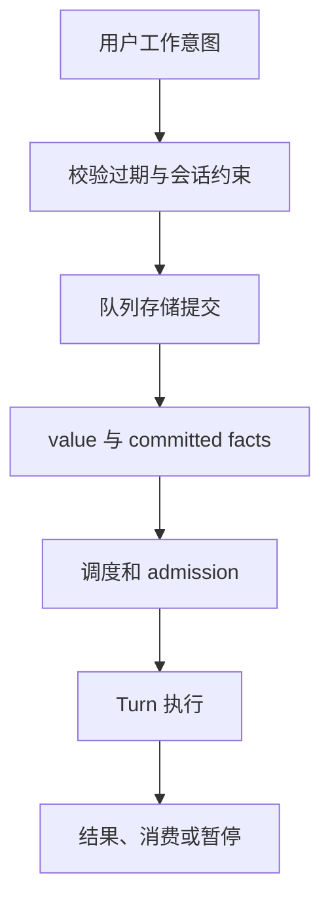
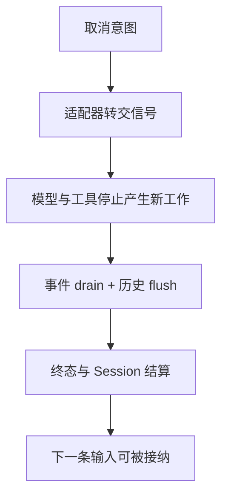

## 本章的问题

用户重试发送同一条消息，网络断线让客户端不知道第一次是否被接纳。若每次都生成新工作，Agent 可能重复修改。clientRequestId 必须在持久意图里保持同一身份。

claim 还不等于执行已持久接受。进程在两者之间崩溃时，可以重新排队；已经 accepted 的工作却可能产生效果，不能盲目重试。本章明确返回这类不确定项等待协调。

子任务使用新 Session 和真正收缩的 read 工具池，仍共享物理目录。父取消通过单独信号传给子任务，消息隔离与工作区隔离各自说明。

## 沿固定源码逐段拆解

@source queue

### QueueService 在存储前处理已知约束

enqueue 与 update 校验 expiresAt；模型覆盖还会读取会话并检查可变性。clientRequestId 已存在时使用原始 model，避免重试把同一项换成另一种配置。底层损坏和 admission 错误转成服务失败，原始存储事实仍由 store 提交。

@source queue-contract

### value 与 committed facts 必须一起返回

value 是调用结果，facts 是已经提交的变更。丢掉 facts 可能让上层视图不更新；先发布未提交的预期事实又会制造幽灵状态。一个服务方法返回，也不表示模型任务已经执行完成。

@source queue-acceptance

### 恢复要问 claim 是否被持久接纳

契约专门表达 claim 与 acceptance 查询。读取这一层时要继续追 repo 的事务与消费者，不能只读门面就宣布 exactly-once。host 用 pending→claimed→accepted→consumed 展示这份责任划分。

取消同样是过程：信号传播、工具进程停止、事件 drain、历史提交、最终终态、busy 释放。下一条任务是否能接纳，是更强的取消验收。

## 机制总览





## 接入贯穿项目

@implementation 09-queue-cancel

### 逐步跟踪本章实现

WorkQueue 不靠内存数组恢复状态，而是重放 enqueue 与 transition 事实。clientRequestId 在同一 session 内去重；claim 按顺序跳过已过期项。claimed 只代表调度器取到了任务，accepted 则额外记录实际 turnId，两个阶段不能合并成一个 busy 布尔值。

app.next 先检查会话可接纳，再 claim 并进入 app.run；capabilities 与 prompt 准备好后才 accept。执行的历史和交付都收尾后才 consume。重启时 claimed 可退回 pending，accepted 保留待协调，因为外部效果可能已经发生，盲目重试会重复写文件或发请求。

取消 active controller 后，仍要等工具进程退出、消息交付和 finally 释放 owner，B 才能接纳。forkTask 则另建 Session 并缩减到 read 目录，独立历史但共享工作区。实验分别验证取消收尾、队列恢复与 fork 权限，不把“发出了 abort”当成所有工作已停止。

## 运行本章实验

```bash
node --disable-warning=ExperimentalWarning labs/chapters/09-queue-cancel.mjs
```

@experiment 09-queue-cancel

## 逐项解释实验结果

相同 clientRequestId 返回原 id 与 model；到期输入在提交前失败；没有 acceptance 不能 consume。重开 WorkQueue 后，未接纳 claim 回到 pending，已接纳项则被列为需要协调。

子任务真实读取后尝试 edit，因工具目录里没有它而失败；父历史保持为空。完整取消与下一条入队执行会在第 12 章一起验收。

## 继续动手与验收

把队列模型从旧值改为新值后重试相同 id，说明应该保留哪一个。再在 accepted 后模拟进程崩溃，写出哪些事实足以重放、哪些文件副作用还需要检查。

::: interview claim、accepted 和 consumed 为什么要分开？
取消是发出停止意图，释放 busy 要等执行、交付和资源收尾。队列用 claimed、accepted、consumed 表达不同事实；重启时 accepted 不能盲目重试，因为外部效果可能已经发生，必须协调。
:::

::: interview 相同 clientRequestId 重试时可以换 model 吗？
同一工作意图需要稳定身份和原先解析出的配置。若确实要换模型，应表达为新意图或显式更新，不能把传输重试悄悄变成不同执行。
:::

::: interview 子任务有新 Session，就具备文件隔离了吗？
没有。新 Session 只隔离历史和任务身份；文件仍可能共享。需要真实收缩工具或建立 worktree、系统隔离，并明确各自能保证什么。
:::
