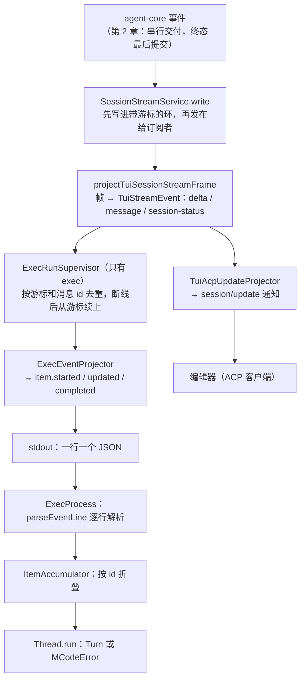
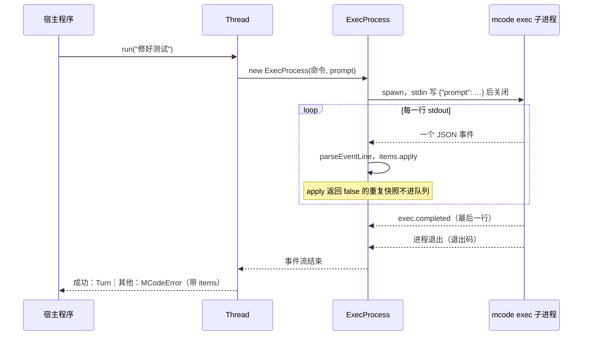
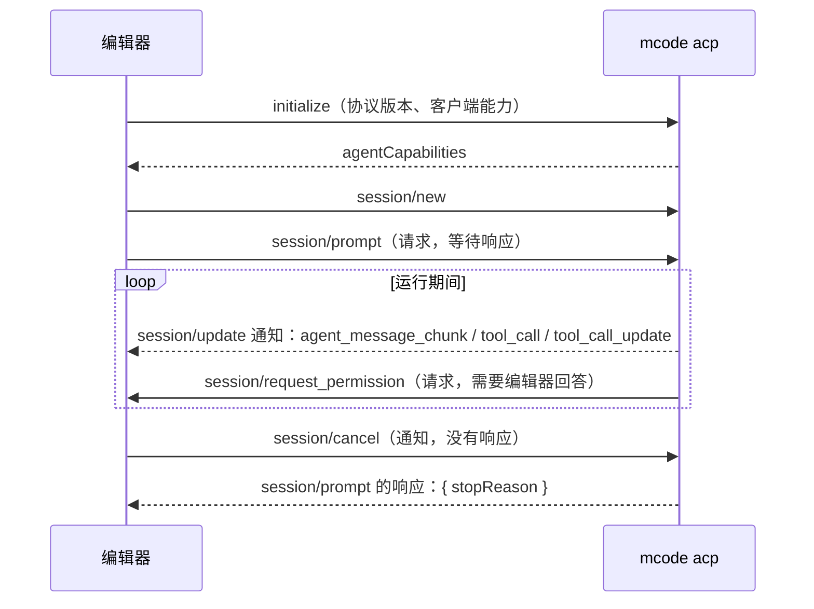

你的 CI 里有一步：让 MiniMax Code 修好失败的测试，再把结果贴到 PR 评论里。这一步没有终端，没有人按回车。脚本要知道三件事：怎么启动它；它做到哪了、最后成功没有；中途要停怎么办。

MiniMax Code 给程序留了三扇门：

- `mcode exec`：一次一个 prompt，标准输出是 JSONL 事件流，退出码给结局。
- `@minimax-ai/code-sdk`：把 exec 包成 `thread.run()`，一个 Turn 起一个子进程。
- `mcode acp`：长期运行，编辑器通过 stdio 用 JSON-RPC 说话（Agent Client Protocol）。

三扇门后面是第 1 章看到的同一个 `CliService`，事件的次序和终态的提交（第 2 章）也是同一套。这一章站到另一头——客户端：它收到的是什么？怎样把一串交错、重复、增量的事件还原成一个值得信任的结果？什么时候应该宣布失败？

Learn Pi Agent 第 19 章读过 Pi 的答案：一个长期运行的 RPC 子进程，命令带 id，响应和事件共用一条 stdout。MiniMax 选了不同的形状，下面一路对照。

@figure assets/course/ch10-sdk.png 交错、重复、增量的事件按编号折叠成完整结果；没有终态就不算成功

## 先看一次真实的输出：31 行 JSON，5 个 item

先看原料。上游 SDK 的测试夹具里有一段真实运行录下来、脱敏后的 `mcode exec --output-format stream-json` 输出（`packages/code-sdk/CONTRIBUTING.md` 说明这些 `.jsonl` 是录制并脱敏的真实输出）。任务是读 `note.txt`、列目录、写出 `out.txt`。共 31 行，每行一个事件。下表逐行列出，最后一列是**真实的** `ItemAccumulator` 对它的处理：

@lab node labs/ch10/stream.mjs | md

表里能读出四件事。

**信封。** 每个事件都带 `schemaVersion`、`sequence`、`timestampMs`、`runId`、`sessionId`、`turnId`。序号从 1 数到 31，开头是 `exec.started`、`session.started`、`turn.started`，结尾是 `turn.completed` 和 `exec.completed`。

**item 有三种形态。** 文字是增量：序号 4、5 各带一小段（`contentDelta`），等消息完成时（序号 16）再给一次整段（`content`）。工具调用是快照：每个事件都带这个调用**当前的整个状态**，`status` 从 4 走到 5、1、2。

**交错。** `read` 的第一个事件是 6，最后一个是 17，中间夹着 `bash` 的 9～11、14、15。事件按产生的时间排队，不按 item 分组。

**重复。** 序号 7、10、20、21 和同一个工具上一份快照一字不差。表里它们被“丢弃”，上游 SDK 的 `stream.test.ts` 断言的正是这四个序号。

状态码的含义在 agent-core 里：

@mm packages/agent-core/src/protocol/agent-message.ts#L37-L50 hl=39-41

4 和 5 是模型还在生成参数的阶段，1 是宿主开始执行，2 是完成。同一个状态连续出现两次（4、4），是因为每一个携带工具调用的增量块，都会把这个调用的当前状态再带一遍——下一节会看到投影器就是这么写的。

表下面还有三种“直观”的合并办法，每一种都错：把所有增量接成一个字符串，两条消息粘成一段，工具调用不见了；一个事件当一条记录，得到 26 条，真正的 item 只有 5 个；每个 id 只留最后一个事件，在完成的 Turn 里碰巧没事，在被取消的 Turn 里却只剩半截文字。还有一件事值得先记下：最终回答在 `exec.completed.result.output` 里，不是事件拼出来的。

## 这些事件从哪来：一条投影链

先把链路摆出来。运行时的事件（第 2 章保证了它们的顺序，终态最后提交）先被写进会话的事件环，再被各个适配器翻成各自的协议：

上面这张图的 A→B 是服务端把帧先记下再投递：

@mm packages/local-runtime-v2/src/service/session-system/stream/session-stream-service.ts#L84-L105 hl=96-100,102-103

`write` 先 `ring.append`（带游标的有界环，有 `identity` 的帧重复写入会被环自己挡下），再 `subscribers.publish`。订阅者看到的每一帧，环里一定有，所以断线后总能从游标补上。host 的 `app.mjs` 里 `events.append(frame)` 排在 `writer(frame)` 前面，是同一个顺序。

exec 这一头，投影器把内部事件翻成 JSONL：

@mm packages/tui/src/headless/events.ts#L10-L48 hl=11-16,29-31,33,41,47

信封是 `ExecEventBase`，事件类型一共八种。成功和失败分成两个类型：`turn.completed` 只有成功，`turn.failed` 带着 `status`（failed、timeout、cancelled、limit_exceeded）和 `error`。最后的 `exec.completed` 携带整个 `ExecResult`，它才是进程级的终态。

@mm packages/tui/src/headless/events.ts#L59-L121 hl=71-73,97,100-107,111-120 collapse=false

- `project`（L70-L74）：每次先 `ensureStarted`，再把内部事件拆成若干 item 事件。第一个事件到来时补出 `exec.started`、`session.started`（续会话则是 `session.resumed`）、`turn.started` 三个开场事件。
- `itemEvent`（L110-L121）：一个 id 没见过就是 `item.started`，见过就是 `item.updated`；完成的消息直接发 `item.completed`，并把 id 从 `startedItems` 里删掉。注意一个 item 从没“开始”就“完成”是合法的，下面实验里会看到。
- `complete`（L76-L98）：成功发 `turn.completed`，其他结局发 `turn.failed`，最后永远是 `exec.completed`。`ensureStarted` 在这里再调一次，所以连一个事件都没产生的 Turn（比如启动就失败）输出里也有三个开场事件，客户端总能拿到 `sessionId`。
- `completed` 标志让 `exec.completed` 之后再调 `project` 直接抛错：终态之后不许再有帧。

重复是怎么产生的，看 `projectItems` 里增量的这一段：

@mm packages/tui/src/headless/events.ts#L141-L177 hl=145-168,169-172

思考和文字各有一个以 `${messageId}:reasoning` 和 `${messageId}:message` 为 id 的 item，只带 `contentDelta`。工具调用不一样（L169-L172）：每个携带 `toolCalls` 的增量块，都会把里面**每一个**调用整个重新投影一次。同一个状态被两个增量块带着，就是两条完全相同的 `item.updated`。交错也来自这里：一个增量块里可以同时有文字和多个工具调用，不同 item 的事件就这样排进同一条流。

## 折叠器：三条规则把过程还原成 items

SDK 拿到这样的流，靠 74 行的 `ItemAccumulator` 还原。整个文件摆在这里：

@mm packages/code-sdk/src/items.ts#L12-L74 hl=33,35-43,48-52,63 collapse=false

规则一：**按 id 合并**（L21、L34-L47）。`states` 是一个 `Map`，第一次见到 id 创建状态，之后所有事件改同一个状态。item 的类型在创建时定下，输出按首次出现的顺序，所以交错无所谓。没见过的类型（`toThreadItem` 的 `default`）留在流上，不进结果。

规则二：**快照去重，增量不去重**（L33-L43）。没有 `contentDelta` 的事件当作快照，序列化成字符串；只有同时满足四个条件才丢弃：这个 id 有状态、事件是 `item.updated`、是快照、和上一份一字不差，并且 item 还没完成。增量的 `snapshot` 是空串，永远走不进这个分支——“ha”之后再来一个“ha”是新文字。第一次出现的 `item.started` 和任何 `item.completed` 也都不会被丢。丢弃时 `apply` 返回 `false`，这个返回值有用处：`ExecProcess` 看到 `false` 就不把事件放进 `runStreamed()` 的流里（后面读）。

规则三：**完成帧的整段文字覆盖增量**（L49-L52）。有 `contentDelta` 就追加；有 `content` 就整段替换。如果误把完成帧的 `content` 当增量追加，整段文字会出现两遍。`toolCall` 则永远整体替换，后到的快照就是当前状态。

最后一个细节在 `toThreadItem`（L62-L63）：没有收到 `item.completed` 的 item 带上 `incomplete: true`。被取消的 Turn 里，说了一半的话和没跑完的命令都还在，只是标明没完。

先按事件顺序走一遍，看三条规则在哪一步起作用：

::: steps ItemAccumulator 折叠十个事件：重复快照丢弃，增量照收
--- **第一个事件**：`item.started`，消息 a，`contentDelta` 是“ha”。`states` 里没有 a，创建状态，文字追加。规则一：按 id 合并（`items.ts` L34-L47）。
flowchart LR
  EV["#1 item.started a +“ha”"]:::on
  ACC["ItemAccumulator 按 id 找状态，创建或修改"]:::on
  A["消息 a ha"]:::on
  R["思考 r （还没出现）"]:::dim
  T["工具 t （还没出现）"]:::dim
  EV --> ACC
  ACC --> A
  ACC --> R
  ACC --> T
--- **工具快照**：`item.updated`，工具 t，状态 4（生成参数）。没有 `contentDelta`，当作快照；t 是新 id，创建状态，记下序列化后的快照。
flowchart LR
  EV["#2 item.updated t 快照：状态 4"]:::on
  ACC["ItemAccumulator 按 id 找状态，创建或修改"]:::on
  A["消息 a ha"]:::done
  R["思考 r （还没出现）"]:::dim
  T["工具 t 状态 4（生成参数）"]:::on
  EV --> ACC
  ACC --> A
  ACC --> R
  ACC --> T
--- **重复快照被丢弃**：第 3 个事件和上一份快照一字不差。有状态、是 `item.updated`、是快照、内容相同、item 没完成，五个条件齐了，`apply` 返回 `false`（规则二，L33-L43）。
flowchart LR
  EV["#3 item.updated t 同一份快照"]:::on
  ACC["ItemAccumulator 按 id 找状态，创建或修改"]:::on
  A["消息 a ha"]:::done
  R["思考 r （还没出现）"]:::dim
  T["工具 t 状态 4（重复，丢弃）"]:::on
  EV --> ACC
  ACC --> A
  ACC --> R
  ACC --> T
--- **增量不去重**：第 4 个事件又是消息 a 的“ha”。增量的 `snapshot` 是空串，走不进丢弃分支，`apply` 返回 `true`，a 变成 `haha`。“ha”之后再来“ha”是新文字。
flowchart LR
  EV["#4 item.updated a +“ha”"]:::on
  ACC["ItemAccumulator 按 id 找状态，创建或修改"]:::on
  A["消息 a haha"]:::on
  R["思考 r （还没出现）"]:::dim
  T["工具 t 状态 4"]:::done
  EV --> ACC
  ACC --> A
  ACC --> R
  ACC --> T
--- **交错**：思考 r 的两个增量（#5、#6）插进来，各追加“想”，得到“想想”。输出按首次出现排序，事件交错没有影响。
flowchart LR
  EV["#5、#6 r 的增量 +“想” +“想”"]:::on
  ACC["ItemAccumulator 按 id 找状态，创建或修改"]:::on
  A["消息 a haha"]:::done
  R["思考 r 想想"]:::on
  T["工具 t 状态 4"]:::done
  EV --> ACC
  ACC --> A
  ACC --> R
  ACC --> T
--- **快照整体替换**：#7、#8 工具 t 的状态走到 1、2，`toolCall` 每次整体替换，后到的快照就是当前状态（L49-L52 里 `toolCall` 的赋值）。
flowchart LR
  EV["#7、#8 t 的快照 状态 1 → 状态 2"]:::on
  ACC["ItemAccumulator 按 id 找状态，创建或修改"]:::on
  A["消息 a haha"]:::done
  R["思考 r 想想"]:::done
  T["工具 t 状态 2（完成），带 input 和 output"]:::on
  EV --> ACC
  ACC --> A
  ACC --> R
  ACC --> T
--- **完成帧**：#9 `item.completed` a 带整段文字“haha”，规则三：`content` **替换**增量，不是追加，仍是 `haha`，标记已完成。#10 t 也完成。r 一直没有 `item.completed`，所以 `toThreadItem` 给它加上 `incomplete: true`（L62-L63）。
flowchart LR
  EV["#9、#10 item.completed a 和 t"]:::on
  ACC["ItemAccumulator 按 id 找状态，创建或修改"]:::on
  A["消息 a haha（完成）"]:::done
  R["思考 r 想想（incomplete）"]:::on
  T["工具 t 状态 2（完成）"]:::done
  EV --> ACC
  ACC --> A
  ACC --> R
  ACC --> T
:::

不读源码也能感受到每条规则是怎么来的。下面的实验造了一段会同时撞上三个坑的流：消息 a 和思考 r 的文字是内容相同的增量，工具 t 有一份重复快照，三者交错，最后 r 没有完成。先看真实折叠器一步一步做了什么，再看五种朴素做法，每种只在一条规则上与上游不同：

@lab node labs/ch10/accumulate.mjs | md

第 3 步 `apply()` 返回 `false`，第 4 步同样的“ha”却返回 `true`，a 变成 `haha`。五种朴素做法里，“按文字去重”把 r 的“想想”吞成“想”，a 只是靠完成帧的整段文字才补回来，换成一个被取消的消息就补不回了；“完成帧也追加”得到 `hahahaha`；“结束时一律当作已完成”让被取消的思考看上去是完整的。“不丢重复快照”的结果其实是对的，代价在消费者一侧：每次都要重画一遍。所以去重的对象是**快照**，目的是少打扰消费者；增量天生不幂等，不能碰。

## Thread.run：从事件流到一个 Turn

`ItemAccumulator` 解决了“事件怎么变成 items”。SDK 的 README 把整体形状说得很清楚：

@mm packages/code-sdk/README.md#L15-L22 hl=15-17

**一次 run，一个 CLI 进程，一个 Turn。** `Thread` 只在 SDK 里记一个 Session id，下一个 Turn 再起一个新进程，用 `--session <id>` 接着聊；会话本身存在 CLI 的数据目录里，宿主崩溃后可以用 `resumeThread` 找回。`exec` 的输入也是一次性的：SDK 往 stdin 写 `{"prompt": "…"}` 就关掉它。

`Thread.run` 把流变成结果：

@mm packages/code-sdk/src/thread.ts#L54-L81 hl=59-62,64-69,72

- 它只是消费 `runStreamed` 的流，从里面取出 `exec.completed`（L59-L61）。
- 没有 `exec.completed`：抛 `MCodeProtocolError`（L62）。
- 有，但 `status` 不是 `succeeded`：抛 `errorForResult` 造的错误，**把当前的 items 带在错误上**（L64-L69）。调用方可以看到做到哪了，再用错误上的 `sessionId` 调 `resumeThread` 续上。
- 成功才返回 `Turn`，`finalResponse` 取自 `result.output`（L72），不是 items 拼的。

折叠器是怎么接进去的，看 `start` 里创建进程的地方：

@mm packages/code-sdk/src/thread.ts#L147-L163 hl=154-157,158,162

`onEvent` 在进程读到每一行时就调用 `items.apply`，返回值 `false` 的事件根本不进队列；同时记下 `sessionId`——所以 `thread.id` 在第一个事件到来时就有了，即使这个 Turn 后来失败。`items: () => items.items()` 是留给失败路径的：进程在没有结果的情况下退出时，当前的 items 要附在错误上。`released` 在进程结束后才释放 `busy`，同一个 Thread 同时只有一个 Turn，第二个调用立即抛 `ThreadBusyError`，SDK 不排队。

## 没有结果就是失败：一条判定梯子

进程读完了，但不是每次都有 `exec.completed`。SDK 在 `ExecProcess` 里按一条固定的梯子判定。先看读 stdout 的一侧：

@mm packages/code-sdk/src/exec-process.ts#L255-L270 hl=257,260,263,265,267-268

- 每行都经过 `parseEventLine`。**任何一行不合格，整个 Turn 作废**：记下错误，并 `interrupt()` 取消 CLI（L267-L268）。上游的测试专门有一个用例：stdout 里混进一行 `Update available: run npm i -g`，SDK 在送出它之前的事件后抛 `MCodeProtocolError`。
- `exec.completed` 到达后 `completed` 置位，之后到来的行一律忽略（L257）；CLI 如果迟迟不退出，5 秒后被 SIGKILL（`onCompleted`）。终态之后不再有帧，在 CLI 一侧由投影器保证，在这一侧由这一行保证。

再看进程退出时怎么办：

@mm packages/code-sdk/src/exec-process.ts#L298-L328 hl=302-305,314,323,327

梯子从上到下：

1. **收到过 `exec.completed`**（L302-L305）：以信封里的 `status` 为准，不再看退出码。
2. 没收到，但 SDK 自己因为 `timeoutMs` 强杀过进程（L314）：`MCodeRunError`，状态 `timeout`。
3. 没收到，且是 SDK 自己发起的取消（L323）：`MCodeAbortError`——除非退出码是 2，那说明参数被 CLI 拒绝了，取消不是原因。
4. 其他情况交给 `errorForExit`，只剩退出码可看：

@mm packages/code-sdk/src/errors.ts#L174-L203 hl=180,183,189,192-194,199-200

退出码 2 是参数被拒绝（`MCodeInvocationError`），130 是取消，141 是 stdout 管道断了（`MCodeProtocolError`）。最耐人寻味的是 0（L192-L194）：**退出码 0 却没有 `exec.completed`，算协议错误**。进程自己说成功，但没留下结果，这个“成功”不可信。查表之外的退出码，比如 1，或者被信号杀死，统统是 `failed` 加 `internal`。

CLI 一侧为什么敢保证“有结果就在最后”？看 `runTuiExec` 的收尾：

@mm packages/tui/src/headless/runner.ts#L430-L458 hl=431,441,445-448,451-457

先 `shutdown` 运行时（L431），再等所有事件行写完（L445-L448），最后才写结果。这是第 2 章“终态是提交点”的同一个道理：`exec.completed` 之前，一行事件都不能漏，运行时也已经关好。如果 Turn 成功、关闭却没干净，结果会被改写成 `failed`（`RUNTIME_SHUTDOWN_FAILED`，L451-L457）——和 host 里“没有送达的 completed 不能算成功”一个思路。

@mm packages/tui/src/headless/runner.ts#L484-L490 hl=486,489

注释写得直白：前面的事件行还卡在管道里（读者不读了），结果就**不写**，“退出码承载结局”。所以梯子上第四级不只是进程崩溃时的兜底，CLI 自己也会走到那里。

::: steps 没有 exec.completed 的进程退出：判定梯子一级一级往下
--- 一次 `mcode exec` 子进程退出了，退出码是 0，但 stdout 里没有 `exec.completed`。`ExecProcess.settle`（`exec-process.ts` L298-L328）按固定梯子判定，从上往下。
flowchart TD
  S["进程退出 ExecProcess.settle(code, signal)"]:::on
  Q1{"收到过 exec.completed？"}:::dim
  OK["以信封里的 status 为准 不再看退出码"]:::dim
  Q2{"SDK 因 timeoutMs 强杀过进程？"}:::dim
  TO["MCodeRunError status = timeout"]:::dim
  Q3{"SDK 自己发起过取消 并且退出码不是 2？"}:::dim
  AB["MCodeAbortError"]:::dim
  EX["errorForExit(退出码)"]:::dim
  Q4{"退出码是 0？"}:::dim
  PE["MCodeProtocolError mcode exited without emitting exec.completed"]:::dim
  OT["2 → InvocationError · 130 → AbortError 141 → ProtocolError · 其他 → failed / internal"]:::dim
  S --> Q1
  Q1 -- 是 --> OK
  Q1 -- 否 --> Q2
  Q2 -- 是 --> TO
  Q2 -- 否 --> Q3
  Q3 -- 是 --> AB
  Q3 -- 否 --> EX
  EX --> Q4
  Q4 -- 是 --> PE
  Q4 -- 否 --> OT
--- 第一级：`this.completed` 是否置位。没有收到过 `exec.completed`，所以不能以信封里的 `status` 为准，往下走。
flowchart TD
  S["进程退出 ExecProcess.settle(code, signal)"]:::done
  Q1{"收到过 exec.completed？"}:::on
  OK["以信封里的 status 为准 不再看退出码"]:::dim
  Q2{"SDK 因 timeoutMs 强杀过进程？"}:::dim
  TO["MCodeRunError status = timeout"]:::dim
  Q3{"SDK 自己发起过取消 并且退出码不是 2？"}:::dim
  AB["MCodeAbortError"]:::dim
  EX["errorForExit(退出码)"]:::dim
  Q4{"退出码是 0？"}:::dim
  PE["MCodeProtocolError mcode exited without emitting exec.completed"]:::dim
  OT["2 → InvocationError · 130 → AbortError 141 → ProtocolError · 其他 → failed / internal"]:::dim
  S --> Q1
  Q1 -- 是 --> OK
  Q1 -- 否 --> Q2
  Q2 -- 是 --> TO
  Q2 -- 否 --> Q3
  Q3 -- 是 --> AB
  Q3 -- 否 --> EX
  EX --> Q4
  Q4 -- 是 --> PE
  Q4 -- 否 --> OT
--- 第二、三级：SDK 没有因 `timeoutMs` 强杀过进程（`backstopFired` 为假），也没有发起过取消（`abortRequested` 为假）。两个特殊解释都排除了。
flowchart TD
  S["进程退出 ExecProcess.settle(code, signal)"]:::done
  Q1{"收到过 exec.completed？"}:::done
  OK["以信封里的 status 为准 不再看退出码"]:::dim
  Q2{"SDK 因 timeoutMs 强杀过进程？"}:::on
  TO["MCodeRunError status = timeout"]:::dim
  Q3{"SDK 自己发起过取消 并且退出码不是 2？"}:::on
  AB["MCodeAbortError"]:::dim
  EX["errorForExit(退出码)"]:::dim
  Q4{"退出码是 0？"}:::dim
  PE["MCodeProtocolError mcode exited without emitting exec.completed"]:::dim
  OT["2 → InvocationError · 130 → AbortError 141 → ProtocolError · 其他 → failed / internal"]:::dim
  S --> Q1
  Q1 -- 是 --> OK
  Q1 -- 否 --> Q2
  Q2 -- 是 --> TO
  Q2 -- 否 --> Q3
  Q3 -- 是 --> AB
  Q3 -- 否 --> EX
  EX --> Q4
  Q4 -- 是 --> PE
  Q4 -- 否 --> OT
--- 第四级：只剩退出码可看，交给 `errorForExit`（`errors.ts` L174-L203）。2、130、141 各有专门的含义，其他码落到 failed。
flowchart TD
  S["进程退出 ExecProcess.settle(code, signal)"]:::done
  Q1{"收到过 exec.completed？"}:::done
  OK["以信封里的 status 为准 不再看退出码"]:::dim
  Q2{"SDK 因 timeoutMs 强杀过进程？"}:::done
  TO["MCodeRunError status = timeout"]:::dim
  Q3{"SDK 自己发起过取消 并且退出码不是 2？"}:::done
  AB["MCodeAbortError"]:::dim
  EX["errorForExit(退出码)"]:::on
  Q4{"退出码是 0？"}:::dim
  PE["MCodeProtocolError mcode exited without emitting exec.completed"]:::dim
  OT["2 → InvocationError · 130 → AbortError 141 → ProtocolError · 其他 → failed / internal"]:::dim
  S --> Q1
  Q1 -- 是 --> OK
  Q1 -- 否 --> Q2
  Q2 -- 是 --> TO
  Q2 -- 否 --> Q3
  Q3 -- 是 --> AB
  Q3 -- 否 --> EX
  EX --> Q4
  Q4 -- 是 --> PE
  Q4 -- 否 --> OT
--- 退出码 **0**（L192-L194）：进程自己说成功，却没留下结果，这个“成功”不可信，算 `MCodeProtocolError`，带着已收到的 items 和 `sessionId`。
flowchart TD
  S["进程退出 ExecProcess.settle(code, signal)"]:::done
  Q1{"收到过 exec.completed？"}:::done
  OK["以信封里的 status 为准 不再看退出码"]:::dim
  Q2{"SDK 因 timeoutMs 强杀过进程？"}:::done
  TO["MCodeRunError status = timeout"]:::dim
  Q3{"SDK 自己发起过取消 并且退出码不是 2？"}:::done
  AB["MCodeAbortError"]:::dim
  EX["errorForExit(退出码)"]:::done
  Q4{"退出码是 0？"}:::on
  PE["MCodeProtocolError mcode exited without emitting exec.completed"]:::on
  OT["2 → InvocationError · 130 → AbortError 141 → ProtocolError · 其他 → failed / internal"]:::dim
  S --> Q1
  Q1 -- 是 --> OK
  Q1 -- 否 --> Q2
  Q2 -- 是 --> TO
  Q2 -- 否 --> Q3
  Q3 -- 是 --> AB
  Q3 -- 否 --> EX
  EX --> Q4
  Q4 -- 是 --> PE
  Q4 -- 否 --> OT
:::

下面的实验把梯子的每一级都用真实函数跑一遍：

@lab node labs/ch10/outcomes.mjs | md

第二张表是上游 `cli-contract.test.ts` 里一条测试的可视化：对每种结局，CLI 的 `exitCodeForExecResult` 给出退出码，SDK 用 `exec.completed` 或只用退出码，得到同一类错误。第三张表是两段真实录像：取消那段，错误是 `MCodeAbortError`，带着两个 `incomplete` 的 item（说了一半的话和状态停在“执行中”的 `bash`）；上游报错那段，没有任何 item，错误是 `failed / runtime`，`retryable` 为真，SDK 不会自动重试，由调用方决定。

::: note exec 不能问人
Pi 的 RPC 和 Claude Code 的 streaming input 模式里，宿主可以在运行中回答审批和提问。exec 没有这条路：stdin 在写完 prompt 后就关了。运行时如果要求用户交互，`normalizeOutcome` 直接把结局改成 `failed`，错误码 `INTERACTION_NOT_AVAILABLE`：

@mm packages/tui/src/headless/contract.ts#L148-L159 hl=148,154-155

所以 SDK 的 `permission` 只有 `smart`、`full`、`off` 三档，没有“询问”（README 的 “Not available in Phase 1” 也列了审批回调和中途插话）。要双向交互，走 ACP。
:::

## 取消：信号在两端各走一段

取消要在两个进程里各走一段。SDK 一侧，`interrupt()` 发 SIGTERM，宽限期之后才发 SIGKILL：

@mm packages/code-sdk/src/exec-process.ts#L198-L210 hl=205-209

注释解释了为什么是 SIGTERM 而不是 SIGINT：用户按 Ctrl+C 时，SIGINT 已经同时发给了宿主和 CLI，CLI 的一次性 SIGINT 处理器用掉了；再发一次 SIGINT 会走默认动作，在 CLI 写出 `exec.completed` 之前把它杀掉。CLI 把 SIGTERM 同样当作取消。宽限期是 60 秒，对应 CLI 运行时的关闭预算。

CLI 一侧：

@mm packages/tui/src/headless/runner.ts#L177-L191 hl=178-183,189-191

三个信号和 `AbortSignal` 都走同一个 `cancel`，调 `coordinator.abort()`，然后**照常走收尾**：关运行时、写完事件、写 `exec.completed`（`cancelled`）、退出码 130。取消不是“立刻死掉”，而是“尽快走到有结果的那一步”。SDK 读到的就是上一节第 3 张表里的那种结局。

消费者一侧还有一个约定：`events()` 的 `finally` 里，如果进程还没退出就 `interrupt()`。在 `for await` 里 `break`，等于取消这个 Turn，并且要等进程退出、`Thread` 空闲才会返回。

## 断线以后：游标、去重与重放

SDK 读的是本机子进程的管道，有序、不丢、不重。事实上 `code-sdk/src` 里除了类型定义，没有任何地方读 `sequence`——丢尾巴的情形由“没有 `exec.completed`”兜住，中间不会丢。

但 CLI 和运行时之间不是一条管道。流可能断，要重连。`ExecRunSupervisor` 负责这件事：

@mm packages/tui/src/headless/supervisor.ts#L89-L124 hl=91-98,99-107,114-118

它记下见过的游标（`seenCursors`）和消息 id（`seenMessageIds`）：重连之后重叠的帧、已经交付的消息，在投影之前就被 `continue` 掉了。收到 `resync-required`（游标已被挤出环，或者无效）就停下，改去读持久化的消息历史补齐。这一层去重发生在 `ExecEventProjector` 之前，所以 stdout 上的 `sequence` 是投影器自己数的、稠密的 1 到 N，重放造成的重叠不会漏到客户端。

这就是 host 里 `EventStore` 和 `collector` 要模拟的东西：服务端先记下，每一帧有游标；客户端重连时凭游标要“之后的帧”；游标不在这条流上时，要明确地报错，而不是返回空。host 的客户端不是读管道，而是可能收到重叠的重放，所以 `collector` 比上游 SDK 多做了一层对账，下面实现时细讲。

## ACP：同一份内部事件，另一种说法

编辑器不会为每个请求起一个进程。`mcode acp` 是长期运行的服务，stdio 上跑 JSON-RPC（换行分隔，由 `@agentclientprotocol/sdk` 的 `ndJsonStream` 承载），而 stdout 必须干净：

@mm packages/tui/src/cli/run-acp-command.ts#L89-L95 hl=91

进入 ACP 模式时，`globalThis.console` 被换成写 stderr 的 `Console`，任何 `console.log` 都不会混进协议。这和 Pi 的 `takeOverStdout` 思路相同，但只管 `console`；直接调用 `process.stdout.write` 的代码不在保护范围里。

两个投影器吃同一种内部事件。把同一串事件分别交给真实的 `ExecEventProjector` 和 `TuiAcpUpdateProjector`：

@lab node labs/ch10/protocols.mjs | md

逐行对比：

- **增量**：exec 的第一个增量是 `item.started`，之后是 `item.updated`，都带 `contentDelta`；ACP 一律是 `agent_message_chunk`，不分开始和更新。
- **工具调用**：exec 重复发快照（第 4 行的 `item.updated` 和上一行的内容相同），由客户端去重；ACP 的投影器自己记着状态：
  
  @mm packages/tui/src/acp/updates.ts#L78-L121 hl=79,81-82,88-93,108-111
  
  第一次见到的调用发 `tool_call`，之后发 `tool_call_update`，完成（或失败）之后同一个 id 的更新被直接丢弃（L79）。
- **完整消息**：exec 把每个 item 都用 `item.completed` 收尾，带整段文字，让客户端校正；ACP 不重发已经流式发过的消息：

  @mm packages/tui/src/acp/updates.ts#L11-L53 hl=24-26,52-53
  
  `streamedMessageIds` 记着流过的消息，完整消息到来时直接返回空（L52）。没有增量的消息（重连后补出的历史，表里的 m2）才整条发出。
- **结束**：exec 有 `turn.completed` 和 `exec.completed` 两个事件；ACP 没有终态通知，结束是 `session/prompt` **请求的响应**。

谁来去重，是两条协议最大的分歧：exec 把重复和增量都发出去，让客户端用 `ItemAccumulator` 折叠；ACP 在服务端就把每个消息和工具调用整理成“只发一次”的更新。后者让编辑器一侧简单，代价是投影器要记状态，而且编辑器看到的更新顺序一旦丢了就无从校正。

`session/prompt` 的处理里藏着本章最微妙的一段顺序：

@mm packages/tui/src/acp/agent.ts#L1152-L1169 hl=1158,1160-1168

每个内部事件的投影结果都被 `notify` 出去，返回的 Promise 收进 `pendingUpdates`。响应是最后才返回的：

@mm packages/tui/src/acp/agent.ts#L1219-L1228 hl=1219,1220-1222,1223

`await Promise.all(pendingUpdates)` 在前，`return { stopReason }` 在后：和第 2 章的终态一样，响应是提交点，前面的更新必须全部送达。成功是 `end_turn`，取消是 `cancelled`，步数用完是 `max_turn_requests`；失败不是一个 stopReason，而是 JSON-RPC 的错误响应。对比 exec：失败是 `turn.failed` 事件加 `exec.completed`，进程退出码是 4。

取消则是另一个故事。`session/cancel` 是**通知**，没有响应；而它可能比它要取消的 `prompt` 先到。先看 `prompt` 一侧怎么防：

@mm packages/tui/src/acp/agent.ts#L1074-L1095 hl=1075-1077,1079,1081-1085,1090-1094

再看 `cancel` 一侧：

@mm packages/tui/src/acp/agent.ts#L1260-L1272 hl=1263-1269

每次取消都让 `promptCancelEpochs` 加一；`prompt` 一到达就记下当前的 epoch（L1079），准入时检查（L1081-L1085），变了就直接返回 `cancelled`，不启动；还有一个更早的出口：闩已经在，就地返回（L1075-L1077）。如果取消到达时还没有活动的 prompt，就在 `promptCancelLatches` 里放一个闩，`setImmediate` 之后清掉：下一个同步到达的 prompt 会被它取消，更晚的不受影响。这和 Pi 第 19 章 mox 的 `busy` 标志是同一类问题：**状态要在“决定”的地方改，而不是在“执行”的地方改**。同一个会话同时只允许一个活动的 prompt（L1090-L1094，“A prompt is already active for this session.”）。

ACP 是双向的：`session/request_permission` 和提问由 agent 向编辑器发请求，等编辑器回答（`interactions.ts`）。这正是 exec 做不到的。

## 对照：Pi 的 RPC、Claude Code 的 stream-json

Pi 把同样的问题答成另一个形状。它的 JSON 事件流同样主张“增量加最终权威”：

@pi packages/coding-agent/src/modes/json-event.ts#L40-L61 hl=41-44

`message_start` 给初始消息，增量一路叠加，`message_end` 给权威的完整消息——对应 MiniMax 的 `item.started`、`item.updated` 和带整段 `content` 的 `item.completed`，规则三（完整文本覆盖增量）是同一个想法。差别在于其余部分：

| | Pi（`--mode rpc`） | MiniMax `exec` + SDK | MiniMax `acp` |
| --- | --- | --- | --- |
| 进程 | 长期运行，一个进程多次 prompt | 一个 Turn 一个进程，会话存在数据目录 | 长期运行，多会话 |
| 输入 | 随时发命令，带 id | 只有开头一次 `{"prompt"}`，stdin 随即关闭 | JSON-RPC 请求和通知 |
| 响应与事件 | 同一条 stdout，响应按 id 认领，事件没有 id | 只有事件，没有命令也就没有响应；结局在最后的 `exec.completed` | 请求有响应，更新是通知 |
| 事件粒度 | 增量，`message_end` 校正 | 增量 + 快照 + 完整文本，客户端折叠 | 服务端整理，只发一次 |
| 终态 | `agent_settled`（不会再自动继续） | `exec.completed` + 退出码 | `session/prompt` 的响应 |
| 失败 | 消息里的 `stopReason: "error"`，不影响进程 | 结果 `status` + 退出码 | JSON-RPC 错误 |
| 取消 | `abort` 命令（响应语义因实现而异） | SIGTERM → SIGKILL | `session/cancel` 通知 |
| 运行中交互 | 有（命令、审批 UI 子协议） | 没有 | 有 |

MiniMax 为什么选“一个 Turn 一个进程”？README 没有明说理由，从代码看得出代价和收益：每次要重新起一个运行时（取消要等约一秒，最多 60 秒的关闭预算），不能插话也不能审批；换来的是极简的协议——不需要 id 配对、不需要判断“现在谁在说话”，进程退出就是边界，崩溃了就是崩溃了，会话状态在磁盘上，宿主只要记一个 id。

::: compare Claude Code：stream-json 与 Agent SDK
- `claude -p --output-format stream-json`（源码里要求同时加 `--verbose`）每行一条 SDK 消息：`system`（`subtype: init` 开场）、`assistant` 和 `user`（带工具结果）、`result` 收尾。默认**不是增量**：每条 `assistant` 消息是完整的；要 token 级增量，加 `--include-partial-messages`，会多出 `stream_event`，包着 Anthropic 的原始流事件，由客户端自己折叠。MiniMax 默认就是增量，所以才需要 `ItemAccumulator`。
- 结局是 `result` 消息：`subtype` 为 `success` 或 `error_*`（`error_during_execution`、`error_max_turns` 等），带 `is_error`、`num_turns`、`total_cost_usd`、`session_id`。对应 MiniMax 的 `exec.completed`；它没有费用字段，有 `usage` 和 `durationMs`。
- `--input-format stream-json` 让进程长期运行，权限提示通过 `control_request` / `control_response` 在同一条流上往返，`interrupt` 是一种控制请求。这对应 MiniMax 里 ACP 的角色，而不是 exec。
- 同样要处理“一行一个 JSON”的成帧：Claude Code 在**发送端**把 U+2028、U+2029 转义成 `\uXXXX`（`ndjsonSafeStringify`），让任何按 JavaScript 行终止符切分的接收方都不会把一条记录切成两半；MiniMax 的 Node 和 Python SDK 读的时候只按换行切。
:::

## 动手：host 里的 collector 与 EventStore

host 的客户端一侧就是 `collector`。它的核心是直接运行上游的 `ItemAccumulator`，在外面包了一层对账：

::: tabs
@@ Pi
@pi packages/coding-agent/src/modes/json-event.ts#L40-L61 hl=41-44
`message_start` 给初始消息，增量叠加，`message_end` 给权威的完整消息。
@@ MiniMax
@mm packages/code-sdk/src/items.ts#L12-L74 hl=33,35-43,48-52,63 collapse=false
`ItemAccumulator`：按 id 合并，快照去重、增量不去重，完成帧的整段文字覆盖增量。
@@ host
@code host/src/sdk.mjs#collector hl=41,45-48,51-53,56,64
直接运行上游的折叠器，外面多包一层对账：归属、幂等、连续、终态之后不再有帧。
:::

四道检查对应四种坏情况：别的 Turn 的帧不能污染本 Turn（归属）；序号已经处理过时，内容一致就忽略，不一致就抛冲突（幂等）；序号跳过一格就抛缺口（连续）；终态之后再来帧就抛错。通过之后才交给折叠器。这比上游 SDK 严格：上游信任管道，host 的帧可能来自 `EventStore.replay`，会有重叠、会有补发。

`digests` 这张 Map 记着每个序号的摘要，比“只比较紧邻的上一帧”更宽：整段重放给一个已经收了前 5 帧的客户端，前 5 帧是内容相同的重复，安静地跳过，之后的帧正常折叠。

`Thread.run` 的收尾对应 `requireSuccess`：

::: tabs
@@ MiniMax
@mm packages/code-sdk/src/thread.ts#L54-L81 hl=59-62,64-69,72
没有 `exec.completed` 抛协议错误；状态不是 `succeeded` 抛错并带上 items；成功才返回 `Turn`。
@@ host
@code host/src/sdk.mjs#requireSuccess
只有 `completed` 才返回，其余抛 `TurnError`，带着状态、items 和 `sessionId`。
:::

只有 `completed` 才返回，其余抛 `TurnError`，错误上带着状态、已经收到的 items（未完成的标着 `incomplete`）和 `sessionId`。`incomplete` 是 host 特有的第三种情形：流在终态之前就断了。上游那时没有 `exec.completed`，改看进程的退出码；host 没有进程，只剩“没有终态”这个事实。

服务端是 `EventStore`：

::: tabs
@@ MiniMax
@mm packages/tui/src/headless/supervisor.ts#L89-L124 hl=91-98,99-107,114-118
`ExecRunSupervisor` 记下 `seenCursors` 和 `seenMessageIds`，重叠的帧在投影前被丢掉；游标失效要求重新同步。
@@ host
@code host/src/events.mjs#EventStore hl=97-101,114-124
`append` 保证每个 Turn 的序号是干净的 1、2、3……；`replay` 把游标变成 seq，无效游标抛错而不是返回空。
:::

`append` 的三条规则（有身份、序号是下一个、终态是最后一帧）保证了存下来的每个 Turn 都是干净的 1、2、3……`replay(turnId, afterSeq)` 把游标变成 seq，游标超过最后一帧时抛“无效游标”而不是返回空数组：空数组会让客户端以为已经追平。上游的环可能把旧帧挤出去（`evicted`），要发 `resync-required`；host 的 Journal 不会丢，所以只剩无效游标一种。

## 实验：断线以后怎么接上

host 跑一个真实的 Turn（读 a、b 两个文件再总结），每一帧先写进 EventStore，再交给客户端。客户端在第 5 帧之后断线，用八种办法重新接上，看谁得到的结果和一直在线的客户端一致：

@lab node labs/ch10/replay.mjs | md

前三种成功：从游标继续、整段重放给原客户端（重叠部分幂等跳过）、新客户端整段重放（折叠是确定的，同样的帧得到同样的结果）。后面五种都明确失败：新客户端只拿游标之后的帧，第一帧就报“期望 #1，收到 #6”——**状态和游标必须一起走**；游标往后跳一格报缺口；重放的第 3 帧被改过报冲突；游标超过最后一帧，`EventStore` 拒绝；终态之后再来帧，拒绝。没有一种失败是“静悄悄地拼出一个看似完整的答案”。

完整的回归检查在 `node labs/chapters/10-sdk-events.mjs`（51 项），除了以上场景，还让真实的 host CLI 子进程把帧写到 stdout，由 `collector` 在管道另一端还原。

## 你来改

::: predict 去掉冲突检查
把 `collector` 里重放分支的 `if (digests.get(frame.seq) === digest(frame)) return false;` 改成直接 `return false`（见过的序号一律忽略），运行 `node labs/ch10/replay.mjs`。“重放的帧和之前不一样”那一行变成什么？
???
变成“与一直在线一致：是”，不再抛出。第 3 帧被篡改了，但原客户端已经处理过第 3 帧，重放的版本被当成普通重复忽略，结果里是旧内容，看起来一切正常。这就是幂等和静默的区别：**重复投递只有在内容一致时才是重复**，内容不同就是两份矛盾的事实，必须报告。脚本末尾的断言会失败，表格先打印。
:::

::: predict 完成之后的增量
在 `labs/ch10/scenarios.mjs` 的 `SYNTHETIC` 末尾追加一条 `["item.updated", message({ contentDelta: "!" })]`（消息 a 已经收到过 `item.completed`）。真实折叠器 `apply` 返回什么？a 的文字是什么？
???
`apply` 返回 `true`，a 变成 `haha!`，仍然是 completed。`completed` 只用来决定 `incomplete` 标记和是否丢弃重复快照，**不会冻结 item**。上游靠别处保证完成之后不再有帧：`ExecProcess` 在收到 `exec.completed` 之后忽略所有行，投影器在 `exec.completed` 之后抛错。折叠器本身是个只管折叠的纯函数，不负责这条规则，所以 host 的 `collector` 要自己检查“终态之后不再有帧”。
:::

::: predict 在终态之后断线
把 `labs/ch10/scenarios.mjs` 里 `reconnects(CUT = 5)` 的默认值改成 12（客户端收齐了所有帧才断线），运行 `node labs/ch10/replay.mjs`。“新客户端，只重放游标之后”那一行会抛错吗？
???
不抛错。`replay(T, 12)` 正好在最后一帧，返回空数组（已追平），新 collector 一帧都没收到，结果是 `incomplete，0 帧，0 个 item`，“与一直在线一致”是“否”。错误没有被暴露，只是得到了一个空结果。所以新客户端不能只凭游标重连——游标属于已经有状态的客户端；没有状态就从 0 开始。“游标往后跳一格”（13）则会被 `EventStore` 当作无效游标拒绝。
:::

## 面试题

::: interview 要让脚本或 CI 驱动一个 coding agent，接口应该怎么设计？
先问三件事：要不要进程边界，一次性还是长期运行，需要多少控制。MiniMax 的答案是 `mcode exec`：一个 Turn 一个进程，prompt 从 stdin 写一次，stdout 输出 JSONL 事件流，最后一行是携带 `ExecResult` 的 `exec.completed`，退出码给出结局（0 成功，2 参数被拒，3 配置，4 运行，6 超时，7 步数超限，70 内部，130 取消，141 管道断了）。SDK 在此之上封装 `thread.run()`，会话状态存在磁盘，宿主只记 session id。

需要中途审批、插话时，换长期运行的双向协议：Pi 的 RPC（命令带 id）或 ACP（JSON-RPC）。加分点：能说出 exec 为什么不能问人（stdin 已关，运行时要求交互就返回 `INTERACTION_NOT_AVAILABLE`）。
:::

::: interview 事件流里同一个 item 有 started、updated、completed 好几条，客户端怎样可靠地还原？
三条规则。第一，按 id 合并，不依赖顺序，输出按首次出现排序。第二，区分增量和快照：增量（`contentDelta`）是追加，永远不按内容去重，因为“ha”之后再来“ha”是新文字；快照（工具调用的整个状态）可以去重，且只丢 `item.updated` 里和上一份完全相同、且 item 未完成的。第三，完成帧的整段 `content` 覆盖增量，不要当增量追加，以它为准校正前面的拼接。再加：没有 `item.completed` 的标 `incomplete`，不要在结束时一律当作完成。

加分点：说出每条规则对应的朴素错误（吞掉重复文字、整段重复追加、被取消的思考看上去完整），并指出 Pi 的 JSON 流用 `message_end` 做同一件事。
:::

::: interview 为什么 `Thread.run` 的最终回答取自 `exec.completed`，而不是把事件拼起来？没有 `exec.completed` 怎么办？
事件是过程，可以交错、重复、残缺；结果必须由发送方明确声明，并且是最后一行，这样“有结果”本身就证明前面的事件都已送达（CLI 先关运行时、等事件行写完，才写结果）。`result.output` 是 CLI 明确声明的最终回答。

没有结果时，SDK 按梯子判定：收到过 `exec.completed` 就以它为准；SDK 强杀过则为 timeout；SDK 自己取消过则为取消（退出码 2 除外）；否则看退出码，其中退出码 0 却没有结果是协议错误。所有失败都带着已收到的 items 和 sessionId，方便续会话，SDK 不自动重试，因为可能重放有副作用的写操作。
:::

::: interview 在子进程里取消一个 Turn，为什么 SDK 发 SIGTERM 而不是 SIGINT？
终端里的 Ctrl+C 会把 SIGINT 同时发给宿主和子进程。子进程的一次性 SIGINT 处理器已经被这次信号用掉；如果 SDK 再发一次 SIGINT，走的是默认动作，子进程会在写出 `exec.completed` 之前被杀。CLI 把 SIGTERM 当作另一条独立的取消路径，所以 SDK 发 SIGTERM，等 60 秒宽限（对应运行时关闭预算），超时才 SIGKILL。取消后 CLI 仍然会走完收尾，写出 `cancelled` 的结果，退出码 130。

加分点：消费者在 `for await` 里 `break` 同样会触发取消；宿主被信号杀死时 SDK 不会清理子进程（它只在 `exit` 事件里发 SIGTERM），可靠的做法是宿主自己在信号处理器里 abort 并等待；Windows 上 SIGTERM 是硬杀。
:::

::: interview ACP 和 exec 对同一个 Turn 的呈现有什么不同？各自的取消怎么做？
exec 把增量、快照、完整文本都发出去，由客户端折叠，最后用 `exec.completed` 声明结局。ACP 在服务端整理：文字作为 `agent_message_chunk`，工具调用第一次发 `tool_call`，之后 `tool_call_update`，已经流过的消息不再重发；结束是 `session/prompt` 请求的响应，`stopReason` 为 `end_turn`、`cancelled` 或 `max_turn_requests`，失败是 JSON-RPC 错误。响应在所有 `session/update` 送达之后才返回（`Promise.all(pendingUpdates)`）。

取消：exec 靠信号；ACP 的 `session/cancel` 是通知，可能比它要取消的 prompt 先到，所以用 epoch 计数加一个 `setImmediate` 清除的闩，保证“先到的取消”也能取消随后到达的 prompt。ACP 还是双向的，能向编辑器发 `session/request_permission`。
:::

::: interview 客户端断线重连后，怎样保证不丢、不重、不乱？
服务端：先记下再投递（环 + 游标，写入再发布），客户端凭游标要“之后的帧”；游标过期或无效时明确要求重新同步（`resync-required`），不返回空。CLI 里的 `ExecRunSupervisor` 用 `seenCursors` 和 `seenMessageIds` 去重，resync 时读持久化的消息补齐。

客户端：归属（turnId）、连续（序号恰好是下一个，跳号就报缺口）、幂等（见过的序号内容一致才忽略，不一致报冲突）、终态之后不再接受帧。状态和游标必须一起保存：只带游标、没有状态的新客户端应该从 0 重放。折叠是确定性的，同样的帧得到同样的结果，所以“新客户端整段重放”永远是安全的兜底。
:::
