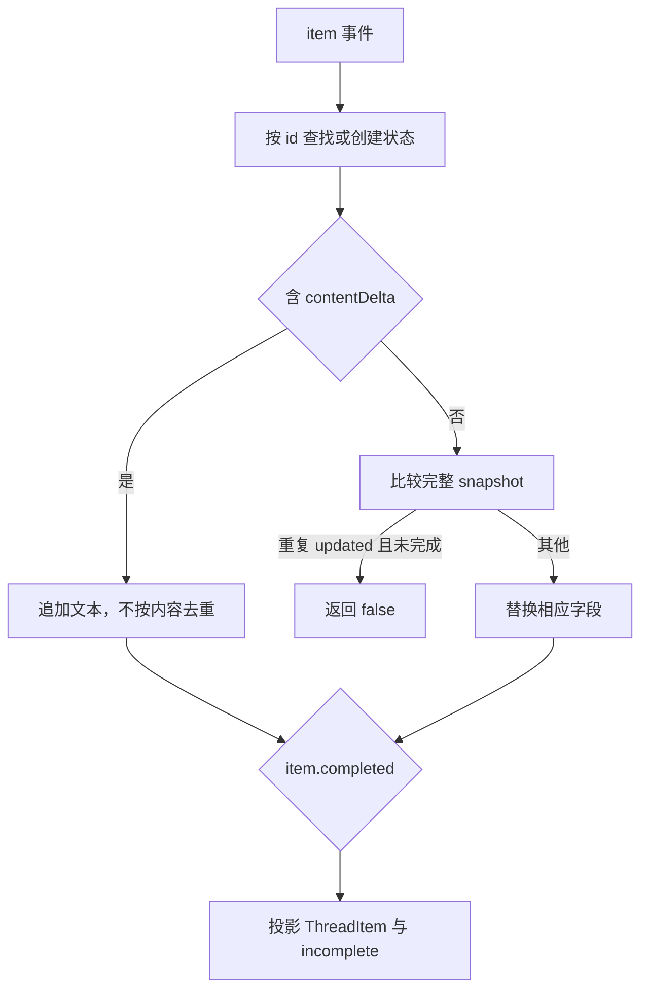

## SDK 把一个长生命周期交给调用者

TypeScript SDK 不只是包一层 HTTP 请求。公开 `packages/code-sdk` 启动 CLI 子进程，读取事件流，归并 items，再把运行结果交给应用。进程发现、启动参数、取消、超时、错误映射和事件完整性都属于契约的一部分。

先读该包 README，然后依次看 `cli-resolver.ts`、`exec-process.ts`、`thread.ts` 和 `items.ts`。SDK 的 Thread 与内部 Session/Turn 需要有明确映射，但不应仅凭术语相同就把它们视为同一对象。

## 增量和快照，不能用同一种去重

模型先输出 `ha`，又输出 `ha`，最终应得到 `haha`。两个 delta 文本相同，仍表示两次新增。相反，同一 item 的完整快照被重复发送，通常不应重复通知消费者或累加文本。

@source sdk

`ItemAccumulator` 按 item id 保存状态；带 `contentDelta` 时追加，带 `content` 时替换。重复的 `item.updated` 快照可以被过滤，delta 不做这种去重。不同 id 的事件即使交错，也分别进入自己的状态。

@lab sdk

实验输入两个 item 的交错事件。a 收到两个相同 delta 后文本为 `haha`，再收到相同快照不会重复发出；a 收到 completed 后完整，b 没有 completed 所以保留 `incomplete: true`。

这直接执行上游完整实现；输入是合成事件。没有启动真实 CLI，也没有测 SDK 的子进程、timeout 或模型服务，不能把结果说成“SDK 所有功能通过”。

## incomplete 是面向调用者的事实

如果进程断开之前只收到一部分文字，SDK 可以保存已有内容，同时说明它未完成。把“暂时有输出”和“正式完成”区分开，调用者才知道能否把它作为最终答案、自动执行下一步或记录成功。

还要检查 unknown item type。源码只把已知 type 转成稳定 ThreadItem，未知类型留在 stream。这样协议扩展不会被错误映射成某个旧类型。

## 为什么 SDK 问题适合开源贡献

很多边界不需要收费模型：可以用 fake CLI 产生分片 JSON、重复快照、异常退出和取消。这让复现便宜且确定。但不要重复别人已有补丁；例如调查日的 Python SDK PR #585 已覆盖多项生命周期问题，选题时应先读完整讨论。

## 流式消息不能简单拼接成一个字符串

同一轮会同时出现 reasoning、agent_message 与 tool_call；不同 item 的事件可以交错。若把所有文本追加进一个 buffer，用户会看到推理混入答案、工具内容错位；若按到达次序创建最终数组，又会被重复 snapshot 干扰。

ItemAccumulator 的状态是 Map<id, ItemState>：第一次见到 id 时确定它的位置，之后更新同一条。items() 按首次出现顺序生成最终结果，并对尚未 completed 的条目标 incomplete。未知 item 类型可以继续作为流事件，但不会被强行转换成已知 ThreadItem。

## 两个 ha 应该变成 haha

delta 是操作：再追加一段文字。两个相同的 delta 可以是合法重复词，不能因为字符串相等就丢掉一个。snapshot 是状态：现在完整内容就是某个值。完全相同的 updated snapshot 才可能被视为重复通知。

还有一个细节：源码先追加 contentDelta，再用存在的 content 覆盖 text。若事件同时携带二者，应按真实代码顺序推导结果，不能假设协议一定不会出现。这正适合写一个边界用例。

## 用七个事件推一遍状态

初始 a started；a 收到 ha；b 收到完整 other；a 再收到 ha；a 收到完整 haha；再次收到同一个 snapshot；最后 a completed。每一步都应写出 a/b 文本、完成状态和 apply 返回值。

@replay sdk

这个播放器的每一步来自构建时执行真实 ItemAccumulator，输入事件为课程合成。它展示函数状态变化，没有伪装成实时 CLI 录制。点击下一步时，注意第六步被判重复，最后 a 不再 incomplete，b 仍 incomplete。

## EOF 并不等于全部成功

如果进程异常退出或协议被截断，客户端仍可能已经收到一部分文字。把不完整 item 标出来，调用方才能区分“得到了部分输出”和“工作正常结束”。最终 task/result 终态与 item.completed 也不应混用：一个 item 完成，并不自动说明整轮成功。

## 练习：把归并规则变成自己的断言

增加未知类型、只有 completed、重复 completed、同时有 content 和 delta、以及两个 tool_call 交错的事件。对每条断言 apply 的返回值与 items() 的结果。再问哪些协议错误应由上游验证器拒绝；Accumulator 的容错行为不等于所有这样的事件都属于合法协议。

::: interview 为什么流式 SDK 应同时提供 events 和最终 items？
events 适合即时渲染与进度，items 适合结束后的结构化消费。归并必须按 id 处理交错，区分 delta 与 snapshot，并保存 incomplete。两种接口共享同一套状态语义，才能避免实时 UI 与最终结果互相矛盾。
:::
