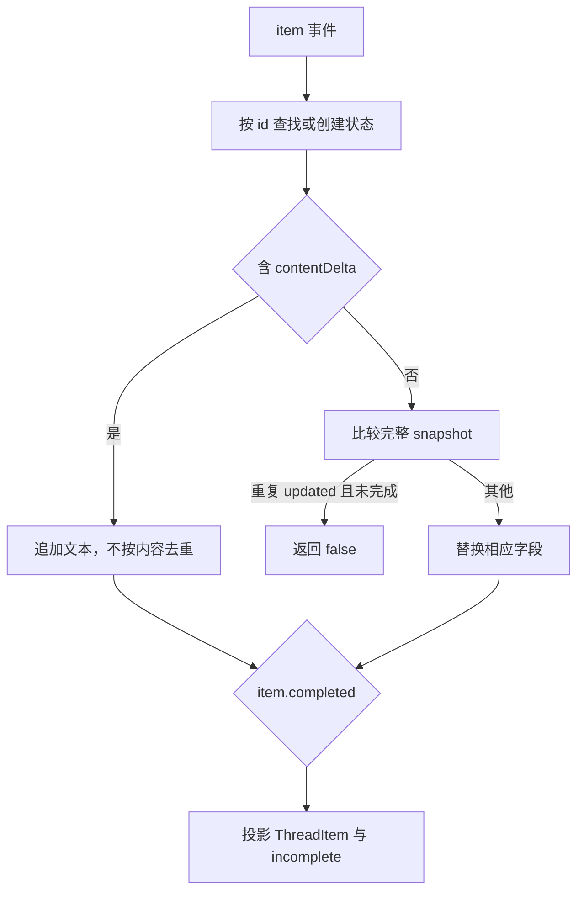

## 本章的问题

a 收到 ha，b 收到 other，a 又收到 ha。把所有文本拼在一起会混淆 item；按内容去重又会把合法的 haha 变成 ha。delta 是追加操作，snapshot 是当前状态，两者不能共用一种去重规则。

host 先校验 turnId 与递增 seq，再把 item 事件交给真实 ItemAccumulator。完全相同的传输帧可以幂等丢弃；跳号或同号异内容必须暴露，而不是悄悄拼出看似完整的答案。

## 沿固定源码逐段拆解

@source sdk

### ItemAccumulator 的 Map 以 id 拥有状态

第一次看到 id 时创建 ItemState，记录 type、text、toolCall、completed 和 snapshot。不同 item 可以交错，items 仍按首次出现顺序输出。未知类型可以留在流上，却不会强行变成已知 ThreadItem。

### 去重条件只覆盖重复 snapshot updated

没有 contentDelta 时才序列化 snapshot；只有相同 updated、已有状态且尚未 completed 才返回 false。delta 从不按字符串去重。若同时有 delta 与 content，源码先追加，再用完整 content 覆盖。

@source sdk-projection

### item 完成与任务完成各有状态

item.completed 去掉该 item 的 incomplete；它不代表整个 Turn 成功。EOF 到来时尚未完成的 item 必须保留 incomplete。host 再用 turn.completed 维护整体终态，不能用“收到一点文字”替代成功。

EventStore 保存可重放帧。客户端去重是传输恢复的一部分，不等于外部工具效果具备 exactly-once。

## 机制总览



## 接入贯穿项目

@implementation 10-sdk-events

### 逐步跟踪本章实现

collector 先检查 turnId，再检查连续 seq。其他 Turn 的帧不会改动本次状态；紧邻的同 seq 同 hash 重放被忽略，序号跳跃、同序不同内容或终态后继续到达则报错。这个包装只处理明确的连续交付规则，不承诺任意历史段重放的 exactly-once。

通过归属与序号检查后，帧交给固定上游 ItemAccumulator。delta 是追加片段，完成帧的 content 是完整结果；把完成快照再次当作 delta 追加会重复文本。Turn 终态与 item 终态也要分开：任务取消时已经开始的 item 仍可能 incomplete。

本章最后 spawn 真正的 host CLI，经 stdin 写请求、读取 JSONL 并结束输入，检查子进程退出。对象级归并测试说明状态转换，CLI 测试说明这些转换确实从管道边界交给了客户端；两层合在一起才能覆盖嵌入程序的使用路径。

## 运行本章实验

```bash
node --disable-warning=ExperimentalWarning labs/chapters/10-sdk-events.mjs
```

@experiment 10-sdk-events

## 逐项解释实验结果

实验输入交错 item、重复传输帧、重复 snapshot 和相同 delta。最终 a 是 haha 且完成，b 仍 incomplete。错误 Turn 被拒绝；新 collector 直接收到 seq=2 会报错，暴露丢失事件。

第 12 章会让同一个 collector 消费真实 host 运行帧，验证这个局部归并器确实接在产品主线上。

## 继续动手与验收

构造重复 completed、未知 item 类型和同 seq 异内容。设计重连协议时，说明请求从哪个 seq 重放，以及何时可以向用户报告结果完整。

::: interview 重复 delta 为什么不能按内容去重？
先按 turnId 与连续 seq 验证归属和交付，再让 accumulator 归并 item。delta 与完整快照的处理不同；取消后的未完成 item 也不能伪装完成。CLI 子进程验证这些状态确实经过了管道边界。
:::

::: interview 收到 EOF 可以把所有 item 标 completed 吗？
不能。进程可能中断，已经收到的部分输出仍有价值，但必须保留 incomplete。item 完成和整体 Turn 终态也要分别判断。
:::

::: interview 为什么遇到序号缺口要暴露而不是继续拼？
缺帧可能丢失调用、结果或终态。继续拼会生成看似完整却不可信的结果；应按重放游标恢复，或明确报告 incomplete。
:::
