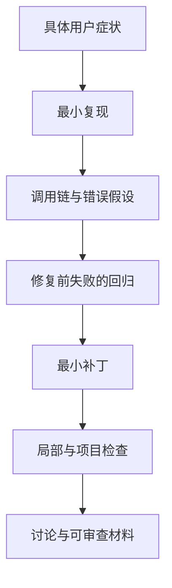

## 本章的问题

第一次贡献最有力的材料，是别人能重复、能反驳的一条因果链。问题很小也没有关系：一个路径判断、模型身份或事件归并边界，都能体现选题、定位、回归与取舍。

本章拿课程中故意写错的模型切分作练习，生成 before/after、版本、检查与范围说明，再在临时 Git 仓库里实际生成并反向校验补丁。它不是新发现的上游 bug，更没有提前取得 contributor 身份。

## 沿固定源码逐段拆解

@source contributing

### 先读贡献契约，再决定外部动作

本课程固定基准的 CONTRIBUTING 对协作者资格与文档语言有要求。学习 checkout 保持只读，真实修复在独立贡献目录准备。政策可能更新，发起外部动作前需要重新核实当前规则和已有讨论。

@source model-identity

### 一个小机制也能形成完整证据

第 3 章已经有合法输入、错误基线、正确解析和对照。把它整理成调查材料时，需要清楚写出“课程故意错误”和“上游实际实现”的区别，不能把教学测试包装成上游缺陷。

@source usage

### 回归要覆盖用户路径的契约

usage 的输入校验、模型归因写入和统计 SQL 可以分别失败。提案必须选清楚修哪条边；只让新 helper 测试通过，不等于修好了用户问题。

一份好的 PR 描述说明触发条件、当前错误、正确 owner、最小行为变化、验证命令与未覆盖环境。生成 diff 只是起点，对每一行负责才使它成为工程经历。

## 机制总览



## 接入贯穿项目

@implementation 11-first-contribution

### 逐步跟踪本章实现

investigation 要求固定 commit、具体症状与 boundary，并比较 before/after 摘要及逐项检查。缺少版本、没有行为差异或仍有失败断言，都拒绝生成“已验证”材料。输出状态明确是 local-evidence-only，生成 Markdown 不等于外部评审通过。

实验把故意错误的 split 作为 red 基线，把第 3 章正确解析作为 green，随后在临时仓库生成真实 unified diff。git apply --check --reverse 验证补丁对应当前修复状态；它不是证明上游存在同一个缺陷，而是训练可审查证据如何装配。

真实选题还要重新检查当前上游、贡献资格、已有 Issue 和重复 PR。源码定位、最小修复、用户路径回归与项目 gate 是各自独立的工作；若没有运行某条检查，应在草稿中保留未验证状态。独立贡献任务继续以它自己的 checkout 与真实结果为准。

## 运行本章实验

```bash
node --disable-warning=ExperimentalWarning labs/chapters/11-first-contribution.mjs
```

@experiment 11-first-contribution

## 逐项解释实验结果

before 由错误 split 实际算出，after 由 host 正确函数算出；缺版本或没有 red-green 差异不能生成材料。随后创建临时 Git repo，生成真实 unified diff，并执行 git apply --check --reverse。

所有操作只在本章临时目录，没有修改上游、发送 Issue、评论或 PR。独立贡献任务的真实状态仍以其实际记录为准。

## 继续动手与验收

从公开 Issue 选择一个你能复现的问题，检查最新版本与已有修复。先交一份只含事实的英文草稿和本地回归；没有运行的 gate 留作待办，不能提前写 PASS。

::: interview 课程里的错误基线为什么不能宣称为上游 bug？
错误基线由课程主动构造，上游正确代码并不存在同一个缺陷。before/after 和补丁只证明训练材料的因果关系；真实贡献必须重新复现当前问题、检查重复工作并满足维护者的贡献要求。
:::

::: interview 一个回归测试怎样证明它覆盖了用户问题？
先在真实触发条件下失败，再在修复后通过，断言具体行为或效果。只测新 helper 返回 true，可能完全绕过原来出错的用户路径。
:::

::: interview 准备补丁、提交 PR 与成为 contributor 如何区分？
以实际 Git 记录、讨论、资格、PR 和维护者接收结果分别证明。生成 diff 仅代表本地准备，不能提前承诺接收或合并。
:::
