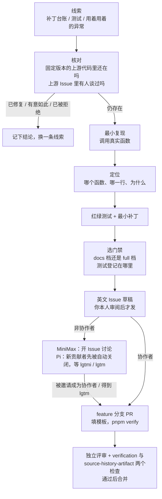

你打开 `third_party/pi-mono/MINIMAX_CHANGES.md`，里面是 MiniMax 给内置的 Pi 打的本地补丁，每一条都写着原因、影响的包、有没有回馈上游、怎么验证。挑一条标着 “generic, upstreamable” 的，花一个晚上写好复现、补丁和测试，准备给 Pi 提 PR。

第二天你才发现，这条在 Pi 最新版里早就修了；或者上游有人报过同一个问题，被维护者标成了 `no-action`；或者上游留着这个行为是有意的。一晚上的工作，换来一个不能用的补丁。

贡献开源项目，大部分时间花在**确认这件事值不值得做**上，写代码反而是最短的一段。这一章把这段时间花在刀刃上：先看清 MiniMax 和 Pi 的规矩，再用补丁台账当地图，把七条补丁逐条拿到 Pi v1.5.0 里核对（结论有四种），最后挑一条仍然存在的行为，走完“复现、定位、红绿测试、补丁、Issue 草稿”。这一遍走到草稿为止，是否发出去、发到哪里，由你自己决定。


@figure assets/course/ch11-contribution.png 从补丁台账出发：核对出处，先红后绿，写好的 Issue 草稿先给人看

## 外部贡献者能做什么：先开 Issue

MiniMax Code 的 `CONTRIBUTING.md` 开头几行就把门槛写明白了：

@mm CONTRIBUTING.md#L5-L7 hl=5,7

- 第 5 行：**目前只接受仓库协作者（collaborator）提交的代码和文档**。不是协作者但有想法，开 Issue 讨论。
- 第 7 行：协作者从 feature 分支提 PR，不直接推默认分支；PR 里要写用户可见的变化、跑过的检查、**没有跑的**实时服务或平台验证、文档影响。
- `docs/maintainers.md` 把话说得更死：开了 Issue 或者提案被接受，并不会自动成为协作者，也不意味着可以提 PR；在外部 PR 关闭期间，仓库不使用 `good first issue` 和 `help wanted`。

所以外部贡献者能拿到的最大产出，是一份让协作者**愿意接手**的 Issue。分流在 `.github/ISSUE_TEMPLATE/config.yml`：`blank_issues_enabled: false`，只能从模板进；bug 模板（`01-bug-report.yml`）要求的字段是产品或界面、版本（`mcode --version` 或源码提交）、平台和系统版本、问题所在区域、复现步骤（“一个最小的合成例子”）、期望与实际行为，以及去掉凭证和私有路径的错误摘要。

协作者一侧的流程，PR 模板写得最直接：

@mm .github/PULL_REQUEST_TEMPLATE.md#L9-L13 hl=11,13

“Validation” 这一节有三行：跑了什么检查、性能档位（basic 还是 `perf:full`）、`NOT RUN`。第三行最重要：模板要求你**白纸黑字写出没有验证的东西**。离线测试通过了，不等于实时模型服务可用；macOS 上过了，不等于 Windows 上过了。写 Issue 也是同一个习惯，后面的草稿里有一栏 “Not verified”。

另一个项目，规矩不一样。Pi 的 `CONTRIBUTING.md` 更严：

@pi CONTRIBUTING.md#L21-L35 hl=23,29-32

新贡献者的 Issue 和 PR 默认被自动关闭，维护者每天翻一遍自动关闭的，值得的重开；批准靠维护者在 Issue 下回复 `lgtmi`（以后的 Issue 不再自动关）或 `lgtm`（以后的 Issue 和 PR 都不再自动关，**只有 `lgtm` 才有资格提 PR**）。同一份文件的下一节还要求：用自己的话写，不要让 LLM 生成 Issue 文字；全文放得进一屏。本章的草稿因此只给事实和结构，最后一段要你自己写。

两边合起来，一次贡献的路径是这样：



前半段（A 到 G）不需要任何人的许可，是这一章要练的；后半段取决于维护者的回应，节奏不由你控制。

## 在七十万行里找线索：三条路

MiniMax Code 的 TypeScript 有七十多万行（第 0 章的体检）。想“读一遍再找 bug”不现实，真正的做法是找线索。常见的有三条：

| 路线 | 怎么做 | 问题 |
| --- | --- | --- |
| 碰运气 | 用着用着发现异常，再去源码里找 | 复现靠记忆，范围不明，很可能别人已经报过 |
| 读 Issue | 在公开 Issue 里挑一个还开着的 | 容易撞上已有人在做；很多 Issue 描述的是现象，不是原因 |
| 读补丁台账 | 从 `MINIMAX_CHANGES.md` 里挑一条，去上游核对 | 线索来自真实用户的真实故障，已经带着原因、影响和验证方式 |

第三条路不靠运气。台账里每一条补丁，都是 MiniMax 在生产环境里踩到、自己动手修过的问题，而且写得很规整：

@mm third_party/pi-mono/MINIMAX_CHANGES.md#L25-L32 hl=27,29,31,32

读法：`Reason` 是故障的因果（Anthropic 兼容接口可能在思考中途截断消息，只发空的 `stop_reason`；`streamAnthropic` 的初始值是 `"stop"`，于是截断的回答看上去像正常结束）；`Affected package` 和 `Change type` 告诉你补丁落在哪个包、MiniMax 自己认为它是否通用；`Upstream PR: not opened` 说明没人替它向上游争取过；`Validation` 点名了回归测试文件。四个信息加起来，已经是一份半成品调查。

下面的实验把整份台账读一遍，数一数：

@lab node labs/ch11/ledger.mjs

先看上半部分：48 条，其中 44 条写着没开过上游 PR，39 条自认通用。这是一份很长的“可能值得回馈”的清单。**但“可回馈”只是 MiniMax 自己的判断**，上游怎么想，要去上游看。

## 七条台账，四种结论

实验的下半部分挑了七条，对着 Pi v1.5.0（`../pi-v1.5.0`，提交 `f9a2636`）逐条核对。每条的出处行号是程序在真实文件里搜出来的。结论是 `VERDICTS` 里的四种：

- **已修复**：stop_reason、Windows taskkill。
- **仍是原样**：长整数、OSC 8 超链接终止符、`read` 的截断上限。
- **只修了一半**：edit 工具的模糊匹配。
- **有意不同**：空 `tools` 数组。

一条一条读，因为每种结论教的东西不一样；“仍是原样”里还要再分：哪些值得做，哪些不值得。

### 已修复：做法不同，目的相同

台账说 MiniMax 在 Anthropic 流的迭代器末尾数 `stop_reason`，一个都没见到就抛错：

@mm third_party/pi-mono/packages/ai/src/providers/anthropic.ts#L516-L529 hl=520,528

MiniMax 的做法是“流结束时回头检查”：看到过 `message_start` 和 `message_stop`，却没有任何 `message_delta` 带非空的 `stop_reason`，就抛出带诊断计数的错误（诊断里只有计数和耗时，不含正文）。Pi v1.5.0 换了一个角度：

@pi packages/ai/src/api/anthropic-messages.ts#L596-L602 hl=601

@pi packages/ai/src/api/anthropic-messages.ts#L838-L848 hl=841

@pi packages/ai/src/api/anthropic-messages.ts#L893-L898 hl=896-897

- 第 601 行：输出消息的初始 `stopReason` 是 `"pending"`，不再是 `"stop"`。Pi 的 `ai` 包 CHANGELOG 在 0.83.0 的条目里写着新增了 `pending` 停止原因。
- 第 841 行：只有 `stop_reason` 为真值时才改写；空字符串被跳过，`stopReason` 仍然是 `pending`。
- 第 896-897 行：流结束时仍是 `pending`，抛出 “Anthropic stream ended without a stop reason”。

台账描述的那个场景（空 `stop_reason`）会走到第 897 行，所以这条补丁对应的问题**在上游已经解决**。再提 PR 就是重复劳动。（CHANGELOG 只能证明 `pending` 在 0.83.0 引入；第 897 行的抛错是哪个版本加的，这个检出的历史太浅，查不到。）

Windows 的 taskkill 那条更直接：Pi 的 `killProcessTree` 现在从 `SystemRoot` 解析 `taskkill.exe`（`shell.ts:225`），并给每次 spawn 挂了 `error` 监听（`shell.ts:234`），和台账补丁说的两件事一致。

这个结果对 MiniMax 自己反而有一个提醒。MiniMax 一侧的消费者是 `packages/shared/src/llm-error-classifier.ts`，它按措辞匹配这条错误。实验末尾用真实的分类器跑了两种措辞：

| 来源 | 分类结果 |
| --- | --- |
| 内置 Pi 0.79.1 加补丁（`stream ended without stop_reason`） | `50113`，带 `incomplete_stream` 信号 |
| Pi v1.5.0（`stream ended without a stop reason`） | `null`，无信号 |

分类器的正则是 `/\bstream ended without stop_reason\b/`，Pi v1.5.0 的措辞多了个 “a”，下划线也变成了空格，匹配不上。这不是今天的缺陷，因为 MiniMax 现在跑的还是自己打过补丁的 0.79.1；但它说明了一件事：**补丁和它的消费者之间靠一句话的措辞耦合，升级内核时这条链会悄悄断**。仓库自己的 `cross-layer-drift-sweep` 技能讲的就是这类问题（改了一端，另一端的假设还停留在旧值）。这是一个值得向 MiniMax 提的讨论，而且它落在 MiniMax 自己的代码里，是外部贡献者能开 Issue 的地方。

### 仍是原样，也不一定值得做

长整数、OSC 8、`read` 的截断上限这三条，v1.5.0 里的代码确实没变（实验表里有出处）。但“没变”还不够，还要看这是不是缺陷、能不能测。

- **OSC 8**：MiniMax 把超链接的终止符从 `ESC \` 换成了 BEL，理由是 macOS Terminal 对折行后的长链接做点击命中时，只认链接的一部分。Pi 的 `hyperlink()` 还是 `ESC \`（`terminal-image.ts:753`）。要证明这个问题需要一个真实的 macOS Terminal 和人手点击，**没有终端就写不出一条红测试**，你顶多断言字符串里是 BEL。这样的补丁适合当一次讨论，不适合当第一次贡献。
- **`read` 的截断上限**：Pi 的 `read` 工具对输出硬编码 2000 行 / 50KB，`truncateHead(selectedContent)` 没有参数（`read.ts:176`）。MiniMax 的补丁给 `ReadToolOptions` 加了一个可选的 `truncation`。这是为 MiniMax 的 PTC 开的接缝，是**新功能**，不是缺陷，上游完全可以不要。
- **长整数**：下一节完整走一遍。它有真正的缺陷，也能写红测试，但还有一个坑，等会儿再说。

### 只修了一半：上游知道，并且选了半步

edit 工具在精确匹配失败时会退回模糊匹配：把文件内容和 `oldText` 都规范化（NFKC、弯引号变直引号、各种破折号变连字符、行尾空白去掉），在规范化后的文本里找位置。MiniMax 的 2026-07-04 补丁说，早先的版本在这之后把**整个文件**都用规范化后的文本写回，一次模糊匹配会悄悄把全文件的弯引号、全角空格改掉。Pi v1.5.0 的相应代码：

@pi packages/coding-agent/src/core/tools/edit-diff.ts#L316-L319 hl=318

@pi packages/coding-agent/src/core/tools/edit-diff.ts#L351-L356 hl=353-354

第 318 行：只要有任何一处用了模糊匹配，替换就在整份规范化后的文本上做。但第 353-354 行不再把它整个写回，而是调用 `applyReplacementsPreservingUnchangedLines`：把每处替换扩到它碰到的**行**，被碰到的行从规范化文本里取，其他行从原文逐字节拷回。所以上游只修了一半：没被碰到的行保持原样，**被碰到的行里，`oldText` 之外的字符仍然被规范化**。

用真实代码复现，同一个请求交给 Pi v1.5.0 和 MiniMax 内置的 Pi：

@lab node labs/ch11/edit.mjs

模型把弯引号写成了直引号，精确匹配失败。Pi v1.5.0 里，第 2 行除了被要求改的 `“auto”`，后面的全角逗号 `，` 和 `“off”` 也被改成了 ASCII；第 3 行没动。MiniMax 的补丁（只替换映射回原文的那个片段，并加了一道“映射回去的片段重新规范化必须等于定位到的文字”的守卫，`fuzzyFindText`）只替换了该替换的部分。对中文文档，这是悄悄的数据损坏。

到这里，这条看上去是最有分量的候选：核心工具、会写坏用户文件、能确定性复现。可是**不看上游的讨论就下结论，就是上一节开头那个晚上**。2026-11-04 用只读方式查看了 Pi 仓库里的相关 Issue（上面实验表格的最后一部分）：

- #5899（整文件被重写）已完成；它的修复就是上面的“没被碰到的行保持原样”。
- #10655 报告的正是上面这个复现（被编辑行上的全角标点被改成 ASCII），已关闭，标签 `no-action`，含义是“经过分流后拒绝”。一位 Pi 成员在下面答复：这个问题和 #3554 重复，把匹配映射回原文位置的做法此前被拒绝了，理由是匹配边界处理会让内置 edit 工具复杂很多，建议用扩展自定义 edit 工具；#5899 的修复保证了未被碰到的行不变，被碰到的行里 `oldText` 之外的文字仍被规范化，这正是遗留的行为。

也就是说，上游**知道**，并且**有意**只走半步。MiniMax 的补丁实现的恰恰是被上游拒绝的方案。再把同一方案提一遍，就是重开一场已经有答案的讨论。这类结果的价值在于：你省下了写 PR 的时间，也知道该讨论什么（例如“能不能通过扩展接口让宿主替换 edit 的定位逻辑”）。

### 有意不同：不是 bug，是取舍

最后一条：MiniMax 的 2026-09-19 补丁去掉了发给 OpenAI 兼容接口的空 `tools: []`，因为某些后端遇到空数组会返回 400（压缩请求有工具历史却没有工具定义，台账里提到 MiniMax 自己的 Issue #194）。Pi v1.5.0 里：

@pi packages/ai/src/api/openai-completions.ts#L836-L848 hl=845-847

第 845-847 行是**有意的**：对话里出现过工具调用时，即使这次没有工具，也发一个空数组，注释写明是因为 Anthropic（经 LiteLLM 或代理）要求有 `tools` 参数。MiniMax 的补丁推翻了这个决定，换了另一批后端的需求。这类补丁上游不会当 bug 接收，要往上提，得先提出“用兼容开关切换”这类设计。

### 小结：核对的四个问题

七条走下来，每条都要回答四个问题，缺一个就容易白干：

1. **代码还在吗？**——在固定版本里找到那一行（出处写文件和行号）。
2. **上游谈过吗？**——搜上游 Issue 和 PR，读维护者怎么说。
3. **是缺陷还是取舍？**——新接缝、兼容开关、有意设计，都不是缺陷。
4. **我能写出红测试吗？**——写不出，就没法让别人在自己机器上看到同一个现象。

## 一次完整的练习：长整数

这一节把长整数这条走到底。补丁只写在临时目录，Issue 草稿只打印；这是一次练习，用来练流程。

台账的条目（2026-10-26）说：模型有时把一个长数字（18 位身份证号、雪花 ID）当作不带引号的 JSON 数字发出来，而工具参数的类型是字符串。`JSON.parse` 会把超过 `Number.MAX_SAFE_INTEGER` 的整数舍入成最近的 double，结果工具收到的是另一串数字。台账还提到上游有一个 Issue（`earendil-works/pi#8943`）报告了同一件事，被自动关闭为 `no-action`。第 1 步先用 v1.5.0 的代码确认它。

### 第 1 步：复现，用真实函数

不要自己写一个“模拟 Pi”的函数。`labs/ch11/upstream.mjs` 做的是和 `importSource` 同一件事：从固定提交的 Git 对象里读出 Pi v1.5.0 的 `json-parse.ts` 和 `validation.ts`，去掉类型后执行，工具参数的解析和类型转换都是 Pi 自己的代码。两个模块依赖外部包：`partial-json`（只在 JSON 不完整时用到）已用替身挡住，`@earendil-works/pi-schema` 指向同一个检出里的 `packages/schema`。

@code labs/ch11/upstream.mjs#createLoader hl=54,62,66,69-70

装载器把模块里的相对导入递归替换成 data URL；外部包必须在 `stubs` 里逐个声明替身，`overlay` 允许用“打了补丁的文本”替换某个文件。没声明的外部依赖一律报错，不会悄悄放过。

@lab node labs/ch11/flow.mjs repro

模型发出 `440103198004279575`，`parseToolCallArguments` 之后是数字 `440103198004279550`，工具收到的是字符串 `"440103198004279550"`。末位的 75 变成了 50，没有任何报错。对照那一行：模型要是给这个数字加了引号，工具收到的就是对的。

### 第 2 步：定位，一站一站

复现只说明“有问题”。要写补丁，得知道问题在哪一站。参数文本的路径：


@lab node labs/ch11/flow.mjs trace

行号是程序在 v1.5.0 的真实文件里搜出来的。最关键的两处：

@pi packages/ai/src/utils/json-parse.ts#L86-L96 hl=88

@pi packages/schema/src/coerce.ts#L541-L546 hl=545

- `json-parse.ts:88`：`JSON.parse(json)` 没有第二个参数。规范规定数字字面量按 double 解析，超过 2^53 的整数在这里就已经丢了精度，后面再怎么处理都找不回来。
- `coerce.ts:545`：`type` 是 `string` 而值是数字时，转换规则是 `String(value)`。这一步对 `42` 这样的值完全合理（模型常把 `"42"` 和 `42` 混着发），所以**不能**去改这里；对一个已经舍入的 double，它只是忠实地把错误的数字字符串化。

定位的结论因此是：修复要发生在解析的那一站，保留字面量的原文。

另一个细节：这条路径是 Pi v1.5.0 的新结构。MiniMax 内置的 0.79.1 里叫 `parseStreamingJson`，v1.5.0 的流式过程换成了增量解析器 `StreamingJsonParser`，完整参数在 `finish()` 时用 `parseToolCallArguments` 解析一次，所以补丁要打在后者。把台账里的补丁原样搬过来，并不是一条能直接用的补丁。

### 第 3 步：红绿测试

测试的价值在于它**曾经失败过**。`redGreen` 把同一组用例分别跑在修复前和修复后：至少有一条在修复前失败，所有用例在修复后通过，否则抛错。

@code host/src/contribution.mjs#redGreen hl=157,160-162

三条用例的设计各有用意：一条抓住问题（字符串参数保留原文）；两条守住不退化（整数参数拿到和以前一样的 double；安全整数、小数、指数不被改写）。守住不退化的用例同样重要：补丁的风险就在于改变了本来正确的行为。

@lab node labs/ch11/flow.mjs redgreen

三条用例里只有第一条在修复前失败，错误信息直接指出了差异。第二条的预期值 `9007199254740992` 来自“整数参数仍然是 `Number('9007199254740993')`”，补丁不改变它。

### 第 4 步：最小补丁

补丁是在 v1.5.0 的 `json-parse.ts` 副本上做的最小修改：给 `parseJsonWithRepair` 加一个可选的 `reviver`，在 `parseToolCallArguments` 里传一个“遇到不安全的整数字面量就保留原文”的 reviver（利用 `JSON.parse` 的源文本访问，Node 21 起可用；Pi 的 `engines` 要求 Node 22.19 以上）。`parseJsonWithRepair` 的其他调用者（比如解析 SSE 事件）不传 reviver，行为不变。

@lab node labs/ch11/flow.mjs patch

在临时仓库里生成真实的 unified diff，再用 `git apply --check` 双向验证：在基线上能干净地应用，在补丁之后能干净地撤销。12 行新增、4 行删除，只动一个文件。这就是评审者会读的东西，每一行都要能解释。

### 第 5 步：装配材料，写 Issue 草稿

补丁写完，该把证据装成别人能审的样子。这一步由 `investigation` 和 `issueDraft` 装配。Issue 的结构跟着 Pi 的 bug 模板走（What happened / Steps to reproduce / Expected behavior / Version），多放三栏事实：出处位置、证据、**没验证的东西**。

@lab node labs/ch11/flow.mjs draft

好 Issue 的样子：

- **标题说出现象**，不是说出你的补丁。
- **一屏放得下**（Pi 的要求）。每一栏只放读者复现所需的事实。
- **复现用公开的 API**，输入是一个具体的数字，输出是另一个具体的数字，读者在自己机器上能看到。
- **指出位置但不夸大**：写 “where” 是帮评审者定位，不是替他们决定怎么修。
- **相关的 Issue 要链接**：这里的 `#8943` 是台账里记着的，写明已关闭，并说明这份报告多了什么。
- **“Not verified” 不留空**：这里写的是 Bun 编译的二进制（Pi 的 `build-binaries.yml` 里用 Bun 构建独立二进制；Bun 的 `JSON.parse` 是否提供源文本访问，这里没验证），以及其他 provider 的流式路径。
- **用你自己的话**：草稿给的是事实，最后写成什么样是你的事。Pi 的要求是明文的：不要用 LLM 生成 Issue 文字。

这份草稿能不能发？按前面的四个问题：代码还在（第 1 步），缺陷是真的，红测试有了。拦住你的是第二条：上游谈过。#8943 标签 `no-action`（标签的描述是 “rejected after triage”），评论里只有自动关闭的通知，没有维护者的话。它是被读过后否决，还是被默认的自动关闭埋掉，从这里读不出来；这要靠读 #8943 的正文、问在场的维护者，不是靠代码。弄清楚之前，这份草稿留在本地。

## 改了这里，该跑哪道门禁

补丁写好、测试写好，下一个问题是：我的改动，在 MiniMax 的仓库里怎么验证？`CONTRIBUTING.md` 的答案是 `pnpm verify`，它按 `scripts/verify.mjs` 里的 `steps` 依次跑所有门禁，和 GitHub CI 的顺序一样。不同的改动走不同的“档”（profile）：

@mm scripts/verify.mjs#L84-L96 hl=88,91-92

每个门禁在每个档里要么运行，要么返回一个跳过的原因：`docs` 档只保留标了 `docs: true` 的几个门禁；`archive` 档跳过需要 Git 的导出；有 `platforms` 的门禁在不适用的系统上跳过（比如 `test:sandbox` 只在 macOS 上有）。跳过都有名字、有原因，不是悄悄略过。

@lab node labs/ch11/gates.mjs

读表：

- `docs` 档只有四个门禁：源码清单、tsconfig 路径、导出源码预览、发布工具测试。没有 `lint`，没有 `build`，没有任何运行时测试。这正是“只改文档”才能走的捷径。
- 能不能走 `docs` 档，由 `scripts/ci-changes.mjs` 的 `classifyChanges` 判断：只有 README、`CONTRIBUTING.md`、PR 模板、`docs/` 下的 Markdown 和少数媒体文件算文档。实验装载的是**这个真实函数**，第二个场景里“改了 PR 模板，顺手改了一个技能”被判为 `full`：`.agents/skills` 下的改动不算文档。
- 测试怎么登记：`test/vitest-suites.json` 按门禁分组登记所有测试文件（`capability` 一组就有 274 个）。新测试要登记在这里，不要写进 `package.json`。实验里的最后一个场景就演示了这条规则的提示。

最重要的一行在表下面：**位于 `third_party/` 下的测试文件，登记的数量是 0**。内置 Pi 自带的测试（比如台账里点名的 `tool-argument-unsafe-integer.test.ts`）不在任何门禁里，`testing-workflow` 技能里也写着 “Vendored upstream test suites are outside this distribution's verification”。所以如果你要改的是内置的 Pi，在 MiniMax 的仓库里**没有一个门禁会替你跑那份测试**；要让 `pnpm verify` 管得到，你需要一个 MiniMax 自己登记的测试，从 MiniMax 的入口走到那段代码（台账里 `compaction-openai-transport.integration.test.ts` 就是这样的例子：它通过 MiniMax 的压缩函数，对着本地 HTTP 夹具验证了 Pi 的请求形状）。

反过来，对 Pi 上游提补丁，测试放在 Pi 自己的 `packages/ai/test/json-parse.test.ts` 里，用 Pi 的 `./test.sh` 和 `npm run check`（Pi 的 CONTRIBUTING 要求这两个都通过）。Pi 的 `AGENTS.md` 还要求回归测试旁边注明对应的 Issue 编号。**同一个补丁，换一个仓库，测试放在哪、跑什么门禁都不一样**，选仓库本身就是选门禁。

## 动手：把这些步骤写成函数

`host/src/contribution.mjs` 是这一章的 host 部分。它不是运行时模块，没有对应的 MiniMax 源文件，而是把上面的动作做成了小函数，每一个都不联网：

- `parseLedger` / `summarizeLedger`：读台账，数条目（上面实验的前半段）。
- `findEvidence` / `upstreamCheck`：在源码文本里搜出处，结论必须带文件和行号，否则抛错。
- `redGreen`：红绿。
- `verificationPlan`：改了哪些路径，该走哪档，测试放哪里。
- `investigation` / `issueDraft`：装配材料。保持原来的签名和两个拒绝条件（缺固定提交、缺红绿证据）。

核对和复现本身是人读代码、跑代码做的，这些函数只负责把结论固定下来，防止凭印象下结论。比如 `findEvidence`：

@code host/src/contribution.mjs#findEvidence hl=119-120

搜不到就抛错，行号是搜出来的而不是手填的。这样实验表格里的 `:88` 之类，随源码变化会自己变，不会过期；换了一个 Pi 版本再跑一遍，找不到的出处会直接让实验失败。

`redGreen`（上面的第 160 行）把“没有一条用例在修复前失败”当作错误，而不是一个好结果：一组修复前后都通过的测试，只说明它没有测到问题。

`verificationPlan` 把门禁规则收成了一个函数，`classifyChanges` 由调用者传入（实验里传的是 MiniMax 自己的）：

@code host/src/contribution.mjs#verificationPlan hl=180-182

简化的地方：台账解析只认 `MINIMAX_CHANGES.md` 现有的“标题加字段列表”格式；`upstreamCheck` 记录的 Issue 状态是人在某一天读到的，程序不联网刷新；`verificationPlan` 没有实现 `perf:full` 的判断，那需要读懂改动是否涉及历史构造、会话存储、流式或工具执行循环，只能由作者判断。

回归实验把前面所有环节检查一遍：

```bash
node labs/chapters/11-first-contribution.mjs
```

## 你来改

::: predict 给 Pi 补丁多一条用例
在 `labs/ch11/scenarios.mjs` 的 `UNSAFE_INTEGER_CASES` 末尾加一条：`raw: '{"id_number": -440103198004279575}'`，schema 同样是 `id_number: string`，期望 `-440103198004279575`。运行 `node labs/ch11/flow.mjs redgreen`。这条用例的“作用”会是什么？
???
“抓住问题”。负号的长整数在修复前同样被舍入（`-440103198004279550` 的字符串），修复后保留原文：补丁里的 `INTEGER_LITERAL` 正则是 `^-?(?:0|[1-9]\d*)$`，允许前导负号。如果把正则里的 `-?` 删掉，这条用例会在修复后失败，`redGreen` 抛出 “修复后仍失败”。
:::

::: predict 把正则放宽
把补丁里的 `INTEGER_LITERAL.test(...)` 条件整个去掉，只留 `!Number.isSafeInteger(value)`，哪条用例会在修复后失败？
???
第三条：“safe integers, decimals and exponents are not rewritten”。`1.5` 和 `1e21` 都不是安全整数（`Number.isSafeInteger` 对它们为假），去掉字面量检查后，它们的源文本会被当字符串返回，期望的是数字。正则的作用就是只保留“看起来像整数”的字面量，指数写法和小数继续按数字处理。这也是为什么测试里要放一条“不退化”的用例：补丁最容易错在改得太多。
:::

::: predict 换成 MiniMax 内置的 Pi
用 `loadMiniMax` 装载 `third_party/pi-mono/packages/ai/src/utils/json-parse.ts`（同样给 `partial-json` 一个替身），对 `RAW_ARGUMENTS` 调用它的 `parseStreamingJson`。`id_number` 是什么？
???
字符串 `"440103198004279575"`，原文保留。内置的 Pi 已经带着 MiniMax 的补丁：`parseStreamingJson` 传了 `preserveUnsafeIntegerSource`。所以这个行为在 MiniMax 自己的产品里已经修了，缺口只存在于上游的 v1.5.0。这也是第 5 步草稿要面对上游而不是面对 MiniMax 的原因。
:::

::: predict 还没核对的候选
台账里还有很多条没核对。比如 2026-09-21 的“edit 的 diff 加上限”：在 Pi v1.5.0 的 `edit-diff.ts` 里搜 `maxEditLength`，会有结果吗？
???
没有。`generateDiffString` 里的 `Diff.diffLines(oldContent, newContent)`（`edit-diff.ts:381`）和 `createTwoFilesPatch`（`edit-diff.ts:366`）都没有传上限参数。这只回答了“代码还在吗”；接下来还要问另外三个问题：上游谈过吗，是缺陷还是取舍，能不能写出红测试（台账说一个 20000 行文件整体重写会让工具阻塞两分钟以上，这是可以确定性测量的）。
:::

## 面试题

::: interview 你怎样给一个陌生的大型开源项目找第一个值得做的贡献？
先看它的规矩（CONTRIBUTING、PR 模板、维护者文档），再找线索，最后核对。线索来源按质量排：项目自己的记录（变更台账、TODO、被跳过的测试）、公开 Issue、使用中的异常。核对要四件事：固定版本里问题还在吗；上游的 Issue/PR 里谈过吗，维护者怎么答的；它是缺陷还是有意的取舍；能不能写出一条在修复前失败的测试。加分点：说出你会先开 Issue 而不是直接提 PR，尤其是项目写明只接受协作者 PR 时。
:::

::: interview 一份好的 bug 报告里应该有什么？
现象（一句话）、版本（固定提交或版本号，环境）、最小复现（调用真实的公开接口，输入和输出都具体）、期望与实际行为、问题所在的位置、证据和**没有验证的东西**。不要有凭证、私有路径、无关日志。重复的 Issue 要链接并说明你多了什么。加分点：Pi 要求一屏放得下并且用自己的话写；MiniMax 的模板要求“最小合成示例”和脱敏的错误摘要。
:::

::: interview 为什么回归测试必须“先红后绿”？
一条从没失败过的测试，不能证明它覆盖了那个问题：它可能根本没走到出错的路径，或者断言太松。红绿流程是：在修复前的版本上运行，它必须失败，并且失败信息指向目标现象；修复后必须通过。同时加几条“不退化”的用例，保证补丁没有改变本来正确的行为（比如安全整数、小数、指数不被改写）。本章的 `redGreen` 把“没有一条在修复前失败”当作错误。
:::

::: interview 代码审查时，你会怎样看一个别人提交的补丁？
先看它解决的是不是真问题（有没有最小复现和红测试）；再看改动是不是最小的、有没有改变其他路径的行为；然后看风险点和没验证的范围（平台、实时服务）；最后看流程：门禁跑了哪档、测试登记在哪里、文档要不要同步。MiniMax 的 PR 模板把这些拆成了 “Change / Validation / NOT RUN / Publication checks”，评审者要求是独立的（作者不能批准自己的 PR），`verification` 和 `source-history-artifact` 两个检查通过才能合并。
:::

::: interview 项目的补丁台账显示某个补丁“可回馈上游”，你就可以直接提 PR 吗？
不可以。“可回馈”是台账作者的判断。要先在上游最新版本里核对：可能已经修了（本章的 stop_reason，上游用 `pending` 初始值解决了同一个问题），可能只修了一半（edit 的模糊匹配，上游保证没碰到的行不变），可能是有意不同的设计（空 `tools` 数组），也可能已经被报告并被拒绝（长整数，#8943 的标签是 `no-action`）。还要看它是缺陷还是新功能（`read` 的截断上限是接缝）。每个结论都要有文件和行号，以及一个标明日期的上游讨论状态。
:::
