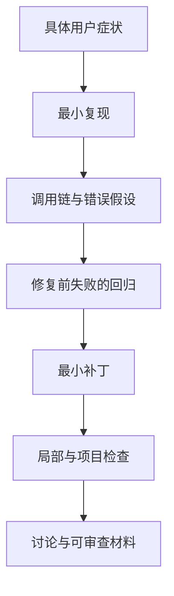

## 用一个真实问题建立工程证据

第一次贡献适合选择输入输出清楚、能独立复现、影响范围可控的问题。一次能解释因果的修复，比一次覆盖大量文件却说不清为什么改的功能，更能支持实习面试。

本项目单独创建了“MiniMax Code 首次贡献：复现、修复与 PR 提案”任务。它使用独立的 `minimax-code-contrib` 克隆，课程的 `minimax-code-source` 保持固定。复现、diff、英文草稿和验证材料输出到旁边的 `minimax-code-contribution`。

## 先检查当前政策

@source contributing

2026-11-03 核实时，仓库只接受 collaborators 的代码和文档 PR；外部贡献者先通过 Issue 讨论，API 同时报告 `pull_request_creation_policy=collaborators_only`。这意味着可以立即调查和准备修复，但提交资格需要维护者确认。原始政策变化后，再依据新状态推进。

上游要求文档和 commit message 主要使用英文，适用的共享 README 内容需要中英同步。当前仓库是内部源码的 reviewed public projection，新增文件还涉及 source inventory，不能只让测试通过就结束。

## 选题先排除三件事

1. **已经修复。** Issue 仍 open 不代表当前 main 仍有问题；要在确定的提交上重现。
2. **别人已有完整补丁。** 阅读评论、关联 PR 和 fork。可以帮助复测，但不能把他人工作包装为自己的修复。
3. **公开代码不覆盖。** Desktop 独有问题可能不在此仓库，不能强行在 CLI 里寻找补丁位置。

起始候选包括 #543 的终端链接检测、#507 的 usage 模型字段、#544 的 nullable schema。这些是调查线索，最终选题由独立任务根据实际源码和讨论确定。

## 一条可审查的修复链

```text
用户症状 → 最小复现 → 根因调用链 → 失败回归
        → 最小修复 → 原回归通过 → 相关入口验证
        → 英文提案 → 获准贡献 → PR / review → merge
```

每一步都要留下能复核的证据。测试失败要因为目标 bug，而不是依赖没装好；修复后要验证边界条件；测试文件应进入 `test/vitest-suites.json` 的正确 gate。只修改已有文件不一定需要重写 inventory；新增/删除文件要先审查，再生成清单。

## 完整验证不能用一个局部检查冒充

迭代时运行 focused test、`git diff --check` 和受影响 gate。上游 `pnpm verify` 的 source export 读取 committed HEAD，要求 tracked working tree 干净；因此完整交付验证应在审查后的本地提交上进行。

是否需要 `perf:full` 依据上游规则判断。历史、存储、流式和工具循环等修改涉及更完整性能验证。未运行的平台、实时服务、交互终端检查，要明确写 NOT RUN。

@lab usage

这里的 usage 实验提供一种可复现边界测试的例子：无效输入在进入存储前被拒绝。它不是对 #507 的修复，也没有证明那个 Issue 仍然存在。

## 先选一个你能独立解释的缺陷

为了实习去做贡献很合理，但有价值的成果来自清晰的问题和可靠的修复。一个小的跨平台能力判断、一个重复事件处理、一个丢失身份的映射，都可能比“重构整个 Agent”更适合第一次贡献。选题标准是能复现、能定位、能写回归、影响范围可控。

不要把本课程用来讲机制的教学反例直接当作上游 bug。需要在固定提交上实际触发错误，确认契约与用户预期，再调查最新主线和已有 Issue/PR 是否已经处理。这样才能避免提交重复修复。



## 分离课程源码和贡献 checkout

课程锁定版本用于复查结论，不能为了试修复随手改它。贡献目录可以切分支、追新主线、运行项目测试。两份目录让“这篇解释依据哪个版本”和“这份补丁基于哪个版本”都清楚。

复现时记录 base SHA、操作系统、终端/运行模式、必要环境变量和实际命令。用最小数据排除个人配置，保留失败输出。涉及终端能力检测时，区分程序对环境的判断与终端真的如何渲染；只有前者的纯函数测试不能证明后者。

## 一份好的回归测试要先失败

假设问题是重复 snapshot 造成客户端重复显示。先给原始实现喂入最小重复事件，断言输出数量与最终内容；确认测试在原始错误版本失败，修复后通过。若测试只验证你新加的 helper 能返回 true，却没有覆盖用户路径，仍可能漏掉真正故障。

同样，若想修取消后 busy，测试必须包含取消后下一条 admission。只断言 abort() 被调用，并没有覆盖用户问题。测试位置应尽量靠近发生错误的契约，避免引入真实 Provider 才能验证的偶然性。

## 把结果写成别人能审查的材料

PR 提案可以分四段：触发条件和当前错误；根因与正确 owner；补丁改变的行为与兼容性；验证命令和未覆盖平台。附一个很短的 before/after 输入输出，让维护者无需先理解你全部学习过程。

面试材料还应保留你自己的判断：为什么排除了另一个原因，为什么没有采用更大的重构，review 提出什么问题，你怎样修订。生成一份 diff 只是起点；能够对每一行负责，才让贡献成为能力证据。

## 当前阶段怎样推进

本仓库的 contribution 页面提供独立任务入口与模板。课程记录的上游政策要求先取得协作资格；准备本地复现、测试与补丁仍然可以继续。是否已经发起讨论、获得授权、提交 PR 或合并，分别以真实记录为准。

练习先交一份无需外部发送的 issue 草稿：只包含可复现事实和问题，不替维护者决定实现。再准备 PR 描述与验证清单，把没有运行的 gate 明确留空，不把计划写成结果。

::: interview 面试时怎样描述一个尚未合并的开源贡献？
按真实阶段说：已复现、已准备补丁与回归测试、已提出方案、已开 PR 或已合并。展示自己负责的根因与验证，说明维护者反馈和未验证范围。只有上游接受的公开记录，才支持“贡献已合并”的表述；准备补丁不能提前等同于 contributor 身份。
:::
