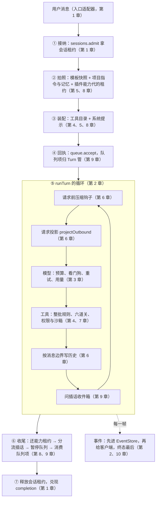
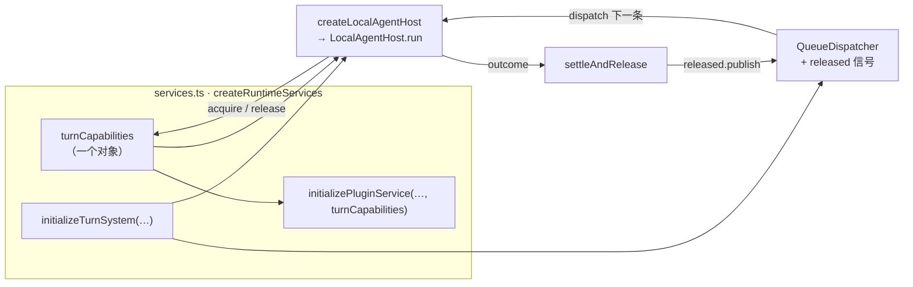
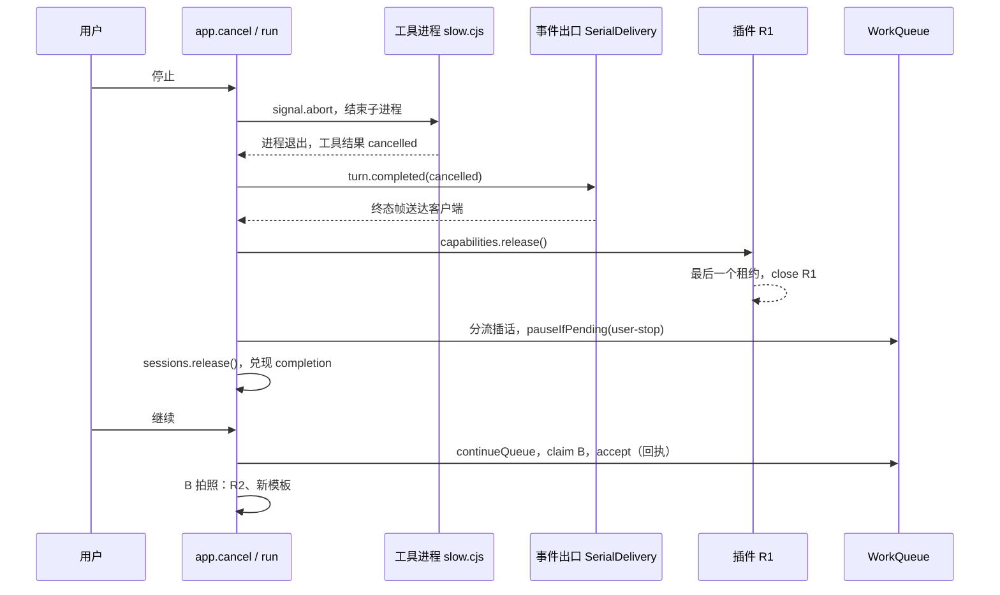

前十一章里，每个机制都有自己的实验，每个实验都通过了。现在把它们放进同一个应用，发生下面这件事：

A 在跑一个不会自己结束的长任务。这时插件更新出了新的一代，用户又发来一条 B，接着按了停止。A 要收尾，旧版插件要关，B 要开始——B 必须用新版插件、新版提示，修好一个真的失败的测试。最后，一个只拿到事件帧的客户端，要能还原出“A 被取消、B 成功”这个结果，断线重连之后结果也不变。

这件事里没有一个新机制。它考的是**顺序**：旧版插件的进程能不能在 A 还在跑的时候关？B 能不能在 A 的终态帧送达之前开始？用户刚按过停止，B 该不该自己跑起来？单章实验回答不了这些问题，因为每个零件单独运行的时候，没有别人和它抢。

这一章先看一遍完整运行，再画出十一个机制挂在 Turn 的哪里；然后读 MiniMax 里五处真正的装配代码；接着回头看总装 host 时暴露的六个问题；最后把 Pi、Claude Code、MiniMax 放进同一张表，收束成可以带走的设计原则。

@figure assets/course/ch12-capstone.png 取消的任务收尾，工具换成新的一代，下一个号码用新工具把失败的测试修好

## 先看一遍：取消、更新、排队、修复

下面的实验跑在 host 的真实应用 `createApplication` 上。没有任何“演示专用”的快捷宿主：A 的工具是一个永不退出的子进程，R1 和 R2 是两个真的 MCP 子进程，测试是真的 `node test.cjs`，队列和事件是真的日志文件。只有模型的回复是脚本。

@lab node labs/ch12/story.mjs

按行读第一张表（后四列是那一刻宿主里的事实）：

- **第 2～3 行**：A 接纳之后，抓走了 R1 和模板 v1。R2 发布之后 R1 进程仍在运行——A 手里还握着 R1 的租约，旧代不能关。
- **第 4～5 行**：B 在会话忙的时候被写进队列；重发同一个 `clientRequestId` 拿回的是同一行。接着有人改了系统提示模板和 `CLAUDE.md`，A 不受影响，因为它的快照早拍过了。
- **第 6～8 行**：停止只是发出意愿。会话仍然“A 占用”，`next()` 被拒绝，终态帧要等客户端那一头写完（实验里故意让它慢了 60 毫秒）。
- **第 9 行**：同一时刻发生了四件事：`run` 返回 `cancelled`，R1 的最后一个租约还掉、进程退出，队列被暂停，会话变成空闲。它们的先后见后面的时序图。
- **第 10 行**：会话已经空闲，`next()` 却不运行 B——用户刚按过停止，排队的指令不该自己跑起来。
- **第 11～13 行**：用户点“继续”，B 才开始。它抓到的是 R2、模板 v2 和新的 `CLAUDE.md`，先看到测试失败，改完再跑一次通过，队列项变成 `consumed`。
- **第 15 行**：应用关闭时，当前代 R2 才关。

B 的修复过程（第二张表）里，第一步 `test` 是真实失败：`slug("a  b")` 得到 `a--b`。后面的 Skill 来自 R2 带来的插件 Skill `course:repair-guide`，A 的提示里没有它。第三张表是 SDK 一侧：客户端手里只有帧，A 还原成 `cancelled` 且消息 item 带着未完成标记，B 还原成 `completed`；第 9 帧后断线再用游标接上、新客户端整段重放，结果都和直播一致；只拿游标之后的帧，缺口当场暴露。

想一步一步看，用下面的回放（每一步的右侧是消息和那一刻的宿主状态）：

@trace node labs/ch12/trace.mjs

## 十一个机制，挂在一个 Turn 的哪里

把一次 `run` 从头到尾摊开，前十一章的东西各有各的位置：

同一件事换成表格，多一列“host 里是哪一行代码”：

| 章 | 机制 | 挂在哪一刻 | host 里的位置 |
| --- | --- | --- | --- |
| 1 | 入口翻译、会话租约 | 接纳之前；释放之后 | `adapters.mjs`；`sessions.admit` 与看门狗 |
| 2 | Turn 的生命周期、串行交付 | 全程 | `runTurn`、`SerialDelivery` |
| 3 | 模型：预算、重试、看门狗 | 循环里每一次请求 | `run` 的 `model` 参数（`composeModel` 套好的函数） |
| 4 | 工具：整批规则、流水线 | 模型回复之后 | `executeCalls` → `batchMode` / `callTool` |
| 5 | 上下文：快照、指令、记忆 | 接纳之后，Turn 开头一次 | `loadPromptLayers` + `preparePrompt` |
| 6 | 历史、投影、压缩 | 每次请求前；每个消息边界 | `compactIfNeeded`、`projectOutbound`、`historyCursor` |
| 7 | 权限、沙箱 | 工具流水线的最后一道准入 | `rules` / `mode` / `sandboxRequired` 传给 `callTool` |
| 8 | 插件、Skill、MCP 的代 | 拍照时抓一代，收尾时还 | `plugins.capture()` 与 `release()` |
| 9 | 队列、插话、取消 | 回执、每步之后、收尾 | `queue.accept`、`SteeringBuffer`、`pauseQueue` |
| 10 | 事件流与 SDK | 每一帧的出口 | `write`：`EventStore.append` 先于 `writer` |
| 11 | 贡献 | 不在 Turn 里：怎样改这条链路 | `contribution.mjs` |

读这张图时有两个看点。一是**租约有三种**：队列的 claim（第 9 章，决定一条消息归谁）、会话租约（第 1 章，决定谁能跑）、能力代租约（第 8 章，决定旧插件何时能关）。拿的顺序是 claim → 会话租约 → 能力代租约 → 队列回执；还的时候先还能力代租约，再结算队列（暂停、消费），最后才放会话租约——每一次交接，下一个负责人都已经记好了账。二是**两条时间线**：Turn 内部的循环在往前走，事件和历史在另一条线上落盘，二者共用一个出口，所以终态帧才能当作整个 Turn 的提交点。

## MiniMax 在哪里把它们装在一起

MiniMax 没有一个叫“总装”的文件，装配分布在五个地方，自外向内读，每一层只解决一个问题。

### 插件和 Turn 共用同一个对象：`services.ts`

`createRuntimeServices` 按依赖顺序把服务一个个建出来：沙箱、检查器、全局事件、工作区，然后是第 431 行 `const turnCapabilities = new AgentHostTurnCapabilityLifecycle()`，再往后是内容安全、提示支持、模型系统和会话系统。到了这里：

@mm packages/local-runtime-v2/src/services.ts#L674-L693 hl=681,692

第 681～693 行把插件服务建起来，第二个参数就是前面那个 `turnCapabilities`。稍后（第 746 行起）`initializeRuntimeTurnSystem` 再把**同一个对象**交给 `createLocalAgentHost`。第 8 章读过的 `acquire` 和发布门，一边由插件系统在发布新一代时关门开门，一边由 Turn 在开头抓取当前代、结尾归还——两边靠的就是这一个对象，没有任何消息传递。所以“旧代什么时候能关”不需要插件系统去问 Turn，也不需要 Turn 通知插件系统：租约数归零就是答案。

host 里对应的是 `createApplication` 里的 `plugins`：`run` 调 `plugins.capture()` 抓取，调 `release()` 归还，`update()` 在另一头发布。

### 释放信号推动下一条：`initializeTurnSystem`

Turn 系统建好仓库、控制器之后，创建宿主，再创建队列分发器：

@mm packages/local-runtime-v2/src/service/turn-system/initialize.ts#L115-L133 hl=131-133

第 131～133 行是整个“取消之后下一条怎么开始”的钩子：每当某个会话被释放（`released` 信号），分发器就 `dispatch` 这个会话，取走队列里的下一项。没有定时轮询，也没有谁去“通知队列”——释放本身就是事件。取走一项由仓库的 `claimNext` 完成，它的条件之一是队列没有被暂停（除非调用方明确要求 `continuePaused`）；所以暂停不是分发器里的特判，而是取走这个动作自己的规则，和第 9 章 `WorkQueue.claim` 的三个“不给”是同一回事。

host 的 `next()` 把这一步留给调用方：由调用方在合适的时候拉一次。这是 host 最大的简化，也是 `app.next` 要自己检查 `session busy`、自己处理 `continuePaused` 的原因。

### 一个 Turn 要带的全部依赖：`production-dependencies.ts`

宿主要跑一个 Turn，需要的东西列在一个接口里：

@mm packages/local-runtime-v2/src/service/turn-system/agent-host/production-dependencies.ts#L35-L57 hl=35,42,44,45,46,49,50,52,55

挑出高亮的几行，对应前面的章节：`sessions` 读会话（第 1 章），`preparation` 准备提示（第 5 章），`compaction` 压缩（第 6 章），`turnControl` 取消与插话（第 9 章），`turnCapabilities` 能力租约（第 8 章），`canonicalHistory` 规范历史（第 6 章），`usage` 用量（第 3 章），`events` 事件投影（第 10 章），`executor` 里是工具、权限、模型（第 3、4、7 章）。`createLocalAgentHost`（`production-composition.ts` 第 394 行）通过 `createNativeAgentHostProductionDependencies` 把这些端口接到产品的实现上；这个文件的注释还说明了边界：这个接缝有意不把宿主挂到 `services.ts`、分发器、HTTP 或 v1 兼容层上——装配是分层做的，每一层只认下一层的接口。

host 里这一整包依赖，就是 `run` 里交给 `runTurn` 的那一个对象（见下一节）：`prompt`、`tools`、`history`、`persist`、`write`、`compaction`、`steering`、`signal`。

### 抓租约、装配、执行、归还：`LocalAgentHost.run`

宿主的 `run` 是第 2 章读过的八步之外的一层壳，壳里管的正是租约：

@mm packages/local-runtime-v2/src/service/turn-system/agent-host/local-agent-host.ts#L190-L204 hl=191-203

第 191～203 行在 Turn 开头 `acquire` 当前的能力代，拿到的 `capabilityLease` 一直带到 `run` 的 `finally`（第 276～277 行 `capabilityLease?.release()`）。两个细节：`acquire` 里的 `signal` 交给能力的准备阶段，发布门本身只在切换的瞬间关着，等待很短，也不可打断；`prepare` 和 `assembleTurn` 都接收 `capabilityLease?.capabilities`，所以提示里的能力清单、工具目录读到的都是**同一代**。拿到之后，Turn 里的一切——工具目录、Skill 清单——都不会再因为插件更新而变化。

### 收尾的顺序：`settleAndRelease`

Turn 的结局出来之后，协调器做收尾：

@mm packages/local-runtime-v2/src/service/turn-system/execution/execution.coordinator.ts#L290-L327 hl=299,301-308,313,321-323

读这段代码要盯着顺序：

1. 第 299 行，先把收件箱里没送出去的插话提交（注释里的 Decision v5：它在**终态结算之前**提交，这样“先停止、再发送”的下一个 Turn 一定读得到这些行）。
2. 第 301～308 行，算出 `queuePauseCause`，和终态结算写在**同一次** `settleRepository` 里——“Turn 结束”和“队列暂停”不会只发生一半。
3. 第 313 行，控制器 `complete`：这一刻起，内存里这个会话不再有活动 Turn。
4. 第 321～323 行，满足条件才 `released.publish`，也就是前面分发器订阅的那个信号。

什么时候暂停，由一个只有四行的函数决定：

@mm packages/local-runtime-v2/src/service/turn-system/execution/queue-pause-on-abort.ts#L3-L18 hl=15-18

只有用户亲手停止（或者离开这个会话）才暂停。注释还点明了设计意图：Turn 结算和插话回填队列两处都走这一个判断，“两个暂停决定不会再漂移”。失败的 Turn 在 `terminalQueuePauseCause` 里另有一个原因 `turn-final-failure`。应用关闭、租约丢失造成的中止，不属于“用户不再盯着这个会话”，不暂停。

把五处合起来看，取消之后到 B 开始，MiniMax 是这个顺序，host 的实验里完整重现了：

## host 的总装：`run()` 的七步

host 把五处装配压成了 `app.mjs` 里的一个函数。先看进门的这一段，① 接纳和看门狗：

@code host/src/app.mjs#L157-L194 hl=159,170-175,188-192

第 159 行 `sessions.admit` 拿会话租约，失败直接抛出——此时还没有任何东西需要释放。第 170～175 行为这个 Turn 建三样内存里的东西：停止原因 `state`、插话收件箱 `steering`、以及登记到 `runs` 里的取消句柄。第 188～192 行是**租约看门狗**：`Sessions` 会自己续租，但续不上的时候它够不到 Turn；这里每个续租间隔看一眼 `holder`，发现不是自己了（过期被别的进程回收），就把原因标成 `lease-lost` 并中止。第 9 章写过 MiniMax 的 Turn 控制器续租失败会自己中止 Turn，host 在这里补上了这一块。

接着是拍照、装配、回执：

@code host/src/app.mjs#L196-L222 hl=202-207,212-219,222

第 202～206 行的 `loadPromptLayers` 是第 5 章留下的缺口：它读磁盘上的项目指令（`CLAUDE.md` 或 `AGENTS.md`）、全局指令和记忆，并且和模板快照发生在**同一个时刻**——都在 `await plugins.capture()` 之前，所以发布门关着时的等待不会让两者拍出不同的“现在”。第 214 行的 `skill` 工具同时认独立 Skill（每次读磁盘）和这一代插件 Skill（正文随代冻结），清单一起进系统提示。第 222 行是第 9 章的回执：Turn 先接纳这条消息，队列才确认。

然后是执行和收尾：

@code host/src/app.mjs#L224-L266 hl=237-238,249-252,257-260

交给 `runTurn` 的这一包参数，就是 `createAgentHostProductionDependencies` 那个接口的 host 版：`compaction`、`steering` 是这一章接进去的，`persist` 有两个出口——追加新消息，或者压缩之后用 `sessions.replace` 整份替换（旧行留在日志里当存档）。第 257～260 行的四行就是上面时序图的后半段：还能力租约，分流插话，在释放会话**之前**决定队列要不要暂停，然后消费队列项（`consume` 只在事件已送达、历史已落盘时发生）。

最后是释放：

@code host/src/app.mjs#L267-L283 hl=268-282

四层嵌套的 `try/finally` 看起来啰嗦，它防的是一个具体的坑：旧版 `finally` 里先 `release()` 再 `done()`，`release()` 一旦抛错，`done()` 就没机会调用，`close()` 等的 `completion` 永远不兑现，整个应用关不掉。现在每一步各自有 `finally`，无论哪一步抛错，后面的都会执行，`done()` 一定会调用。这个顺序的原则是：**先归还别人借给你的，最后才宣布“我不忙了”**。

## 总装时才暴露的六个问题

每个零件单独都对，装在一起才发现这六处接缝：

| # | 单章实验里看不到的现象 | 根因 | 现在怎么做 | MiniMax 里的对应 |
| --- | --- | --- | --- | --- |
| 1 | 提示里没有 `CLAUDE.md` 和记忆 | `app` 只传了模板快照 | `loadPromptLayers`，和快照同一刻 | `preparation/` 的提示块、`GlobalInstructions` |
| 2 | 历史很长也不压缩 | 压缩钩子没人调 | `compactIfNeeded` 在每次请求前；`persist` 分追加与替换 | 压缩钩子 `compactBeforeLlm` |
| 3 | 请求投影有两份，行为不一样 | 第 5 章的 `projectMessages`，第 6 章的 `projectOutbound` | Turn 只用后者，外加补缺失的结果；`details` 不出本机 | `convertToLlm`，Pi 的 `transform-messages` |
| 4 | 批次规则有两套 | `turns.mjs` 自己做相邻分组 | 改用 `batchMode` 与 `callTool` | Pi 的 `executeToolCalls` |
| 5 | 停止之后队列自己跑起来；插话没有入口 | `cancel` 只发信号 | 收尾阶段按原因暂停；`app.steer`；`next({ continuePaused })` | `settleAndRelease`、`pausesQueueOnAbort` |
| 6 | 释放抛错会让 `close()` 卡死；丢了租约的 Turn 还在跑 | 顺序释放、没有主动中止 | 嵌套 `try/finally`、看门狗 | 续租失败即 `lease-lost` |

后四个值得看实际输出。

### 请求前压缩，和唯一的投影入口

压缩钩子（第 6 章的 `compactBeforeModelCall`）在 `turns.mjs` 的 `askModel` 里每次请求前被调用一次；它改的是 `turn.messages` 这个数组本身，所以紧接着生成的请求副本已经是压缩后的样子。下面这个实验把一段很长的会话（工具结果占大头）交给 `run`，窗口设得很小：

@lab node labs/ch12/fixes.mjs compaction

注意第 3、4 行：模型实际收到的第一条是摘要，会话历史从 24 条变成了 3 条，但日志里被换掉的旧行还在，当存档。第二个 Turn 不再压缩：摘要已经是历史的一部分，估算回到了触发线以下，摘要请求总共只有一次。

请求副本的生成现在只有一个入口，批次规则也只有一套：

@lab node labs/ch12/fixes.mjs shape

孤儿结果 `ghost` 被宿主丢掉；没有结果的调用 `c1` 由 Turn 补一条“中断”的结果（Pi 在发送前做的事）；存档里的 `details` 到不了模型，模型只看到文本和 `error`。批次的两行是第 4 章的整批规则：有一个串行工具，整批按顺序跑，不会像相邻分组那样让 `read` 越过 `edit`。

### 插话终于有了出口

第 9 章的 `SteeringBuffer` 是一个孤立的零件。总装时它要同时接三个地方：`runTurn` 每一步之后问一次，`app.steer` 往里放，收尾时按出口规则分流。

@lab node labs/ch12/fixes.mjs steering

同一个 `app.steer`，四种处境，去处不同。第 2 行最容易想错：模型的回答已经写完，用户这时递来一句话，它**不会**把回答延长（否则一条已经交付的回答又被改写），而是等收件箱关门时变成队首的排队项，成为下一个 Turn。第 3 行相反：用户按了停止，还没被模型读到的话写进会话历史，下一次请求模型就能读到；第 4 行是停止之后才来的话，收件箱已经关门，只能排队，而队列此时是暂停的，所以它不会自己跑。

### 租约丢了，Turn 自己停下

A 的会话租约被另一个进程回收了（时钟走过了期限）。旧版 host 要等到 A 下一次写历史才发现，在那之前它的工具还在继续干活。

@lab node labs/ch12/fixes.mjs lease

看门狗在一个续租间隔内发现自己不再是持有者，中止 Turn，原因记为 `lease lost`；收尾时补写历史被挡下（`persisted` 为 false）。队列没有被暂停：租约丢失不是用户的意愿。释放顺序那一处同样有实验：

@lab node labs/ch12/fixes.mjs release

`release()` 抛了错，`run` 把错误交给调用方，但 `close()` 照样返回，R1 照样关闭。

## 命令行入口：退出码是最后一次运行的结局

`mcode exec` 是给脚本用的，脚本最先看到的是退出码。host 的 `cli.mjs` 是第四个入口：stdin 每行一个命令，stdout 每行一帧事件。这一章给它补上了入口该有的四样东西：

@code host/src/cli.mjs#L22-L34

stdout 只写协议帧，并且把 U+2028、U+2029 转义（JSON 允许它们直接出现，但按 JavaScript 行终止符切行的接收方会把一帧切成两半）；管道断了（`EPIPE`）按约定的 141 退出，而不是当成崩溃。Ctrl-C 取消当前运行，没有运行就直接以 130 退出。退出码取自最后结束的那次运行，数值和第 1 章的 `exitCodeOf` 一致：

@code host/src/cli.mjs#L65-L107 hl=66,76,85,98,103

下面起三个真实子进程，各喂一行输入：

@lab node labs/ch12/fixes.mjs cli

这和 Claude Code 的做法同源——它看最后一条 `result` 的 `is_error`；MiniMax 的区别是码分得更细（见第 1 章的映射表）。

## 三方对照：十个问题，三种答案

前十一章每章都做过局部对照。把它们收到一张表里：

| 问题 | Pi（v1.5.0） | Claude Code（2.1.88） | MiniMax Code（0.7.2） | host（本课） |
| --- | --- | --- | --- | --- |
| 入口与分层 | 一个 `main()`，`resolveAppMode` 选模式，三种模式共享一个 runtime | `cli.tsx` 快速通道，再进 `main.tsx`；`isNonInteractive` 一个标志到处判断 | 子命令先分岔，每条命令自己建运行时，汇合在 `CliService` → Application → Service | 三个入口适配器共用 `RunCoordinator` 与 `app` |
| Turn 的边界 | `agent_start` 到结束，没有“终态”这个概念 | `QueryEngine.submitMessage` 调 `query()`，每圈：压缩 → 模型 → 工具 → 附件；结果是 `result` 消息 | 八步装配；agent-core 发终态，宿主暂存，排空对齐后提交并核对 | `runTurn`：drain → 补写历史 → 终态帧最后 |
| 模型 | `getModel(provider, id)`；provider 层按状态码重试 | `withRetry` 默认 10 次，500 毫秒起指数退避；先发后按 400 调整输出上限 | 一个字符串键、三种来源；事前收缩输出上限；5 次重试、两个看门狗、提交边界 | `composeModel` 按上游顺序套五层 |
| 工具 | `AgentTool`；整批规则（有串行整批串行） | 相邻分批 `partitionToolCalls`；内部有 REPL 版“工具藏进 VM” | `RuntimeTool` 三路返回值；PTC 的 `run_code`；八种失败各停在一关 | `callTool` + `batchMode`；`run_code` 用 `node:vm` 演示 |
| 上下文 | 分节系统提示，项目指令在 `<project_context>` | `CLAUDE.md` 放第一条用户消息，会话内缓存 | 指令在系统提示里；Turn 开头拍照，Turn 内冻结；整包回退 | `loadPromptLayers` 与模板快照同一刻 |
| 历史与压缩 | 同一文件的树；窗口减 16384 触发；发送前补 “No result provided” | 有效窗口减 13K 触发；整段换摘要并重新注入文件；连续失败 3 次熔断 | 每次请求前；95% × (窗口 − 输出预留)；先存档再替换；摘要敞开、提交闭合 | 同上，`Sessions.replace` 保留旧行 |
| 权限与沙箱 | 扩展挂 `tool_call`；默认靠隔离 | `hasPermissionsToUseTool` 在核心里；逐项审批；沙箱开启后 bash 自动放行 | `beforeToolCall` 钩子链最后一站；风险分级；沙箱默认关，与权限独立 | `authorize` 是流水线的最后一道准入 |
| 插件 | `/reload`；流式输出中拒绝重载 | `/reload-plugins` 原地替换，立刻断开过期 MCP 连接 | 新旧两代并存；每个 Turn 持租约；最后一个租约释放才关旧代 | `createPlugins`：旁边备候选、关门提交、按租约清理 |
| 队列与取消 | 内存数组 `steer` / `followUp`；`abort()` 发信号 | 进程内 `commandQueue`；Esc 取消，空闲时 Esc 把排队的弹回输入框 | 数据库里的持久队列；取消等 Turn 放手；用户停止则暂停 | 日志里的 `WorkQueue`；`pauseQueue`；`next({ continuePaused })` |
| 对外协议 | `--mode rpc` / `json`，`agent_settled` | `stream-json` + Agent SDK；`control_request` 做审批 | `exec` 的 stream-json、ACP、`code-sdk` 的 `ItemAccumulator` | `EventStore` 重放 + `collector` 对账 |

读这张表，有三个规律。

**Pi 把决定留给宿主，MiniMax 把决定写进了数据。** 同一个“忙时又来一条”，Pi 抛错或推进内存数组，MiniMax 写数据库、发回执、记 claim。数据比函数调用更重，换来的是崩溃之后还能说清每一条消息在哪里。

**Claude Code 优化的是单用户交互，MiniMax 优化的是多入口、多进程。** 插件更新一栏最典型：Claude Code 由用户明确触发，状态原地换，断开过期连接；MiniMax 的更新可能由目录监视器在任何时候触发，旧 Turn 正在用旧代，所以要租约。两个都对，前提不同。

**越靠近“用户看得见的承诺”，MiniMax 越保守。** 终态最后提交、插话不延长已交付的回答、停止之后不自己跑、摘要失败敞开而提交失败闭合——都是“宁可多一个状态，也不让用户看到前后矛盾”。

两门课里的教学实现各自在哪里止步，也值得放在一起看：

| | mox（Learn Pi Agent） | coda（Learn Claude Code） | host（本课） |
| --- | --- | --- | --- |
| 力气花在哪 | 循环、工具、会话树、压缩、扩展、子 Agent | 权限、Hook、记忆、Skill、MCP、子 Agent | 状态活过进程：租约、队列、代、事件重放 |
| 同时几个运行 | 一次只有一个会话在跑，插话与追加是循环里的数组 | 一次只处理一个提问，CLI 一个进程只接一次提问 | 一个会话一个 Turn，其余排队；多进程靠共享日志 |
| 内核 | 真实模型适配器 | 真实请求组装 | 脚本模型加三个小工具 |
| 崩溃之后 | 会话文件可恢复，补上中断的工具结果 | 会话文件可恢复 | 租约回收、队列 `recover()`、历史读取时修复 |

## 带走的八条设计原则

十一章读下来，下面八条几乎在每个模块里都能再看到一遍：

1. **状态写在入口脚下**（第 1 章）。“会话在忙”不是进程里的一个变量，而是数据库里一行带租约的锁，因为同一台机器上随时开着三个进程。
2. **先记账，后动手**（第 2、9 章）。历史先于工具执行落盘；队列的回执先于确认；`claim` 先于 `accept`。每次交接，新负责人已经把账记在日志里，旧负责人才松手。
3. **终态最后提交**（第 2、10 章）。事件串行交付，历史按消息边界写，`turn.completed` 是整个 Turn 的提交点：它前面的一切已经落地，它后面不能再有任何帧。
4. **材料拍照，Turn 内冻结**（第 5、8 章）。提示的快照、插件的能力代，都在 Turn 开头取一次，之后配置怎么变都不影响这个 Turn。
5. **维护性故障敞开，事实性故障闭合**（第 6 章）。摘要失败，用户的任务不该停；历史写不下去，就必须停。
6. **解析不等于许可**（第 7 章）。`deny` 站在台阶最前，沙箱与权限是两个独立的开关，路径检查和物理隔离是两层。
7. **更新不改正在用的东西**（第 8 章）。旁边造一份新的，整体换上去，旧的等最后一位使用者走了才拆。
8. **过程可以乱，结果只认终态**（第 10 章）。事件可以交错、重复、残缺；没有终态就是失败，序号有缺口就是流不可信。

还有一条贯穿全课、不属于任何一章的：**对内核的修改要小、要有账**。`MINIMAX_CHANGES.md` 里四十多条补丁，每条写明原因、影响和是否可回馈上游，这是第 3、11 章反复用到的素材。

## 你来改

::: predict 外部信号会不会暂停队列
在主线实验里，把 `app.cancel(session.id)` 换成：用 `AbortController` 的 `abort()` 通过 `run` 的 `signal` 选项取消 A。B 排队着，A 收尾之后队列会暂停吗？如果换成 `app.close()` 呢？
???
`signal` 取消会暂停，`close()` 不会。暂停不是 `cancel()` 函数里写的，而是收尾阶段按停止原因决定的：从外部传进来的 `signal` 被中止时，`state.cause` 保持默认值 `user-stop`（入口适配器的取消句柄走的就是这条路），所以和 `app.cancel` 一样暂停；`close()` 在中止之前把原因改成 `shutdown`，租约看门狗改成 `lease-lost`，这两种都不是用户的意愿，不暂停。这正对应 MiniMax 的 `pausesQueueOnAbort`：只看中止原因，不看是谁调用了哪个函数。
:::

::: predict 停止之后的插话去哪里
A 在跑长任务，B 已经排在队列里。用户先 `app.steer(session, "顺便检查 lint")`，随后按停止，紧接着又 `app.steer(session, "然后部署")`。两句话各自去了哪里？它们和 B 的执行顺序是什么？
???
第一句在收件箱里等待，还没被模型读到就遇到取消，收件箱以 `abort` 为原因把它交出，收尾时写进会话历史（`steered: true`），不进队列；下一次请求模型时，它作为一条用户消息出现在历史里。第二句来得更晚，收件箱已经关门，`steer` 返回 `queued`，它被放在队列末尾（排在 B 之后，因为没有指定 `front`），而队列此时处于暂停，要等用户点“继续”才会依次执行 B 和它。实验 `fixes.mjs steering` 的第 3、4 行就是这两种情形。
:::

::: predict 如果去掉嵌套的 finally
把 `run` 末尾四层嵌套的 `try/finally` 改回“依次调用”：`capabilities?.release(); release(); done();`。测试里让会话的 `release()` 抛一个错，然后调用 `app.close()`，会发生什么？
???
`release()` 抛错之后 `done()` 不会被调用，这个 Turn 的 `completion` 永远不会兑现。`close()` 里的 `Promise.all([...completions.values()])` 就一直等下去，应用关不掉，R1 也关不掉。这是 MiniMax 的释放链不允许发生的事（失败的结算还有 `releaseUnsettledTurn` 兜底）。实验 `fixes.mjs release` 的结果是现在的行为：`run` 抛出，`close()` 正常返回。
:::

## 面试题

::: interview 把一个 Agent 内核做成产品，需要在外面加什么？
先给结论：循环只是百分之一，剩下的都是“状态怎样活过进程、怎样被多个入口和多个进程共享、怎样在失败时给用户一个一致的结果”。可以按本课的结构答：

- **入口与状态**：多入口共享一个应用层，“会话在忙”写成带租约的锁，而不是进程变量（第 1 章）。
- **Turn 生命周期**：接纳、拍照、执行、收尾、释放的固定顺序；事件串行交付，终态最后提交（第 2 章）。
- **模型系统**：键与凭证、输出预算、重试的提交边界、看门狗、用量（第 3 章）。
- **工具与权限**：来源、校验、三路返回值；权限与沙箱是两道门（第 4、7 章）。
- **上下文与历史**：Turn 级快照；存下来的和发出去的分开；压缩先存档再替换（第 5、6 章）。
- **扩展**：插件按代发布，租约决定旧代何时关（第 8 章）。
- **队列、插话、取消**：持久队列、回执、暂停（第 9 章）。
- **对外协议**：SDK 按序号对账，断线可重放（第 10 章）。
- **对内核的补丁与治理**：补丁台账、上游回馈（第 3、11 章）。

加分点：能说出“为什么这些不能留给内核”——它们都是关于多方协调和失败后果的决定，而内核只知道一个会话、一个调用者。
:::

::: interview 为什么事件要串行交付，终态要最后提交？
结论：客户端把“最后一帧”当作 Turn 的承诺，所以前面的帧必须已经落地，而且到达顺序必须等于产生顺序。

- 并行工具会从不同的 Promise 分支同时产生事件。直接写，到达顺序会和产生顺序不同：客户端可能先看到工具结束再看到它开始。所以所有事件先进同一条队列（`SerialDelivery`），再一个个写出。
- 终态晚于所有事件和历史：`runTurn` 的收尾是 drain → 补写历史 → 决定结局 → 发终态 → 再 drain 确认。一个没有送达的 `completed` 不能算成功。
- 失败的帧不能把已经断掉的队列继续写下去，但失败或取消的终态例外（`force`），因为客户端必须知道 Turn 已经结束。
- 宿主层还有一次“暂存再提交”，对齐队列和历史之后才发出，并核对发出的终态和结局一致。
- 这也是 `EventStore.append` 拒绝“终态之后还有帧”、SDK 的 `collector` 拒绝序号缺口的原因：整条链路的两端用同一条规则对账。
:::

::: interview 持久队列怎样保证一条消息只被接纳一次？
结论：靠三个身份加一条交接规则，让每个环节都能在崩溃后说清“这条消息现在归谁”。

- **入队去重**：调用方给的 `clientRequestId`。网络断了重发，拿回的是同一行，连同第一次解析好的模型，而不是新造一行。
- **claim**：同一个会话同一时刻只允许一个 claim，带租约和 owner。崩溃后租约过期或 owner 不是自己，`recover()` 把它放回队列。
- **回执在 Turn 一侧**：Turn 接纳一个 claim 时写 `ingress` 回执（`claimId`、`turnId`），同一个 claim 不能被两个 Turn 接纳。队列只会来问，不能自己宣布“已有人接手”。
- **确认问 Turn，不问自己**：`acknowledge` 查回执，没有就拒绝。确认发生在 Turn 开始执行之前，所以 claim 还在说明 Turn 一定没动过手，重排安全；已确认（`accepted`）的项，崩溃后归 Turn 一侧善后，队列不再重试。
- 加分点：host 多记了一步 `consumed`，表示 Turn 的事件已送达、历史已落盘。保证的是接纳至多一次；`accepted` 之后崩溃，外部副作用是否已经发生，要由会话一侧核对。
:::

::: interview 用户按了停止，到下一条开始之间，系统要按什么顺序做哪些事？
结论：先让正在跑的 Turn 真的放手，再记账，再放行；任何一步对调都会出事。

1. 取消信号送到工具进程，等它真的退出（否则“已取消”的任务还在改文件）。
2. 终态帧送达客户端（否则客户端过早放开输入框）。
3. 归还能力租约，旧版插件的进程此时才能关。
4. 没送出去的插话各回各家：取消时写进会话历史，不进队列。
5. 在**同一次结算**里暂停队列（用户停止）——Turn 结束和暂停不会只发生一半。
6. 释放会话租约，这时才允许别的 Turn 被接纳。
7. 用户明确点“继续”，才取走下一条；B 接纳时再拍快照，用的是新的模板和新一代插件。

追问“先释放会话再暂停队列行不行”：不行，释放的那一刻起分发器就可能取走下一项，用户刚按的停止就失效了。
:::

::: interview 插件热更新时，怎样保证正在运行的任务不受影响，旧版本什么时候才能关？
结论：不改正在用的东西。新一代在旁边准备好，整体切换；旧一代等最后一位使用者归还租约才关。

- Turn 开头 `capture()` 抓当前代并加租约，抓取和加租约之间没有 `await`，所以拿到的代一定还没被清理。
- 发布新一代分两段：先在旁边备好候选（连接、列工具，期间旧代照常服务），再关门、提交、切换；任何一步失败，候选被关掉，旧代原样保留。
- 旧代退休后，租约数归零才 `close` 运行时，再跑 `finalize`；应用关闭则等进行中的工作收尾，再清理所有代。
- 一个 Turn 内工具目录、Skill 清单读的是同一代；插件里的 Skill 正文随代冻结，磁盘上之后改了也不影响。
- 加分点：说明这和 Claude Code 的原地替换是两个场景的合理答案——后者由用户在交互里明确触发，前者的更新可能在任何时候由机器触发。
:::

::: interview 为什么发给模型的历史和存下来的历史不是同一份？压缩失败时该继续还是该停？
结论：存下来的是事实，发出去的是针对这一次请求的投影；压缩失败看是哪一半失败。

- 投影每次现算、永远不写回：丢掉宿主专用消息、合并同一次“立即发送”拆出的用户消息、丢掉孤儿工具结果（接口会拒绝整个请求）、限制图片数量。按精确前缀缓存的模型不裁图片，因为每次请求改早先的内容会让缓存失效。
- “有调用没结果”由 Pi 在发送前补一条，MiniMax 在读取时则删掉配不齐的回合——两边分工不同。
- 压缩分两半：摘要（探测、生成、校验、事后核对）失败 → 敞开，这一次照旧用压缩前的历史，因为压缩是维护工作；提交（持久化替换）失败 → 闭合，不请求模型，因为带着没存下来的新历史去请求，下次恢复就对不上。
- 提交是先存档、再替换、最后核对，任何崩溃点旧历史都在。
:::

::: interview 客户端从事件流还原结果，断线重连怎样保证和直播一致？
结论：靠序号、对账和终态三件事，宁可报错也不拼出一个看起来完整的结果。

- 每个 Turn 的帧序号从 1 连续递增，`EventStore` 先记后投递，所以客户端看到过的每一帧服务端都有。
- `collector` 先检查归属（`turnId`），再检查序号：已见过的序号，内容相同是幂等重复，内容不同抛冲突；跳号抛缺口；终态之后还有帧抛错。通过对账的帧才交给折叠器按 id 合并。
- 断线重连用游标（最后处理的序号）从 `replay(turnId, afterSeq)` 接上；整段重放与已收到的重叠没关系；新客户端只拿游标之后的帧，缺口会被当场暴露，而不是静默得到半个结果。
- 结果只认终态：A 被取消，未完成的 item 保留 `incomplete`；没有终态就是 `incomplete`，不是成功。
- 加分点：上游 SDK 读的是子进程 stdout 管道，有序不丢不重，所以它不看序号，丢尾巴靠“没有 `exec.completed` 就是失败”兜底；host 的帧可能来自重放，所以多了对账。
:::

::: interview 假如只做一个单用户、只在本机交互的 CLI，MiniMax 里哪些复杂度可以不要？
结论：取决于有没有“多个入口同时操作同一份状态”和“机器触发的变更”这两个前提；没有，就能砍掉不少。

- **可以砍**：会话租约和存活判断（只有一个进程，内存里的 `busy` 够了）；持久队列的 claim、回执、恢复（进程退出，排队的话丢了可以接受，Pi 和 Claude Code 都是这样）；插件代的租约（更新由用户明确触发，可以拒绝在运行中重载，或者原地替换）。
- **不能砍**：串行交付和终态顺序（界面一样会乱）；先写历史再执行工具；权限闸门；投影不写回；压缩的失败取舍；对取消的“等它真的放手”。这些和是否多进程无关。
- **要小心**：一旦加了编辑器协议或脚本入口，或者允许后台任务、定时任务触发 Turn，前面砍掉的就会一件件补回来——这正是 MiniMax 比 Pi 多出那几层的来历。
- 加分点：能说出“砍掉”的代价和触发补回的条件，而不是说“越简单越好”。
:::
