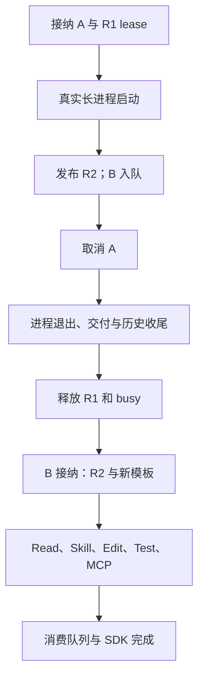

## 本章的问题

这是整门课的最终任务：A 正运行一个真实长进程，插件从 R1 更新到 R2，用户取消 A，同时 B 已经进入持久队列。我们要证明旧连接不会提前关闭，A 真的收尾，B 能立即接纳，并用 R2 工具修好项目。

模型回复仍可控，其他路径都实际执行：日志写盘、长进程启动与终止、两个 MCP 服务、Skill 展开、文件替换、Node 回归、队列消费和 SDK 归并。课程不再另写一个“演示专用”的快捷宿主。

## 沿固定源码逐段拆解

@source runner-finalize

### 先把最终时刻定义清楚

取消请求返回不是完成，Agent idle 不是交付完成。drain、flushTail 与 emitTerminal 的相对顺序，决定何时可以释放 active owner。host Application 的 finally 等 runTurn 完整结算后才释放。

@source mcp-generation

### 更新不会改变 A 已持有的契约

A 捕获 R1 后，R2 可以发布，但 R1 lease 仍为一。只有取消运行完成、finally 释放之后，旧 runtime 才关闭。应用 dispose 则等活动工作收尾，再关闭当前代。

@source queue-contract

### B 的意图与执行分别持久化

入队保存 clientRequestId，claim 后需要 acceptance，完成且可恢复的执行才 consume。accepted 后崩溃仍保留不确定性，课程没有把这段状态机包装成外部效果 exactly-once。

@source sdk

### 两个 Turn 的客户端结果互不污染

collector 先检查归属，再使用 ItemAccumulator。A 的文字可以保留为 incomplete，整体状态为 cancelled；B 完成自己的 item 和 Turn。旧事件不会因为 Session 相同便落入 B。



三门课此时可以按同一套问题比较：Pi 的内核与扩展，Claude Code 的产品分支与控制面，MiniMax 的宿主装配与持久责任。比较状态 owner 和失败证据，比比较功能打勾更有用。

## 接入贯穿项目

@implementation 12-comparison-interview

### 逐步跟踪本章实现

A 运行时先让实际长工具子进程写 started 标记，证明它已经产生生命周期，而非只在模型脚本里声明“正在运行”。发布 R2 后，A 手里的 R1 lease 仍有效；取消必须传到工具进程，等待其退出并完成 runTurn 收尾后，owner 与 R1 才可以释放。

B 的文本已在队列持久化，接纳时捕获 R2 和新模板，随后经 Skill、read、edit、test 与 MCP 完成修复。检查 capabilityRevision、请求提示、测试 stdout、磁盘文件和 consumed 状态，能够把“用了哪份能力”和“做成了什么”关联到同一个 turnId。

两个 collector 分别消费自己的事件。A 的终态 cancelled 不会让未完成 item 变 completed；B 的 turn.completed 出现在历史与交付之后。最后 Application.close 阻止新接纳、等待 completion 并关闭 R2。模型选择是脚本化的，但取消、租约、文件修复、队列与客户端结果都是本次真实执行所得。

## 运行本章实验

```bash
node --disable-warning=ExperimentalWarning labs/chapters/12-comparison-interview.mjs
```

@experiment 12-comparison-interview

@journey 12-comparison-interview

## 逐项解释实验结果

展开最终实验轨迹，先定位 A 的 turnId 和 started 标记文件，确认长进程确实启动。R2 发布后 closed 仍为空；A 取消结束后才出现 r1。B 捕获 R2 与新提示，真实 test 输出 tests passed，queue 变 consumed。

最后查看 SDK：A 的 item 仍 incomplete，B 整体 completed。Application.close 之后 r2 也关闭。每个结论都有独立断言，不能用总 PASS 替代这条因果链。

## 继续动手与验收

在 writer 人为延迟时取消 A，证明 B 仍要等交付。再把 A 的迟到事件重放给 B collector，检查归属拒绝。最后模拟 accepted 后进程退出，写一份恢复协调方案和哪些效果必须人工核对。

::: interview 取消以后怎样证明下一条任务真的可以继续？
先证明 A 的实际工具进程启动，再验证取消收尾、R1 lease 释放和 owner 释放；B 随后捕获 R2 与新提示，完成真实文件修复和测试。队列、磁盘、日志、SDK 和进程各自提供证据，不能只看模型最后一句成功。
:::

::: interview 为什么总装要同时检查文件、测试、队列和 SDK？
它们是不同消费者和事实层。测试通过不代表队列已消费，SDK 收到文字不代表历史已保存。组合实验需要逐边建立因果，而不只看一个总状态。
:::

::: interview R2 发布后，怎样证明 A 仍使用 R1 而 B 使用 R2？
记录每个 Turn 捕获的 revision、lease 释放与 close 时刻，并检查模型请求的提示快照。不能只看全局 current，因为那会掩盖正在运行的旧视图。
:::
