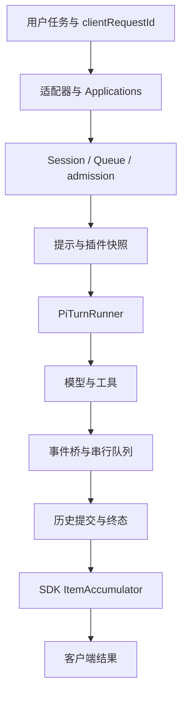

## 总装：把一个请求走到底

你现在应该能解释：输入经适配器进入应用；Session 与队列管理工作意图；Turn admission 确定执行身份；preparation 捕获提示与插件能力；PiTurnRunner 创建 Agent；模型和工具事件经过桥接提交；历史尾部收束后发布终态；SDK 再把 item 事件投影成客户端结果。




@source runner-finalize

这个收尾片段与第 2 章相同：先等待事件队列和历史，再发布终态。下面的教学宿主把这个顺序缩成可以改动的代码。


## 总装实验：一个可以运行的教学宿主

Pi 课最后把部件装成 mox；这里把三个真实上游组件装进一个很小的课程宿主：PromptReadRegistry 管理准备材料，GenerationRegistry 管理能力代，ItemAccumulator 管理客户端结果。宿主的接纳、busy 和事件归属逻辑由课程自己实现，方便你逐行修改。

完整实现位于 [labs/host-lifecycle.mjs](https://github.com/Jialei-03/learn-minimax-code/blob/main/labs/host-lifecycle.mjs)。它不请求模型，也不启动生产 Session 服务；它是把前面机制组合起来的实验台。

```bash
npm run lab -- capstone
```

实验按顺序做十一件事：接纳 A，持有 R1；发布 R2；请求取消 A；尝试过早接纳 B；等待 A 交付收尾；释放 R1 和 busy；接纳 B；丢弃 A 的迟到事件；完成 B；再关闭当前 runtime。A 保留 partial/incomplete，B 得到完整结果。B 的 tests passed 是合成文本，没有运行项目测试。

@replay capstone

### 从这个实验里改出一个错误

先把 finish 中释放 busy 的动作移到等待 pendingDelivery 之前，重新设计断言，证明 B 会越过 A 的交付。再暂时去掉 deliver 的 turnId 归属检查，给 B 运行期间注入 A 的迟到事件，观察结果怎样被污染。最后恢复代码，让所有断言重新通过。

还可以把 generations.release 删掉，检查旧 R1 为什么会一直保留到系统 dispose；把它提前到热更新之前，说明正在使用的契约为什么会失效。每次只改一个地方，保存自己的输入和输出。

这个宿主验证的是组合后的教学契约。生产 MiniMax 的 busy 释放、事件存储与 admission 仍应沿第 1、2、9 章的实际实现独立验证。掌握这个区别后，你就能用小实验缩小问题，又不会把模拟当成产品已通过。


## 三个项目真正值得比较的设计点

Pi 课程帮助你理解最小内核和扩展机制；Claude Code 主线现在依据还原源码研究产品分支，并保留独立版本实验；MiniMax 展示公开产品如何装配 Pi、拥有状态和发布能力。它们不只是能力清单不同，而是状态 owner 与扩展边界不同。

比较工具调度，要看谁声明并发安全、谁分组、结果怎样保持关联；比较恢复，要看事实保存、模型投影、压缩和协议修复分别在哪一层；比较取消，要看信号、事件 drain、进程回收和 admission；比较插件，要看发现、快照与旧代清理。

不要把当前 MiniMax vendored Pi 与 Pi v1.5.0 当作逐行相同。相同的包名和 Agent API 只能提示关联，版本与宿主补丁仍需核对。


@source sdk

SDK 的归并类是客户端边界；它与 runner 的终态不是同一份状态。这也是总装实验同时保留 A incomplete 与 B completed 的理由。


## 把三门课连成一条能力线

| 维度 | Learn Pi Agent | Learn Claude Code | Learn MiniMax Code |
| --- | --- | --- | --- |
| 主要方法 | 从零实现，再读 Pi | 还原源码与独立版本实验 | 公开源码与真实函数实验 |
| 核心问题 | 一个 Agent 怎样工作 | 成熟产品做了什么 | 产品运行时怎样装配内核 |
| 证据 | 自写代码与源码对照 | 固定还原源码、录制与开源组件 | 固定提交、局部实验、贡献补丁 |
| 工程产出 | mox 与扩展 | 可重复实验与对照 | 架构地图与首次贡献材料 |

这张表比较学习方法；不宣称三个 Agent 在所有能力上等价。MiniMax 的 vendored Pi 也不能直接视为另一门课固定的 Pi v1.5.0：版本、补丁、宿主接法都需要分别检查。


## 综合作业：提交一份故障调查包

选择“取消后立即继续”“旧插件 Turn 在更新后仍可完成”或“SDK 交错事件正确归并”之一。调查包应包含固定版本、最小输入、状态时间线、关键源码链接、回归测试和实际运行输出。至少给出一个失败路径和一个正常路径。

只做本课程离线层，也可以交出有价值的结果：例如用真实 GenerationRegistry 证明旧代保留条件，用真实 QueueService 证明过期输入在存储前被拒绝。但标题要写“局部契约验证”，不能写“所有入口端到端无误”。


## 一页证据清单

| 面试官追问 | 应拿出的证据 |
| --- | --- |
| 你改的是什么 | 具体用户症状、版本与最小复现 |
| 为什么会出错 | 调用链、状态变化和错误假设 |
| 为什么这样修 | 最小 diff、兼容性与取舍 |
| 怎么证明修好了 | 修复前失败、修复后通过的测试与检查记录 |
| 为什么没有测某平台 | 实际限制、已覆盖层次与后续验证方案 |
| 是你的贡献吗 | Git 作者记录、讨论、PR 与维护者反馈 |


## 口头检验：五分钟讲清一个机制

第一分钟讲用户遇到了什么；第二分钟画状态和职责；第三分钟沿固定源码解释错误假设；第四分钟展示回归输入输出；最后一分钟讲取舍和未覆盖环境。若某一段只能说“AI 帮我写的”，回到那一段做一次手工推演。


## 三个追问，检查理解是否扎实

**为什么不在 replace 时直接关闭所有旧 MCP？** 因为旧 Turn 仍持有快照契约；要等租约结束，同时保证最终关闭。

**为什么取消响应后还要等 drain？** 因为停止产生新事件与已排队事件完成提交是两个时刻，terminal 不能越过前面的事实。

**为什么重复 delta 不能像 snapshot 去重？** 因为 delta 是操作，重复内容可能是合法文本；snapshot 是状态，重复通知才可能被省略。

这些答案来自具体实现和实验。继续给每个答案补一个反例，直到你能够在没有课程文字的情况下自己推导它。

::: interview 你会怎样评价一段 Agent 实习经历的工程含量？
看能否把模糊用户问题缩成可验证契约，找到正确的状态和职责边界，做出影响范围可控的修复，并诚实报告证据与限制。Agent 会生成代码，但工程能力体现在选题、因果判断、验证和协作反馈之中。
:::
