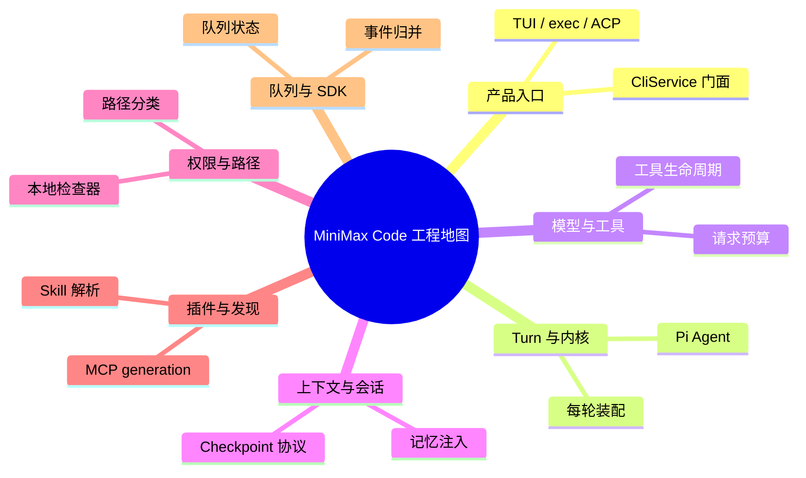

# MiniMax Code 工程地图

版本：0.7.2 · 固定提交：[6e062ae](https://github.com/MiniMax-AI/minimax-code/tree/6e062ae8ca365db34b93a7cdc96ffda3a8b9fffc)。

主题分类与实现入口；不是完整调用图。每个实现入口都在构建时核对文件与行号。

## 源码入口

### 产品入口

- [TUI / exec / ACP · packages/tui/src/cli/program.ts:62–104](https://github.com/MiniMax-AI/minimax-code/blob/6e062ae8ca365db34b93a7cdc96ffda3a8b9fffc/packages/tui/src/cli/program.ts#L62-L104)
- [CliService 门面 · packages/local-runtime-v2/src/local/cli-service.ts:107–136](https://github.com/MiniMax-AI/minimax-code/blob/6e062ae8ca365db34b93a7cdc96ffda3a8b9fffc/packages/local-runtime-v2/src/local/cli-service.ts#L107-L136)

### Turn 与内核

- [每轮装配 · packages/agent-core/src/pi-turn-runner/pi-turn-runner.ts:133–171](https://github.com/MiniMax-AI/minimax-code/blob/6e062ae8ca365db34b93a7cdc96ffda3a8b9fffc/packages/agent-core/src/pi-turn-runner/pi-turn-runner.ts#L133-L171)
- [Pi Agent · packages/agent-core/src/pi-turn-runner/agent.ts:35–63](https://github.com/MiniMax-AI/minimax-code/blob/6e062ae8ca365db34b93a7cdc96ffda3a8b9fffc/packages/agent-core/src/pi-turn-runner/agent.ts#L35-L63)

### 模型与工具

- [请求预算 · packages/local-runtime-v2/src/service/model-system/resolution/dynamic-max-tokens.ts:50–78](https://github.com/MiniMax-AI/minimax-code/blob/6e062ae8ca365db34b93a7cdc96ffda3a8b9fffc/packages/local-runtime-v2/src/service/model-system/resolution/dynamic-max-tokens.ts#L50-L78)
- [工具生命周期 · packages/agent-core/src/pi-turn-runner/tools.ts:72–110](https://github.com/MiniMax-AI/minimax-code/blob/6e062ae8ca365db34b93a7cdc96ffda3a8b9fffc/packages/agent-core/src/pi-turn-runner/tools.ts#L72-L110)

### 上下文与会话

- [记忆注入 · packages/local-runtime-v2/src/service/turn-system/agent-host/preparation/prompt-blocks.ts:93–114](https://github.com/MiniMax-AI/minimax-code/blob/6e062ae8ca365db34b93a7cdc96ffda3a8b9fffc/packages/local-runtime-v2/src/service/turn-system/agent-host/preparation/prompt-blocks.ts#L93-L114)
- [Checkpoint 协议 · packages/local-runtime-v2/src/service/turn-system/compaction/algorithm/checkpoint-protocol.ts:33–49](https://github.com/MiniMax-AI/minimax-code/blob/6e062ae8ca365db34b93a7cdc96ffda3a8b9fffc/packages/local-runtime-v2/src/service/turn-system/compaction/algorithm/checkpoint-protocol.ts#L33-L49)

### 权限与路径

- [本地检查器 · packages/local-runtime-v2/src/service/permission/decision/checkers.ts:34–62](https://github.com/MiniMax-AI/minimax-code/blob/6e062ae8ca365db34b93a7cdc96ffda3a8b9fffc/packages/local-runtime-v2/src/service/permission/decision/checkers.ts#L34-L62)
- [路径分类 · packages/tui/src/acp/paths.ts:3–5](https://github.com/MiniMax-AI/minimax-code/blob/6e062ae8ca365db34b93a7cdc96ffda3a8b9fffc/packages/tui/src/acp/paths.ts#L3-L5)

### 插件与发现

- [Skill 解析 · packages/local-runtime-v2/src/service/plugin-system/skill/frontmatter.ts:5–29](https://github.com/MiniMax-AI/minimax-code/blob/6e062ae8ca365db34b93a7cdc96ffda3a8b9fffc/packages/local-runtime-v2/src/service/plugin-system/skill/frontmatter.ts#L5-L29)
- [MCP generation · packages/local-runtime-v2/src/service/plugin-system/mcp/generation-registry.ts:16–59](https://github.com/MiniMax-AI/minimax-code/blob/6e062ae8ca365db34b93a7cdc96ffda3a8b9fffc/packages/local-runtime-v2/src/service/plugin-system/mcp/generation-registry.ts#L16-L59)

### 队列与 SDK

- [队列状态 · packages/local-runtime-v2/src/service/session-system/queue/service.ts:63–99](https://github.com/MiniMax-AI/minimax-code/blob/6e062ae8ca365db34b93a7cdc96ffda3a8b9fffc/packages/local-runtime-v2/src/service/session-system/queue/service.ts#L63-L99)
- [事件归并 · packages/code-sdk/src/items.ts:20–65](https://github.com/MiniMax-AI/minimax-code/blob/6e062ae8ca365db34b93a7cdc96ffda3a8b9fffc/packages/code-sdk/src/items.ts#L20-L65)
